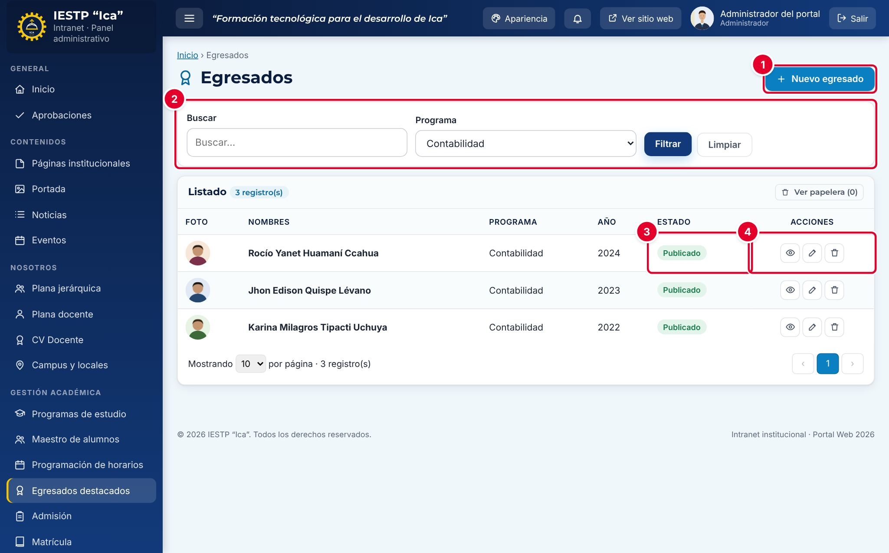
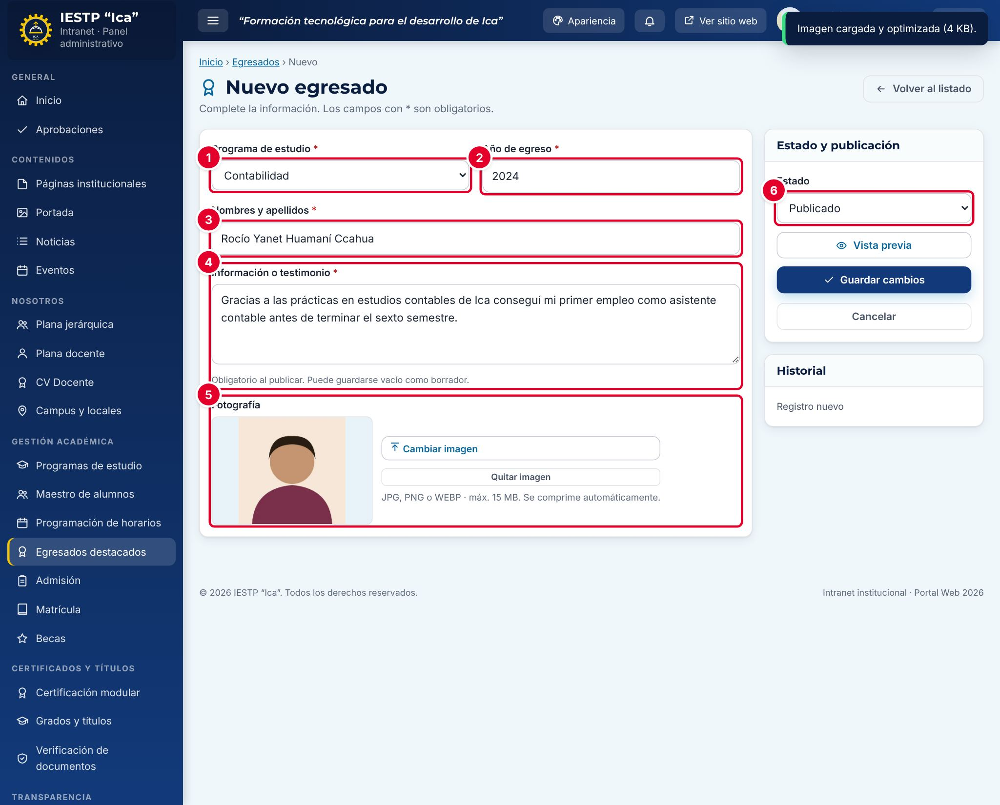
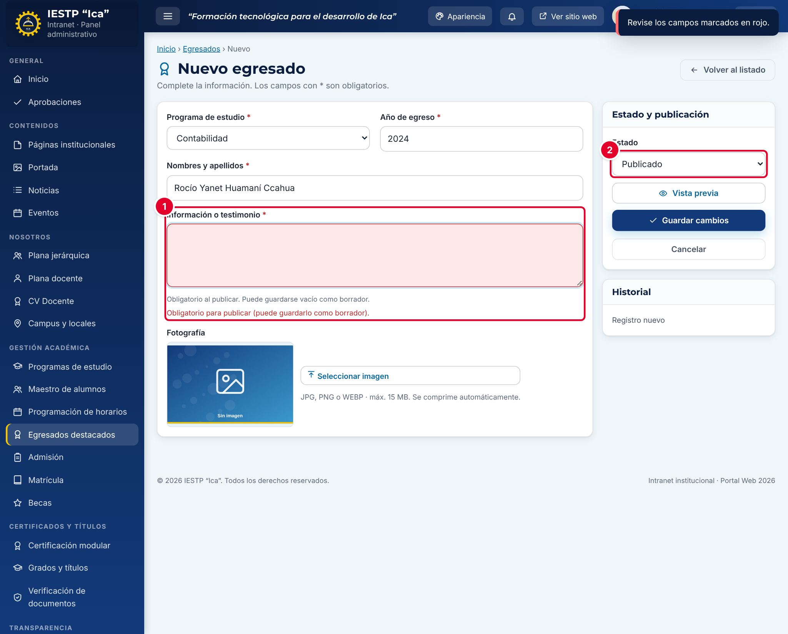
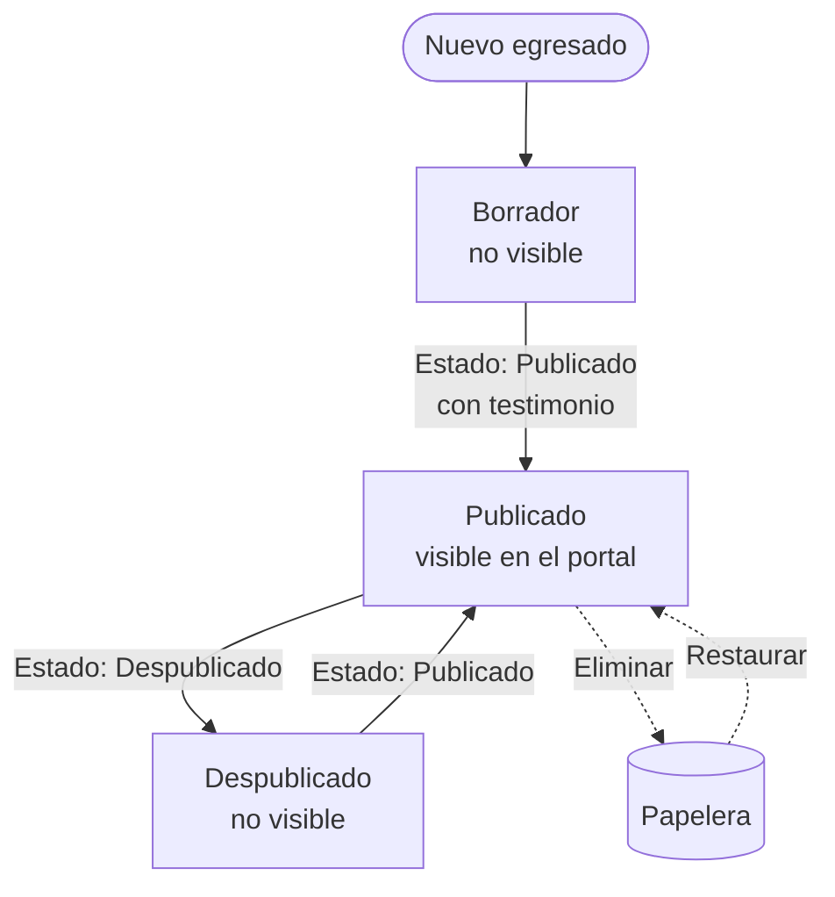
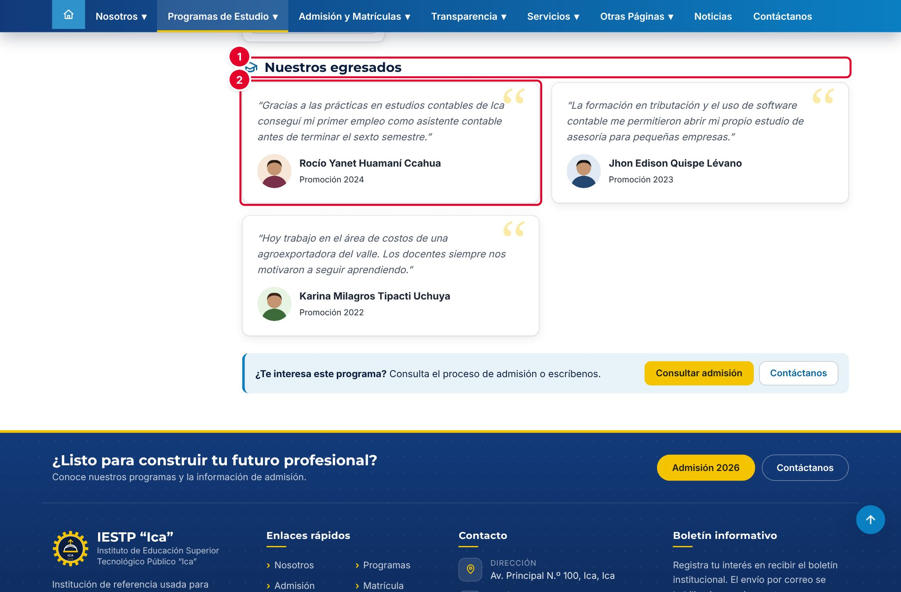
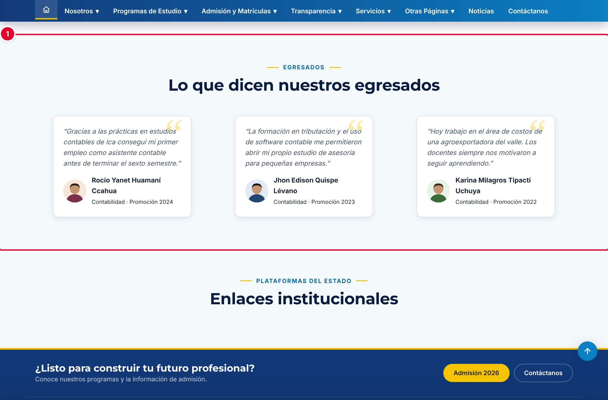

# 12 · Egresados destacados

## Para qué sirve

En este módulo se registran los egresados que la institución quiere destacar, con su programa, su año de egreso, una foto y un testimonio breve. Los egresados publicados aparecen en la sección **Nuestros egresados** de la página de su programa y en el bloque **Lo que dicen nuestros egresados** de la página de inicio del portal.

No es el padrón oficial de egresados: ese registro se lleva en **Maestro de alumnos** (capítulo 10).

## Quién lo usa

| Rol | Puede |
|---|---|
| Administrador | Todo, incluida la **eliminación definitiva** |
| Secretaría académica | Crear, editar, publicar, enviar a la papelera y restaurar egresados de cualquier programa |
| Coordinador de programa | Lo mismo, pero **solo para los egresados de su programa** |

## Cómo se llega

Menú lateral › **Gestión académica** › **Egresados destacados**. Ruta: `#/admin/egresados`

## Pantalla principal

| N.º | Elemento | Para qué sirve |
|---|---|---|
| 1 | **Nuevo egresado** | Abre el formulario para registrar un egresado. |
| 2 | Filtros | **Buscar** por nombre y filtrar por **Programa**. Pulsa **Filtrar** para aplicarlos y **Limpiar** para quitarlos. |
| 3 | **Estado** | Borrador, Publicado o Despublicado. |
| 4 | Acciones de la fila | **Vista previa** (página del programa), **Editar** y **Eliminar**. |

Los egresados se ordenan del año de egreso más reciente al más antiguo. El botón **Ver papelera** muestra los registros eliminados. El coordinador de programa solo ve a los egresados de su programa.

## Formulario

| N.º | Campo | Descripción |
|---|---|---|
| 1 | **Programa de estudio** \* | Programa del que egresó. El coordinador solo puede elegir el suyo. |
| 2 | **Año de egreso** \* | Se propone el año anterior al actual. |
| 3 | **Nombres y apellidos** \* | Nombre completo, tal como se publicará. |
| 4 | **Información o testimonio** | Texto breve en primera persona. Obligatorio para publicar. |
| 5 | **Fotografía** | Foto del egresado. |
| 6 | **Estado** | **Borrador**, **Publicado** o **Despublicado**. |

| Campo | Obligatorio | Formato o límite | Ejemplo |
|---|---|---|---|
| Programa de estudio | Sí | Uno de los programas registrados | Contabilidad |
| Año de egreso | Sí | Número | 2024 |
| Nombres y apellidos | Sí | Texto; no puede repetirse dentro del mismo programa | Rocío Yanet Huamaní Ccahua |
| Información o testimonio | Al publicar | Hasta 400 caracteres | Gracias a las prácticas en estudios contables de Ica… |
| Fotografía | No | JPG, PNG o WEBP, hasta 15 MB. Se comprime automáticamente | Foto de frente, fondo claro |
| Estado | Sí | Borrador, Publicado o Despublicado | Publicado |

## Procedimientos

### Registrar un egresado destacado

1. Pulsa **Nuevo egresado**.
2. Elige el **Programa de estudio** ① y escribe el **Año de egreso** ②.
3. Escribe los **Nombres y apellidos** ③.
4. Escribe el **testimonio** ④: dos o tres oraciones sobre su experiencia o su logro profesional.
5. Pulsa **Seleccionar imagen** ⑤ y carga la foto.
6. Elige el **Estado** ⑥: **Publicado** para que se vea en el portal o **Borrador** para dejarlo en preparación.
7. Pulsa **Guardar cambios**. Aparece «Cambios guardados.».

Si eliges **Publicado** ② sin escribir el testimonio, el campo se marca en rojo ① con el mensaje «Obligatorio para publicar (puede guardarlo como borrador).» y el registro no se guarda.

### Editar, retirar o eliminar

- **Editar:** pulsa el lápiz, cambia los datos y pulsa **Guardar cambios**.
- **Retirar del portal sin borrar:** cambia el **Estado** a **Despublicado**.
- **Eliminar:** pulsa la papelera de la fila y confirma. El registro va a la papelera y se puede restaurar desde **Ver papelera**. Solo el **Administrador** puede **Eliminar definitivamente**.

## Flujo y estados

| Estado | Significado | Visible en el portal |
|---|---|---|
| Borrador | En preparación | No |
| Publicado | Testimonio aprobado | **Sí** |
| Despublicado | Retirado temporalmente | No |
| En papelera | Eliminado; se puede restaurar | No |

## Resultado en el portal público

En la página de cada programa (`{{inst.dominio}}/#/programas/<programa>`), la sección **Nuestros egresados** ① muestra **todos** los egresados publicados del programa ②: testimonio, foto, nombre y promoción. Si no hay ninguno, la sección indica que no hay testimonios.

En la página de inicio, el bloque **Lo que dicen nuestros egresados** ① muestra hasta **tres** egresados publicados ②, de cualquier programa, en el orden en que se registraron (primero los más antiguos). Cada tarjeta indica el programa y la promoción. El bloque solo se ve si está activo en **Portada** (bloque **Testimonios de egresados**) y si hay al menos un egresado publicado.

## Mensajes y problemas frecuentes

| Mensaje o situación | Causa | Qué hacer |
|---|---|---|
| «Obligatorio para publicar (puede guardarlo como borrador).» | Falta el testimonio y el estado es **Publicado** | Escribe el testimonio o guarda como **Borrador** |
| «Este campo es obligatorio.» | Falta el programa, el año o el nombre | Complétalos |
| «Ya existe un registro con este valor (…)» | Ya hay un egresado con el mismo nombre en ese programa | Edita el registro existente |
| El testimonio se corta al escribir | Llegó al límite de 400 caracteres | Resume el texto |
| Un egresado nuevo no aparece en la página de inicio | La página de inicio muestra solo los tres primeros publicados | Despublica uno de los anteriores si quieres que se vea el nuevo. En la página del programa sí aparece |
| El coordinador no ve a un egresado | El egresado pertenece a otro programa | Solicita el cambio a la Secretaría académica |

## Buenas prácticas

- Pide al egresado su **consentimiento por escrito** para publicar su nombre, su foto y su testimonio (Ley N.º 29733).
- Escribe testimonios breves, en primera persona y con un logro concreto.
- Usa fotos de frente, con fondo claro y del mismo tamaño para todos.
- No publiques datos de contacto del egresado (DNI, teléfono o correo personal).
- Revisa al menos una vez al año que los testimonios publicados sigan vigentes.
