# 13 · Admisión

## Para qué sirve

En este módulo se publica cada **proceso de admisión** del instituto: título y presentación, prospecto, reglamento, resultados por programa de estudio, vacantes, cronograma, requisitos y modalidades. El proceso marcado como **vigente** es el que aparece en la página **Admisión** del portal; los procesos anteriores se conservan como histórico y se pueden consultar desde la misma página.

## Quién lo usa

| Rol | Puede |
|---|---|
| Administrador | Crear y editar procesos, publicarlos directamente, marcar el proceso vigente, cerrarlos y **aprobar o devolver** lo que envía la Secretaría académica |
| Secretaría académica | Crear y editar procesos. Cuando elige **Publicado**, el proceso se envía a **aprobación del Administrador** y queda **En revisión** |

> Los procesos de admisión **no se eliminan**: el listado no tiene botón de eliminar. Un proceso que terminó se pasa a **Cerrado** y queda como histórico.

## Cómo se llega

Menú lateral › **Gestión académica** › **Admisión**. Ruta: `#/admin/admision`

## Pantalla principal

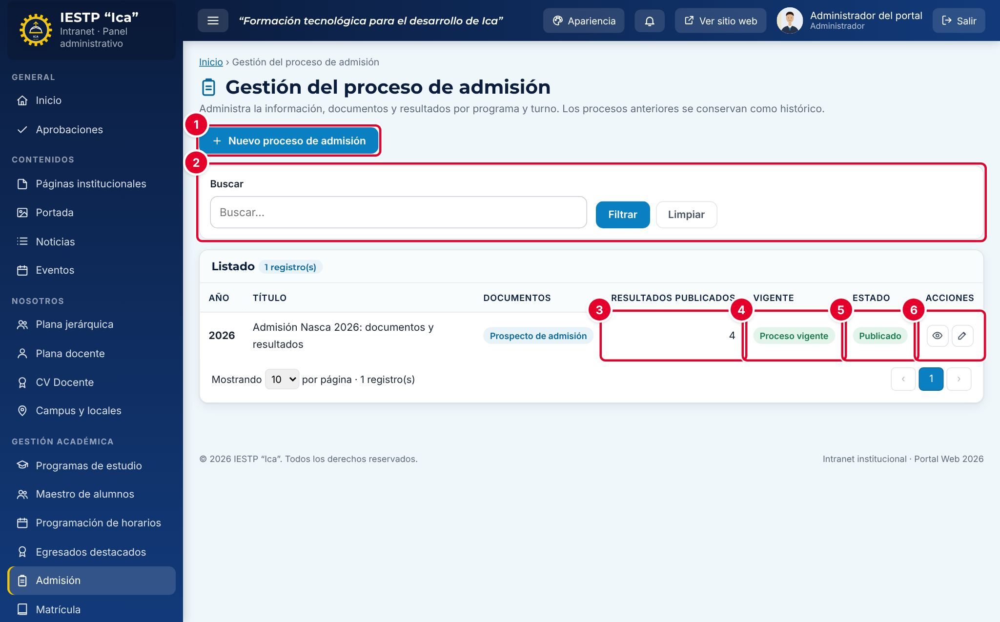

| N.º | Elemento | Para qué sirve |
|---|---|---|
| 1 | **Nuevo proceso de admisión** | Abre el formulario para registrar un proceso. |
| 2 | **Buscar** | Filtra el listado por texto. Pulsa **Filtrar** para aplicar y **Limpiar** para quitar el filtro. |
| 3 | **Resultados publicados** | Cuántos archivos de resultados tiene cargados el proceso. |
| 4 | **Vigente** | La etiqueta **Proceso vigente** marca el proceso que el portal muestra por defecto. Solo puede haber uno. |
| 5 | **Estado** | **Borrador**, **En revisión**, **Publicado** o **Cerrado**. |
| 6 | Acciones | **Vista previa** (el ojo) muestra la página pública con los datos del proceso, aunque no esté publicado. **Editar** (el lápiz) abre el formulario. |

La columna **Documentos** indica si el proceso tiene cargado el **Prospecto de admisión** y el **Reglamento**.

## Formulario

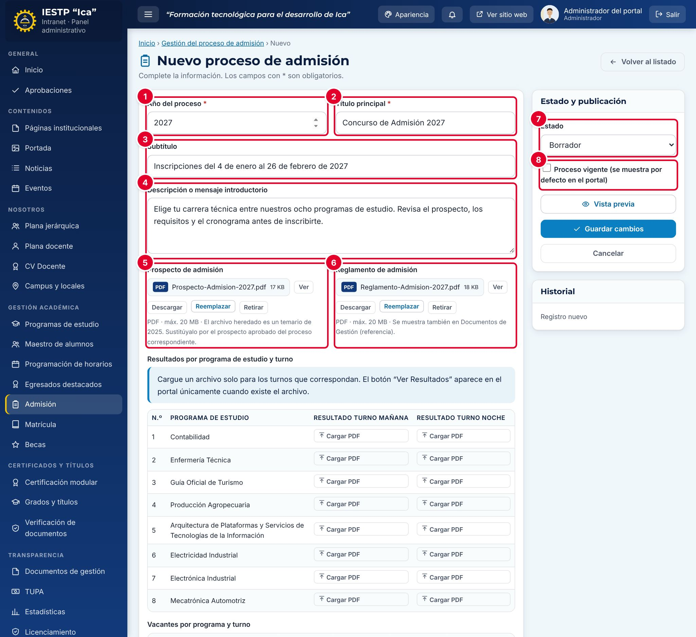

| N.º | Campo | Para qué sirve |
|---|---|---|
| 1 | **Año del proceso** | Año del concurso. No puede repetirse y, una vez guardado, ya no se puede cambiar. |
| 2 | **Título principal** | Título grande de la página de Admisión. |
| 3 | **Subtítulo** | Texto que aparece en la franja superior (banner) de la página. |
| 4 | **Descripción o mensaje introductorio** | Párrafo de presentación, debajo del título. |
| 5 | **Prospecto de admisión** | PDF del prospecto. En el portal aparece como botón para verlo y descargarlo. |
| 6 | **Reglamento de admisión** | PDF del reglamento. También se muestra en **Documentos de gestión** cuando ese módulo lo referencia (ver el capítulo correspondiente). |
| 7 | **Estado** | Estado del proceso. |
| 8 | **Proceso vigente** | Marca el proceso que el portal muestra por defecto. |

| Campo | Obligatorio | Formato o límite | Ejemplo |
|---|---|---|---|
| Año del proceso | Sí | Número entre 2000 y 2100, único | 2027 |
| Título principal | Sí | Texto | Concurso de Admisión 2027 |
| Subtítulo | No | Texto | Inscripciones del 4 de enero al 26 de febrero de 2027 |
| Descripción | No | Texto | Elige tu carrera técnica entre nuestros ocho programas… |
| Prospecto y Reglamento | No | PDF, hasta 20 MB | Prospecto-Admision-2027.pdf |
| Resultados | No | Un PDF por programa y turno, hasta 20 MB cada uno | Resultados-Contabilidad-Manana.pdf |
| Vacantes | No | Números enteros por programa: **Mañana**, **Tarde**, **Noche** y **Total publicado** | 20 / 20 / — / 40 |
| Cronograma | No | Filas con **Actividad** y **Fecha(s)** (texto libre) | Examen de admisión · 07/03/2027 |
| Requisitos | No | Un requisito por línea | Copia simple del DNI |
| Modalidades de admisión | No | Filas con **Modalidad** y **Detalle** | Exoneración · Primeros puestos… |
| Estado | Sí | Borrador, Publicado o Cerrado | Borrador |
| Proceso vigente | No | Casilla. No se permite en Borrador | — |

## Procedimientos

### Registrar un proceso nuevo

1. Pulsa **Nuevo proceso de admisión**. El formulario propone el año siguiente y un título.
2. Completa **Título principal**, **Subtítulo** y **Descripción**.
3. En **Prospecto de admisión** y **Reglamento de admisión**, pulsa **Cargar archivo** y elige el PDF. Cuando termina la carga aparecen los botones **Ver**, **Descargar**, **Reemplazar** y **Retirar**.
4. Carga los resultados, las vacantes, el cronograma, los requisitos y las modalidades (ver los apartados siguientes). Puedes hacerlo ahora o más adelante.
5. Deja el **Estado** en **Borrador** y pulsa **Guardar cambios**. Un borrador **no se ve en el portal**.

> El aviso gris debajo del prospecto («El archivo heredado es un temario de 2025…») es un texto fijo de la plataforma. Aparece siempre, aunque el proceso sea nuevo; puedes ignorarlo.

### Cargar resultados y vacantes

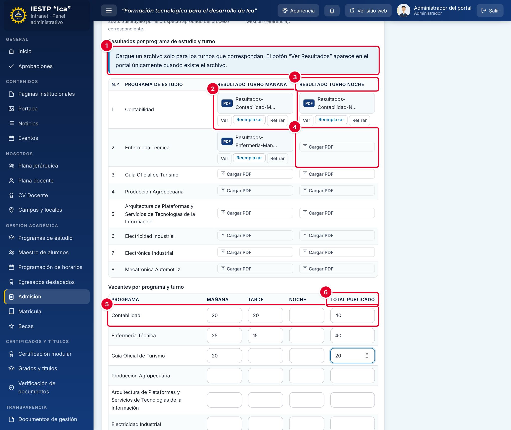

1. En **Resultados por programa de estudio y turno**, lee el aviso ①: el botón **Ver Resultados** aparece en el portal solo para los programas que tienen archivo.
2. En la fila del programa, pulsa **Cargar PDF** en la columna del turno y elige el archivo ②. Cada celda acepta un PDF.
3. La segunda columna se titula **Resultado turno noche** ③. Úsala solo si el programa tiene un segundo turno (ver la incidencia al final de este apartado). Si un turno no tiene resultados, deja la celda vacía ④.
4. En **Vacantes por programa y turno** ⑤, escribe las vacantes de **Mañana**, **Tarde** y **Noche**, y el **Total publicado** ⑥. En el portal solo se muestra el total: si lo dejas vacío, se calcula sumando los tres turnos.
5. Pulsa **Guardar cambios**.

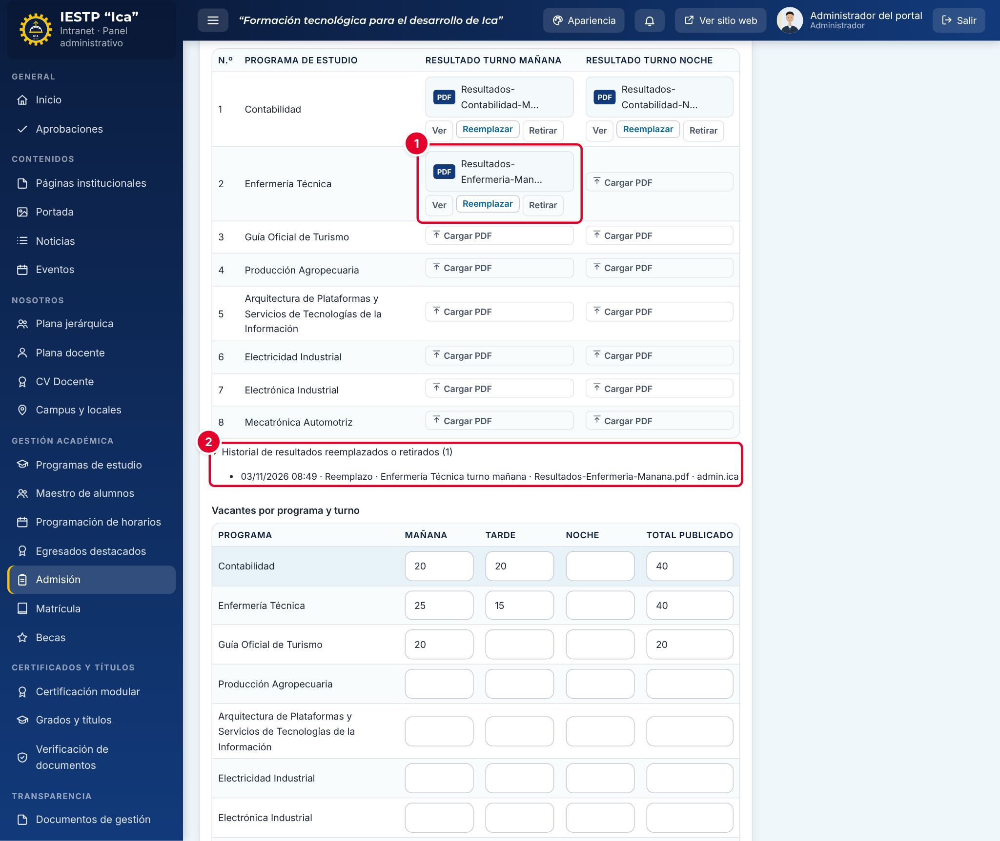

Para corregir un resultado ya cargado, pulsa **Reemplazar** ① y elige el nuevo PDF. El sistema pide confirmación («Ya existe un resultado para… ¿Reemplazarlo? El anterior quedará en el historial.»). **Retirar** quita el archivo y el botón deja de verse en el portal. Cada reemplazo o retiro queda en **Historial de resultados reemplazados o retirados** ②, con la fecha, el programa, el turno, el archivo anterior y el usuario.

> **Incidencia detectada al elaborar este manual (versión actual de la plataforma)**
> Si un programa tiene **dos** archivos de resultados (las dos columnas), el portal muestra **un solo** botón **Ver Resultados**, que abre solo uno de los dos archivos (el que se cargó primero). El otro archivo **no es accesible para el público**. Además, la segunda columna se titula «turno noche», pero los avisos y el historial la llaman «turno tarde». Ya se reportó para su corrección. Mientras tanto, si un programa tiene dos turnos, **une los resultados de ambos turnos en un solo PDF** y carga solo ese archivo.

### Registrar el cronograma, los requisitos y las modalidades

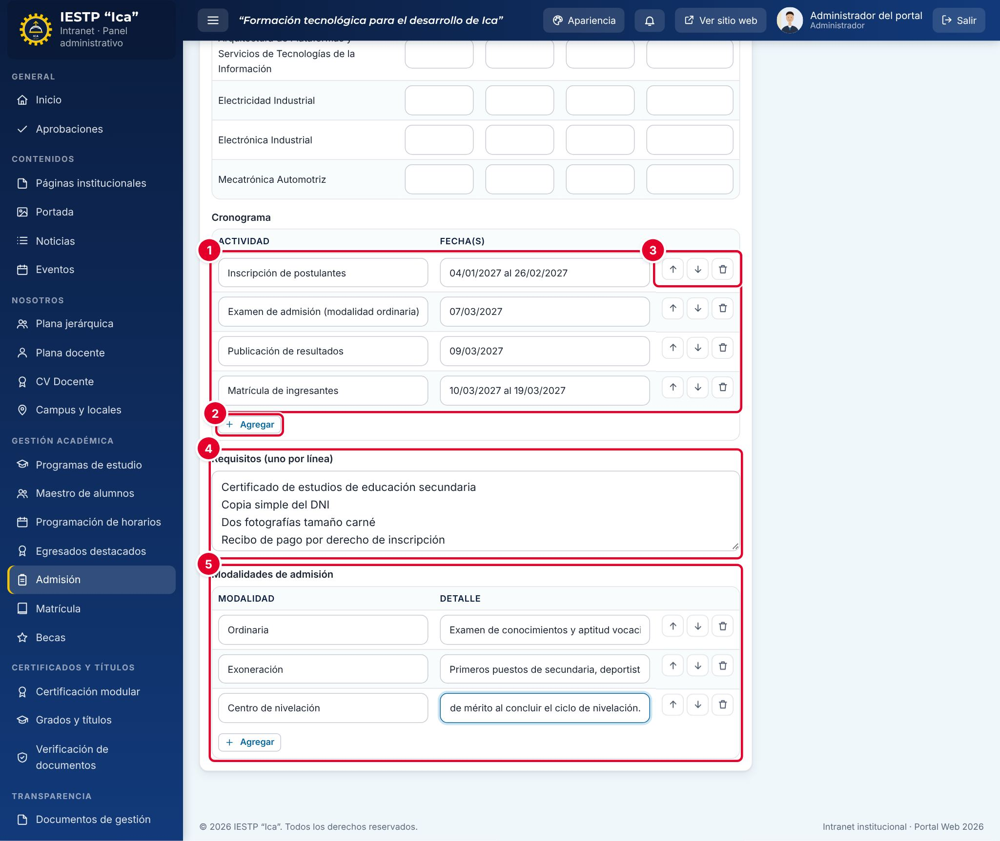

1. En **Cronograma** ①, pulsa **Agregar** ② para añadir una fila y escribe la **Actividad** y la **Fecha(s)**. Las fechas son texto libre: puedes escribir un rango como «04/01/2027 al 26/02/2027».
2. Usa las flechas para **Subir** o **Bajar** una fila y la papelera para **Quitar fila** ③.
3. En **Requisitos (uno por línea)** ④, escribe cada requisito en una línea distinta. En el portal se muestran como lista.
4. En **Modalidades de admisión** ⑤, agrega una fila por modalidad con su **Detalle**.
5. Pulsa **Guardar cambios**.

### Publicar el proceso y marcarlo como vigente

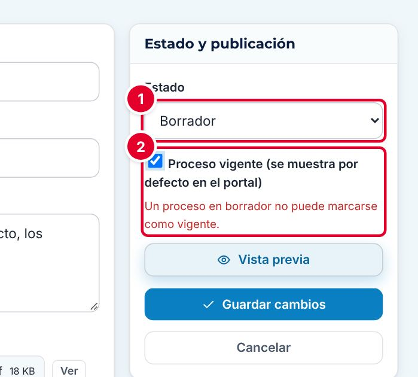

1. Abre el proceso con **Editar**.
2. Cambia el **Estado** ① a **Publicado**.
3. Marca **Proceso vigente (se muestra por defecto en el portal)** ②. Si lo marcas con el estado en **Borrador**, aparece el mensaje «Un proceso en borrador no puede marcarse como vigente.».
4. Pulsa **Vista previa** si quieres revisar la página antes de guardar.
5. Pulsa **Guardar cambios**.

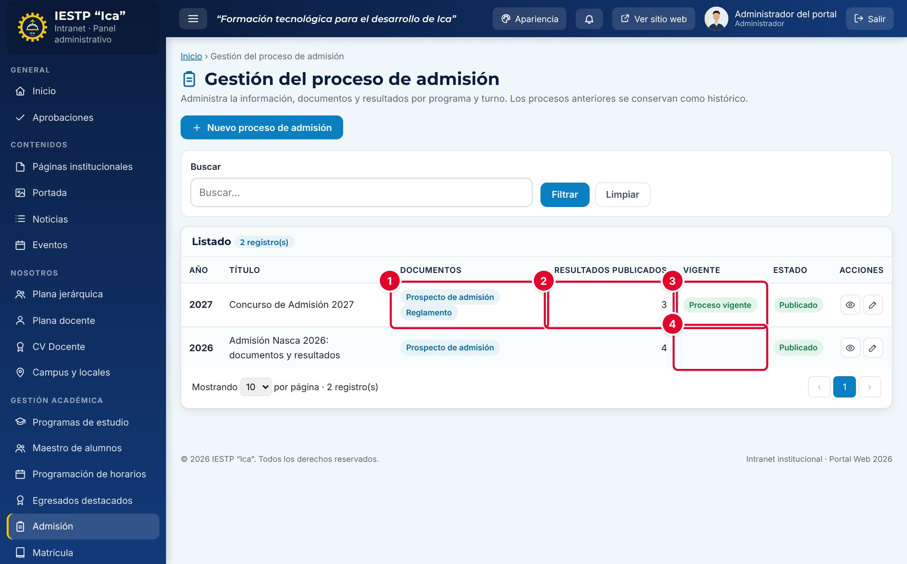

El proceso queda **Publicado** con sus documentos ① y resultados ②, y con la etiqueta **Proceso vigente** ③. El proceso que antes era vigente **pierde la marca** automáticamente ④, pero sigue publicado como histórico.

### Cerrar un proceso

Cuando el proceso termina, edítalo, cambia el **Estado** a **Cerrado** y pulsa **Guardar cambios**. Al cerrarlo se le quita la marca de vigente. Un proceso cerrado se sigue viendo en el portal como proceso anterior.

### Enviar a aprobación (Secretaría académica)

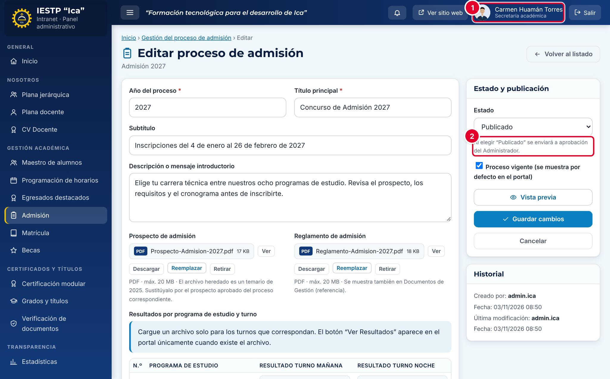

Cuando la persona que trabaja con el rol **Secretaría académica** ① edita un proceso, debajo del **Estado** ve el aviso «Al elegir “Publicado” se enviará a aprobación del Administrador.» ②.

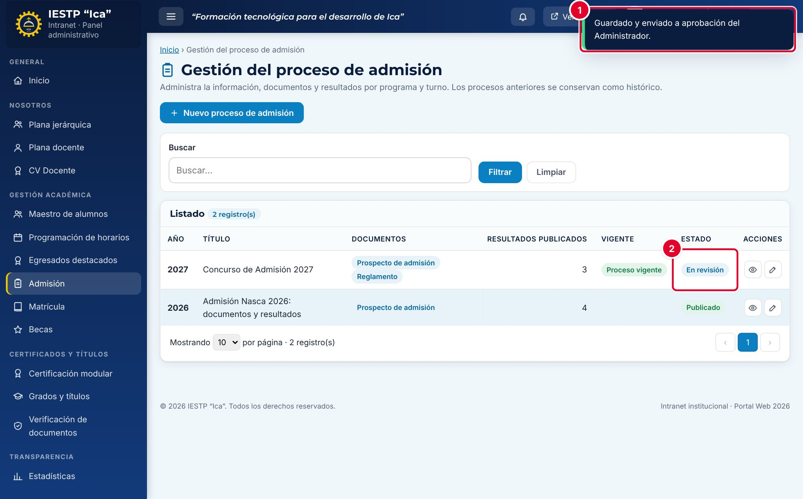

1. La Secretaría académica completa o corrige el proceso, deja el **Estado** en **Publicado** y pulsa **Guardar cambios**.
2. Aparece el aviso «Guardado y enviado a aprobación del Administrador.» ① y el proceso pasa a **En revisión** ②.

> **Importante:** esto ocurre con **cualquier cambio** que la Secretaría académica guarde en un proceso publicado, por pequeño que sea (por ejemplo, cargar un resultado o agregar una fila al cronograma). Mientras el proceso está **En revisión**, **no se ve en el portal**: la página de Admisión muestra el último proceso publicado. Coordina con el Administrador para que apruebe pronto, sobre todo en días de publicación de resultados.

### Aprobar o devolver (Administrador)

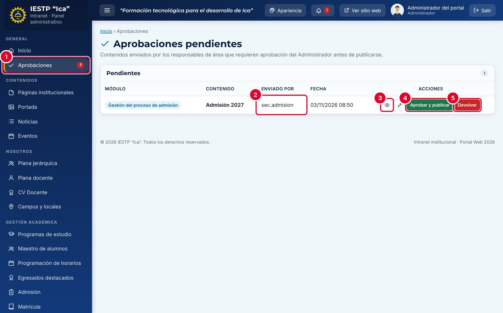

1. Entra a **Aprobaciones** ① (menú **General**). El número rojo indica cuántos contenidos esperan aprobación.
2. Revisa quién lo envió ② y pulsa **Vista previa** ③ para ver cómo quedará la página. El lápiz (**Abrir**) abre el formulario.
3. Si todo está bien, pulsa **Aprobar y publicar** ④ y confirma. El proceso pasa a **Publicado** y, si estaba marcado como vigente, vuelve a ser el proceso que muestra el portal.
4. Si hay que corregir algo, pulsa **Devolver** ⑤, escribe la observación y confirma. El proceso vuelve a **Borrador** y la observación aparece en rojo en el formulario, debajo del **Estado**.

## Flujo y estados

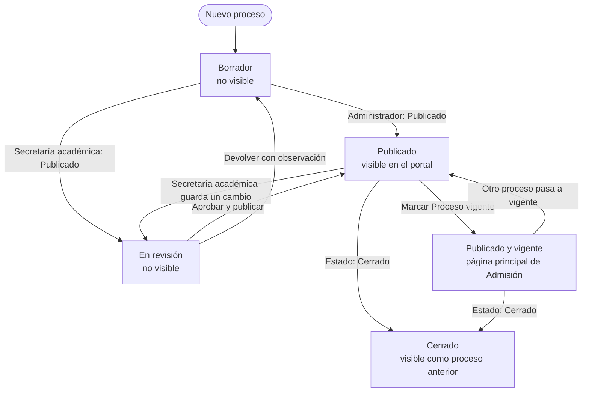

| Estado | Significado | Visible en el portal |
|---|---|---|
| Borrador | En preparación, o devuelto con observaciones | No |
| En revisión | Enviado por la Secretaría académica; espera la aprobación del Administrador | No |
| Publicado | Aprobado. Si además es **vigente**, es la página principal de Admisión | **Sí** |
| Cerrado | Proceso concluido; se conserva como histórico | Sí, como proceso anterior |

## Resultado en el portal público

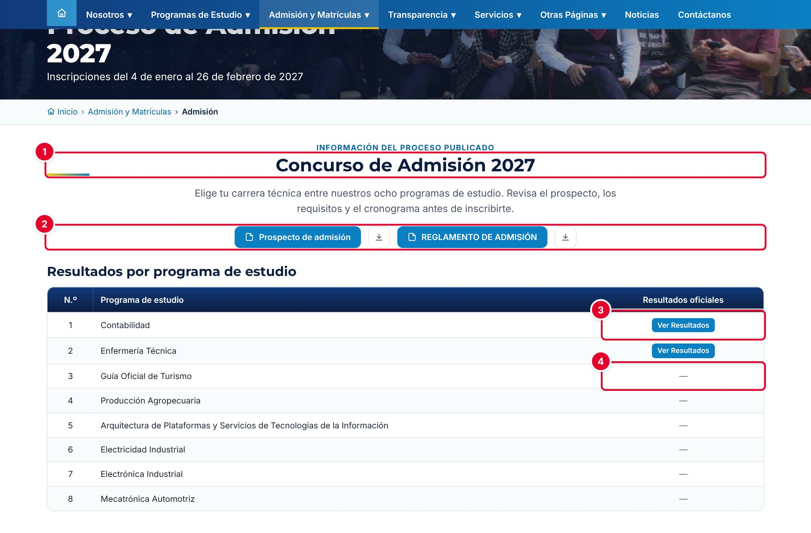

En `{{inst.dominio}}/#/admision` (menú **Admisión y Matrículas** › **Admisión**) el público ve el proceso vigente: el **Título principal** ① con la descripción, los botones del **Prospecto de admisión** y del **REGLAMENTO DE ADMISIÓN** con su botón de descarga ②, y la tabla **Resultados por programa de estudio**. Los programas con archivo muestran **Ver Resultados** ③; los demás muestran una raya ④.

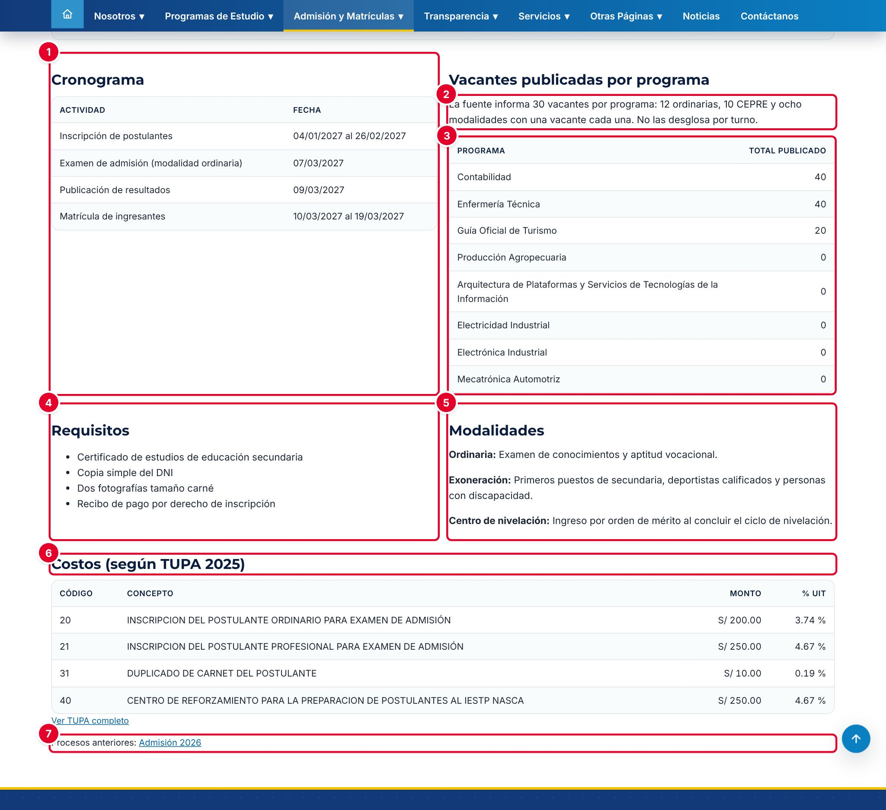

Más abajo se muestran el **Cronograma** ①, las **Vacantes publicadas por programa** ③, los **Requisitos** ④, las **Modalidades** ⑤ y los **Costos**, que se toman del **TUPA** vigente (conceptos de la categoría Admisión) ⑥. Al final aparecen los enlaces a los **Procesos anteriores** ⑦: al abrir uno, el portal avisa «Estás consultando el proceso…, que ya concluyó.».

> **Incidencia detectada al elaborar este manual (versión actual de la plataforma)**
> Sobre la tabla de vacantes aparece siempre el texto «La fuente informa 30 vacantes por programa: 12 ordinarias, 10 CEPRE y ocho modalidades con una vacante cada una. No las desglosa por turno.» ②. Es un texto fijo de la plataforma: **no se puede editar** y no corresponde necesariamente a las vacantes que registraste. Ya se reportó para su corrección. Mientras tanto, si las cifras no coinciden, aclara las vacantes reales en la **Descripción** del proceso.

## Mensajes y problemas frecuentes

| Mensaje o situación | Causa | Qué hacer |
|---|---|---|
| «Ya existe un registro con este valor…» en **Año del proceso** | Ya hay un proceso de ese año | Edita el proceso existente; no se pueden tener dos procesos del mismo año |
| «Año no válido.» | El año está vacío o fuera del rango 2000–2100 | Escribe un año de cuatro cifras |
| «Un proceso en borrador no puede marcarse como vigente.» | Marcaste **Proceso vigente** con el estado en Borrador | Cambia el estado a **Publicado** o quita la marca |
| «Guardado y enviado a aprobación del Administrador.» | Tu rol es Secretaría académica | Es normal. El proceso queda **En revisión** hasta que el Administrador lo apruebe |
| El proceso desapareció del portal | Está **En revisión** o en **Borrador** | Pide al Administrador que lo apruebe en **Aprobaciones** |
| Aparece una observación en rojo debajo del **Estado** | El Administrador devolvió el proceso | Corrige lo indicado y vuelve a guardar como **Publicado** |
| El portal no muestra el botón **Ver Resultados** de un programa | El programa no tiene ningún archivo de resultados | Carga el PDF y guarda (ver también la incidencia de resultados) |
| La página dice «Información del proceso publicado» y no «Inscripciones abiertas» | El formulario no tiene una opción para indicar que las inscripciones están abiertas | Indícalo en el **Subtítulo** o en la **Descripción** |
| El botón amarillo del pie de página dice «Admisión» con el año en curso | Ese botón muestra el año del calendario, no el del proceso vigente | Ninguna; el botón lleva a la página del proceso vigente |
| «Extensión… no permitida» o «El archivo pesa…» | El archivo no es PDF o pesa más de 20 MB | Convierte el documento a PDF y redúcelo |

## Buenas prácticas

- Prepara el proceso nuevo como **Borrador** con anticipación y publícalo solo cuando el prospecto y el reglamento estén aprobados.
- Mantén un único proceso **vigente** y cierra el anterior cuando termine.
- Revisa la página con **Vista previa** antes de publicar o de aprobar.
- Publica en los resultados solo la información necesaria (orden de mérito, nombres y condición). **No incluyas el DNI completo, el domicilio ni el teléfono** de los postulantes (Ley N.º 29733, de Protección de Datos Personales).
- Si eres Secretaría académica, agrupa tus cambios y avisa al Administrador al enviarlos: cada envío retira el proceso del portal hasta su aprobación.
- Usa nombres de archivo claros, como «Resultados-Contabilidad-2027.pdf»: el nombre se ve al descargar.
