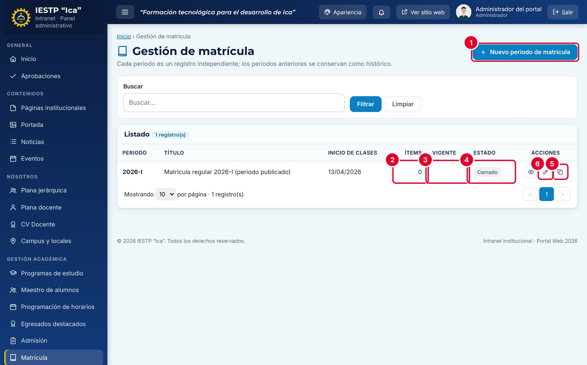
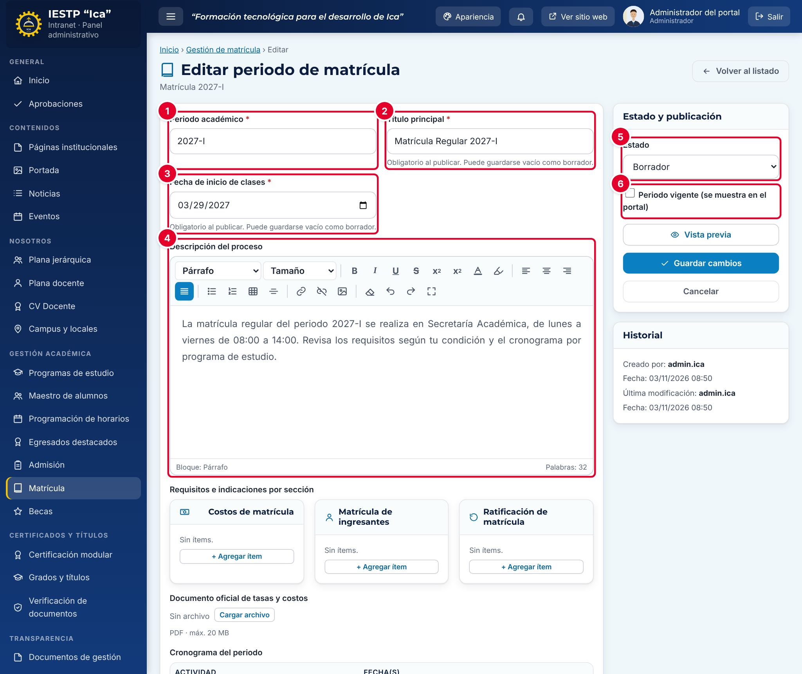
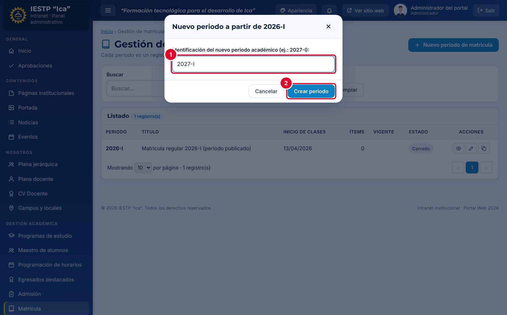
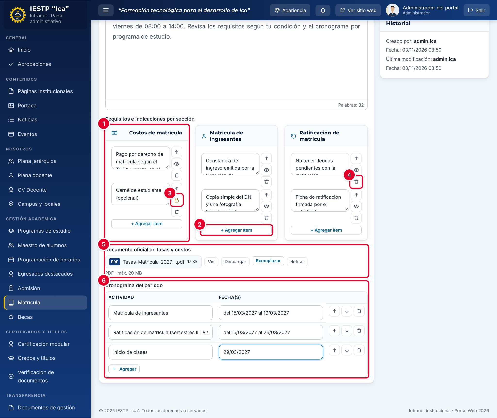
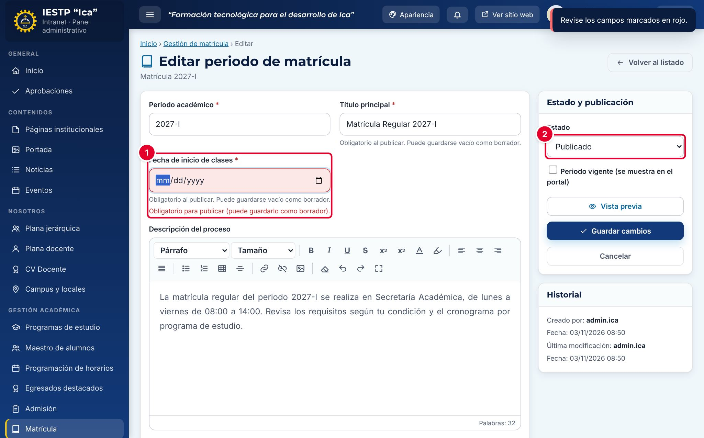
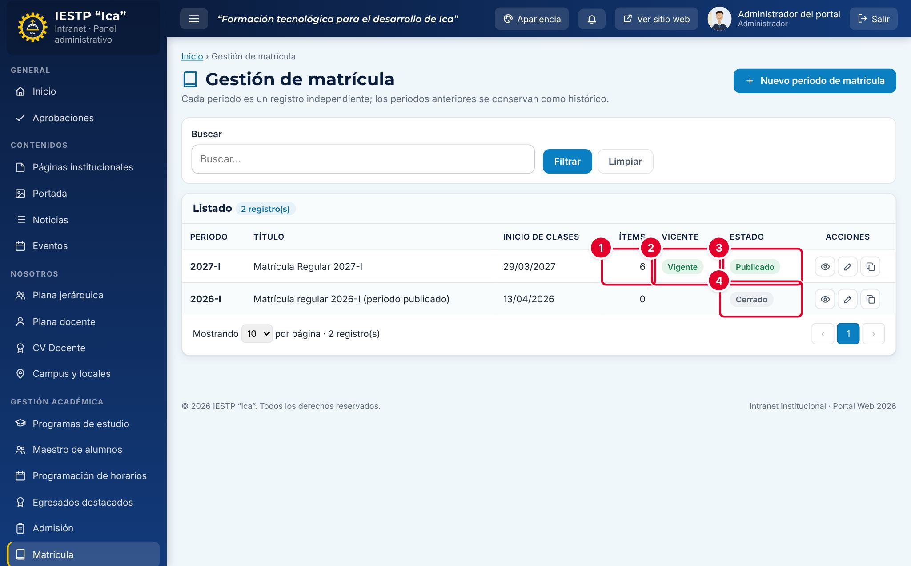
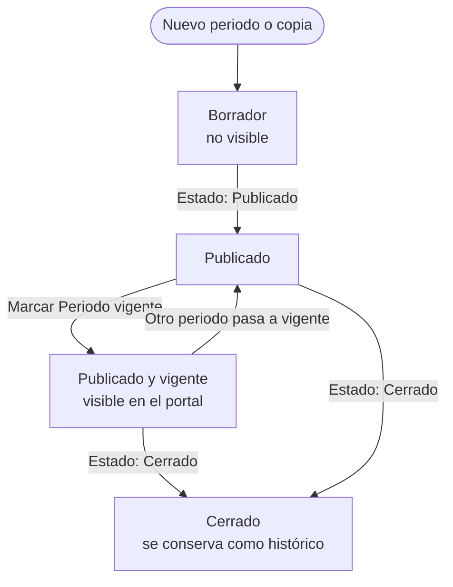
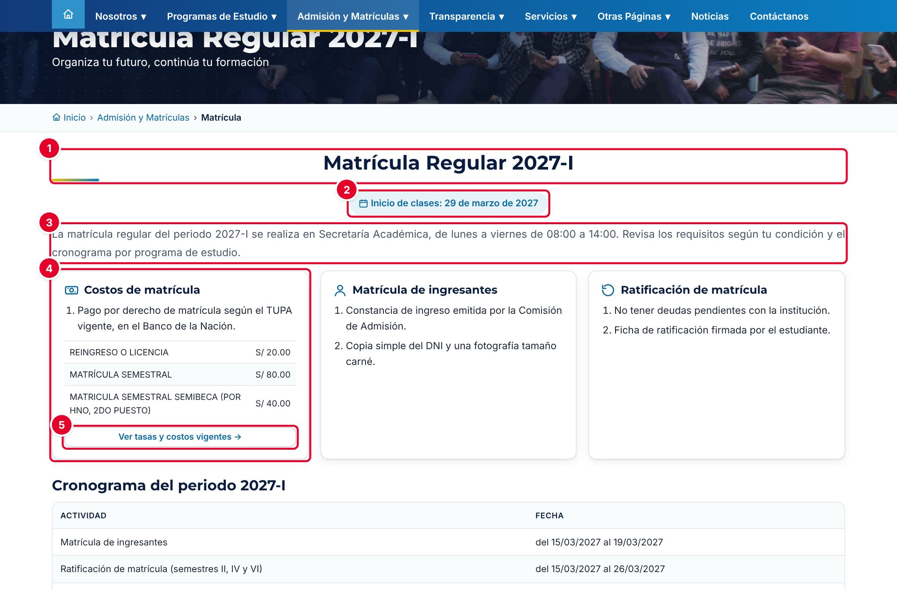
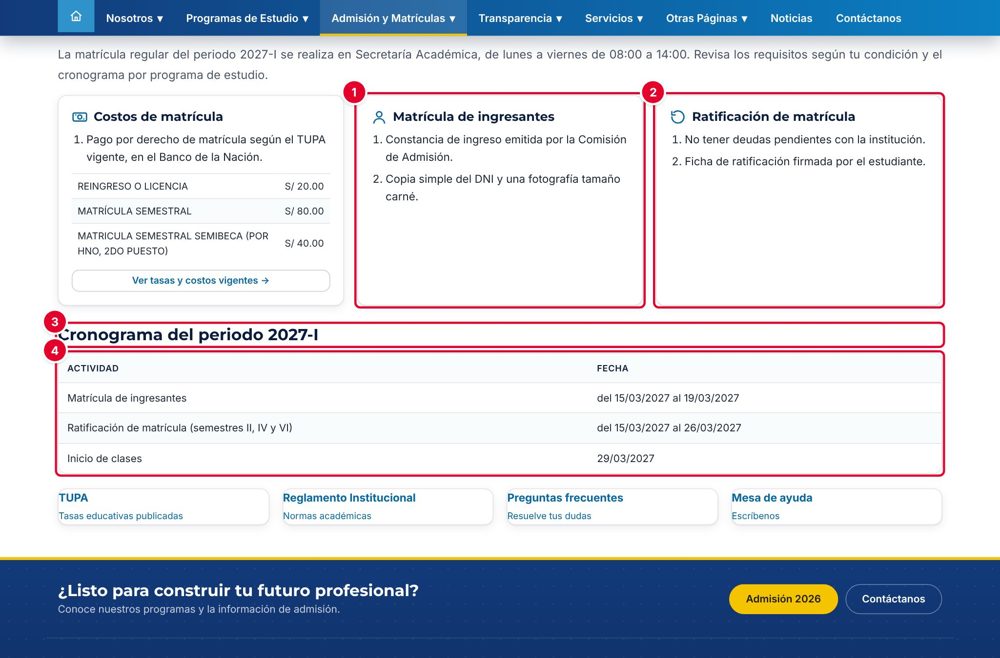

# 14 · Matrícula

## Para qué sirve

En este módulo se publica la información de cada **periodo de matrícula**: título, fecha de inicio de clases, descripción del proceso, requisitos de costos, de ingresantes y de ratificación, el documento oficial de tasas y el cronograma. El periodo marcado como **vigente** es el que aparece en la página **Matrícula** del portal. Cada periodo es un registro independiente y los anteriores se conservan como histórico.

## Quién lo usa

| Rol | Puede |
|---|---|
| Administrador | Todo: crear, copiar, editar, publicar, marcar como vigente y cerrar periodos |
| Secretaría académica | Lo mismo que el Administrador. En este módulo **publica directamente**, sin aprobación |

> Los periodos de matrícula **no se eliminan**: el listado no tiene botón de eliminar. Un periodo que terminó se pasa a **Cerrado**.

## Cómo se llega

Menú lateral › **Gestión académica** › **Matrícula**. Ruta: `#/admin/matricula`

## Pantalla principal

| N.º | Elemento | Para qué sirve |
|---|---|---|
| 1 | **Nuevo periodo de matrícula** | Crea un periodo vacío. |
| 2 | **Ítems** | Cuántos requisitos o indicaciones tiene el periodo (sin contar los eliminados). |
| 3 | **Vigente** | La etiqueta **Vigente** marca el periodo que muestra el portal. Solo puede haber uno. |
| 4 | **Estado** | **Borrador**, **Publicado** o **Cerrado**. |
| 5 | **Crear nuevo periodo copiando esta estructura** | Crea un periodo nuevo a partir de este (ver el procedimiento). |
| 6 | **Editar** | Abre el formulario del periodo. El ojo (**Vista previa**) muestra la página pública con los datos del periodo. |

El listado también muestra el **Periodo**, el **Título** y la fecha de **Inicio de clases**.

## Formulario

| N.º | Campo | Para qué sirve |
|---|---|---|
| 1 | **Periodo académico** | Identificación del periodo, por ejemplo 2027-I. No puede repetirse y, una vez guardado, ya no se puede cambiar. |
| 2 | **Título principal** | Título de la página de Matrícula. |
| 3 | **Fecha de inicio de clases** | Se muestra destacada en el portal. |
| 4 | **Descripción del proceso** | Texto con formato (negrita, listas, tablas, enlaces). |
| 5 | **Estado** | Estado del periodo. |
| 6 | **Periodo vigente** | Marca el periodo que se muestra en el portal. |

| Campo | Obligatorio | Formato o límite | Ejemplo |
|---|---|---|---|
| Periodo académico | Sí | Texto único | 2027-I |
| Título principal | Al publicar | Texto | Matrícula Regular 2027-I |
| Fecha de inicio de clases | Al publicar | Fecha | 29/03/2027 |
| Descripción del proceso | No | Texto con formato | La matrícula regular se realiza en Secretaría Académica… |
| Requisitos e indicaciones | No | Ítems de texto en tres secciones; sin ítems vacíos ni repetidos en la misma sección | Constancia de ingreso emitida por la Comisión de Admisión |
| Documento oficial de tasas y costos | No | PDF, hasta 20 MB | Tasas-Matricula-2027-I.pdf |
| Cronograma del periodo | No | Filas con **Actividad** y **Fecha(s)** (texto libre) | Matrícula de ingresantes · del 15/03/2027 al 19/03/2027 |
| Estado | Sí | Borrador, Publicado o Cerrado | Borrador |
| Periodo vigente | No | Casilla. No se permite en Borrador | — |

Los campos con la nota «Obligatorio al publicar. Puede guardarse vacío como borrador.» se pueden dejar en blanco mientras el periodo esté en **Borrador**.

## Procedimientos

### Crear un periodo copiando el anterior

Es la forma más rápida: copia la descripción, la fecha de inicio de clases y los requisitos del periodo anterior.

1. En la fila del periodo anterior, pulsa **Crear nuevo periodo copiando esta estructura**.
2. Escribe la **Identificación del nuevo periodo académico** ①, por ejemplo 2027-I.
3. Pulsa **Crear periodo** ②.

Aparece el aviso «Periodo creado como borrador. El periodo original no se modificó.» y se abre el formulario del nuevo periodo. La copia se crea en **Borrador**, sin marca de vigente, **sin documento de tasas y sin cronograma**, y con el título «Matrícula Regular» seguido del periodo. Revisa todos los datos copiados, en especial la **Fecha de inicio de clases**.

Si prefieres empezar desde cero, pulsa **Nuevo periodo de matrícula**.

### Completar los datos generales

1. Revisa el **Título principal** y la **Fecha de inicio de clases**.
2. Escribe o actualiza la **Descripción del proceso** con el editor de texto.
3. Pulsa **Guardar cambios**.

### Registrar los requisitos, las tasas y el cronograma

Los requisitos se organizan en tres secciones: **Costos de matrícula** ①, **Matrícula de ingresantes** y **Ratificación de matrícula**.

1. En la sección que corresponda, pulsa **+ Agregar ítem** ② y escribe el texto.
2. Cada ítem tiene tres botones: **Subir** (cambia el orden), **Despublicar** o **Publicar** ③ y **Eliminar** ④.
   - El ojo indica que el ítem está publicado. Al pulsarlo se convierte en un candado naranja: el ítem se conserva, pero **no se muestra en el portal**.
   - **Eliminar** pide confirmación. El ítem queda atenuado con el botón **Restaurar** hasta que guardes.
3. En **Documento oficial de tasas y costos** ⑤, pulsa **Cargar archivo** y elige el PDF.
4. En **Cronograma del periodo** ⑥, pulsa **Agregar** y escribe la **Actividad** y la **Fecha(s)** de cada etapa.
5. Pulsa **Guardar cambios**.

### Publicar el periodo y marcarlo como vigente

1. Cambia el **Estado** a **Publicado** ②.
2. Marca **Periodo vigente (se muestra en el portal)**.
3. Pulsa **Guardar cambios**.

Si falta el título o la fecha de inicio de clases, el campo se marca en rojo con el mensaje «Obligatorio para publicar (puede guardarlo como borrador).» ① y aparece el aviso «Revise los campos marcados en rojo.». Complétalo y vuelve a guardar.

El periodo muestra sus **Ítems** ①, la etiqueta **Vigente** ② y el estado **Publicado** ③. Si otro periodo era vigente, pierde la marca automáticamente. El periodo anterior se mantiene en su estado (en el ejemplo, **Cerrado** ④).

### Cerrar un periodo

Edita el periodo, cambia el **Estado** a **Cerrado** y pulsa **Guardar cambios**. Al cerrarlo se le quita la marca de vigente.

## Flujo y estados

| Estado | Significado | Visible en el portal |
|---|---|---|
| Borrador | En preparación | No |
| Publicado | Información aprobada. Se muestra solo si además es **vigente** | Solo si es vigente |
| Cerrado | Periodo concluido | Solo si no hay un periodo vigente: el portal muestra el último periodo cerrado, con el aviso «Información histórica de matrícula…» |

## Resultado en el portal público

En `{{inst.dominio}}/#/matricula` (menú **Admisión y Matrículas** › **Matrícula**) el público ve el **Título principal** ①, la fecha de **Inicio de clases** ②, la **Descripción del proceso** ③ y la tarjeta **Costos de matrícula** ④. Esta tarjeta añade los conceptos de matrícula del **TUPA** y el botón **Ver tasas y costos vigentes →** ⑤, que abre el documento oficial de tasas. Los ítems despublicados no aparecen.

Más abajo están las tarjetas **Matrícula de ingresantes** ① y **Ratificación de matrícula** ②, con los ítems numerados, y el **Cronograma del periodo** ③ ④. Al final hay accesos directos al TUPA, al Reglamento Institucional, a las Preguntas frecuentes y a la Mesa de ayuda.

## Mensajes y problemas frecuentes

| Mensaje o situación | Causa | Qué hacer |
|---|---|---|
| «Ya existe un periodo con esa identificación.» | Al copiar, escribiste un periodo que ya existe | Usa otra identificación o edita el periodo existente |
| «Obligatorio para publicar (puede guardarlo como borrador).» | Falta el título o la fecha de inicio de clases | Complétalos o guarda como **Borrador** |
| «Un periodo en borrador no puede ser vigente.» | Marcaste **Periodo vigente** con el estado en Borrador | Publica el periodo o quita la marca |
| «Hay ítems vacíos.» | Agregaste un ítem sin texto | Escribe el texto o elimina el ítem |
| «Requisito duplicado en la misma sección: “…”.» | Dos ítems iguales en la misma sección | Elimina uno de ellos |
| El portal muestra un periodo antiguo con «Información histórica de matrícula…» | No hay un periodo **Publicado** y **vigente** | Publica el periodo actual y marca **Periodo vigente** |
| El periodo está Publicado, pero no aparece en el portal | No está marcado como vigente | Edítalo y marca **Periodo vigente** |
| Un requisito no aparece en el portal | El ítem está despublicado (candado naranja) | Pulsa el candado para publicarlo y guarda |

## Buenas prácticas

- Crea cada periodo nuevo con **Crear nuevo periodo copiando esta estructura** y revisa todo lo copiado antes de publicar.
- Publica el periodo y márcalo como vigente **antes** de que empiece el cronograma de matrícula.
- Carga siempre el documento oficial de tasas en PDF y verifica que coincida con el TUPA vigente.
- Escribe los requisitos como acciones concretas («Copia simple del DNI»). No pidas por la web más datos personales de los necesarios (Ley N.º 29733).
- Cierra el periodo anterior cuando empiece el nuevo, para que el histórico quede ordenado.
