# 15 · Becas

## Para qué sirve

En este módulo se registran los **periodos de becas**, los **tipos de beca** y los **beneficiarios** de cada periodo. Los beneficiarios se pueden registrar uno por uno o **importar** desde una hoja de Excel guardada como CSV. Lo publicado aparece en la página **Becas** del portal, donde el público consulta a los beneficiarios por periodo, programa o tipo de beca. El DNI de los beneficiarios **nunca se muestra** en el portal.

## Quién lo usa

| Rol | Puede |
|---|---|
| Administrador | Todo, incluida la edición de beneficiarios de periodos **Cerrados** y la **eliminación definitiva** |
| Secretaría académica | Crear y editar periodos, tipos y beneficiarios; importar; publicar directamente; enviar beneficiarios a la papelera y restaurarlos. No puede modificar beneficiarios de un periodo **Cerrado** |

Ambos roles ven el **DNI completo** de los beneficiarios en la intranet y en el CSV exportado. Un rol sin permiso para ver DNI lo vería enmascarado (por ejemplo, ****8193).

## Cómo se llega

Menú lateral › **Gestión académica** › **Becas**. Ruta: `#/admin/becas`

## Pantalla principal

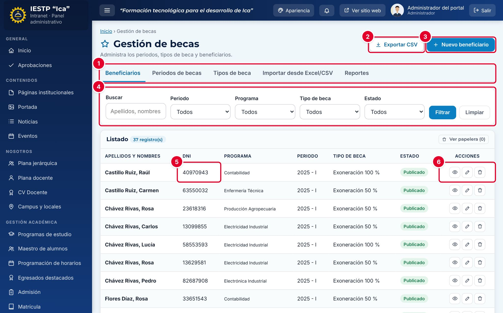

| N.º | Elemento | Para qué sirve |
|---|---|---|
| 1 | Pestañas | **Beneficiarios**, **Periodos de becas**, **Tipos de beca**, **Importar desde Excel/CSV** y **Reportes**. |
| 2 | **Exportar CSV** | Descarga el listado filtrado: periodo, apellidos, nombres, DNI, programa, tipo de beca, motivo y estado. |
| 3 | **Nuevo beneficiario** | Abre el formulario para registrar un beneficiario. |
| 4 | Filtros | **Buscar** (apellidos, nombres o DNI), **Periodo**, **Programa**, **Tipo de beca** y **Estado**. Pulsa **Filtrar** o **Limpiar**. |
| 5 | **DNI** | DNI del beneficiario. Es un dato privado: solo se ve en la intranet. |
| 6 | Acciones | **Vista previa** (página pública de Becas), **Editar** y **Eliminar** (envía a la papelera). En un periodo **Cerrado** solo el Administrador ve **Editar** y **Eliminar**. |

**Ver papelera** muestra los beneficiarios eliminados, con el botón **Restaurar**. Solo el Administrador ve **Eliminar definitivamente**.

## Formulario

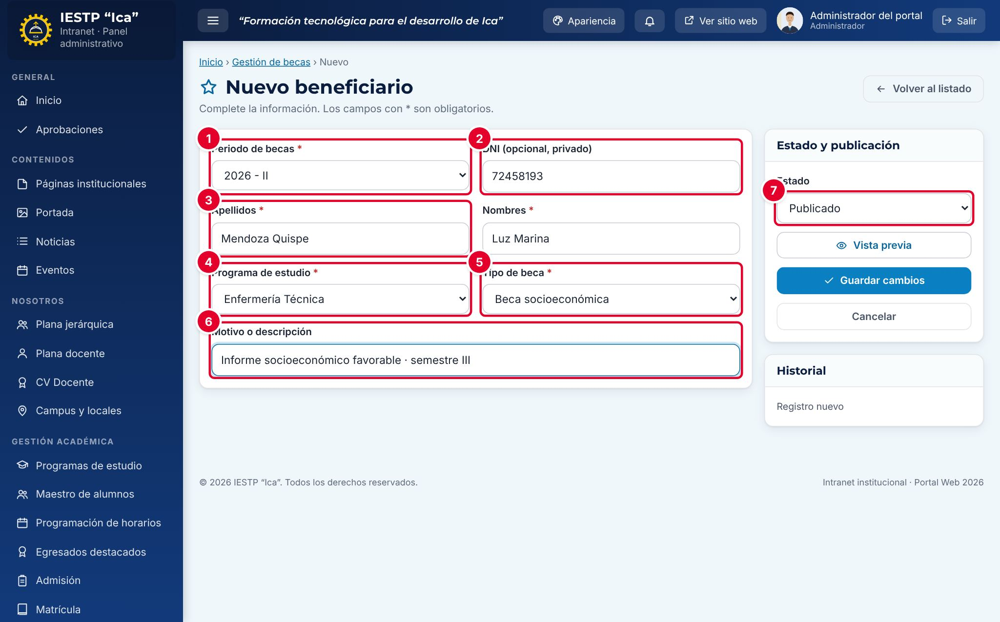

| N.º | Campo | Para qué sirve |
|---|---|---|
| 1 | **Periodo de becas** | Periodo al que pertenece la beca. Se propone el periodo vigente. Los periodos cerrados solo aparecen para el Administrador. |
| 2 | **DNI (opcional, privado)** | Permite que el estudiante encuentre su beca escribiendo su DNI en el portal. No se publica. |
| 3 | **Apellidos** y **Nombres** | Tal como figuran en el documento de identidad. |
| 4 | **Programa de estudio** | Programa del beneficiario. |
| 5 | **Tipo de beca** | Solo se listan los tipos **Activos**. |
| 6 | **Motivo o descripción** | Aparece en letra pequeña debajo del tipo de beca, en el portal. |
| 7 | **Estado** | **Borrador**, **Publicado** o **Despublicado**. Por defecto, **Publicado**. |

| Campo | Obligatorio | Formato o límite | Ejemplo |
|---|---|---|---|
| Periodo de becas | Sí | Uno de los periodos registrados | 2026 - II |
| DNI | No | 8 dígitos | 72458193 |
| Apellidos | Sí | Texto | Mendoza Quispe |
| Nombres | Sí | Texto | Luz Marina |
| Programa de estudio | Sí | Uno de los programas | Enfermería Técnica |
| Tipo de beca | Sí | Un tipo activo | Beca socioeconómica |
| Motivo o descripción | No | Texto | Informe socioeconómico favorable · semestre III |
| Estado | Sí | Borrador, Publicado o Despublicado | Publicado |

## Procedimientos

### 1. Crear el periodo de becas

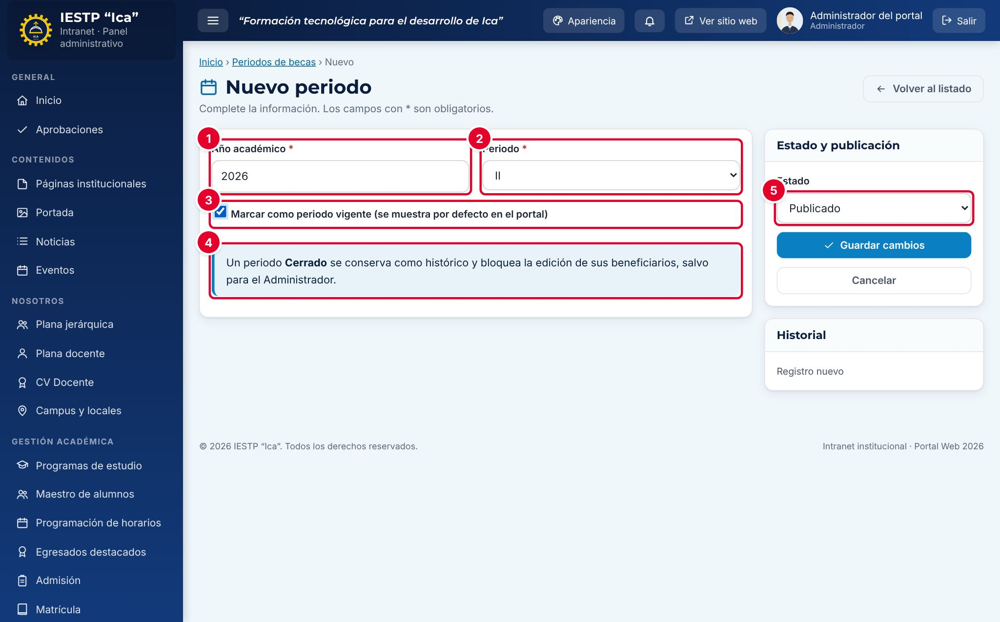

1. Entra a la pestaña **Periodos de becas** y pulsa **Nuevo periodo**.
2. Escribe el **Año académico** ① y elige el **Periodo** ② (**I** o **II**).
3. Marca **Marcar como periodo vigente** ③ si el portal debe mostrar este periodo por defecto. Solo puede haber un periodo vigente: al guardar, los demás pierden la marca.
4. Lee el aviso ④: un periodo **Cerrado** se conserva como histórico y bloquea la edición de sus beneficiarios, salvo para el Administrador.
5. Elige el **Estado** ⑤ y pulsa **Guardar cambios**.

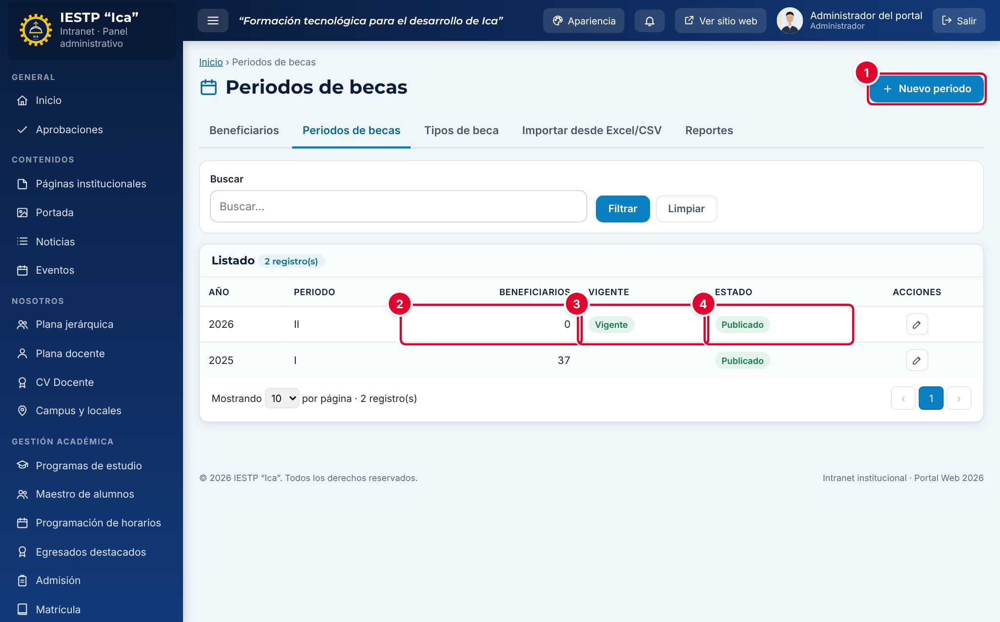

**Nuevo periodo** ① crea otro periodo. El listado muestra cuántos **Beneficiarios** tiene cada periodo ②, cuál es el **Vigente** ③ y su **Estado** ④. Los periodos no se eliminan; cuando terminan, se pasan a **Cerrado**.

### 2. Revisar los tipos de beca

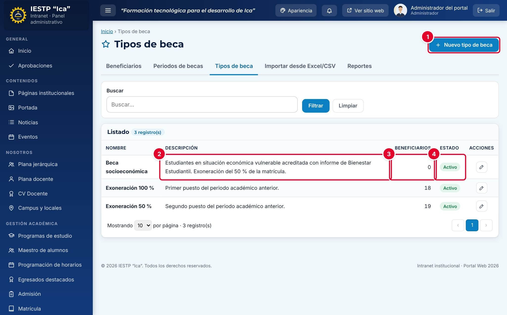

1. Entra a la pestaña **Tipos de beca** y pulsa **Nuevo tipo de beca** ①.
2. Escribe el **Nombre** (no puede repetirse) y la **Descripción y requisitos** ②. Ambos son obligatorios. La descripción se publica en el portal.
3. Pulsa **Guardar cambios**.

La columna **Beneficiarios** ③ indica cuántos beneficiarios usan el tipo. Si un tipo ya no se otorga, cámbialo a **Inactivo** ④: deja de ofrecerse en el formulario y en el portal, pero los registros históricos no cambian.

> **Incidencia detectada al elaborar este manual (versión actual de la plataforma)**
> Al pasar un tipo de beca a **Inactivo**, el portal deja de mostrar su nombre también en los beneficiarios que ya lo tenían: la columna **Tipo de beca** queda **en blanco** (solo se ve el motivo) y el tipo desaparece del filtro. En la intranet los registros no cambian. Ya se reportó para su corrección. Mientras tanto, **no desactives un tipo** que tenga beneficiarios publicados; si ya no se otorga, actualiza su **Descripción y requisitos** indicando, por ejemplo, «No vigente desde 2027».

### 3. Registrar un beneficiario

1. En la pestaña **Beneficiarios**, pulsa **Nuevo beneficiario**.
2. Completa el formulario (ver la tabla de campos).
3. Pulsa **Guardar cambios**.

Si el DNI ya tiene **otra** beca en el mismo periodo, aparece un aviso de advertencia con el tipo de esa beca; puedes guardar igual. Si es **la misma** persona, con el mismo periodo, programa y tipo de beca, el sistema no lo permite.

### 4. Importar beneficiarios desde Excel

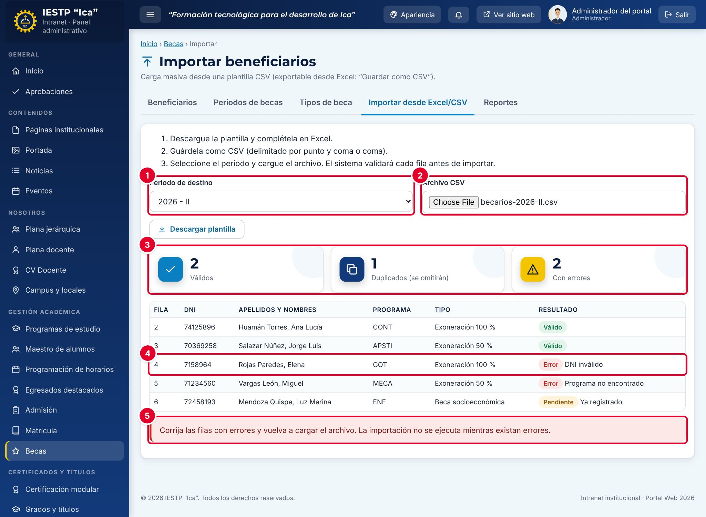

1. Entra a la pestaña **Importar desde Excel/CSV** y pulsa **Descargar plantilla**.
2. Completa la plantilla en Excel. Tiene estas columnas, en la primera fila:

   | Columna | Contenido |
   |---|---|
   | dni | 8 dígitos. **En la importación es obligatorio** |
   | apellidos | Apellidos |
   | nombres | Nombres |
   | codigo_programa | Código del programa (por ejemplo, CONT o APSTI) o su nombre completo |
   | tipo_beca | Nombre exacto del tipo de beca (por ejemplo, Exoneración 100 %) |
   | motivo | Opcional |

3. Guárdala como **CSV UTF-8 (delimitado por comas)**. También se acepta el punto y coma. El archivo puede pesar hasta 2 MB.
4. Elige el **Periodo de destino** ①. No se muestran los periodos cerrados.
5. En **Archivo CSV** ②, elige el archivo. El sistema revisa cada fila **antes** de importar nada.
6. Revisa el resumen ③: **Válidos**, **Duplicados (se omitirán)** y **Con errores**. En la tabla, cada fila dice su resultado; por ejemplo, **Error · DNI inválido** ④.
7. Si hay errores, aparece el aviso ⑤ y **no se importa ninguna fila**. Corrige el archivo en Excel y vuelve a cargarlo.

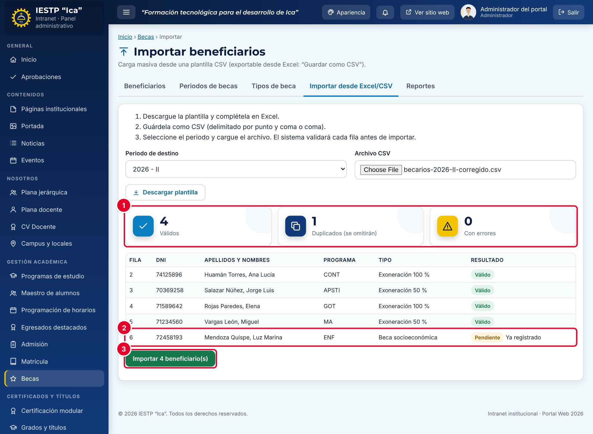

8. Cuando no hay errores ①, los duplicados aparecen como **Pendiente · Ya registrado** ② y se omitirán. Pulsa **Importar N beneficiario(s)** ③.

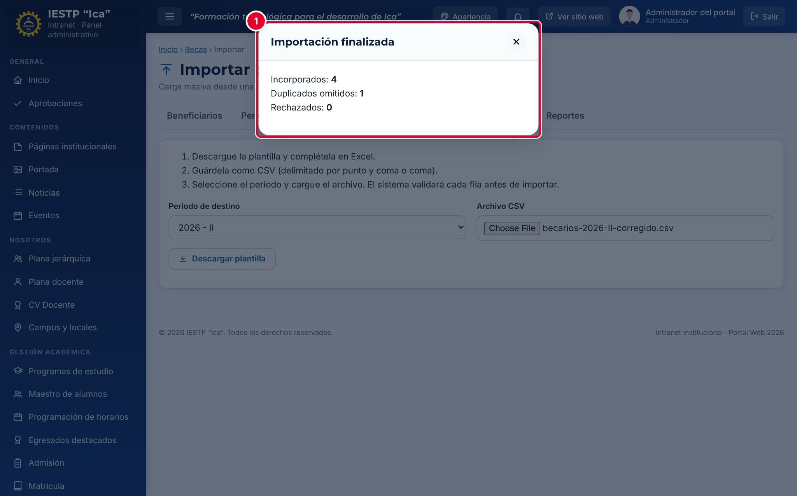

9. La ventana **Importación finalizada** ① indica cuántos se **incorporaron**, cuántos **duplicados** se omitieron y cuántos se **rechazaron**. Los beneficiarios importados quedan **Publicados** y la operación queda registrada en la **Auditoría**.

### 5. Consultar los reportes

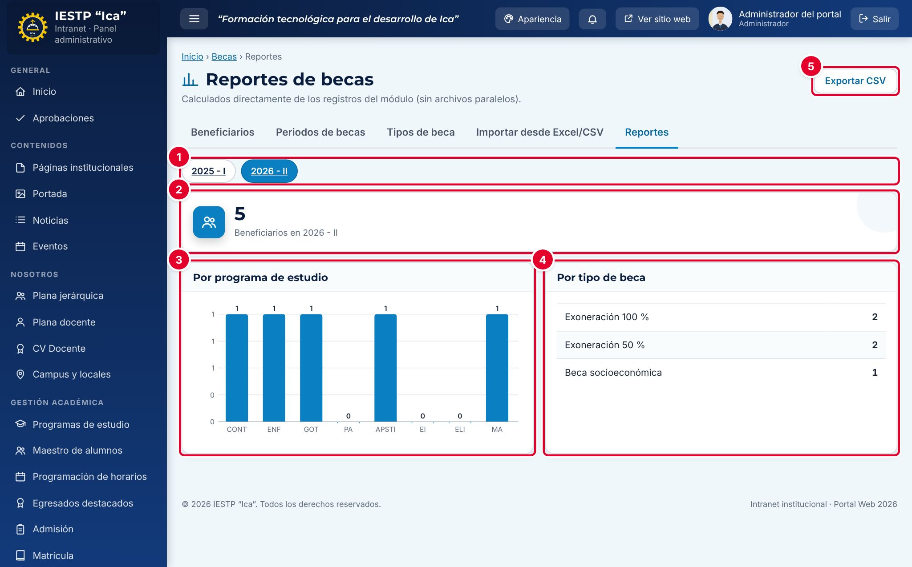

En la pestaña **Reportes**, elige el periodo ①. Se muestran el total de beneficiarios ②, un gráfico **Por programa de estudio** ③ (por código de programa) y una tabla **Por tipo de beca** ④. **Exportar CSV** ⑤ descarga ambos conteos.

### 6. Corregir, retirar o eliminar

- Para retirar un beneficiario del portal sin borrarlo, edítalo y cambia el **Estado** a **Despublicado**.
- **Eliminar** lo envía a la papelera, previa confirmación. Se recupera desde **Ver papelera** › **Restaurar**.
- Para corregir un periodo ya terminado, el periodo debe estar abierto o lo debe hacer el Administrador.

## Flujo y estados

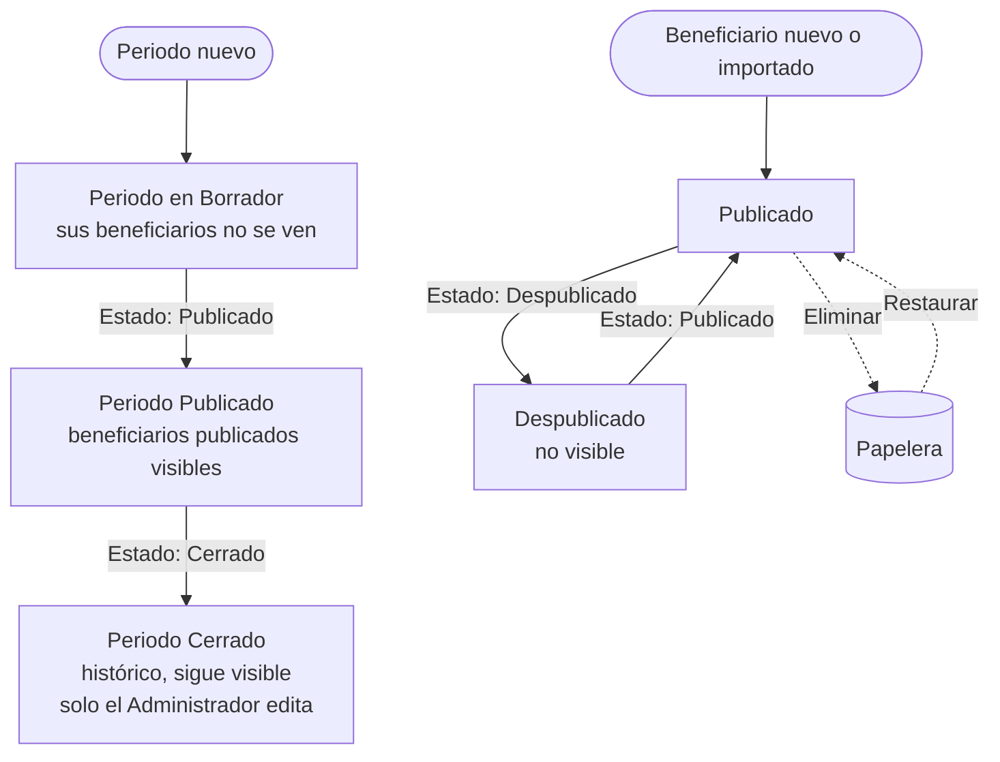

| Estado | Se aplica a | Significado | Visible en el portal |
|---|---|---|---|
| Borrador | Periodo y beneficiario | En preparación | No |
| Publicado | Periodo y beneficiario | Información oficial | **Sí**, si el periodo y el beneficiario están publicados (o el periodo está cerrado) |
| Despublicado | Beneficiario | Retirado sin borrarlo | No |
| Cerrado | Periodo | Periodo concluido; bloquea la edición salvo para el Administrador | Sí, como histórico |
| Activo / Inactivo | Tipo de beca | Si se ofrece o no | Solo los activos (ver la incidencia del paso 2) |

## Resultado en el portal público

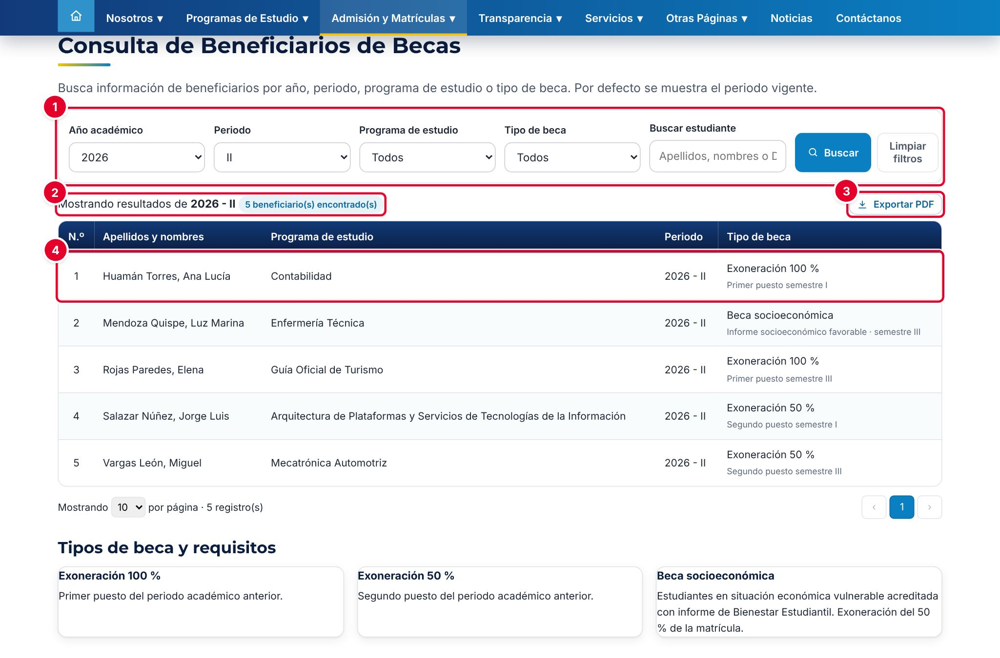

En `{{inst.dominio}}/#/becas` (menú **Admisión y Matrículas** › **Becas**) el público usa los filtros ① **Año académico**, **Periodo**, **Programa de estudio**, **Tipo de beca** y **Buscar estudiante**. Por defecto se muestra el periodo vigente ②. **Exportar PDF** ③ descarga la lista filtrada. Cada fila ④ muestra el número, los apellidos y nombres, el programa, el periodo, el tipo de beca y el motivo.

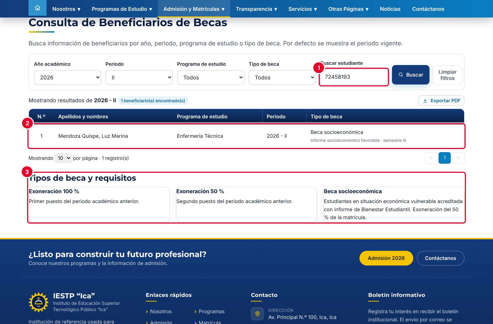

Un estudiante puede escribir su **DNI completo** (8 dígitos) en **Buscar estudiante** ① para encontrar su beca ②. El DNI debe coincidir exactamente; no se aceptan números parciales. Al final de la página está **Tipos de beca y requisitos** ③, con la descripción de cada tipo activo.

**Protección de datos personales (Ley N.º 29733):** el portal **nunca muestra el DNI**, ni en la tabla ni en el PDF. Los datos que se envían al navegador del visitante llevan el DNI enmascarado (solo los cuatro últimos dígitos, por ejemplo ****8193). Por eso, la búsqueda por DNI se resuelve en el servidor y solo devuelve las becas de ese DNI.

## Mensajes y problemas frecuentes

| Mensaje o situación | Causa | Qué hacer |
|---|---|---|
| «El DNI debe tener 8 dígitos numéricos.» | El DNI tiene letras o no tiene 8 dígitos | Corrígelo o deja el campo vacío |
| «Este beneficiario ya está registrado con el mismo periodo, programa y tipo de beca.» | Registro duplicado | Busca el registro existente y edítalo |
| «Advertencia: el DNI ya tiene otra beca en el mismo periodo (…)» | La persona tiene otra beca en el periodo | Verifica que corresponda. Es solo un aviso |
| «El periodo está cerrado.» o no aparecen **Editar** y **Eliminar** | El periodo del beneficiario está **Cerrado** | Solo el Administrador puede modificarlo |
| «Ya existe ese año y periodo.» | El periodo de becas ya existe | Usa el periodo existente |
| «Estructura incorrecta. Faltan las columnas: …» | La primera fila del archivo no tiene los nombres de columna de la plantilla | Usa la plantilla descargada sin cambiar los encabezados |
| **Error · DNI inválido** | El DNI está vacío o no tiene 8 dígitos. Excel suele quitar los ceros iniciales | Da formato de **Texto** a la columna dni antes de escribir |
| **Error · Programa no encontrado** | El código o nombre del programa no existe | Usa los códigos de **Programas de estudio** |
| **Error · Tipo de beca no encontrado** o nombres con símbolos extraños | El nombre del tipo no coincide, o el CSV no se guardó en UTF-8 y se dañaron las tildes | Copia el nombre exacto del tipo y guarda como **CSV UTF-8** |
| «Corrija las filas con errores y vuelva a cargar el archivo…» | Hay al menos una fila con error | Corrige todas las filas: no se importa nada mientras haya errores |
| Un beneficiario no aparece en el portal | El beneficiario no está **Publicado** o su periodo está en **Borrador** | Publica el periodo y el beneficiario |

## Buenas prácticas

- Crea primero el periodo y los tipos de beca; después registra o importa a los beneficiarios.
- Usa la importación para listas largas y revisa siempre la vista previa antes de pulsar **Importar**.
- Registra el DNI solo si el estudiante lo necesita para consultar su beca. No lo copies en el **Motivo** ni en otros campos de texto, porque esos sí se publican (Ley N.º 29733).
- Cierra el periodo cuando la lista sea definitiva, para evitar cambios posteriores.
- Guarda el archivo CSV importado como respaldo del acto administrativo que aprobó las becas.
