# 16 · Certificación modular

## Para qué sirve

En este módulo se registran los **módulos formativos** de cada programa de estudios y la **certificación** de cada módulo que aprueba un estudiante. También se lleva el **historial académico** (notas por unidad didáctica) y se emite la **Constancia de certificación modular**, con código de verificación y código QR.

Cada certificación registrada aquí se publica automáticamente en **Verificación de documentos** (capítulo 18), de modo que cualquier persona puede comprobar su autenticidad en el portal con el número de certificado.

## Quién lo usa

| Rol | Puede |
|---|---|
| Administrador | Todo, incluido registrar los módulos formativos y **eliminar** registros |
| Secretaría académica | Registrar certificaciones y notas, consultar, emitir constancias y exportar. Ve los módulos formativos, pero no los modifica |
| Directivo | Consultar la ficha de un estudiante por DNI o apellidos |
| Estudiante y egresado | Ver su propia ficha (módulos, certificaciones y notas) y emitir su constancia |

## Cómo se llega

Menú lateral › **Certificados y títulos** › **Certificación modular**. Ruta: `#/admin/ix-certificados`

## Pantalla principal

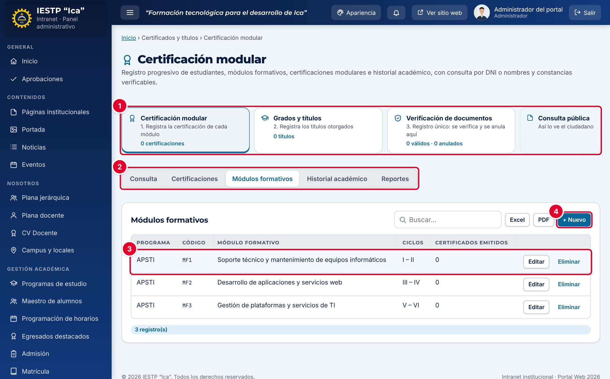

| N.º | Elemento | Para qué sirve |
|---|---|---|
| 1 | Accesos del grupo | **Certificación modular**, **Grados y títulos**, **Verificación de documentos** y **Consulta pública** (abre la página que ve el ciudadano). Muestran el orden de trabajo y los totales. |
| 2 | Pestañas | **Consulta**, **Certificaciones**, **Módulos formativos**, **Historial académico** y **Reportes**. |
| 3 | Módulo formativo | Programa, código, nombre, ciclos y cuántos certificados se emitieron. |
| 4 | **+ Nuevo** | Registra un módulo formativo. |

Todas las listas tienen **Buscar…**, **Excel** y **PDF**.

## Paso 1 · Registrar los módulos formativos (una vez por programa)

Pestaña **Módulos formativos** › **+ Nuevo**. Solo el administrador puede registrarlos.

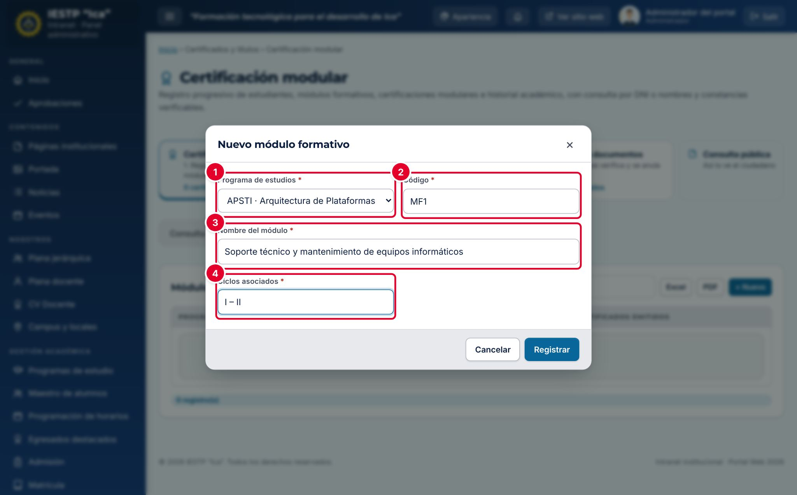

| N.º | Campo | Obligatorio | Formato o límite |
|---|---|---|---|
| 1 | **Programa de estudios** | Sí | Un programa registrado |
| 2 | **Código** | Sí | Se guarda en mayúsculas. No se repite dentro del programa. Ej.: MF1 |
| 3 | **Nombre del módulo** | Sí | Según el plan de estudios |
| 4 | **Ciclos asociados** | Sí | Texto. Ej.: I – II |

Un módulo con certificaciones registradas no se puede eliminar.

## Paso 2 · Registrar una certificación

Pestaña **Certificaciones** › **+ Registrar certificación**. También puedes usar **+ Registrar certificación** desde la ficha del estudiante (pestaña **Consulta**): el estudiante ya viene elegido.

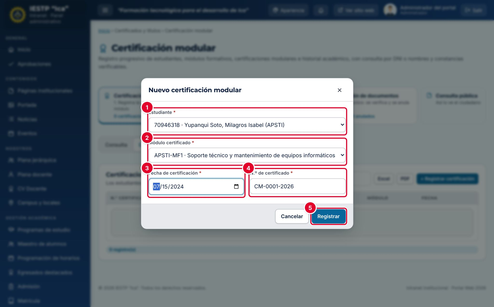

| N.º | Campo | Obligatorio | Formato o límite |
|---|---|---|---|
| 1 | **Estudiante** | Sí | Alumno del Maestro de alumnos (DNI · nombre · programa) |
| 2 | **Módulo certificado** | Sí | Debe ser un módulo del programa del estudiante |
| 3 | **Fecha de certificación** | Sí | No puede ser futura. Por defecto, la fecha de hoy |
| 4 | **N.º de certificado** | Sí | Único. Se propone el siguiente número correlativo, con el formato `CM-0001-2026`. Puedes reemplazarlo por el número de tu registro físico |
| 5 | **Registrar** | — | Guarda la certificación |

Al guardar, el estudiante recibe una notificación en su intranet y la certificación aparece en **Verificación de documentos** con su número como código de verificación.

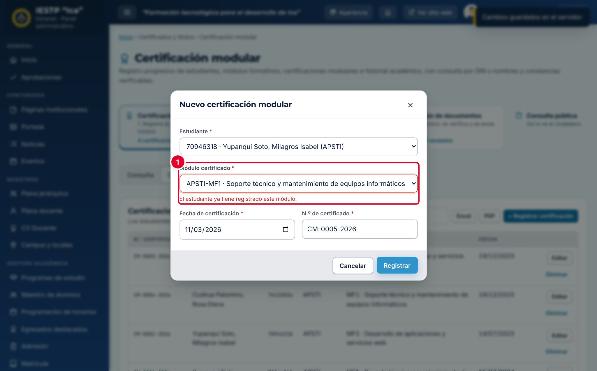

El sistema no permite registrar dos veces el mismo módulo para un estudiante ①: «El estudiante ya tiene registrado este módulo.». Si eliges un módulo de otro programa, el mensaje es «El módulo pertenece a XXX y el estudiante es de YYY.».

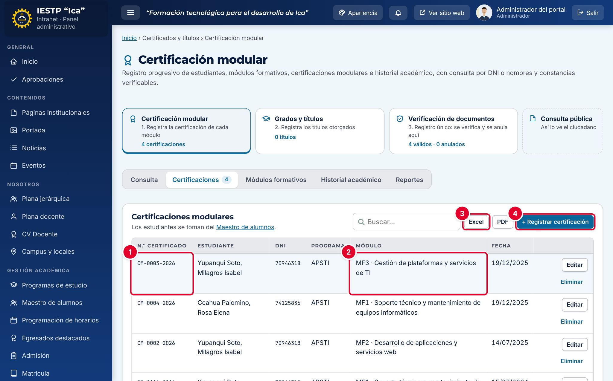

| N.º | Elemento | Para qué sirve |
|---|---|---|
| 1 | **N.º certificado** | Número del certificado; es también su código en la consulta pública. |
| 2 | **Módulo** | Código y nombre del módulo certificado. |
| 3 | **Excel** | Descarga la lista filtrada (también hay **PDF**). |
| 4 | **+ Registrar certificación** | Registra otra certificación. |

> Si una certificación se registró por error, corrígela con **Editar**. Solo el administrador puede eliminarla, y no se puede eliminar si ya se emitió una constancia con ella: primero hay que anular la constancia en **Verificación de documentos**. Cuando se elimina una certificación, su registro de verificación pasa a **Anulado** con el motivo «Retirado del registro académico».

## Paso 3 · Registrar el historial académico (notas)

Pestaña **Historial académico** › **+ Registrar nota**.

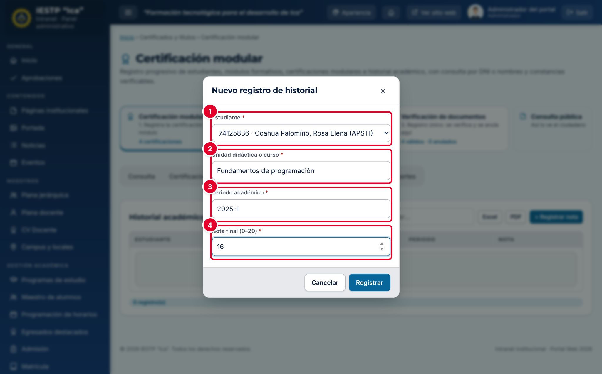

| N.º | Campo | Obligatorio | Formato o límite |
|---|---|---|---|
| 1 | **Estudiante** | Sí | Alumno del Maestro de alumnos |
| 2 | **Unidad didáctica o curso** | Sí | Texto. Ej.: Fundamentos de programación |
| 3 | **Periodo académico** | Sí | `AAAA-I` o `AAAA-II` |
| 4 | **Nota final (0–20)** | Sí | Escala vigesimal. Las notas de 13 o más se muestran en verde; las menores, en rojo |

## Paso 4 · Consultar la ficha y emitir la constancia

Pestaña **Consulta**. Escribe el **DNI o apellidos** (mínimo 3 caracteres) y pulsa **Buscar**. Si hay varias coincidencias, pulsa **Ver** en la que corresponda.

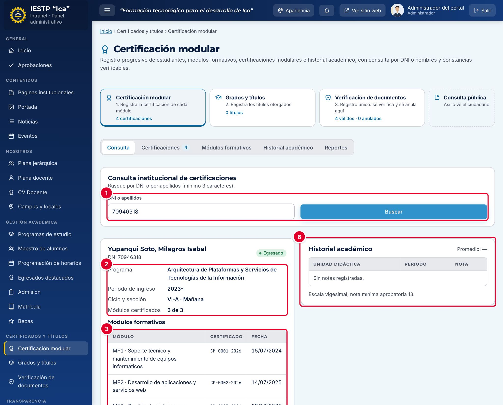

| N.º | Elemento | Descripción |
|---|---|---|
| 1 | **DNI o apellidos** | Búsqueda del estudiante. |
| 2 | Datos | Programa, periodo de ingreso, ciclo y sección, y módulos certificados (por ejemplo, 3 de 3). |
| 3 | **Módulos formativos** | Todos los módulos del programa: número y fecha del certificado, o **Pendiente**. |
| 4 | **Emitir constancia de certificación** | Genera la constancia. Se activa cuando el estudiante tiene al menos una certificación. |
| 5 | **+ Registrar certificación** | Registra una certificación para este estudiante. |
| 6 | **Historial académico** | Notas por unidad didáctica y periodo, con el promedio. |

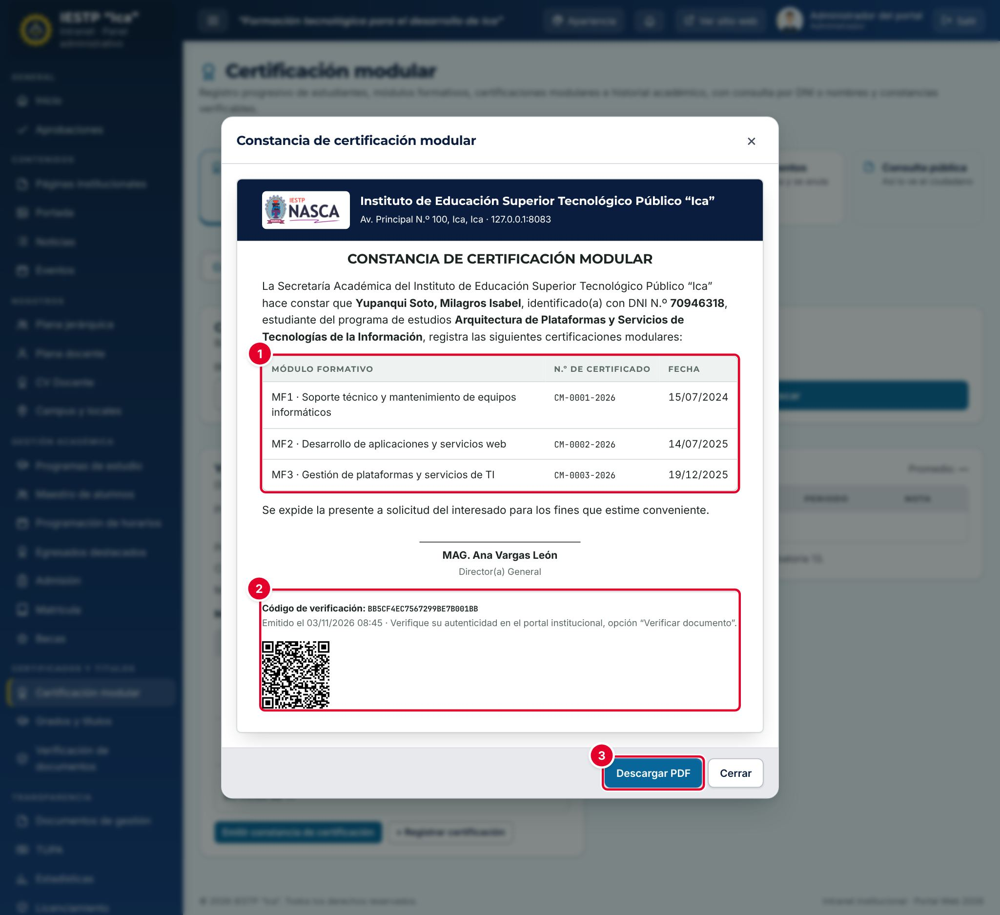

| N.º | Elemento | Descripción |
|---|---|---|
| 1 | Certificaciones | Módulos certificados con su número y fecha. |
| 2 | **Código de verificación** y QR | Código único del documento. El QR abre la consulta pública con ese código. |
| 3 | **Descargar PDF** | Descarga la constancia en PDF, lista para imprimir. |

El encabezado, el logotipo, la firma y el pie de la constancia se configuran en **Configuración académica** › **Constancias y reportes** (capítulo 32). Si se emite otra constancia del mismo estudiante el mismo día, se reutiliza el mismo código.

## Reportes

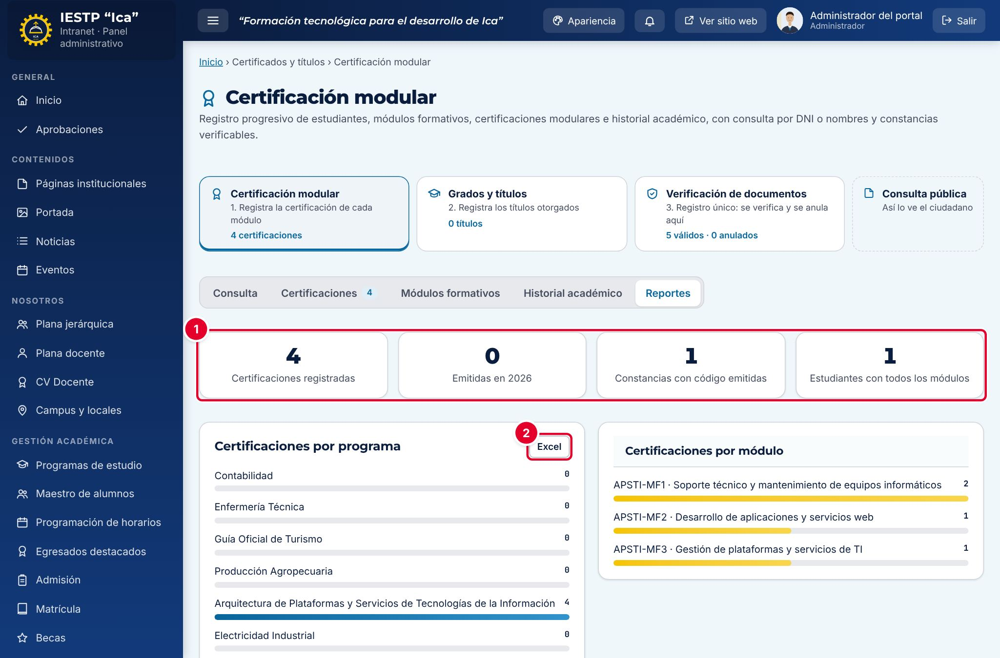

| N.º | Elemento | Descripción |
|---|---|---|
| 1 | Indicadores | Certificaciones registradas, emitidas en el año, constancias con código emitidas y estudiantes con todos los módulos certificados. |
| 2 | **Excel** | Descarga todas las certificaciones con DNI, estudiante, programa, módulo y fecha. |

Debajo se muestran las barras de **Certificaciones por programa** y **Certificaciones por módulo**.

## Lo que ve el estudiante

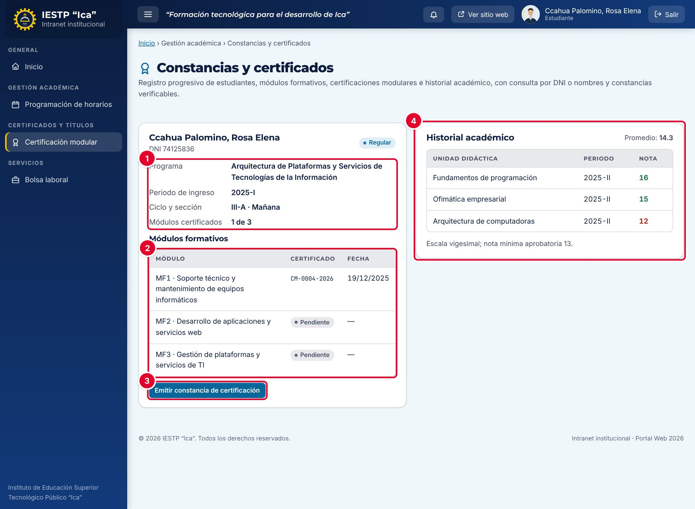

El estudiante o egresado entra a **Certificación modular** y ve directamente su ficha: sus datos ①, sus módulos con el estado de certificación ②, el botón **Emitir constancia de certificación** ③ (si tiene al menos una certificación) y su **Historial académico** ④. No puede registrar ni modificar datos.

## Flujo y estados

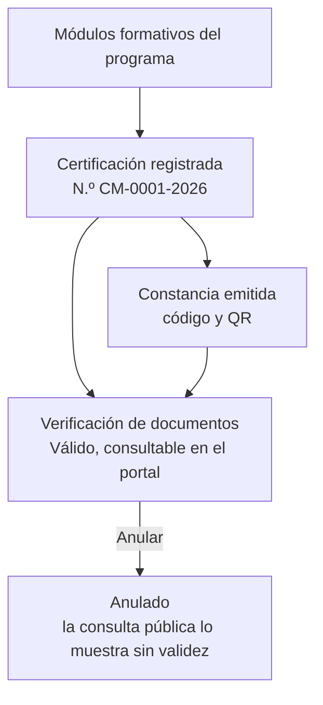

| Estado en Verificación de documentos | Significado | Visible en el portal |
|---|---|---|
| Válido | La certificación o la constancia existe y está vigente | Sí, como «DOCUMENTO VÁLIDO» |
| Anulado | Se anuló o se retiró del registro académico | Sí, como «DOCUMENTO ANULADO», con el motivo |

## Resultado en el portal público

La certificación y la constancia se verifican en **Servicios** › **Consulta de certificados** (`{{inst.dominio}}/#/servicios/consulta-certificados`), por código o por DNI. Ver el capítulo 18.

## Mensajes y problemas frecuentes

| Mensaje o situación | Causa | Qué hacer |
|---|---|---|
| «El estudiante ya tiene registrado este módulo.» | El módulo ya está certificado para ese estudiante | Revisa la lista de certificaciones |
| «El módulo pertenece a … y el estudiante es de ….» | Elegiste un módulo de otro programa | Elige un módulo del programa del estudiante |
| «La fecha no puede ser futura.» | La fecha de certificación es posterior a hoy | Corrige la fecha |
| «Ya existe un registro con este valor.» | El N.º de certificado ya se usó | Usa otro número |
| «Ese código ya existe en el programa.» | El código del módulo se repite en el programa | Usa otro código |
| **Emitir constancia de certificación** está desactivado | El estudiante no tiene certificaciones | Registra al menos una certificación |
| «El documento fue anulado. Consulta con Secretaría Académica.» | La constancia de hoy fue anulada en Verificación de documentos | Emite una nueva al día siguiente o consulta con el administrador |
| «No se puede eliminar» al borrar un alumno | Tiene certificaciones registradas (captura siguiente) | Cambia su estado a **Retirado** en el Maestro de alumnos |

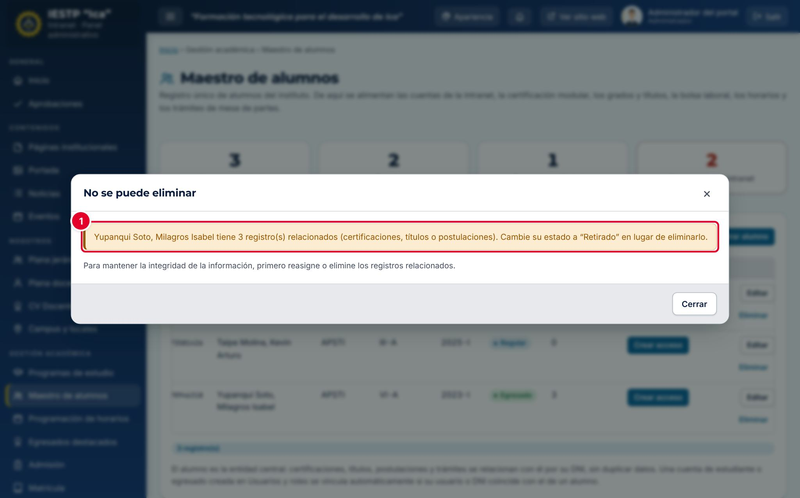

## Buenas prácticas

- Registra los módulos formativos de cada programa al inicio, con los mismos códigos y nombres del plan de estudios.
- Registra la certificación en cuanto se emita el certificado físico, con su mismo número: así la consulta pública coincide con el documento impreso.
- No elimines certificaciones: si hay un error, edítala; si el certificado se anuló, anúlalo en **Verificación de documentos** con el motivo.
- Revisa cada mes la pestaña **Reportes** para detectar estudiantes con módulos pendientes.
