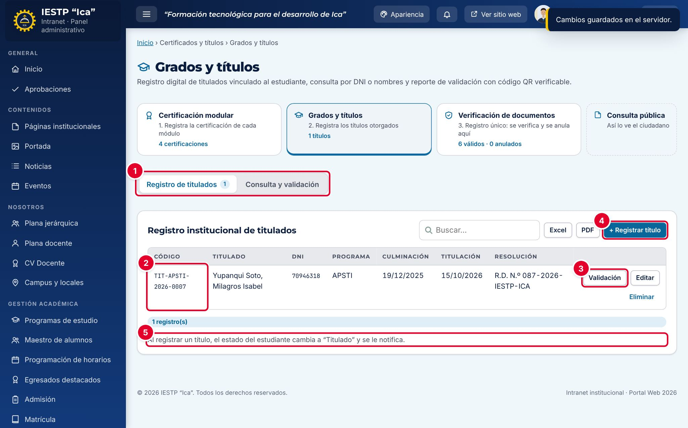
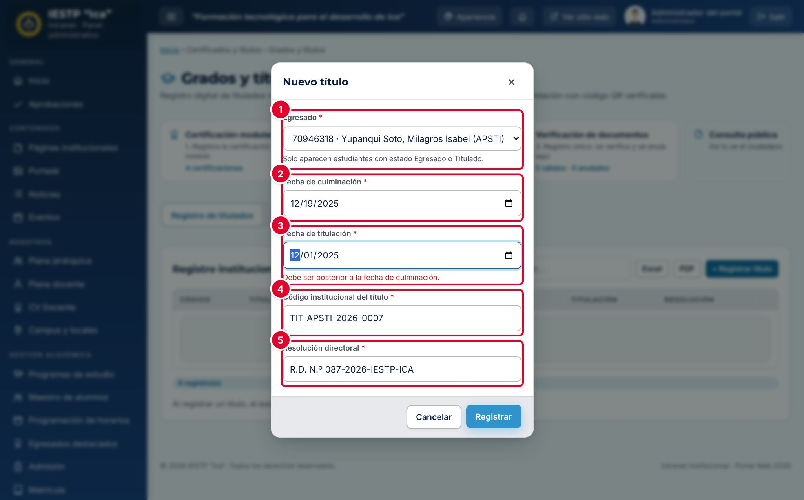
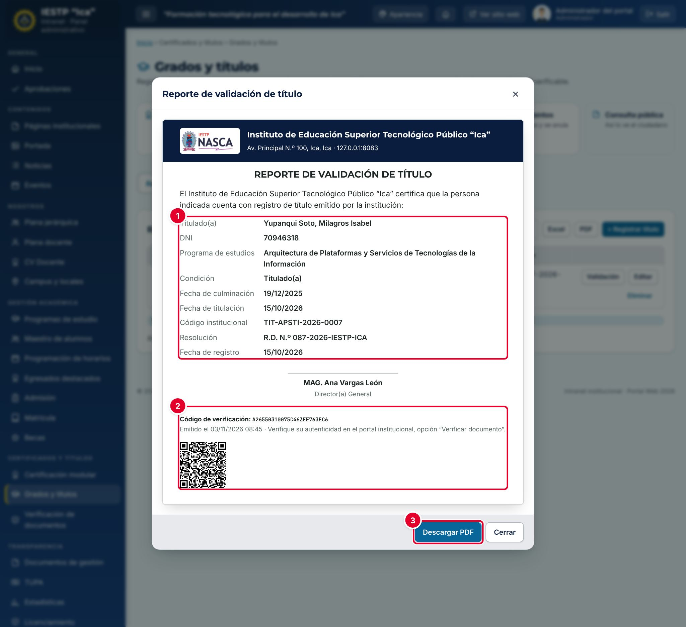
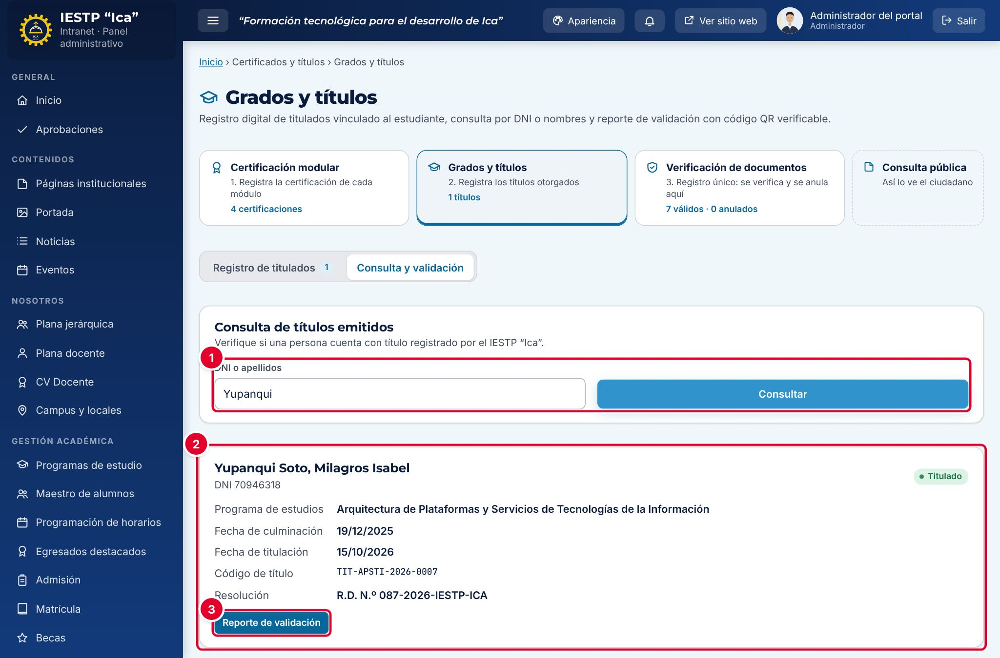
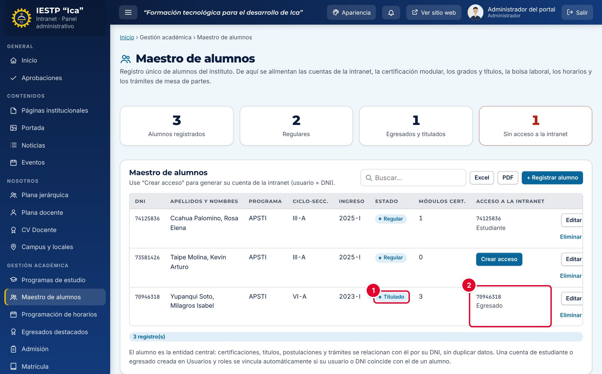
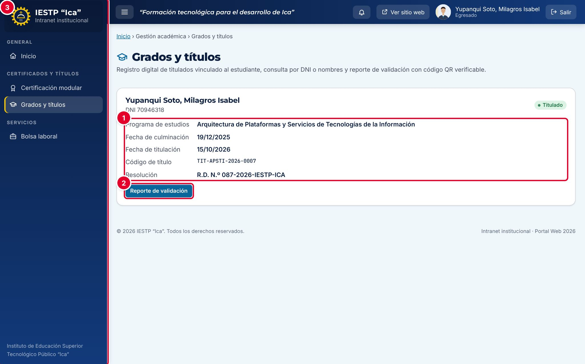
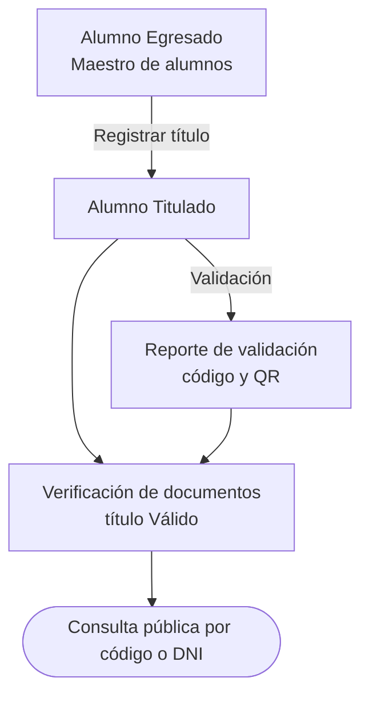

# 17 · Grados y títulos

## Para qué sirve

Este módulo es el registro institucional de titulados. Por cada egresado que obtiene su título se registran las fechas de culminación y de titulación, el código institucional del título y la resolución directoral. Desde aquí se emite el **Reporte de validación de título**, con código de verificación y código QR.

Cada título registrado se publica automáticamente en **Verificación de documentos** (capítulo 18): cualquier persona puede comprobarlo en el portal con el código del título o el DNI del titulado.

## Quién lo usa

| Rol | Puede |
|---|---|
| Administrador | Todo, incluida la **eliminación** |
| Secretaría académica | Registrar y editar títulos, consultar y emitir reportes de validación |
| Directivo | Consultar los títulos (sin registrar ni editar) |
| Egresado | Ver su propio título y emitir su reporte de validación |

## Cómo se llega

Menú lateral › **Certificados y títulos** › **Grados y títulos**. Ruta: `#/admin/ix-titulos`

## Pantalla principal

| N.º | Elemento | Para qué sirve |
|---|---|---|
| 1 | Pestañas | **Registro de titulados** (con el total) y **Consulta y validación**. |
| 2 | **Código** | Código institucional del título. Es también su código en la consulta pública. |
| 3 | **Validación** | Emite el Reporte de validación de título. |
| 4 | **+ Registrar título** | Abre el formulario. |
| 5 | Nota | Recuerda que, al registrar un título, el estado del estudiante cambia a «Titulado» y se le notifica. |

La tabla también tiene **Buscar…**, **Excel** y **PDF**, y los botones **Editar** y **Eliminar** en cada fila.

## Formulario

| N.º | Campo | Obligatorio | Formato o límite |
|---|---|---|---|
| 1 | **Egresado** | Sí | Solo aparecen alumnos con estado **Egresado** o **Titulado** en el Maestro de alumnos. Un egresado solo puede tener un título |
| 2 | **Fecha de culminación** | Sí | Fecha en que culminó sus estudios |
| 3 | **Fecha de titulación** | Sí | Igual o posterior a la culminación. Por defecto, hoy. En la captura se ve el error «Debe ser posterior a la fecha de culminación.» |
| 4 | **Código institucional del título** | Sí | Único. Se guarda en mayúsculas. Ej.: TIT-APSTI-2026-0007 |
| 5 | **Resolución directoral** | Sí | Ej.: R.D. N.º 087-2026-IESTP-ICA |

## Procedimientos

### Registrar un título

1. Verifica que el alumno tenga el estado **Egresado** en el Maestro de alumnos (capítulo 10). Si no aparece en la lista **Egresado**, edítalo allí.
2. Pulsa **+ Registrar título**.
3. Elige el **Egresado** y completa las fechas, el código del título y la resolución directoral.
4. Pulsa **Registrar**.

Aparece «Cambios guardados en el servidor.». El título se agrega al registro, el estado del alumno cambia a **Titulado**, el egresado recibe una notificación en su intranet y el título queda disponible en la consulta pública.

### Emitir el reporte de validación

1. En la fila del título, pulsa **Validación** (o **Reporte de validación** en la pestaña **Consulta y validación**).
2. Revisa el documento y pulsa **Descargar PDF**.

| N.º | Elemento | Descripción |
|---|---|---|
| 1 | Datos del título | Titulado, DNI, programa, condición, fechas, código institucional y resolución. |
| 2 | **Código de verificación** y QR | Código único del reporte. El QR abre la consulta pública con ese código. |
| 3 | **Descargar PDF** | Descarga el reporte, listo para imprimir o enviar. |

El formato (logotipos, encabezado, firma y pie) se configura en **Configuración académica** › **Constancias y reportes** (capítulo 32).

### Consultar un título

1. Abre la pestaña **Consulta y validación**.
2. Escribe el **DNI o apellidos** (mínimo 3 caracteres) ① y pulsa **Consultar**.
3. Se muestra la ficha del titulado ② con su **Reporte de validación** ③. Si no hay resultados, aparece «No existe registro de título emitido por el … para "…"».

### Corregir o eliminar un título

Usa **Editar** para corregir un dato. Solo el administrador puede **eliminar** un título, y no se puede eliminar si ya se emitió un reporte de validación con él: primero hay que anular ese reporte en **Verificación de documentos**. Al eliminar un título, su registro de verificación pasa a **Anulado** con el motivo «Retirado del registro académico».

> Eliminar el título **no** devuelve al alumno al estado Egresado. Si corresponde, cámbialo manualmente en el Maestro de alumnos.

## Lo que ve el egresado

Después del registro, el estado del alumno es **Titulado** ① y, si aún no tiene cuenta, se le puede crear desde el Maestro de alumnos ②; se crea con el rol **Egresado**.

El egresado entra a **Grados y títulos** ③ y ve su ficha con los datos del título ① y el botón **Reporte de validación** ②, para descargar su propio reporte con código QR. Si aún no tiene título registrado, ve «Aún no tiene un título registrado.» y un enlace a la Mesa de partes para seguir su expediente de titulación.

## Flujo y estados

| Estado del alumno | Significado | Puede recibir un título |
|---|---|---|
| Regular | Estudia actualmente | No |
| Egresado | Culminó sus estudios | Sí |
| Titulado | Tiene un título registrado | No: ya tiene uno |

## Resultado en el portal público

El título se verifica en **Servicios** › **Consulta de certificados** (`{{inst.dominio}}/#/servicios/consulta-certificados`) con el código del título (por ejemplo, `TIT-APSTI-2026-0007`), con el código del reporte de validación o con el DNI del titulado. Ver el capítulo 18.

## Mensajes y problemas frecuentes

| Mensaje o situación | Causa | Qué hacer |
|---|---|---|
| El alumno no aparece en **Egresado** | Su estado no es Egresado ni Titulado | Cambia su estado en el Maestro de alumnos |
| «Este egresado ya tiene un título registrado.» | Ya existe un título para ese alumno | Edita el título existente |
| «Debe ser posterior a la fecha de culminación.» | La fecha de titulación es anterior a la de culminación | Corrige las fechas |
| «Ya existe un registro con este valor.» | El código del título ya se usó | Usa el código correcto |
| «El título requiere un egresado y fechas válidas.» | El servidor rechazó el registro por el estado o las fechas | Revisa el estado del alumno y las fechas |
| «El registro tiene documentos emitidos. Anula el documento antes de retirar su origen.» | Se intentó eliminar un título con un reporte de validación emitido | Anula el reporte en **Verificación de documentos** |

## Buenas prácticas

- Registra el título el mismo día en que se emite la resolución directoral, con el mismo código del diploma.
- Revisa el DNI y el nombre en el Maestro de alumnos antes de registrar: el reporte de validación los toma de allí.
- Entrega al egresado el reporte de validación en PDF; con el QR, cualquier empleador puede comprobarlo en el portal.
- No elimines títulos para corregirlos: usa **Editar**.
