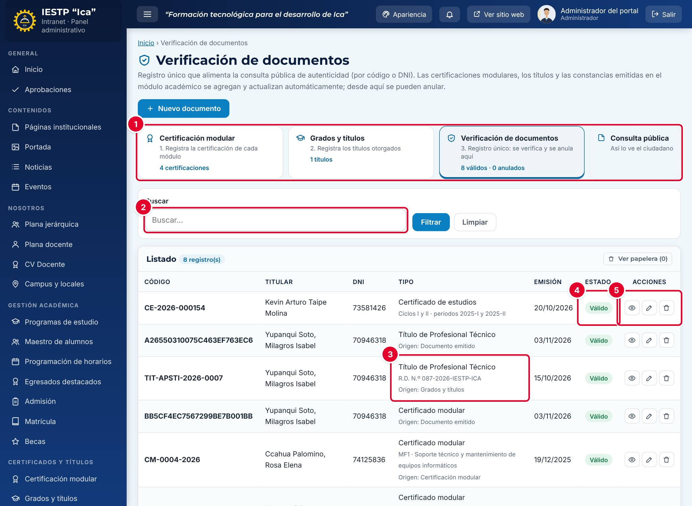
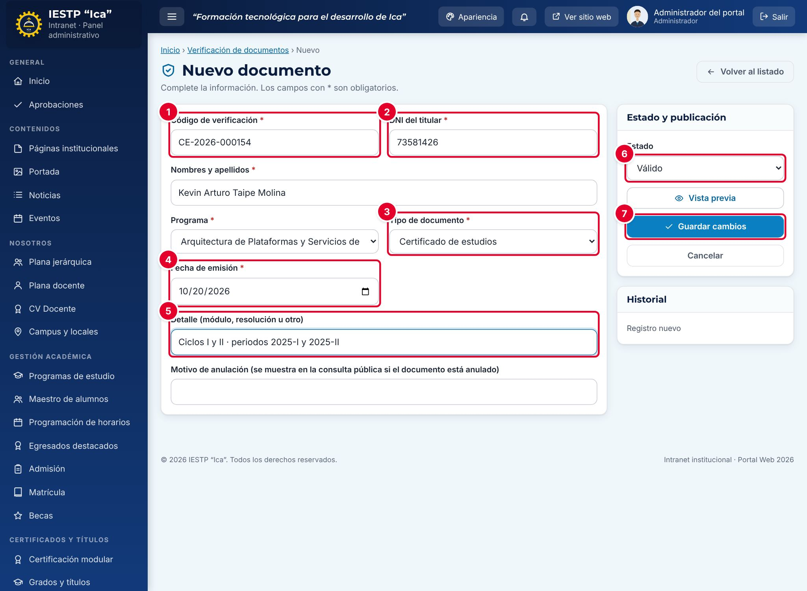
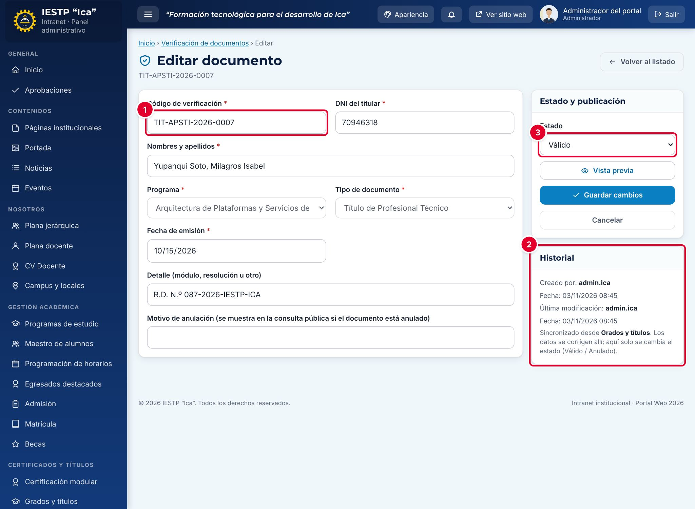
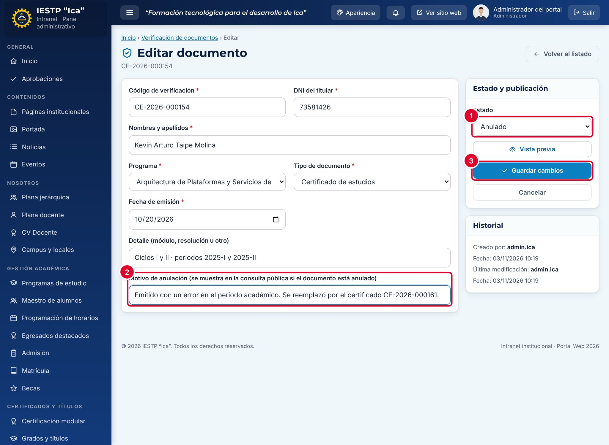
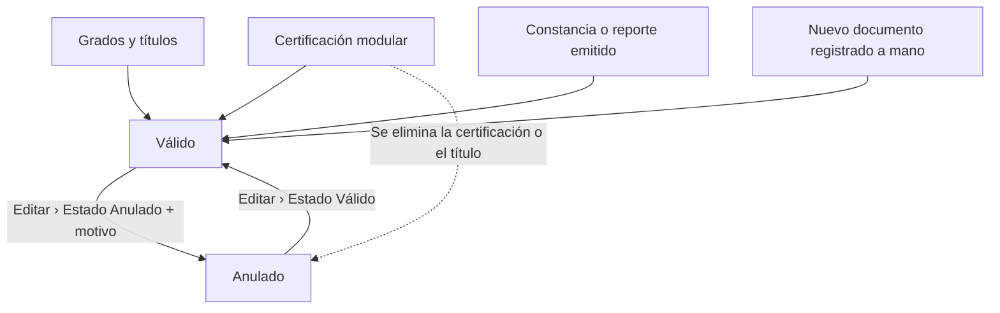
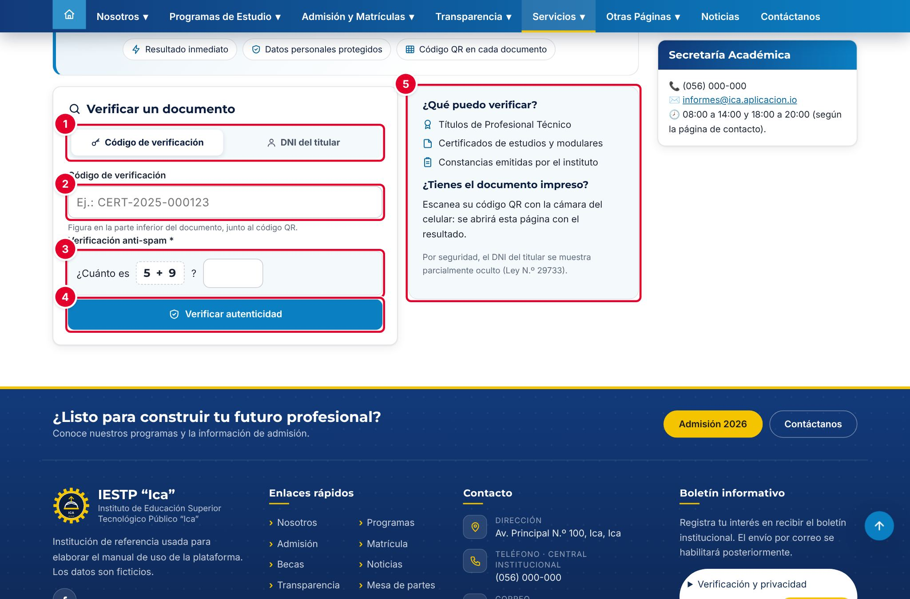
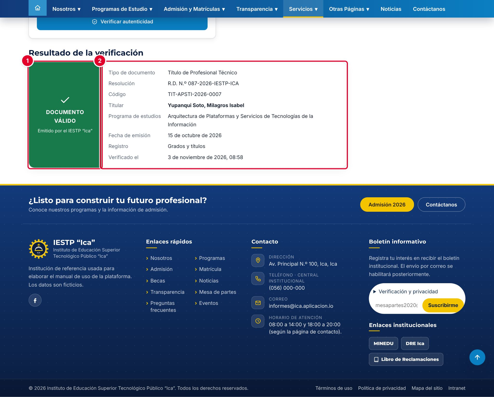
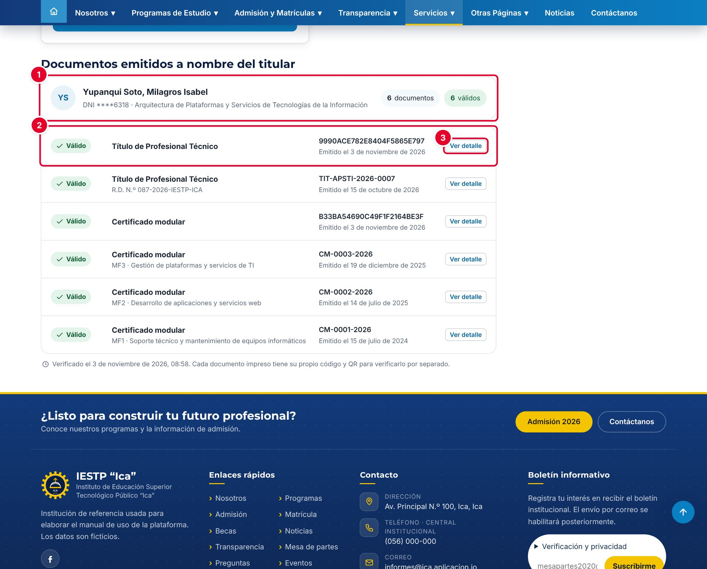
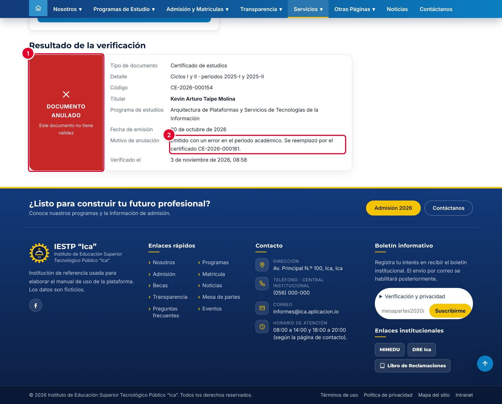

# 18 · Verificación de documentos

## Para qué sirve

**Verificación de documentos** es el registro único de los documentos que emite el instituto y que cualquier persona puede verificar en el portal: certificaciones modulares, títulos, constancias y reportes de validación. Se alimenta solo desde Certificación modular (capítulo 16) y Grados y títulos (capítulo 17), y además permite registrar a mano documentos emitidos fuera del sistema (por ejemplo, certificados de estudios).

Desde aquí se **anula** un documento: la consulta pública lo muestra entonces como «DOCUMENTO ANULADO», con el motivo.

La página pública **Consulta de certificados** permite verificar un documento por su **código de verificación** (o escaneando su código QR) o listar todos los documentos de una persona por su **DNI**.

## Quién lo usa

| Rol | Puede |
|---|---|
| Administrador | Todo: registrar, editar, anular, enviar a la papelera, restaurar y **eliminar definitivamente** |
| Secretaría académica | Registrar, editar, anular, enviar a la papelera y restaurar |
| Ciudadano (sin cuenta) | Verificar documentos en el portal por código o DNI |

## Cómo se llega

- Intranet: menú lateral › **Certificados y títulos** › **Verificación de documentos**. Ruta: `#/admin/certificados`
- Portal: menú **Servicios** › **Consulta de certificados**. Ruta: `{{inst.dominio}}/#/servicios/consulta-certificados`

## Pantalla principal

| N.º | Elemento | Para qué sirve |
|---|---|---|
| 1 | Accesos del grupo | Certificación modular, Grados y títulos, Verificación de documentos (con el número de válidos y anulados) y **Consulta pública**. |
| 2 | **Buscar** | Busca por código, DNI o nombre. Pulsa **Filtrar** para aplicar y **Limpiar** para quitar el filtro. |
| 3 | **Tipo** | Tipo de documento, su detalle (módulo o resolución) y su **Origen**: Certificación modular, Grados y títulos o Documento emitido. Los registrados a mano no tienen origen. |
| 4 | **Estado** | **Válido** o **Anulado**. |
| 5 | Acciones | Vista previa (abre la consulta pública), Editar y Eliminar (envía a la papelera). |

**+ Nuevo documento** registra un documento a mano y **Ver papelera** muestra los eliminados.

Los registros se crean y actualizan solos:

| Se registra en | Aparece aquí como | Código de verificación |
|---|---|---|
| Certificación modular › Certificaciones | Certificado modular · origen Certificación modular | El N.º de certificado (ej.: CM-0001-2026) |
| Grados y títulos | Título de Profesional Técnico · origen Grados y títulos | El código del título (ej.: TIT-APSTI-2026-0007) |
| Constancia de certificación modular emitida | Certificado modular · origen Documento emitido | El código impreso en la constancia |
| Reporte de validación de título emitido | Título de Profesional Técnico · origen Documento emitido | El código impreso en el reporte |

> **Incidencia detectada al elaborar este manual (versión actual de la plataforma)**
> Las **constancias** y los **reportes de validación** emitidos se registran con el mismo tipo que el documento de origen («Certificado modular» y «Título de Profesional Técnico») y sin detalle. Por eso, en la consulta pública por DNI (captura 18-07), una persona con un título y un reporte de validación aparece con **dos** «Título de Profesional Técnico». El dato es correcto (son dos documentos verificables distintos), pero puede confundir a quien consulta. Ya se reportó para su corrección. Mientras tanto, si alguien pregunta, explica que el documento con código largo (24 caracteres) es el reporte de validación o la constancia.

## Formulario

Pulsa **+ Nuevo documento**. Úsalo solo para documentos que **no** se emiten desde Certificación modular ni Grados y títulos (por ejemplo, certificados de estudios o constancias de egresado).

| N.º | Campo | Obligatorio | Formato o límite |
|---|---|---|---|
| 1 | **Código de verificación** | Sí | Único. Se guarda en mayúsculas. Debe coincidir con el código impreso en el documento. Ej.: CE-2026-000154 |
| 2 | **DNI del titular** y **Nombres y apellidos** | Sí | DNI de 8 dígitos |
| 3 | **Programa** y **Tipo de documento** | Sí | Tipos: Constancia de certificación modular, Reporte de validación de título, Título de Profesional Técnico, Certificado de estudios, Certificado modular (MP01, MP02, MP03), Constancia de egresado |
| 4 | **Fecha de emisión** | Sí | Fecha del documento |
| 5 | **Detalle** | No | Módulo, resolución, ciclos u otro dato que ayude a identificarlo |
| 6 | **Estado** | Sí | Válido o Anulado. El campo **Motivo de anulación** se usa al anular |
| 7 | **Guardar cambios** | — | Guarda el documento. **Vista previa** muestra cómo se verá en la consulta pública |

## Procedimientos

### Revisar un documento sincronizado

Al editar un documento que viene de Certificación modular o Grados y títulos, los datos ① (código, DNI, nombres, programa, tipo, fecha y detalle) **no se pueden cambiar aquí**: el recuadro **Historial** ② indica «Sincronizado desde … Los datos se corrigen allí; aquí solo se cambia el estado (Válido / Anulado).». Solo puedes cambiar el **Estado** ③ y el motivo de anulación.

### Anular un documento

1. Pulsa **Editar** en la fila del documento.
2. En **Estado** ①, elige **Anulado**.
3. Escribe el **Motivo de anulación** ②. Se muestra en la consulta pública.
4. Pulsa **Guardar cambios** ③.

El documento sigue en el registro, con el estado **Anulado**. Para revertir la anulación, vuelve a ponerlo en **Válido**.

### Eliminar y restaurar

**Eliminar** envía el documento a la papelera y deja de mostrarse en la consulta pública. Desde **Ver papelera** se restaura. Solo el administrador puede eliminar definitivamente. Prefiere **anular** antes que eliminar: la anulación informa al ciudadano que el documento existió y ya no es válido.

## Flujo y estados

| Estado | Significado | Visible en el portal |
|---|---|---|
| Válido | Documento auténtico y vigente | Sí: «DOCUMENTO VÁLIDO» |
| Anulado | Documento anulado o retirado del registro académico | Sí: «DOCUMENTO ANULADO», con el motivo |
| En papelera | Eliminado | No: la consulta dice «NO SE ENCONTRÓ EL DOCUMENTO» |

## Resultado en el portal público

| N.º | Elemento | Descripción |
|---|---|---|
| 1 | Buscar por | **Código de verificación** o **DNI del titular**. |
| 2 | Código o DNI | El código figura al pie del documento, junto al QR (incluye los guiones). El DNI debe tener 8 dígitos. |
| 3 | **Verificación anti-spam** | Suma sencilla para evitar consultas automáticas. |
| 4 | **Verificar autenticidad** | Realiza la consulta. |
| 5 | Ayuda | Qué se puede verificar y cómo usar el código QR. |

Al escanear el QR de una constancia o un reporte, la página se abre con el código ya escrito y muestra el resultado directamente.

Con el código, el portal muestra el sello **DOCUMENTO VÁLIDO** ① y los datos del documento ②: tipo, resolución o detalle, código, titular, programa, fecha de emisión, registro de origen y la fecha y hora de la verificación.

Con el DNI, el portal lista todos los documentos del titular: su nombre, el DNI parcialmente oculto (Ley N.º 29733), el total de documentos válidos y anulados ①, cada documento con su estado ② y **Ver detalle** ③ para verificarlo por separado. Si la persona tiene solicitudes de certificados o constancias en trámite en la Mesa de Partes Virtual, también se informa.

Un documento anulado aparece en rojo como **DOCUMENTO ANULADO** ① con el **Motivo de anulación** ②.

## Mensajes y problemas frecuentes

| Mensaje o situación | Causa | Qué hacer |
|---|---|---|
| «NO SE ENCONTRÓ EL DOCUMENTO» | El código está mal escrito (faltan guiones), el documento está en la papelera o nunca se registró | Verifica el código en la intranet. Si es un documento antiguo, regístralo con **+ Nuevo documento** |
| «El código de verificación ya pertenece a otro documento. Usa un código único.» | Ya existe un documento con ese código | Revisa el código |
| «El DNI debe tener 8 dígitos.» | El DNI está incompleto | Corrígelo |
| Los datos de una certificación o un título están mal | Se corrigen en su módulo de origen | Edítalos en Certificación modular o Grados y títulos: el registro se actualiza solo |
| «Demasiados intentos. Espera unos minutos antes de continuar.» | Se hicieron más de 10 consultas en un minuto desde la misma conexión | Espera un minuto |

## Buenas prácticas

- Anula un documento apenas se detecte un error o un reemplazo, y escribe en el motivo qué documento lo reemplaza.
- Registra a mano solo documentos que no se emiten desde el sistema, con el mismo código impreso en el papel.
- Prueba cada cierto tiempo la consulta pública con un QR impreso para comprobar que funciona.
- No compartas la lista completa de documentos: contiene datos personales (Ley N.º 29733).
