# 19 · Documentos de gestión

## Para qué sirve

En este módulo se publican los documentos de gestión de la institución: planes (PEI, PAT), reglamentos, manuales, directivas, resoluciones e informes, cada uno con su archivo PDF. El módulo guarda las **versiones** de cada documento: al publicar una versión nueva, la anterior pasa a **Histórico** y sigue disponible para consulta.

Lo publicado aparece en el portal, en **Transparencia** › **Documentos de Gestión**. Es parte de la información que la institución difunde en cumplimiento de la Ley N.º 27806, Ley de Transparencia y Acceso a la Información Pública.

## Quién lo usa

| Rol | Puede |
|---|---|
| Administrador | Todo: crear, editar, publicar directamente, aprobar o devolver lo que envía Transparencia, enviar a la papelera, restaurar y **eliminar definitivamente** |
| Transparencia / administración | Crear y editar documentos, cargar versiones nuevas y gestionar las categorías. **No publica directamente**: al elegir **Publicado** o **Histórico**, el documento se envía a aprobación del Administrador |

## Cómo se llega

Menú lateral › **Transparencia** › **Documentos de gestión**. Ruta: `#/admin/documentos`

Las aprobaciones pendientes están en menú lateral › **General** › **Aprobaciones** (solo el Administrador). Ruta: `#/admin/aprobaciones`

## Pantalla principal

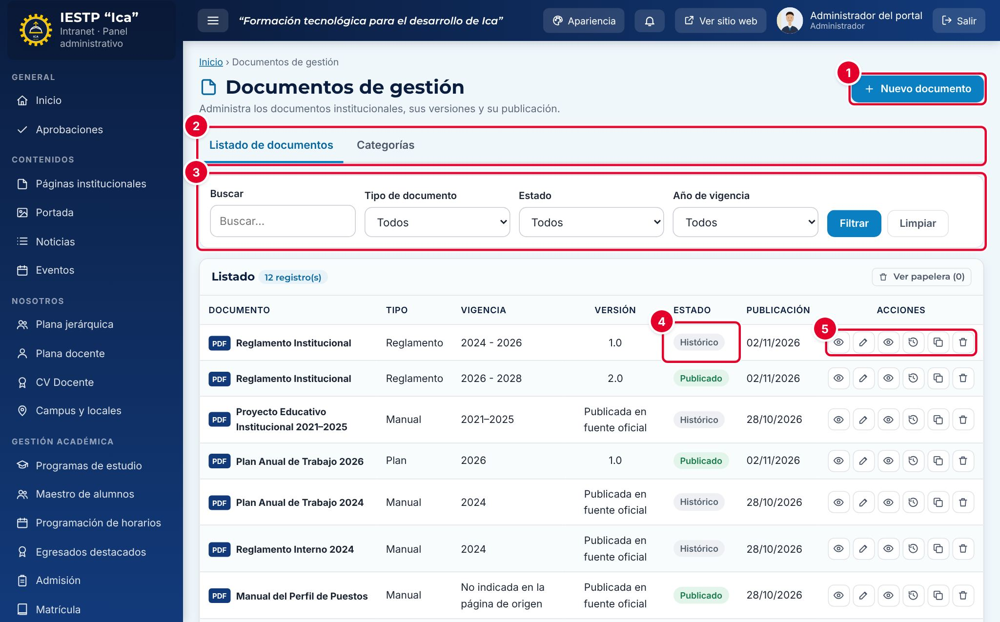

| N.º | Elemento | Para qué sirve |
|---|---|---|
| 1 | **Nuevo documento** | Abre el formulario para registrar un documento. |
| 2 | Pestañas **Listado de documentos / Categorías** | Cambian entre los documentos y los tipos de documento. |
| 3 | Filtros | Buscan por nombre o descripción, y filtran por **Tipo de documento**, **Estado** y **Año de vigencia**. Pulsa **Filtrar** para aplicarlos y **Limpiar** para quitarlos. |
| 4 | **Estado** | **Borrador**, **En revisión**, **Publicado** (vigente) o **Histórico** (versión anterior). |
| 5 | Acciones de la fila | En orden: **Vista previa** (cómo se verá en el portal), **Editar**, **Ver archivo** (abre el PDF), **Historial de versiones**, **Nueva versión** y **Eliminar** (envía a la papelera). |

El listado se ordena por el campo **Orden de presentación**. **Ver papelera** muestra los documentos eliminados, que se pueden restaurar.

## Formulario

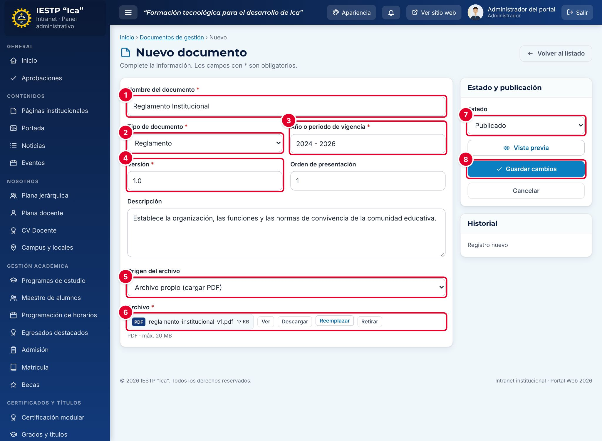

| N.º | Campo | Para qué sirve |
|---|---|---|
| 1 | **Nombre del documento** | Nombre con el que aparece en el portal. Todas las versiones de un mismo documento llevan el mismo nombre. |
| 2 | **Tipo de documento** | Categoría (Plan, Reglamento, Manual, Directiva, Resolución, Informe u otra que crees). |
| 3 | **Año o periodo de vigencia** | Un año (2026) o un periodo (2024 - 2028). |
| 4 | **Versión** | Número de la versión, por ejemplo 1.0. |
| 5 | **Origen del archivo** | **Archivo propio (cargar PDF)** o la referencia al Reglamento de Admisión vigente, que se administra en el módulo Admisión. |
| 6 | **Archivo** | PDF del documento. Usa **Ver**, **Descargar**, **Reemplazar** o **Retirar**. |
| 7 | **Estado** | **Borrador**, **Publicado** o **Histórico**. |
| 8 | **Guardar cambios** | Guarda el documento. |

| Campo | Obligatorio | Formato o límite | Ejemplo |
|---|---|---|---|
| Nombre del documento | Sí | Texto | Reglamento Institucional |
| Tipo de documento | Sí | Una categoría activa | Reglamento |
| Año o periodo de vigencia | Sí | Año o periodo | 2024 - 2026 |
| Versión | Sí | Texto. Se propone 1.0 | 1.0 |
| Orden de presentación | No | Número desde 1. Ordena el listado y el portal | 1 |
| Descripción | No | Texto | Establece la organización… |
| Origen del archivo | No | Archivo propio o referencia al módulo Admisión | Archivo propio (cargar PDF) |
| Archivo | Al publicar | PDF, hasta 20 MB | reglamento-institucional-v1.pdf |
| Estado | Sí | Borrador, Publicado o Histórico | Borrador |

## Procedimientos

### Registrar y publicar un documento (Administrador)

1. Pulsa **Nuevo documento**.
2. Completa **Nombre del documento** ①, **Tipo de documento** ②, **Año o periodo de vigencia** ③ y **Versión** ④.
3. Deja **Origen del archivo** ⑤ en **Archivo propio (cargar PDF)** y pulsa **Cargar archivo** ⑥ para subir el PDF.
4. Elige el **Estado** ⑦: **Borrador** si aún no debe verse, o **Publicado**.
5. Pulsa **Guardar cambios** ⑧. Aparece «Cambios guardados.».

Si eliges **Publicado** y ya existe otra versión publicada del mismo documento (mismo nombre), esa versión pasa sola a **Histórico**.

### Enviar un documento a aprobación (Transparencia)

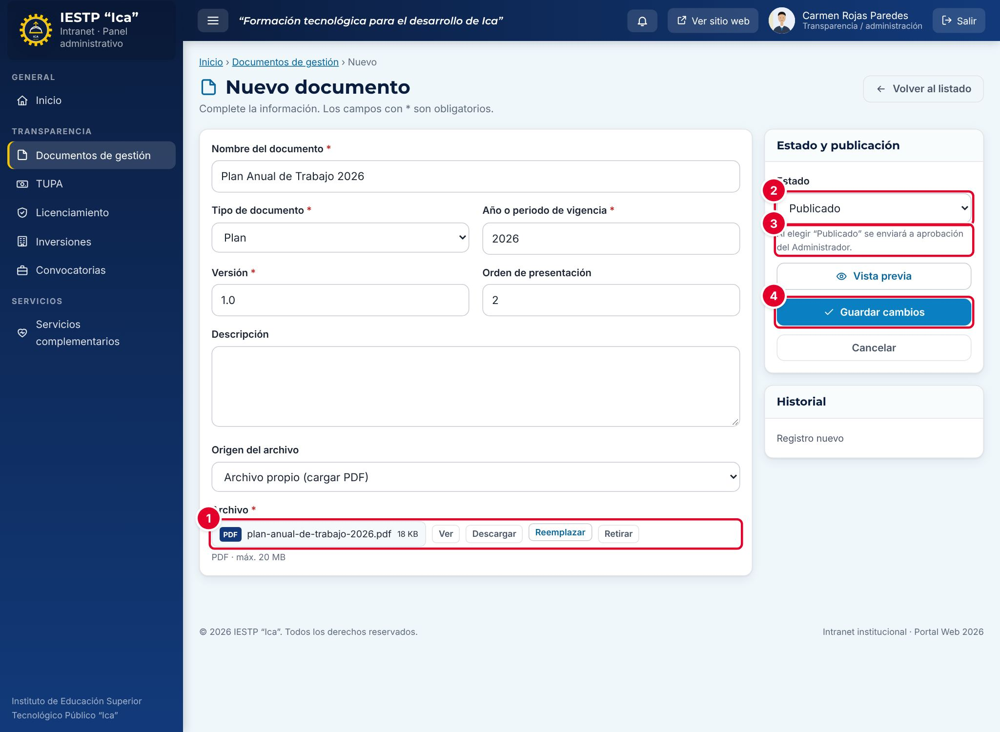

1. Registra el documento como en el procedimiento anterior y carga el PDF ①.
2. En **Estado** ②, elige **Publicado**. Debajo aparece el aviso ③: «Al elegir “Publicado” se enviará a aprobación del Administrador.».
3. Pulsa **Guardar cambios** ④.

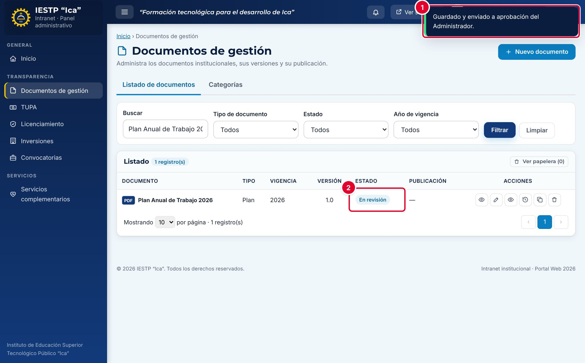

Aparece el aviso «Guardado y enviado a aprobación del Administrador.» ① y el documento queda **En revisión** ②. Un documento en revisión **no se ve en el portal** hasta que el Administrador lo aprueba.

### Aprobar o devolver (Administrador)

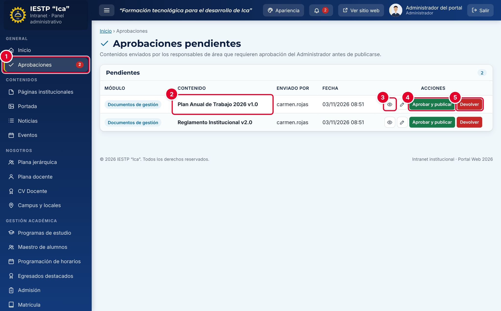

1. En el menú lateral, pulsa **Aprobaciones** ①. El número rojo indica cuántos contenidos esperan aprobación. La campana de la barra superior muestra el mismo número.
2. Revisa el **Contenido** ②: el nombre y la versión, quién lo envió y cuándo.
3. Pulsa **Vista previa** ③ para ver cómo quedará en el portal, o el lápiz (**Abrir**) para revisar el registro completo.
4. Elige una acción:
   - **Aprobar y publicar** ④: confirma en la ventana. El documento pasa a **Publicado** y se ve en el portal.
   - **Devolver** ⑤: el documento vuelve al responsable como **Borrador**, con una observación.

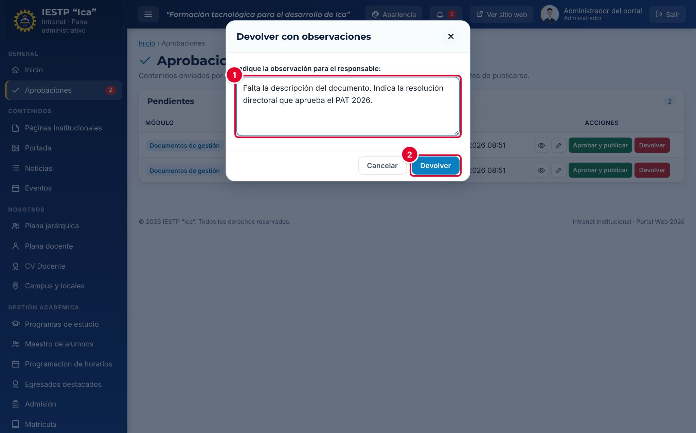

Al devolver, escribe la observación ① (es obligatoria) y pulsa **Devolver** ②.

### Corregir un documento observado (Transparencia)

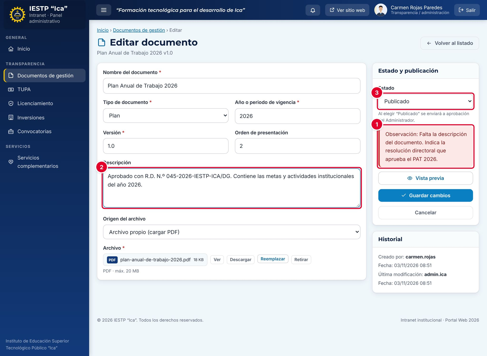

1. Abre el documento con el lápiz (**Editar**). La **Observación** ① aparece en rojo, en el panel **Estado y publicación**.
2. Corrige lo que se indica; en el ejemplo, la **Descripción** ②.
3. Elige otra vez **Publicado** en **Estado** ③ y pulsa **Guardar cambios**. El documento vuelve a **Aprobaciones**.

### Cargar una versión nueva

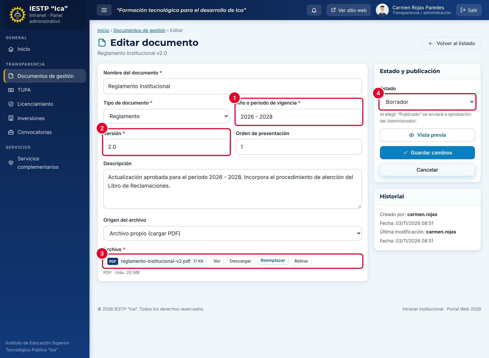

1. En el listado, pulsa **Nueva versión** (ícono de copia) en la fila de la versión vigente.
2. Se crea una copia con el número de versión siguiente y el estado **Borrador**. Aparece el aviso «Se creó la versión 2.0 como borrador. Cargue el archivo y publíquela.» y se abre el formulario.
3. Actualiza el **Año o periodo de vigencia** ①. Revisa la **Versión** ② (se propone la siguiente: 2.0, 3.0…).
4. Carga el PDF de la nueva versión ③: la copia no conserva el archivo anterior.
5. Cambia el **Estado** ④ a **Publicado** y pulsa **Guardar cambios**. Si eres de Transparencia, la versión se envía a aprobación.

Cuando la nueva versión se publica, la anterior pasa sola a **Histórico**.

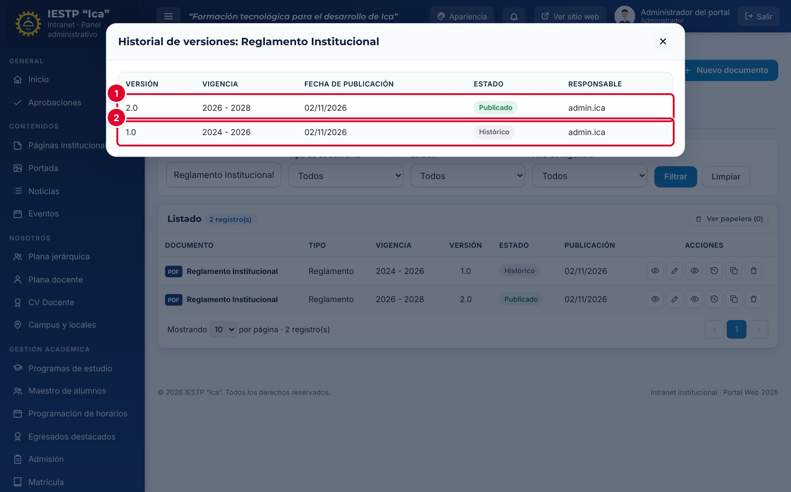

El botón **Historial de versiones** muestra todas las versiones del documento: la vigente ① y las anteriores ②, con su vigencia, la fecha de publicación, el estado y el responsable.

> **Incidencia detectada al elaborar este manual (versión actual de la plataforma)**
> La **fecha de publicación** de los documentos se muestra **un día antes** de la real en la columna **Publicación** del listado y en el **Historial de versiones**. Por ejemplo, un documento publicado el 3/11/2026 aparece con 02/11/2026. La fecha se guarda bien; el error está solo en cómo se muestra con la hora del Perú. Tenlo en cuenta al revisar o informar fechas de publicación.

### Registrar una versión antigua como Histórico

Para subir al portal una versión que ya no está vigente (por ejemplo, el PEI anterior), registra el documento con **Estado: Histórico**. Si lo hace el Administrador, queda publicado como histórico. Si lo hace Transparencia, se envía a aprobación.

> **Incidencia detectada al elaborar este manual (versión actual de la plataforma)**
> Cuando Transparencia envía una versión con **Estado: Histórico** y el Administrador pulsa **Aprobar y publicar**, la versión no queda como Histórico: queda como **Publicado** (vigente), y la versión que sí estaba vigente pasa a **Histórico**. Se comprobó con el Reglamento Institucional: la versión 1.0 enviada como Histórico quedó Publicado y la 2.0 pasó a Histórico. Solución temporal: el Administrador debe registrar él mismo las versiones históricas, o, después de aprobar, editar las dos versiones y corregir su **Estado**.

### Gestionar las categorías

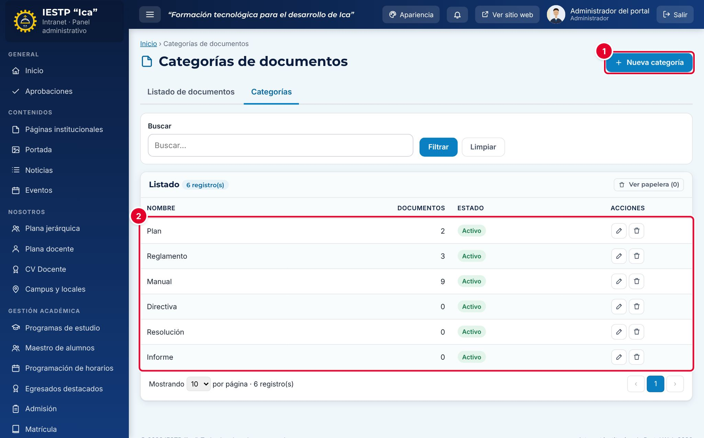

En la pestaña **Categorías** se crean los tipos de documento con **Nueva categoría** ① y se editan o desactivan en el listado ②. La columna **Documentos** indica cuántos documentos usa cada una.

- Una categoría **Inactiva** ya no se ofrece en el formulario, pero sus documentos se conservan.
- No se puede eliminar una categoría con documentos: aparece «Hay documentos asociados. Desactive la categoría en lugar de eliminarla.».

### Eliminar y restaurar

1. Pulsa la papelera (**Eliminar**) de la fila y confirma. El documento deja de verse en el portal.
2. Para recuperarlo, pulsa **Ver papelera** y luego **Restaurar**.
3. Solo el **Administrador** puede **Eliminar definitivamente**, con doble confirmación. Esta acción no se puede deshacer.

## Flujo y estados

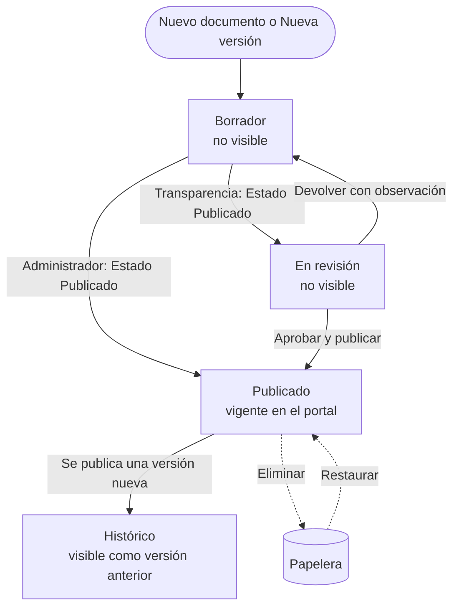

| Estado | Significado | Visible en el portal |
|---|---|---|
| Borrador | En preparación, o devuelto con observación | No |
| En revisión | Enviado por Transparencia; espera la aprobación del Administrador | No |
| Publicado | Versión vigente | **Sí**, en «Vigentes» |
| Histórico | Versión anterior, reemplazada por una más reciente | **Sí**, en «Históricos» |
| En papelera | Eliminado; se puede restaurar | No |

## Resultado en el portal público

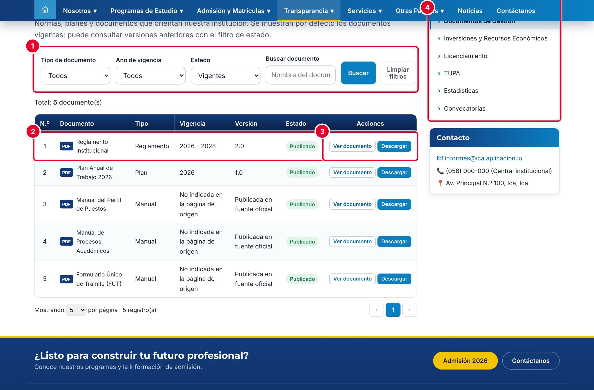

En `{{inst.dominio}}/#/transparencia/documentos-gestion` el público ve los documentos vigentes. Puede filtrarlos por tipo, año de vigencia, estado y nombre ①. Cada fila ② muestra el tipo, la vigencia, la versión y el estado, con los botones **Ver documento** y **Descargar** ③. El menú lateral **Transparencia** ④ lleva a las demás secciones de transparencia.

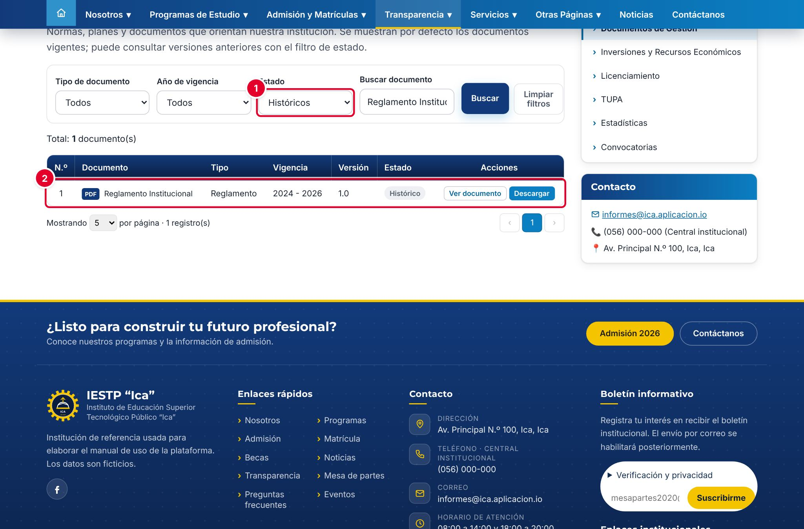

Con el filtro **Estado** en **Históricos** ① se consultan las versiones anteriores ②. Con **Todos** se ven las vigentes y las históricas juntas.

## Mensajes y problemas frecuentes

| Mensaje o situación | Causa | Qué hacer |
|---|---|---|
| «Ya existe esta misma versión del documento (mismo nombre, tipo, vigencia y versión).» | Hay otro registro idéntico | Cambia el número de **Versión** o edita el registro existente |
| «El Reglamento de Admisión ya se administra en el módulo Admisión…» | Se intentó cargar el Reglamento de Admisión como archivo propio | En **Origen del archivo**, elige la referencia al módulo Admisión |
| «Obligatorio para publicar (puede guardarlo como borrador).» | Se eligió Publicado sin cargar el PDF | Carga el **Archivo** o guarda como Borrador |
| «Guardado y enviado a aprobación del Administrador.» | Tu rol (Transparencia) necesita aprobación para publicar | Espera la aprobación. El documento queda **En revisión** |
| El documento está En revisión y no sale en el portal | Falta la aprobación | El Administrador debe revisar **Aprobaciones** |
| En el portal aparece «No disponible» en lugar de los botones | El registro no tiene archivo | Edita el documento y carga el PDF |
| La fecha de publicación sale un día antes | Error de la versión actual | Ver la incidencia de «Cargar una versión nueva» |

## Buenas prácticas

- Usa **siempre el mismo nombre** para todas las versiones de un documento. Así el sistema las agrupa y pasa la anterior a Histórico.
- Usa **Nueva versión** en lugar de reemplazar el PDF de la versión vigente: así el historial queda completo.
- Sube documentos **firmados y escaneados en PDF con texto buscable**, y revisa que se abran con **Ver** antes de publicar.
- Indica en la **Descripción** la resolución que aprueba el documento.
- El Administrador debe revisar **Aprobaciones** al menos una vez por día hábil.
