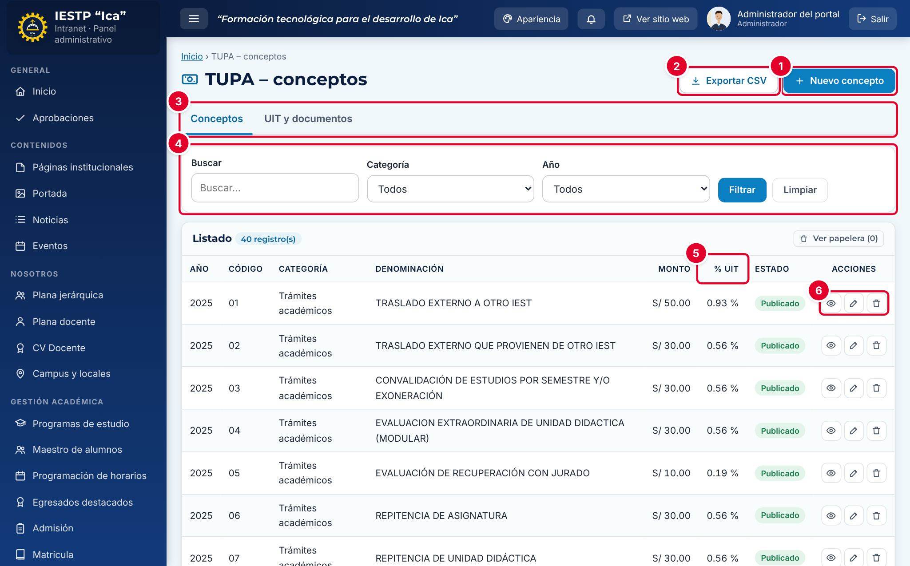
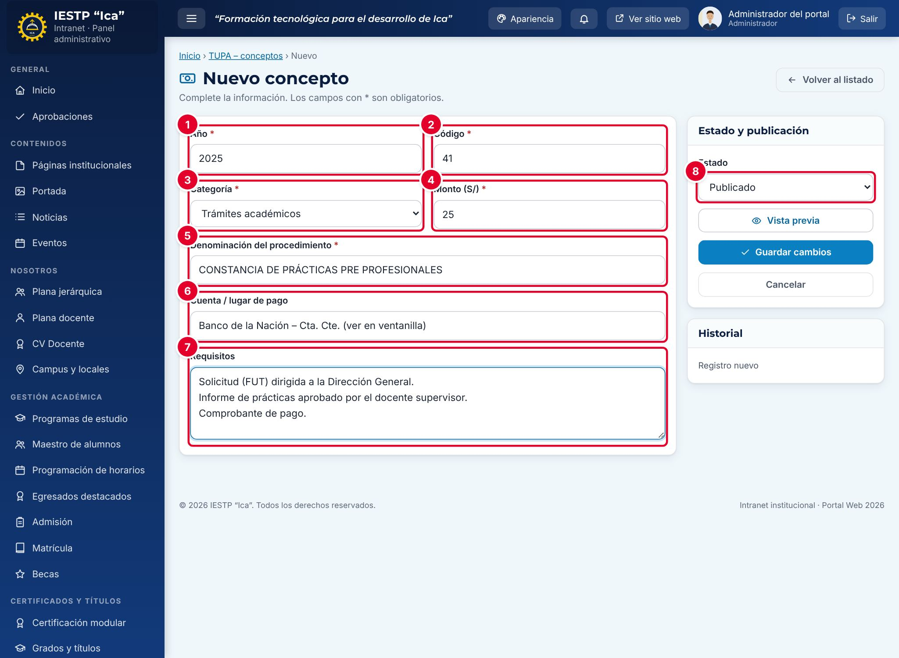
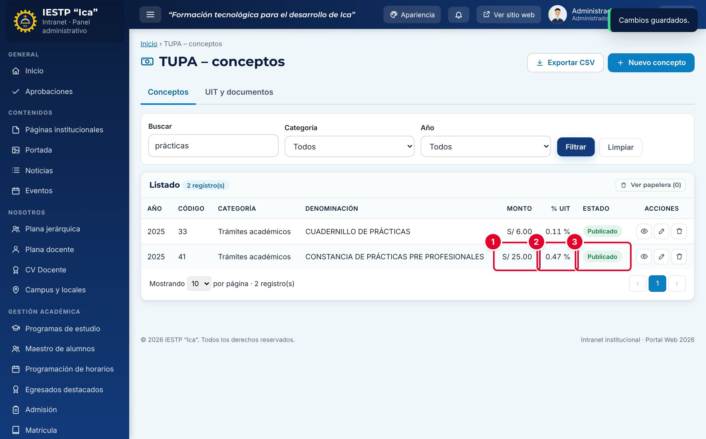
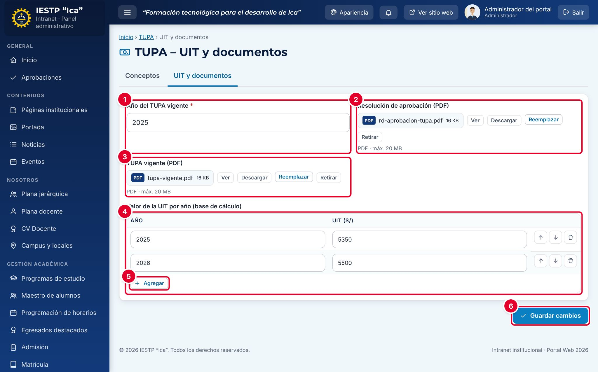
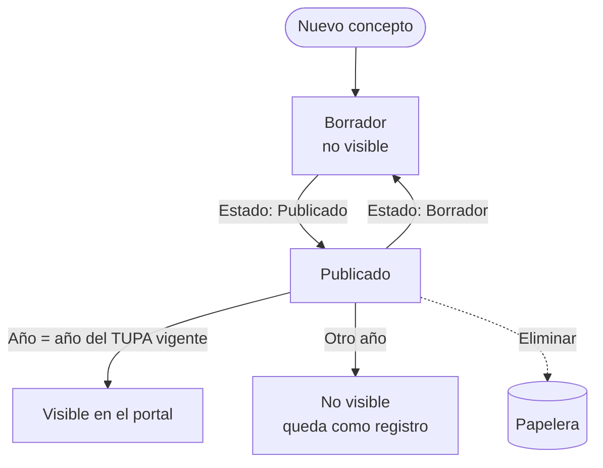
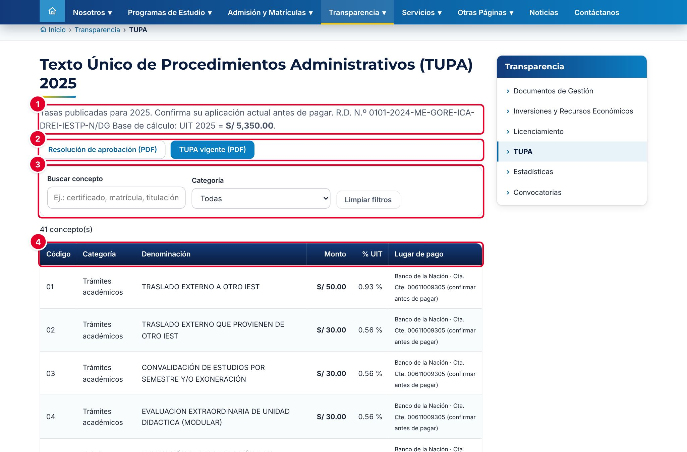
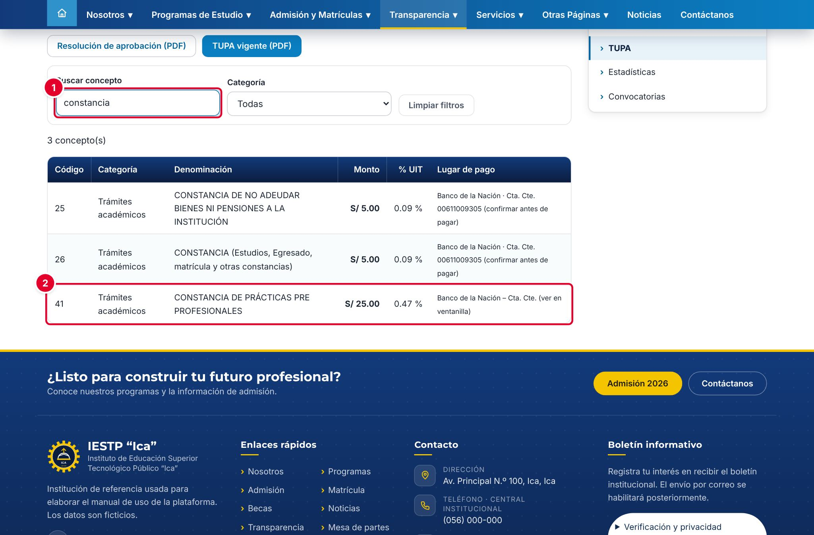

# 20 · TUPA

## Para qué sirve

En este módulo se registran los conceptos del **Texto Único de Procedimientos Administrativos (TUPA)**: el código, la denominación del trámite, el monto, el lugar de pago y los requisitos. También se cargan el TUPA vigente y su resolución de aprobación en PDF, y el valor de la **UIT** de cada año, que el sistema usa para calcular el porcentaje de la UIT de cada tasa.

Lo publicado aparece en el portal, en **Transparencia** › **TUPA**, como parte de la información que la institución difunde en cumplimiento de la Ley N.º 27806, Ley de Transparencia y Acceso a la Información Pública.

## Quién lo usa

| Rol | Puede |
|---|---|
| Administrador | Todo, incluidos el valor de la UIT y la **eliminación definitiva** |
| Transparencia / administración | Crear, editar, publicar, enviar a la papelera y restaurar conceptos; cargar el TUPA y la resolución en PDF. **No puede cambiar el valor de la UIT** (ver la incidencia) |

Los conceptos del TUPA **no requieren aprobación** del Administrador: Transparencia los publica directamente.

## Cómo se llega

Menú lateral › **Transparencia** › **TUPA**. Ruta: `#/admin/tupa`

La pestaña **UIT y documentos** está en `#/admin/tupacfg`.

## Pantalla principal

| N.º | Elemento | Para qué sirve |
|---|---|---|
| 1 | **Nuevo concepto** | Abre el formulario para registrar una tasa. |
| 2 | **Exportar CSV** | Descarga los conceptos del listado (año, código, categoría, denominación, monto y cuenta) para abrirlos en Excel. |
| 3 | Pestañas **Conceptos / UIT y documentos** | Cambian entre los conceptos y la configuración de la UIT y los PDF. |
| 4 | Filtros | Buscan por código o denominación, y filtran por **Categoría** y **Año**. |
| 5 | **% UIT** | Porcentaje que representa el monto respecto de la UIT del año del concepto. Se calcula solo. Si no hay UIT registrada para ese año, se muestra «—». |
| 6 | Acciones de la fila | **Vista previa**, **Editar** y **Eliminar** (envía a la papelera). |

## Formulario

| N.º | Campo | Para qué sirve |
|---|---|---|
| 1 | **Año** | Año del TUPA al que pertenece el concepto. Se propone el año del TUPA vigente. |
| 2 | **Código** | Número o código del procedimiento en el TUPA. |
| 3 | **Categoría** | Grupo del concepto: Admisión, Matrícula, Titulación, Trámites académicos, etc. |
| 4 | **Monto (S/)** | Importe en soles. |
| 5 | **Denominación del procedimiento** | Nombre del trámite tal como figura en el TUPA. |
| 6 | **Cuenta / lugar de pago** | Dónde se paga. Se propone «Banco de la Nación – Cta. Cte. (ver en ventanilla)». |
| 7 | **Requisitos** | Lista de requisitos del trámite. |
| 8 | **Estado** | **Borrador** o **Publicado**. |

| Campo | Obligatorio | Formato o límite | Ejemplo |
|---|---|---|---|
| Año | Sí | Número | 2025 |
| Código | Sí | Texto. No se repite dentro del mismo año | 41 |
| Categoría | Sí | Una de la lista | Trámites académicos |
| Monto (S/) | Sí | Número con dos decimales, desde 0 | 25.00 |
| Denominación del procedimiento | Sí | Texto | CONSTANCIA DE PRÁCTICAS PRE PROFESIONALES |
| Cuenta / lugar de pago | No | Texto | Banco de la Nación – Cta. Cte. … |
| Requisitos | No | Texto, uno por línea | Solicitud (FUT)… |
| Estado | Sí | Borrador o Publicado | Publicado |

## Procedimientos

### Registrar un concepto

1. Pulsa **Nuevo concepto**.
2. Revisa el **Año** ①. Escribe el **Código** ② y elige la **Categoría** ③.
3. Escribe el **Monto (S/)** ④ y la **Denominación del procedimiento** ⑤.
4. Revisa la **Cuenta / lugar de pago** ⑥ y escribe los **Requisitos** ⑦.
5. Elige el **Estado** ⑧ y pulsa **Guardar cambios**.

Aparece «Cambios guardados.». En el listado se ven el **Monto** ①, el **% UIT** calculado ② y el **Estado** ③. En el ejemplo, S/ 25.00 equivale al 0.47 % de la UIT 2025 (S/ 5 350).

### Cargar el TUPA y registrar la UIT

1. Abre la pestaña **UIT y documentos**.
2. Revisa el **Año del TUPA vigente** ①. El portal muestra solo los conceptos publicados de ese año.
3. Pulsa **Cargar archivo** en **Resolución de aprobación (PDF)** ② y en **TUPA vigente (PDF)** ③.
4. En **Valor de la UIT por año** ④, revisa que exista una fila con el año del TUPA y su valor en soles. Para un año nuevo, pulsa **Agregar** ⑤ y completa **Año** y **UIT (S/)**.
5. Pulsa **Guardar cambios** ⑥.

El valor de la UIT lo fija cada año el Ministerio de Economía y Finanzas. Regístralo en cuanto se publique.

> **Incidencia detectada al elaborar este manual (versión actual de la plataforma)**
> El rol **Transparencia / administración** puede abrir la pestaña **UIT y documentos**, pero si cambia o agrega un valor de la UIT y pulsa **Guardar cambios**, aparece «Tu rol no puede modificar esa configuración.» y no se guarda nada. Sí puede cargar los PDF si no toca la tabla de la UIT. Solución temporal: el **Administrador** registra el valor de la UIT de cada año.

### Pasar al TUPA de un año nuevo

1. Registra los conceptos del año nuevo con ese **Año** (puedes dejarlos en **Borrador** mientras los revisas).
2. En **UIT y documentos**, agrega la UIT del año nuevo, carga los PDF nuevos y cambia el **Año del TUPA vigente**.
3. Pulsa **Guardar cambios**. Desde ese momento el portal muestra los conceptos publicados del año nuevo.

Si el año elegido no tiene UIT en la tabla, aparece «Registre el valor de la UIT para el año …» y no se guarda.

### Editar, retirar o eliminar un concepto

- Para cambiar un monto o un requisito, pulsa el lápiz (**Editar**), corrige y guarda.
- Para retirarlo del portal sin borrarlo, cambia el **Estado** a **Borrador**.
- La papelera (**Eliminar**) lo envía a la papelera; se recupera con **Ver papelera** › **Restaurar**. Solo el Administrador puede eliminar definitivamente.

## Flujo y estados

| Estado | Significado | Visible en el portal |
|---|---|---|
| Borrador | En preparación o retirado | No |
| Publicado | Concepto aprobado | **Sí**, si su año es el del TUPA vigente |
| En papelera | Eliminado; se puede restaurar | No |

## Resultado en el portal público

En `{{inst.dominio}}/#/transparencia/tupa` el público ve el TUPA del año vigente:

| N.º | Elemento | Descripción |
|---|---|---|
| 1 | Texto inicial | Año del TUPA, referencia normativa y valor de la UIT usado como base de cálculo |
| 2 | Botones de los PDF | **Resolución de aprobación (PDF)** y **TUPA vigente (PDF)**. Solo aparecen si se cargaron |
| 3 | Filtros | **Buscar concepto** y **Categoría** |
| 4 | Tabla | Código, categoría, denominación, monto, % de la UIT y lugar de pago |

La línea de referencia normativa (por ejemplo, el número de la resolución directoral) viene de la carga inicial de datos y no se edita desde este formulario.

La búsqueda ① filtra la tabla mientras se escribe; por ejemplo, «constancia» muestra todas las constancias ②.

## Mensajes y problemas frecuentes

| Mensaje o situación | Causa | Qué hacer |
|---|---|---|
| «El código ya existe para el año …» | Hay otro concepto con el mismo código ese año | Usa otro código o edita el concepto existente |
| «Registre el valor de la UIT para el año …» | El año del TUPA vigente no tiene UIT en la tabla | Agrega la fila de la UIT de ese año |
| «Tu rol no puede modificar esa configuración.» | Transparencia intentó cambiar la UIT | Ver la incidencia de «Cargar el TUPA y registrar la UIT» |
| El concepto está Publicado pero no sale en el portal | Su **Año** no es el del TUPA vigente | Corrige el año del concepto o el **Año del TUPA vigente** |
| La columna % UIT muestra «—» | No hay UIT registrada para el año del concepto | Registra la UIT de ese año |
| No aparecen los botones de los PDF en el portal | No se cargaron los archivos | Cárgalos en **UIT y documentos** |

## Buenas prácticas

- Copia la **denominación** y el **código** exactamente como figuran en el TUPA aprobado.
- Escribe un requisito por línea, en el orden en que se presentan.
- Revisa los montos con el documento aprobado antes de publicar: el público paga según lo que ve en el portal.
- Al inicio de cada año, registra la UIT nueva y revisa si el TUPA cambió.
- Usa **Exportar CSV** para revisar todos los montos de una vez en Excel.
