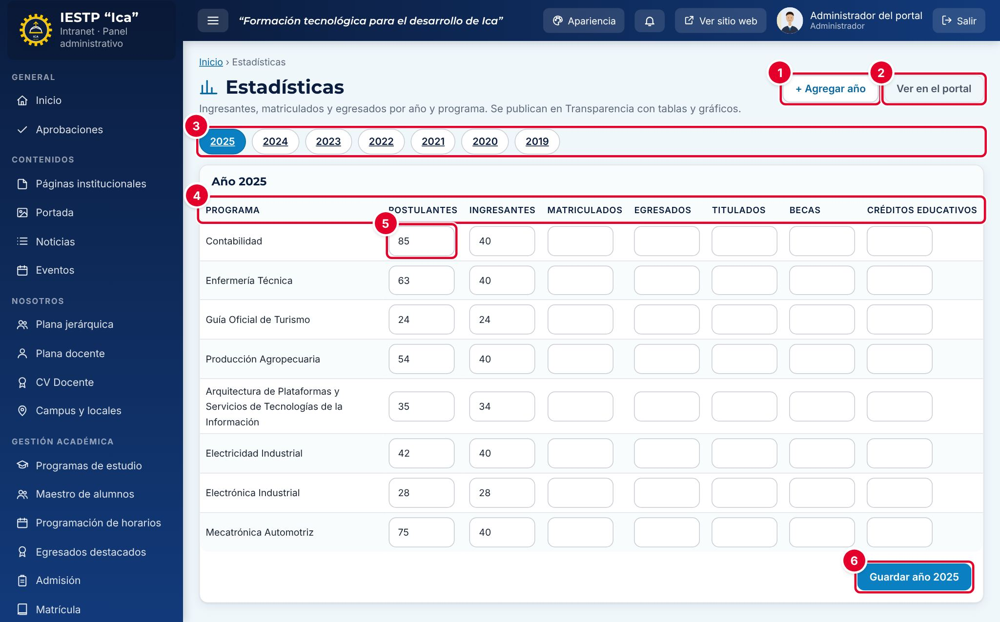
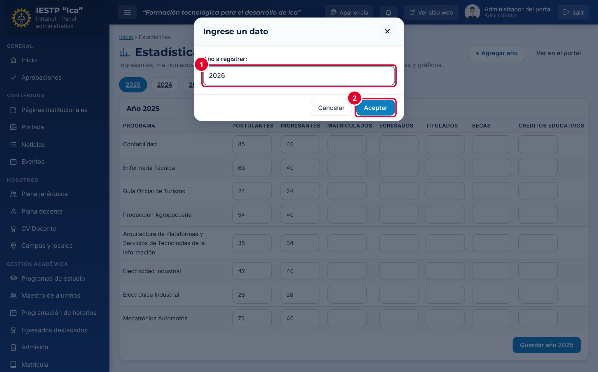
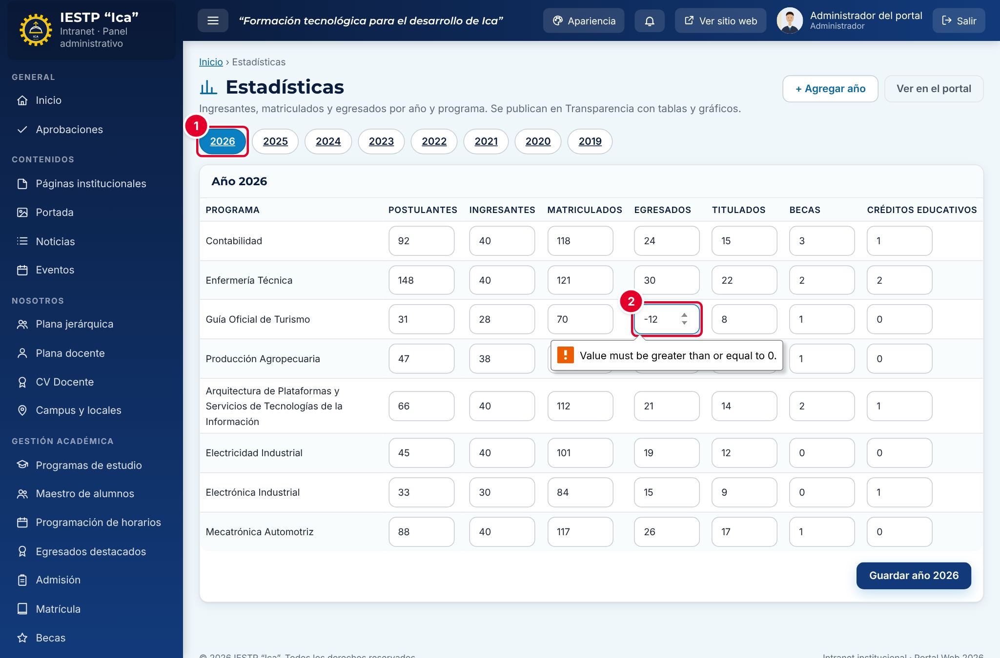
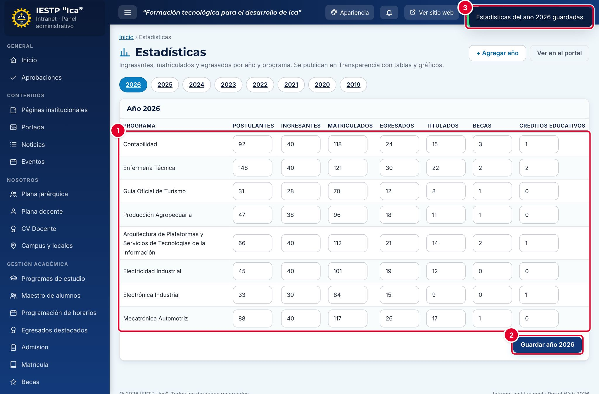
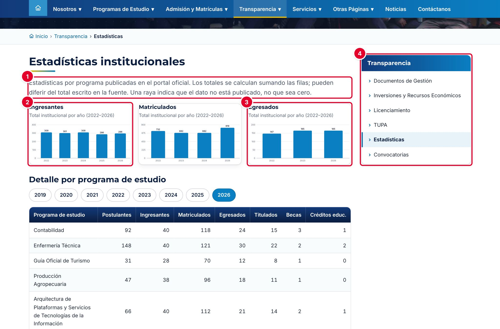
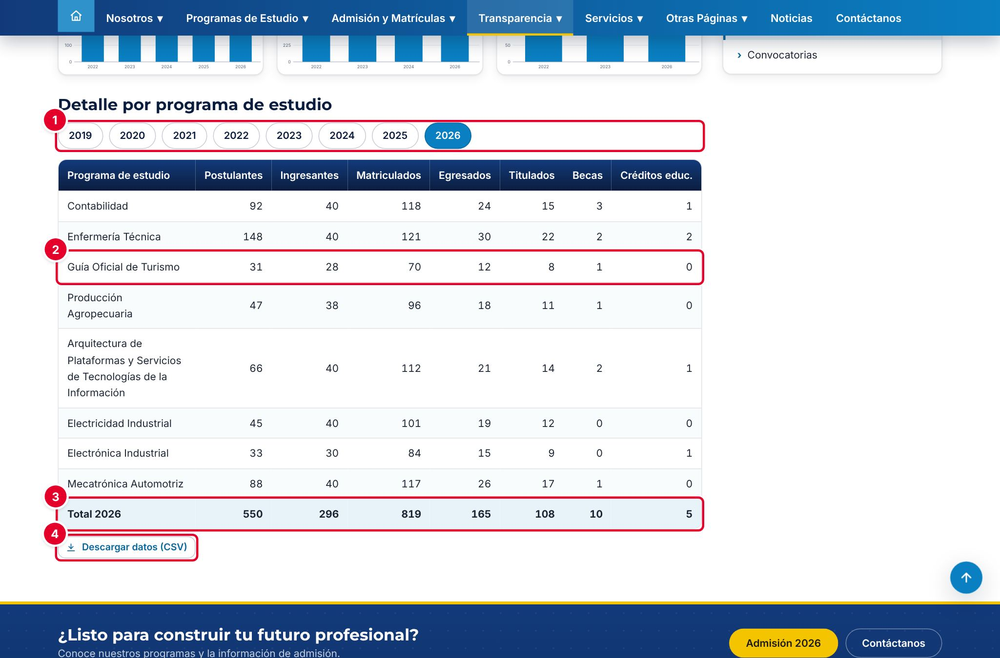

# 21 · Estadísticas

## Para qué sirve

En este módulo se registran, por **año** y por **programa de estudio**, los indicadores institucionales: postulantes, ingresantes, matriculados, egresados, titulados, becas y créditos educativos. Las cifras se publican en el portal, en **Transparencia** › **Estadísticas**, con gráficos de los últimos cinco años, una tabla por programa y un archivo descargable.

## Quién lo usa

| Rol | Puede |
|---|---|
| Administrador | Agregar años y registrar o corregir las cifras |
| Secretaría académica | Agregar años y registrar o corregir las cifras |
| Directivo | Agregar años y registrar o corregir las cifras. Normalmente lo usa para revisarlas |

> Las estadísticas **no tienen estados** ni pasan por aprobación: lo que se guarda se publica **de inmediato** en el portal. Revisa bien las cifras antes de pulsar **Guardar**.

## Cómo se llega

Menú lateral › **Transparencia** › **Estadísticas**. Ruta: `#/admin/estadisticas`

## Pantalla principal

| N.º | Elemento | Para qué sirve |
|---|---|---|
| 1 | **+ Agregar año** | Crea un año nuevo con una fila vacía para cada programa. |
| 2 | **Ver en el portal** | Abre la página pública de Estadísticas en otra pestaña. |
| 3 | Años | Cada botón abre las cifras de ese año. El año seleccionado aparece resaltado. |
| 4 | Indicadores | **Postulantes**, **Ingresantes**, **Matriculados**, **Egresados**, **Titulados**, **Becas** y **Créditos educativos**. |
| 5 | Celda | Cifra de un programa en un indicador. Una celda vacía significa «dato no publicado», no cero. |
| 6 | **Guardar año AAAA** | Guarda todas las cifras del año que estás viendo. |

## Formulario

Cada año es una tabla con una fila por programa de estudio y una columna por indicador.

| Campo | Obligatorio | Formato o límite | Ejemplo |
|---|---|---|---|
| Año | Sí | Entre 2000 y 2100; no se puede repetir | 2026 |
| Postulantes, Ingresantes, Matriculados, Egresados, Titulados, Becas, Créditos educativos | No | Número entero, 0 o mayor. Vacío = dato no publicado | 92 |

## Procedimientos

### Agregar un año

1. Pulsa **+ Agregar año**. El sistema propone el año siguiente.
2. Escribe el **Año a registrar** ①.
3. Pulsa **Aceptar** ②.

Se crea el año con una fila vacía para cada programa y se abre su tabla. Si el año ya existe, aparece el aviso «El año ya existe.».

### Registrar o corregir las cifras

1. Pulsa el botón del año.
2. Escribe las cifras en cada celda. Deja vacías las que todavía no tengas: en el portal se verán como una raya (—).
3. Pulsa **Guardar año AAAA**.

Si una cifra es negativa o tiene decimales, el navegador marca la celda ② y muestra su propio mensaje (por ejemplo, «El valor debe ser mayor o igual que 0»), y no se guarda nada. En el año seleccionado ① no se pierde lo que escribiste: corrige la celda y vuelve a guardar.

Con todas las cifras correctas ①, al pulsar **Guardar año 2026** ② aparece el aviso «Estadísticas del año 2026 guardadas.» ③. Desde ese momento las cifras se ven en el portal.

### Corregir un año anterior

Pulsa el botón del año, corrige las celdas y pulsa **Guardar año AAAA**. La modificación queda registrada en la **Auditoría** con tu usuario. Los años no se eliminan desde esta pantalla; si un año se creó por error, deja sus celdas vacías.

## Resultado en el portal público

En `{{inst.dominio}}/#/transparencia/estadisticas` (menú **Transparencia** › **Estadísticas**) el portal muestra una nota ① que explica que los totales se calculan sumando las filas y que una raya indica que el dato no está publicado. Luego vienen tres gráficos de barras con el total institucional por año: **Ingresantes** ②, **Matriculados** y **Egresados** ③. Cada gráfico abarca los **cinco últimos años** registrados y omite los años sin datos en ese indicador. Al pasar el puntero sobre una barra se ve su valor. El menú lateral **Transparencia** ④ lleva a las demás secciones.

En **Detalle por programa de estudio**, el visitante elige el año ① y ve la cifra de cada programa ② y la fila **Total** del año ③, que suma solo las celdas con dato. **Descargar datos (CSV)** ④ descarga las cifras de **todos** los años y programas, para abrirlas en Excel.

## Mensajes y problemas frecuentes

| Mensaje o situación | Causa | Qué hacer |
|---|---|---|
| «El año ya existe.» | Intentaste agregar un año que ya está registrado | Pulsa el botón de ese año para editarlo |
| No pasa nada al pulsar **Aceptar** en **Agregar año** | El año está fuera del rango 2000–2100 o no es un número | Escribe un año de cuatro cifras |
| El navegador marca una celda y no guarda | La cifra es negativa o tiene decimales | Escribe un número entero, 0 o mayor |
| «Ingrese números enteros positivos.» o «Los indicadores estadísticos deben ser enteros no negativos.» | Alguna cifra no es válida | Revisa las celdas marcadas en rojo |
| En el portal aparece «—» en lugar de 0 | La celda quedó vacía | Si el valor real es cero, escribe **0** |
| Un gráfico no muestra un año | Ese año no tiene ninguna cifra en ese indicador | Completa el indicador o déjalo así si el dato no existe |
| Un programa nuevo no aparece en un año antiguo | El año se creó antes que el programa | Escribe sus cifras en ese año y guarda: la fila se crea al guardar |

## Buenas prácticas

- Registra las cifras con una **fecha de corte** fija cada año (por ejemplo, al cierre del semestre II) y usa siempre la misma fuente: el registro académico o el informe oficial al MINEDU.
- Diferencia el **cero** (escribe 0) del **dato no disponible** (deja la celda vacía).
- Pide a otra persona que revise las cifras antes de guardar: se publican al instante.
- Publica solo cifras agregadas. Este módulo no debe contener nombres, DNI ni otros datos personales (Ley N.º 29733).
- Compara los totales con los gráficos del portal después de guardar, para detectar errores de digitación.
