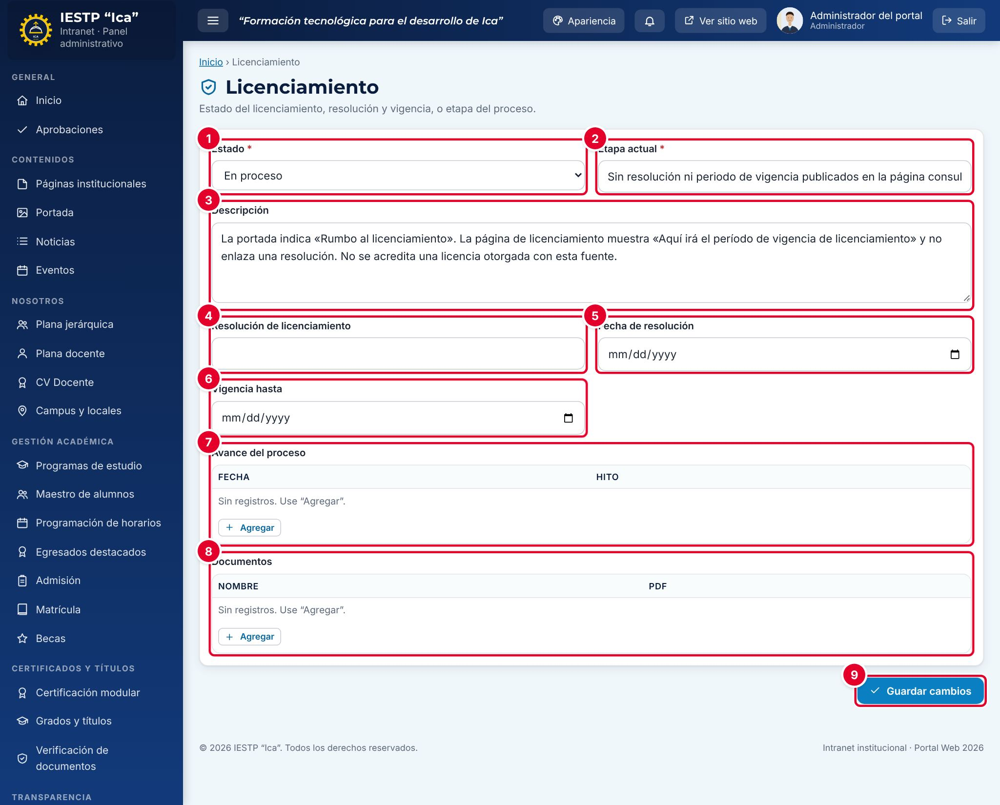
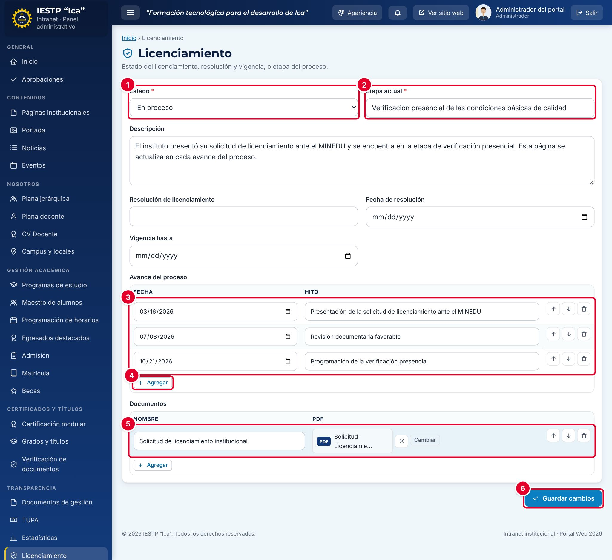
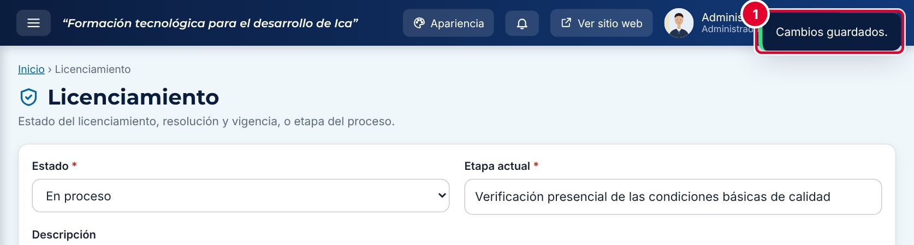
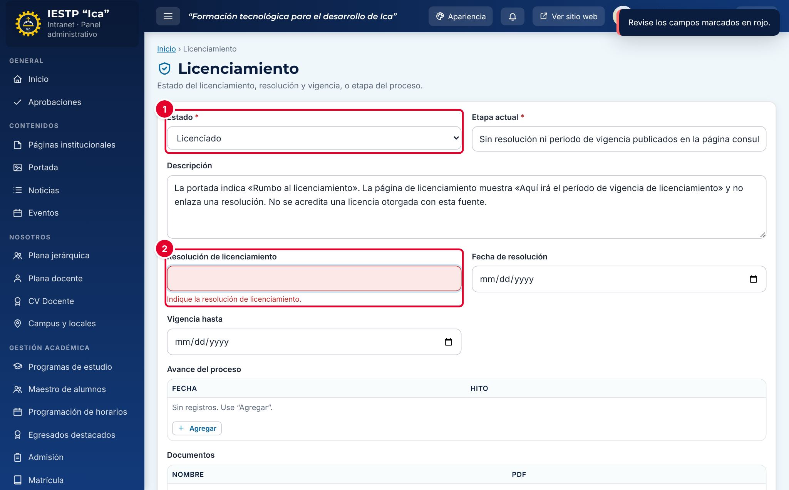
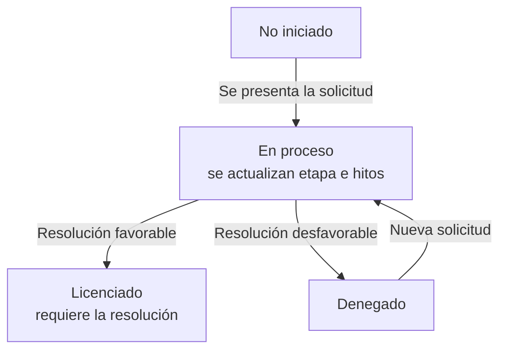
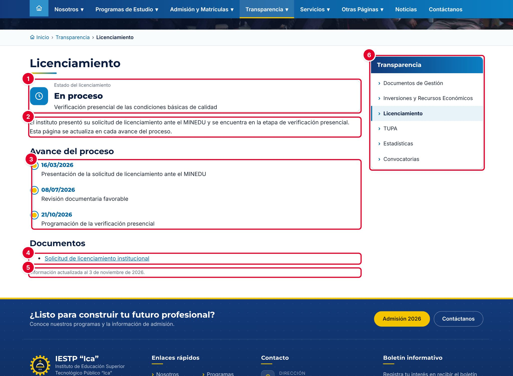

# 22 · Licenciamiento

## Para qué sirve

En este módulo se informa la situación del **licenciamiento institucional** ante el MINEDU: el estado, la etapa actual, la resolución y su vigencia, los hitos del proceso y los documentos de sustento. La información se publica en el portal, en **Transparencia** › **Licenciamiento**. Es una sola ficha: no hay listado de registros, sino un único formulario que se actualiza en cada avance.

## Quién lo usa

| Rol | Puede |
|---|---|
| Administrador | Ver y modificar la ficha de licenciamiento |
| Transparencia / administración | Ver y modificar la ficha de licenciamiento |

> La ficha **no tiene estados de publicación** ni pasa por aprobación: lo que se guarda se publica **de inmediato** en el portal.

## Cómo se llega

Menú lateral › **Transparencia** › **Licenciamiento**. Ruta: `#/admin/licenciamiento`

## Pantalla principal

| N.º | Elemento | Para qué sirve |
|---|---|---|
| 1 | **Estado** | Situación del licenciamiento: **No iniciado**, **En proceso**, **Licenciado** o **Denegado**. |
| 2 | **Etapa actual** | Frase corta que describe en qué paso está el proceso. Se muestra debajo del estado. |
| 3 | **Descripción** | Explicación para el público. |
| 4 | **Resolución de licenciamiento** | Número de la resolución. Es obligatoria si el estado es **Licenciado**. |
| 5 | **Fecha de resolución** | Fecha de emisión de la resolución. |
| 6 | **Vigencia hasta** | Fecha hasta la que rige la licencia. |
| 7 | **Avance del proceso** | Hitos con **Fecha** e **Hito**. En el portal se muestran como línea de tiempo. |
| 8 | **Documentos** | Documentos de sustento: **Nombre** y archivo **PDF**. |
| 9 | **Guardar cambios** | Guarda la ficha y la publica. |

## Formulario

| Campo | Obligatorio | Formato o límite | Ejemplo |
|---|---|---|---|
| Estado | Sí | No iniciado, En proceso, Licenciado o Denegado | En proceso |
| Etapa actual | Sí | Texto corto | Verificación presencial de las condiciones básicas de calidad |
| Descripción | No | Texto | El instituto presentó su solicitud de licenciamiento… |
| Resolución de licenciamiento | Si el estado es **Licenciado** | Texto | R. M. N.º 123-2027-MINEDU |
| Fecha de resolución | No | Fecha | 10/05/2027 |
| Vigencia hasta | No | Fecha | 09/05/2032 |
| Avance del proceso | No | Filas con fecha y texto | 16/03/2026 · Presentación de la solicitud… |
| Documentos | No | Filas con nombre y PDF (hasta 20 MB) | Solicitud de licenciamiento institucional |

## Procedimientos

### Actualizar la etapa y registrar un avance

1. Revisa el **Estado** ①. Mientras el MINEDU evalúa la solicitud, usa **En proceso**.
2. Actualiza la **Etapa actual** ② y, si hace falta, la **Descripción**.
3. En **Avance del proceso**, revisa los hitos registrados ③ y pulsa **Agregar** ④ para añadir uno nuevo. Elige la **Fecha** y escribe el **Hito**.
4. Ordena los hitos de **más antiguo a más reciente** con las flechas **Subir** y **Bajar**: el portal los muestra en el mismo orden en que aparecen aquí.
5. En **Documentos**, pulsa **Agregar**, escribe el **Nombre** y pulsa **Adjuntar** para elegir el PDF ⑤. **Cambiar** reemplaza el archivo y la **X** lo retira.
6. Pulsa **Guardar cambios** ⑥.

Aparece el aviso «Cambios guardados.» ① y el portal se actualiza de inmediato.

### Registrar el licenciamiento otorgado

1. Cambia el **Estado** a **Licenciado** ①.
2. Escribe la **Resolución de licenciamiento** ②, la **Fecha de resolución** y la fecha de **Vigencia hasta**.
3. Agrega como hito la fecha de la resolución y adjunta la resolución en **Documentos**.
4. Pulsa **Guardar cambios**.

Si dejas vacía la resolución, el campo se marca en rojo con el mensaje «Indique la resolución de licenciamiento.» y aparece el aviso «Revise los campos marcados en rojo.».

### Registrar una denegatoria

Cambia el **Estado** a **Denegado**, explica en la **Descripción** los pasos que seguirá la institución, registra el hito y adjunta el documento. Pulsa **Guardar cambios**.

## Flujo y estados

| Estado | Significado | Cómo se ve en el portal |
|---|---|---|
| No iniciado | La institución aún no presentó su solicitud | Ícono de reloj |
| En proceso | Solicitud presentada; el MINEDU la evalúa | Ícono de reloj |
| Licenciado | Licencia otorgada | Ícono de escudo en verde, con la resolución y su vigencia |
| Denegado | Solicitud denegada | Ícono de reloj |

En todos los casos, la ficha es visible en el portal.

## Resultado en el portal público

En `{{inst.dominio}}/#/transparencia/licenciamiento` (menú **Transparencia** › **Licenciamiento**) el público ve:

| N.º | Elemento | Origen |
|---|---|---|
| 1 | **Estado del licenciamiento** y etapa | Campos **Estado** y **Etapa actual** |
| 2 | Descripción | Campo **Descripción** |
| 3 | **Avance del proceso** | Hitos, en el orden registrado |
| 4 | **Documentos** | Cada nombre abre su PDF |
| 5 | «Información actualizada al…» | Fecha del último guardado |
| 6 | Menú **Transparencia** | Acceso a las demás secciones de transparencia |

Cuando hay una resolución registrada, aparece además un bloque con **Resolución**, **Fecha** y **Vigencia hasta**. Estas dos fechas se muestran tal como se guardan, en formato año-mes-día (por ejemplo, 2027-05-10).

## Mensajes y problemas frecuentes

| Mensaje o situación | Causa | Qué hacer |
|---|---|---|
| «Indique la resolución de licenciamiento.» | El estado es **Licenciado** y la resolución está vacía | Escribe el número de la resolución |
| «Obligatorio.» en **Etapa actual** | La etapa está vacía | Escribe la etapa, aunque sea breve |
| «Estado de licenciamiento no válido.» o «La fecha de licenciamiento no es válida.» | El servidor rechazó un estado o una fecha mal formada | Recarga la página y vuelve a elegir el estado o la fecha |
| Los hitos se ven desordenados en el portal | Se muestran en el orden del formulario, no por fecha | Ordénalos con **Subir** y **Bajar** y guarda |
| Un documento del portal no abre | La fila de **Documentos** no tiene PDF | Pulsa **Adjuntar** en esa fila, elige el archivo y guarda |

## Buenas prácticas

- Actualiza la ficha **el mismo día** en que ocurre cada avance: la página es una fuente de información pública.
- Escribe la etapa en lenguaje sencillo, sin siglas internas.
- Adjunta solo documentos oficiales y públicos, como la solicitud o la resolución. No publiques informes con datos personales del personal o de los estudiantes (Ley N.º 29733).
- Cuando la licencia esté por vencer, registra como hito el inicio de la renovación.
