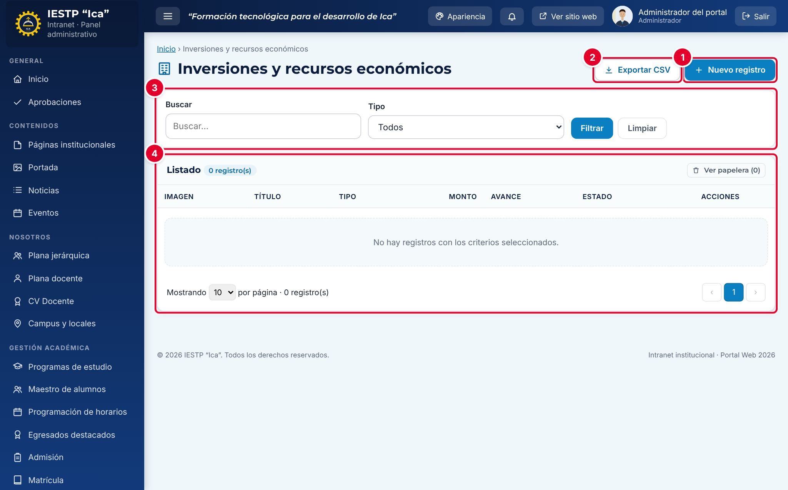
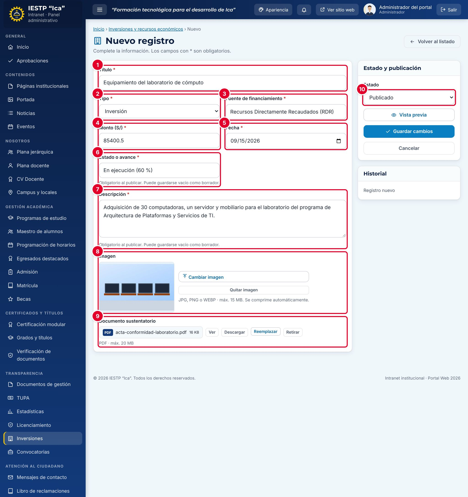
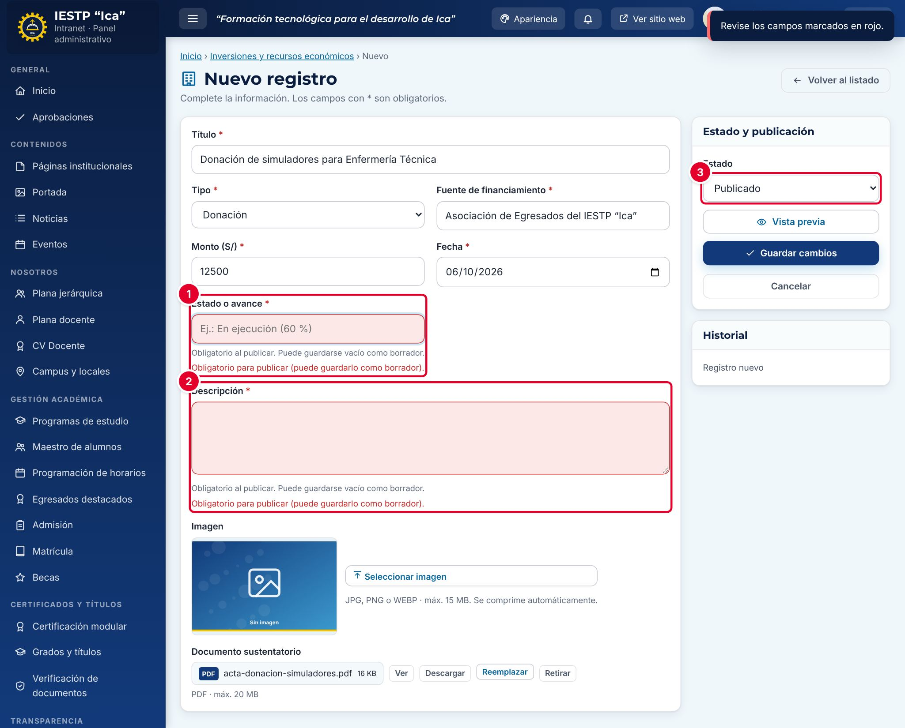
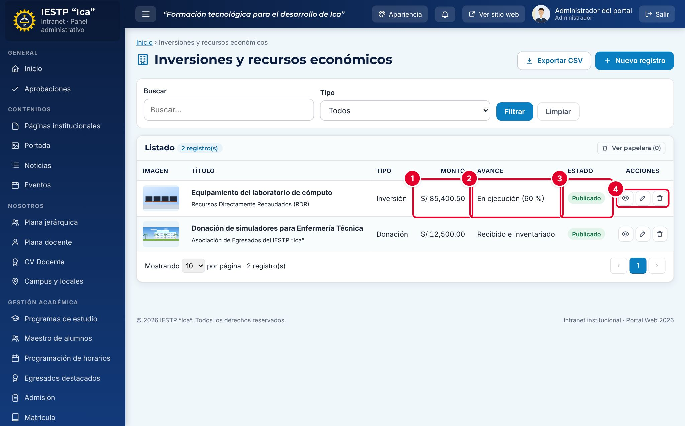
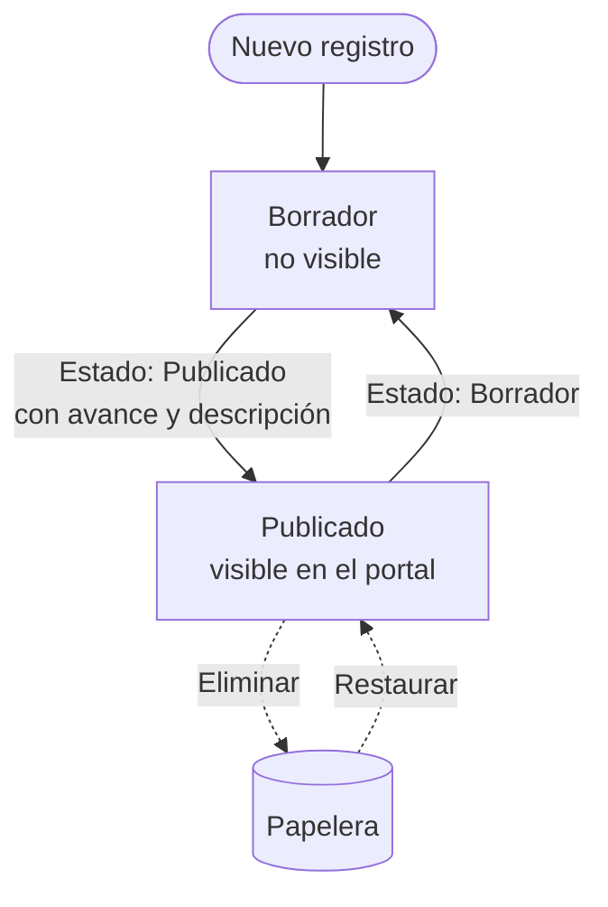
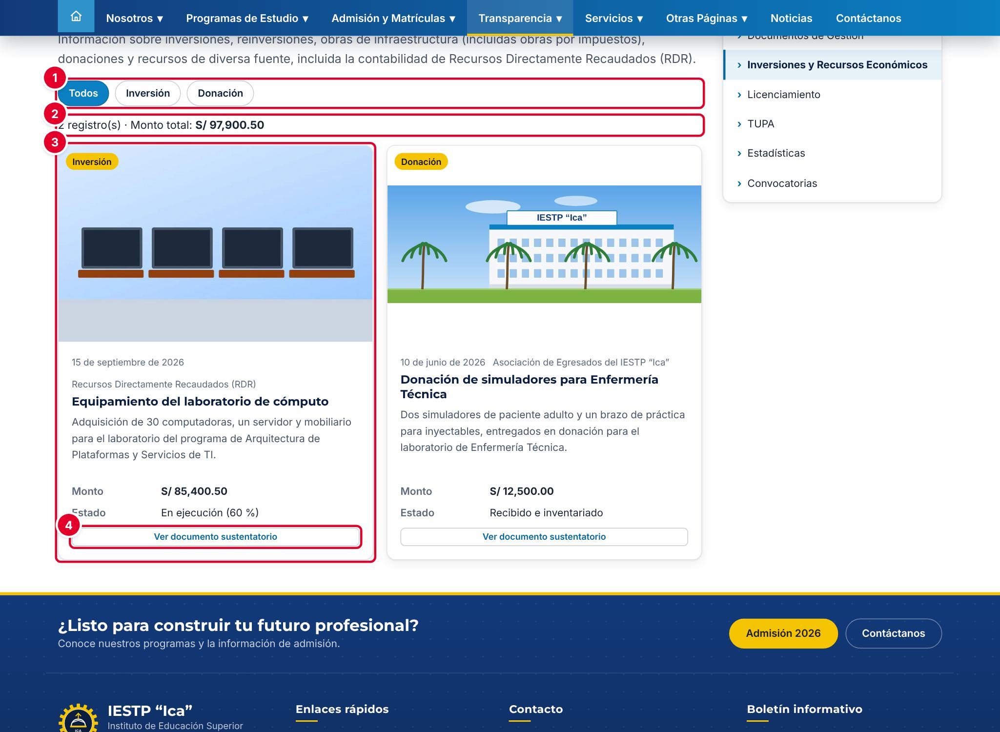
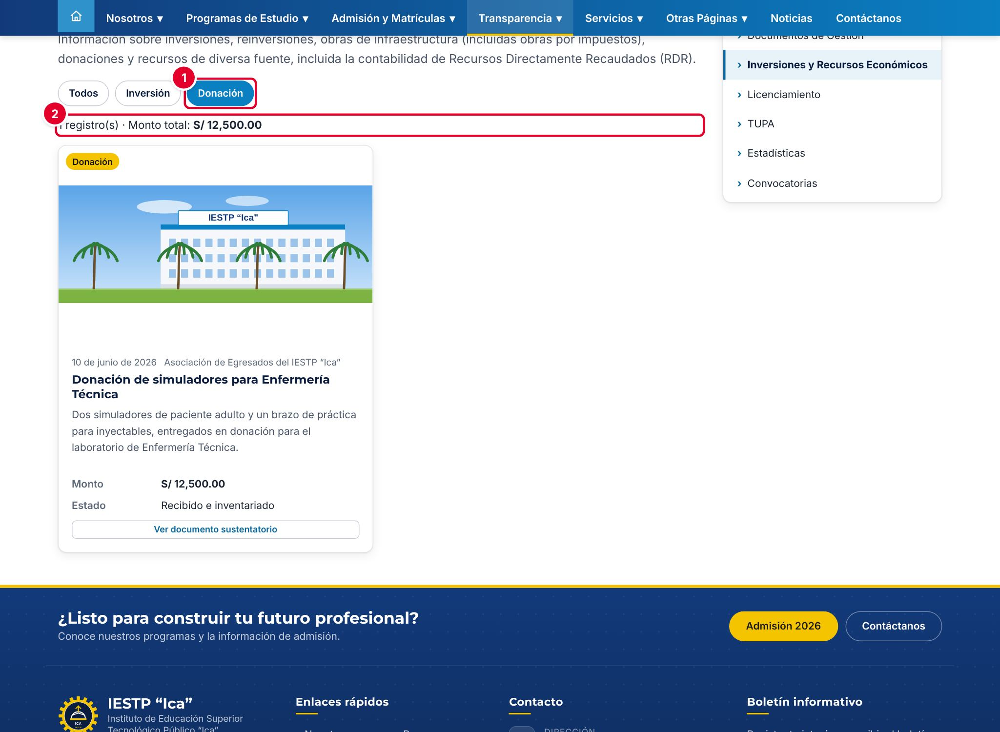

# 23 · Inversiones y recursos económicos

## Para qué sirve

En este módulo se registran las inversiones, reinversiones, obras de infraestructura (incluidas las obras por impuestos), donaciones y otros recursos que recibe o ejecuta la institución, con su monto, su fuente de financiamiento, su avance y el documento que lo sustenta.

Lo publicado aparece en el portal, en **Transparencia** › **Inversiones y Recursos Económicos**, como rendición de cuentas a la comunidad y en el marco de la Ley N.º 27806, Ley de Transparencia y Acceso a la Información Pública.

## Quién lo usa

| Rol | Puede |
|---|---|
| Administrador | Todo, incluida la **eliminación definitiva** |
| Transparencia / administración | Crear, editar, publicar, enviar a la papelera y restaurar. No necesita aprobación del Administrador |

## Cómo se llega

Menú lateral › **Transparencia** › **Inversiones**. Ruta: `#/admin/inversiones`

## Pantalla principal

| N.º | Elemento | Para qué sirve |
|---|---|---|
| 1 | **Nuevo registro** | Abre el formulario para registrar una inversión o un recurso. |
| 2 | **Exportar CSV** | Descarga el listado (título, tipo, fuente, monto, fecha y avance) para abrirlo en Excel. |
| 3 | Filtros | Buscan por título y filtran por **Tipo**. |
| 4 | **Listado** | Registros, del más reciente al más antiguo. Al inicio está vacío. |

## Formulario

| N.º | Campo | Para qué sirve |
|---|---|---|
| 1 | **Título** | Nombre corto de la inversión o del recurso. |
| 2 | **Tipo** | Inversión, Reinversión, Obra de infraestructura, Obra por impuestos (OxI), Donación u Otros recursos. |
| 3 | **Fuente de financiamiento** | De dónde provienen los fondos; por ejemplo, Recursos Directamente Recaudados (RDR). |
| 4 | **Monto (S/)** | Importe en soles. |
| 5 | **Fecha** | Fecha del registro (inicio, adjudicación o recepción). |
| 6 | **Estado o avance** | Situación actual; por ejemplo, «En ejecución (60 %)». |
| 7 | **Descripción** | Qué se adquirió o se ejecutó y para quién. |
| 8 | **Imagen** | Foto de la obra o del equipamiento. |
| 9 | **Documento sustentatorio** | PDF que respalda el registro: acta, contrato, resolución o informe. |
| 10 | **Estado** | **Borrador** o **Publicado**. |

| Campo | Obligatorio | Formato o límite | Ejemplo |
|---|---|---|---|
| Título | Sí | Texto | Equipamiento del laboratorio de cómputo |
| Tipo | Sí | Una de la lista | Inversión |
| Fuente de financiamiento | Sí | Texto | Recursos Directamente Recaudados (RDR) |
| Monto (S/) | Sí | Número desde 0, con dos decimales | 85400.50 |
| Fecha | Sí | Fecha | 15/09/2026 |
| Estado o avance | Al publicar | Texto | En ejecución (60 %) |
| Descripción | Al publicar | Texto | Adquisición de 30 computadoras… |
| Imagen | No | JPG, PNG o WEBP, hasta 15 MB. Se comprime automáticamente | Si no se carga, se usa una imagen institucional |
| Documento sustentatorio | No | PDF, hasta 20 MB | acta-conformidad-laboratorio.pdf |
| Estado | Sí | Borrador o Publicado | Publicado |

## Procedimientos

### Registrar una inversión o un recurso

1. Pulsa **Nuevo registro**.
2. Completa **Título** ①, **Tipo** ②, **Fuente de financiamiento** ③, **Monto (S/)** ④ y **Fecha** ⑤.
3. Escribe el **Estado o avance** ⑥ y la **Descripción** ⑦.
4. Opcional: pulsa **Seleccionar imagen** ⑧ para cargar una foto.
5. Pulsa **Cargar archivo** en **Documento sustentatorio** ⑨ para subir el PDF.
6. Elige el **Estado** ⑩ y pulsa **Guardar cambios**. Aparece «Cambios guardados.».

Si eliges **Publicado** sin completar el **Estado o avance** ① o la **Descripción** ②, el sistema marca esos campos en rojo con el mensaje «Obligatorio para publicar (puede guardarlo como borrador).» y no guarda. Complétalos, o cambia el **Estado** ③ a **Borrador** para terminar después.

En el listado se ven el **Monto** ①, el **Avance** ② y el **Estado** ③. Las acciones de la fila ④ son **Vista previa**, **Editar** y **Eliminar**.

### Actualizar el avance

1. Pulsa el lápiz (**Editar**) del registro.
2. Cambia el **Estado o avance**; por ejemplo, de «En ejecución (60 %)» a «Concluida».
3. Si hay un documento nuevo (por ejemplo, el acta de entrega), pulsa **Reemplazar** en **Documento sustentatorio**.
4. Pulsa **Guardar cambios**.

### Retirar, eliminar o restaurar

- Para retirarlo del portal sin borrarlo, cambia el **Estado** a **Borrador**.
- La papelera (**Eliminar**) lo envía a la papelera; se recupera con **Ver papelera** › **Restaurar**. Solo el Administrador puede eliminar definitivamente.

## Flujo y estados

| Estado | Significado | Visible en el portal |
|---|---|---|
| Borrador | En preparación o retirado | No |
| Publicado | Registro completo y aprobado | **Sí** |
| En papelera | Eliminado; se puede restaurar | No |

## Resultado en el portal público

En `{{inst.dominio}}/#/transparencia/inversiones` el público ve:

| N.º | Elemento | Descripción |
|---|---|---|
| 1 | Filtros por tipo | **Todos** y un botón por cada tipo que tenga registros publicados |
| 2 | Resumen | Cantidad de registros y **Monto total** de los registros mostrados |
| 3 | Tarjeta | Imagen, tipo, fecha, fuente, título, descripción, monto y estado o avance |
| 4 | **Ver documento sustentatorio** | Abre el PDF. Si no hay documento, dice «Sin documento adjunto» |

Al pulsar un tipo ①, por ejemplo **Donación**, se muestran solo esos registros y el monto total se recalcula ②.

Si no hay ningún registro publicado, el portal muestra el contenido de la página institucional «inversiones», si existe, o un aviso de que aún no hay información.

## Mensajes y problemas frecuentes

| Mensaje o situación | Causa | Qué hacer |
|---|---|---|
| «Obligatorio para publicar (puede guardarlo como borrador).» | Falta **Estado o avance** o **Descripción** | Complétalos o guarda como Borrador |
| «Este campo es obligatorio.» | Falta título, tipo, fuente, monto o fecha | Completa el campo marcado |
| El registro no aparece en el portal | Está en Borrador o en la papelera | Revisa el **Estado** |
| La tarjeta muestra una imagen genérica | No se cargó imagen | Carga una foto en **Imagen** |
| El monto total no coincide con el de contabilidad | Hay registros en Borrador o se aplicó un filtro de tipo | Revisa los estados y pulsa **Todos** |

## Buenas prácticas

- Escribe el monto **exacto** del documento sustentatorio y adjunta siempre ese documento.
- Indica la fuente con su nombre completo y su sigla: «Recursos Directamente Recaudados (RDR)».
- Actualiza el **Estado o avance** cada vez que cambie la situación de la obra o del proyecto.
- Usa fotos reales de la obra o del equipamiento, sin personas identificables.
- Usa **Exportar CSV** para las rendiciones de cuentas y los informes de gestión.
