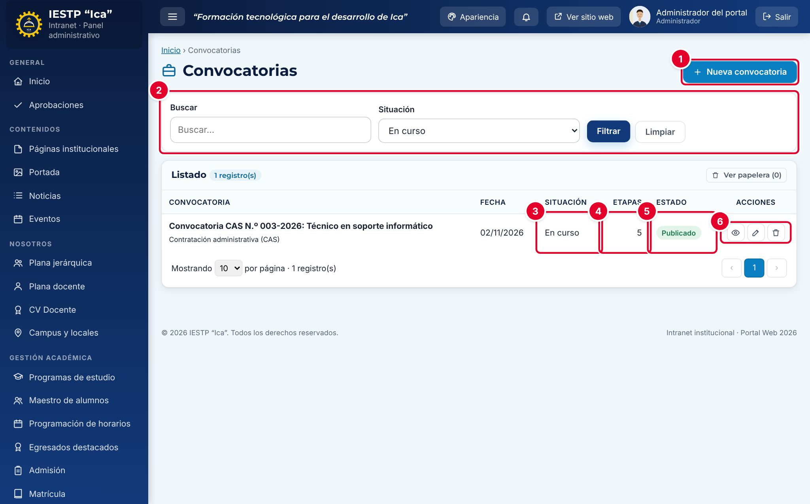
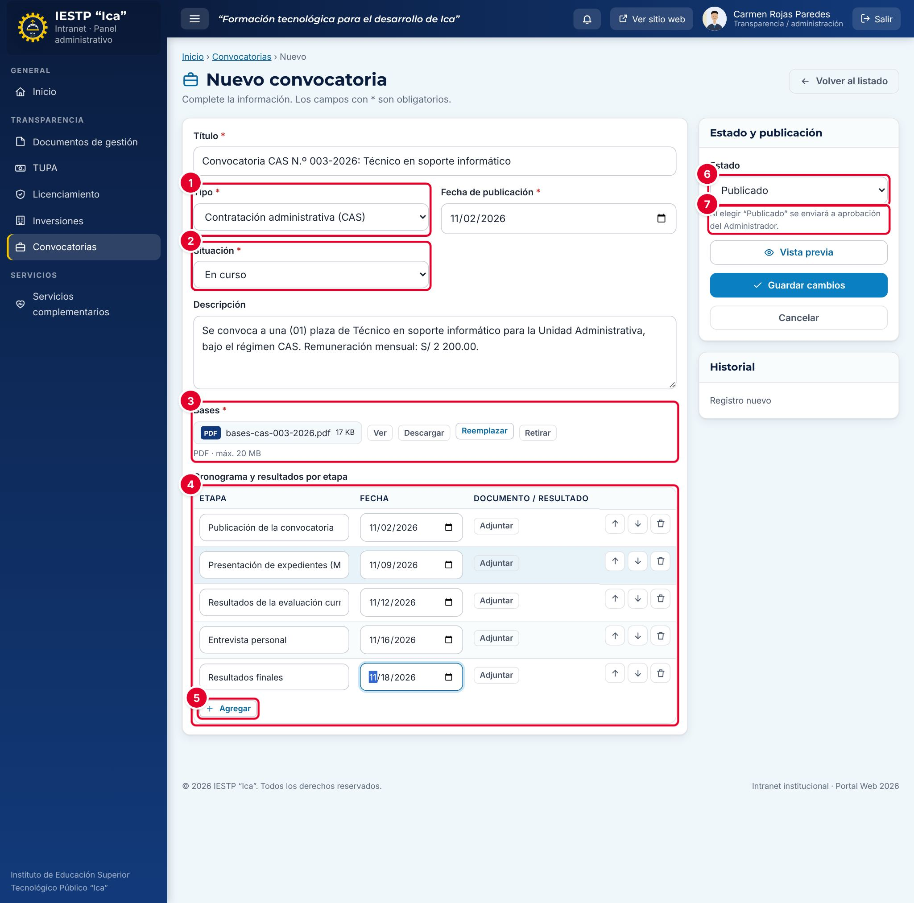
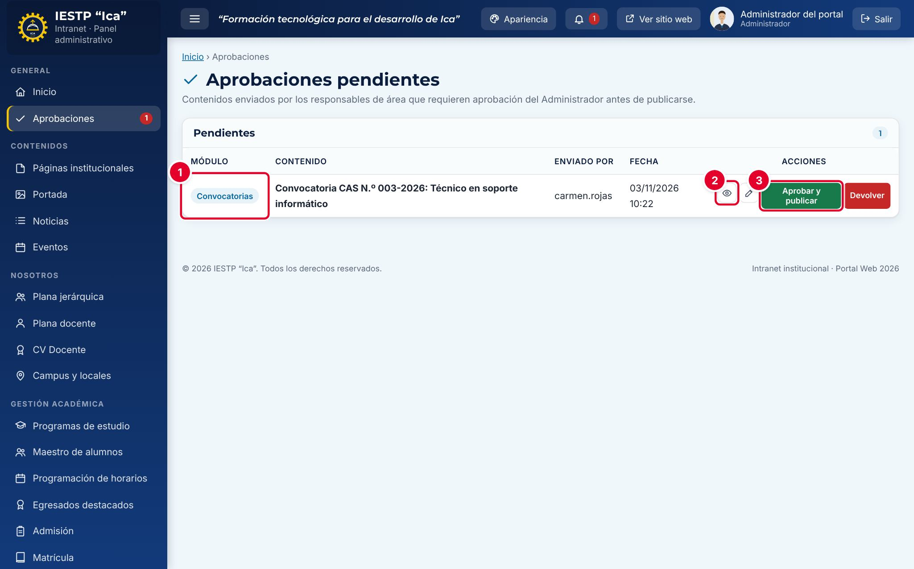
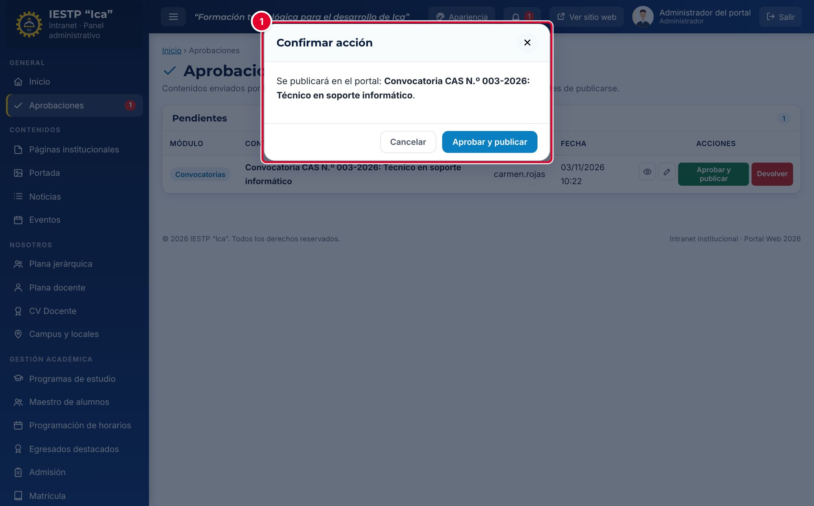
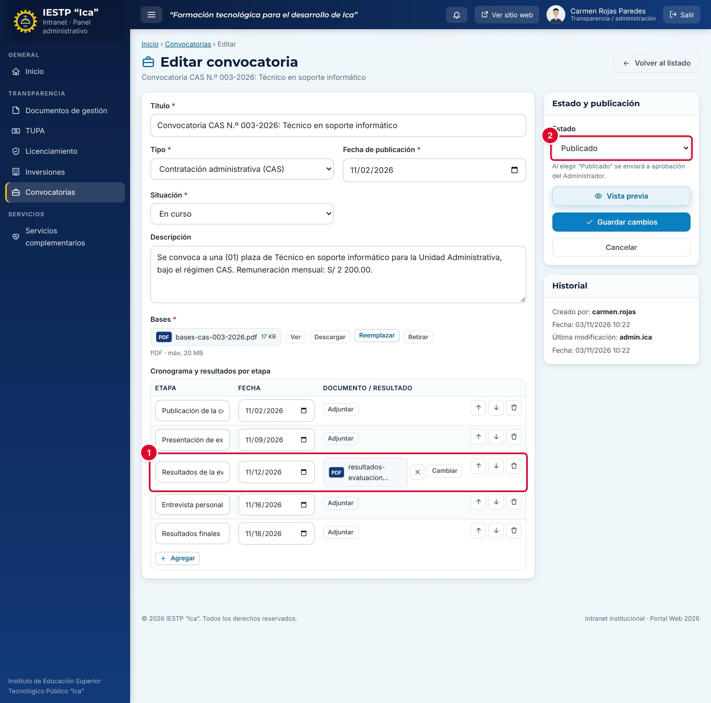
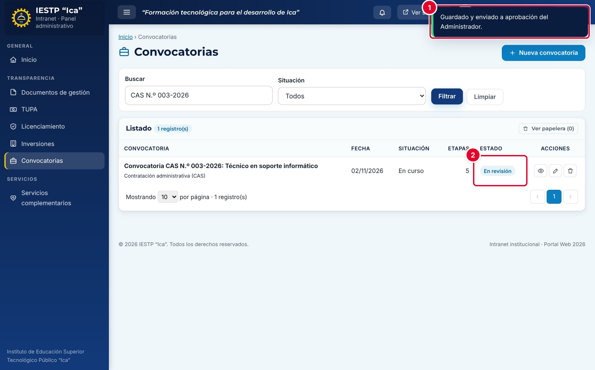
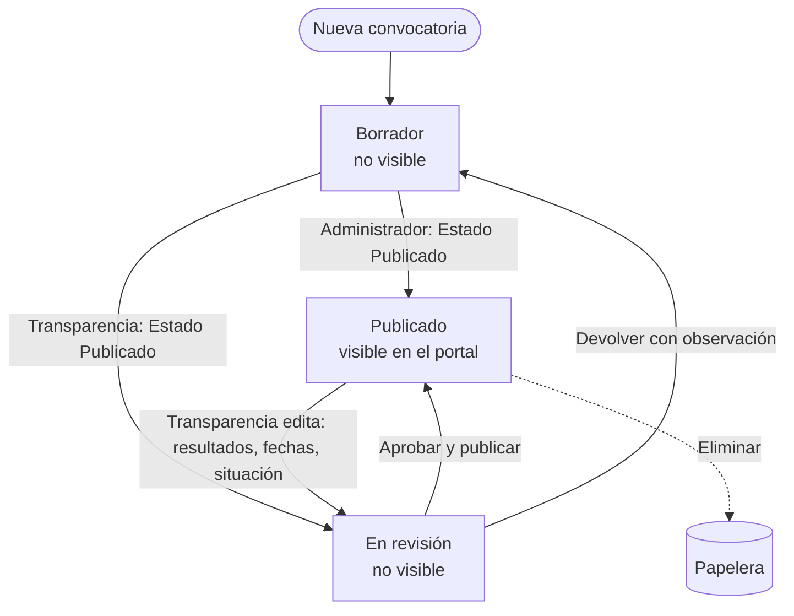
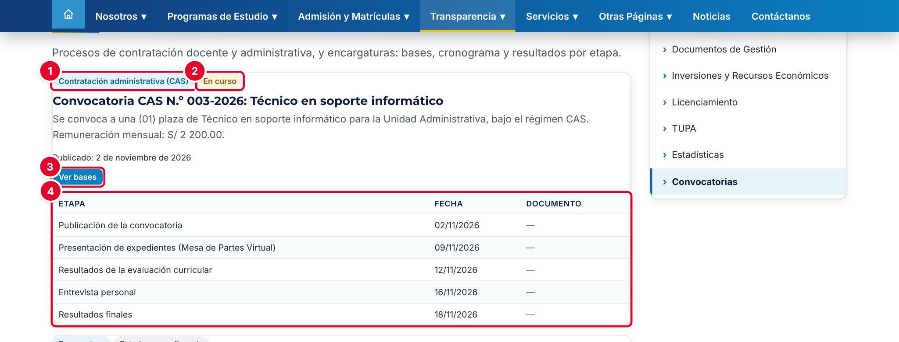
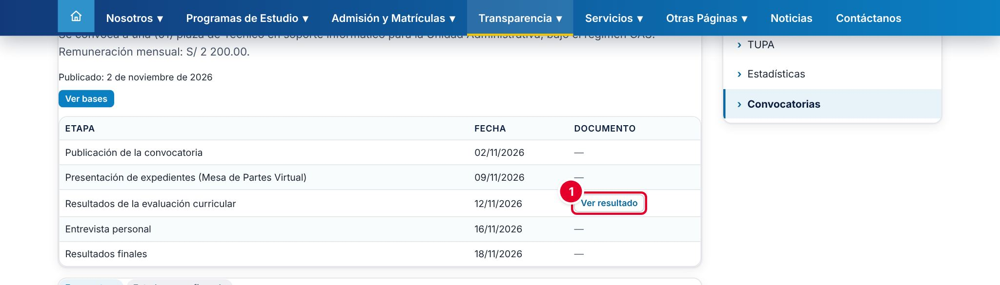

# 24 · Convocatorias

## Para qué sirve

En este módulo se publican los procesos de selección de la institución: contratación docente, contratación administrativa (CAS), encargaturas y otros. Cada convocatoria tiene sus **bases** en PDF y un **cronograma por etapas**, y en cada etapa se adjunta el resultado cuando se emite.

Lo publicado aparece en el portal, en **Transparencia** › **Convocatorias**, como parte de la información que la institución difunde en cumplimiento de la Ley N.º 27806, Ley de Transparencia y Acceso a la Información Pública.

## Quién lo usa

| Rol | Puede |
|---|---|
| Administrador | Todo: crear, editar, publicar directamente, aprobar o devolver lo que envía Transparencia, enviar a la papelera, restaurar y **eliminar definitivamente** |
| Transparencia / administración | Crear y editar convocatorias, adjuntar bases y resultados. **No publica directamente**: cada publicación y cada cambio en una convocatoria publicada se envían a aprobación del Administrador |

## Cómo se llega

Menú lateral › **Transparencia** › **Convocatorias**. Ruta: `#/admin/convocatorias`

Las aprobaciones pendientes están en menú lateral › **General** › **Aprobaciones** (solo el Administrador).

## Pantalla principal

| N.º | Elemento | Para qué sirve |
|---|---|---|
| 1 | **Nueva convocatoria** | Abre el formulario. |
| 2 | Filtros | **Buscar** por título y filtrar por **Situación**. |
| 3 | **Situación** | Momento del proceso: Estado no confirmado, En curso, Concluida, Desierta o Cancelada. |
| 4 | **Etapas** | Cantidad de etapas del cronograma. |
| 5 | **Estado** | Estado de publicación: **Borrador**, **En revisión** o **Publicado**. |
| 6 | Acciones de la fila | **Vista previa**, **Editar** y **Eliminar** (envía a la papelera). |

La **Situación** describe el proceso de selección; el **Estado** indica si la convocatoria se ve en el portal. Son datos distintos.

## Formulario

| N.º | Campo | Para qué sirve |
|---|---|---|
| 1 | **Tipo** | Contratación docente, Contratación administrativa (CAS), Encargatura u Otros. |
| 2 | **Situación** | Momento del proceso. Se muestra como etiqueta en el portal. |
| 3 | **Bases** | PDF con las bases de la convocatoria. |
| 4 | **Cronograma y resultados por etapa** | Una fila por etapa: **Etapa**, **Fecha** y **Documento / resultado** (PDF). |
| 5 | **Agregar** | Añade una etapa. Las flechas cambian el orden y la papelera quita la fila. |
| 6 | **Estado** | **Borrador** o **Publicado**. |
| 7 | Aviso de aprobación | Para Transparencia: «Al elegir “Publicado” se enviará a aprobación del Administrador.» |

| Campo | Obligatorio | Formato o límite | Ejemplo |
|---|---|---|---|
| Título | Sí | Texto | Convocatoria CAS N.º 003-2026: Técnico en soporte informático |
| Tipo | Sí | Una de la lista | Contratación administrativa (CAS) |
| Fecha de publicación | Sí | Fecha | 02/11/2026 |
| Situación | Sí | Una de la lista | En curso |
| Descripción | No | Texto | Se convoca a una (01) plaza… |
| Bases | Al publicar | PDF, hasta 20 MB | bases-cas-003-2026.pdf |
| Etapas | No | Etapa (texto), Fecha y documento PDF de hasta 20 MB por fila | Resultados de la evaluación curricular · 12/11/2026 |
| Estado | Sí | Borrador o Publicado | Publicado |

## Procedimientos

### Registrar una convocatoria y enviarla a aprobación (Transparencia)

1. Pulsa **Nueva convocatoria**.
2. Escribe el **Título**, elige el **Tipo** ① y la **Fecha de publicación**, y elige la **Situación** ②; para un proceso abierto, **En curso**.
3. Escribe la **Descripción**: plazas, área, régimen y remuneración.
4. Pulsa **Cargar archivo** en **Bases** ③.
5. En **Cronograma y resultados por etapa** ④, pulsa **Agregar** ⑤ por cada etapa y escribe su nombre y su fecha. Deja el documento vacío hasta que haya resultados.
6. Elige **Publicado** en **Estado** ⑥. Lee el aviso ⑦.
7. Pulsa **Guardar cambios**. Aparece «Guardado y enviado a aprobación del Administrador.» y la convocatoria queda **En revisión**.

Si lo hace el Administrador, la convocatoria se publica directamente.

### Aprobar la publicación (Administrador)

1. Abre **Aprobaciones**. La fila indica el **Módulo** ①: **Convocatorias**.
2. Pulsa **Vista previa** ② para revisar cómo quedará en el portal.
3. Pulsa **Aprobar y publicar** ③.

4. Confirma en la ventana ① con **Aprobar y publicar**. Aparece «Contenido aprobado y publicado.».

Si hay algo que corregir, pulsa **Devolver** y escribe la observación: la convocatoria vuelve al responsable como **Borrador** y la observación aparece en su formulario (ver el capítulo 19).

### Publicar el resultado de una etapa

1. Pulsa el lápiz (**Editar**) de la convocatoria.
2. En la fila de la etapa ①, pulsa **Adjuntar** y elige el PDF del resultado. Para corregirlo, usa **Cambiar**; para quitarlo, la **X**.
3. Deja el **Estado** ② en **Publicado** y pulsa **Guardar cambios**.
4. Si el proceso terminó, cambia la **Situación** a **Concluida** (o **Desierta** o **Cancelada**).

Si lo hace Transparencia, aparece «Guardado y enviado a aprobación del Administrador.» ① y la convocatoria pasa a **En revisión** ②.

> **Importante:** mientras está **En revisión**, la convocatoria **deja de verse en el portal**, incluidas las bases y las etapas que ya estaban publicadas. Vuelve a verse cuando el Administrador la aprueba. Coordina con el Administrador para que apruebe el mismo día, sobre todo cuando hay plazos de postulación en curso.

### Retirar, eliminar o restaurar

- Para retirarla del portal sin borrarla, cambia el **Estado** a **Borrador**.
- La papelera (**Eliminar**) la envía a la papelera; se recupera con **Ver papelera** › **Restaurar**. Solo el Administrador puede eliminar definitivamente.

## Flujo y estados

| Estado | Significado | Visible en el portal |
|---|---|---|
| Borrador | En preparación o devuelta con observación | No |
| En revisión | Enviada por Transparencia; espera la aprobación del Administrador | No |
| Publicado | Aprobada | **Sí** |
| En papelera | Eliminada; se puede restaurar | No |

## Resultado en el portal público

En `{{inst.dominio}}/#/transparencia/convocatorias` las convocatorias publicadas aparecen de la más reciente a la más antigua. Cada una muestra el **Tipo** ① y la **Situación** ② (en amarillo si está **En curso**), el título, la descripción, la fecha de publicación, el botón **Ver bases** ③ y la tabla de **etapas** ④.

Cuando una etapa tiene documento, aparece el botón **Ver resultado** ①, que abre el PDF.

## Mensajes y problemas frecuentes

| Mensaje o situación | Causa | Qué hacer |
|---|---|---|
| «Obligatorio para publicar (puede guardarlo como borrador).» en **Bases** | Se eligió Publicado sin bases | Carga el PDF de las bases |
| «Guardado y enviado a aprobación del Administrador.» | Tu rol (Transparencia) necesita aprobación | Avisa al Administrador |
| La convocatoria desapareció del portal | Se editó y está **En revisión** | El Administrador debe aprobarla en **Aprobaciones** |
| La convocatoria tiene una observación en rojo | El Administrador la devolvió | Corrige lo indicado y vuelve a elegir **Publicado** |
| Una etapa muestra «—» en el portal | La etapa no tiene documento | Adjunta el PDF del resultado |

## Buenas prácticas

- Registra **todas las etapas** del cronograma desde el inicio, con sus fechas, aunque los resultados lleguen después.
- Publica cada resultado **el mismo día** de la etapa y mantén la **Situación** al día.
- No publiques DNI, teléfonos ni domicilios de los postulantes en los resultados: basta con nombres y puntajes (Ley N.º 29733).
- Usa títulos con el número de la convocatoria: «Convocatoria CAS N.º 003-2026: …».
- Conserva las convocatorias concluidas como registro: no las elimines.
