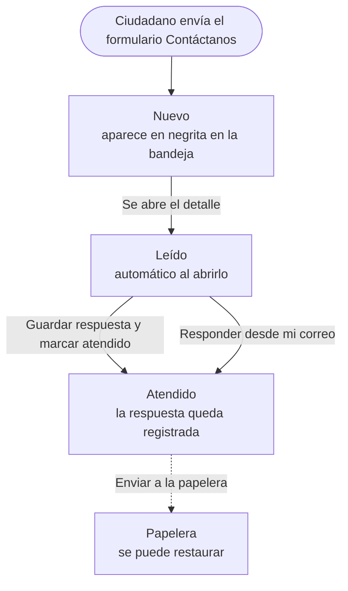
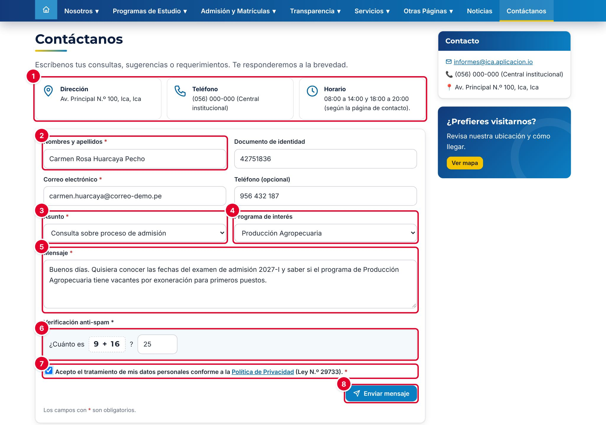
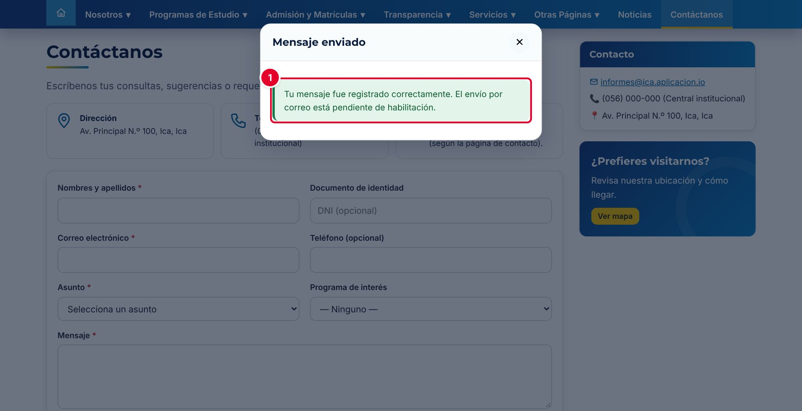
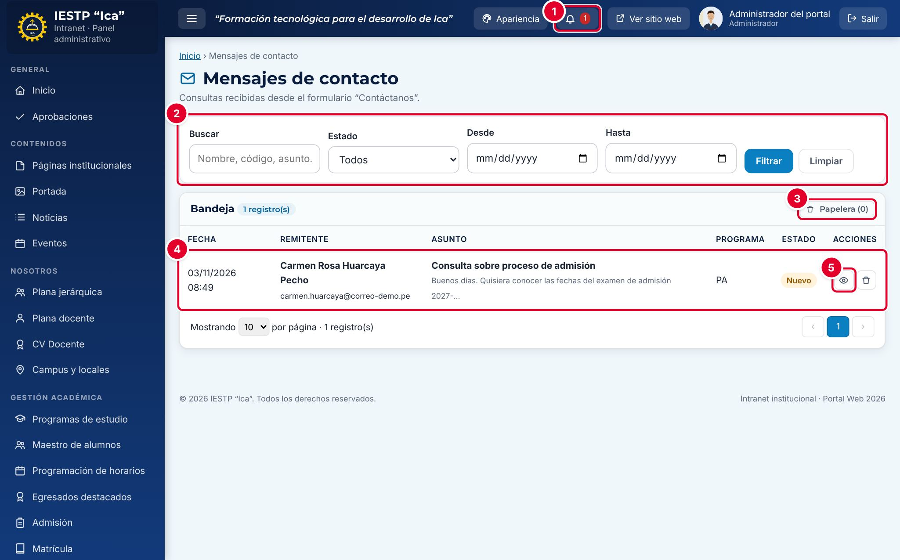
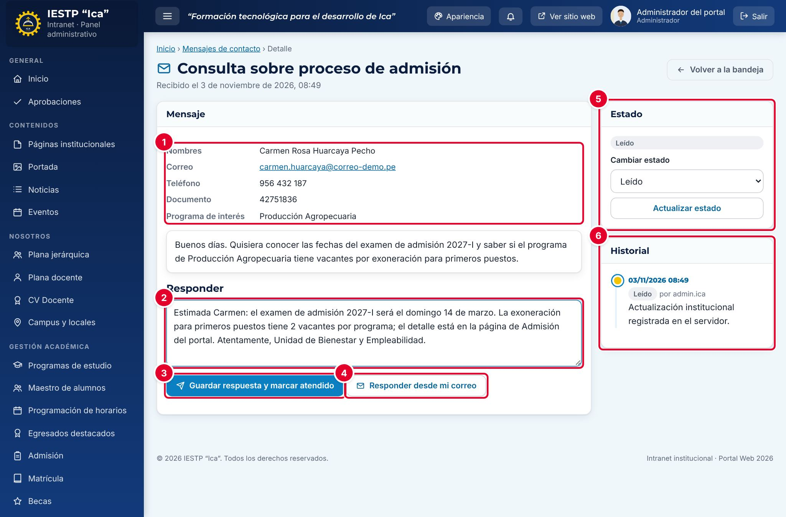
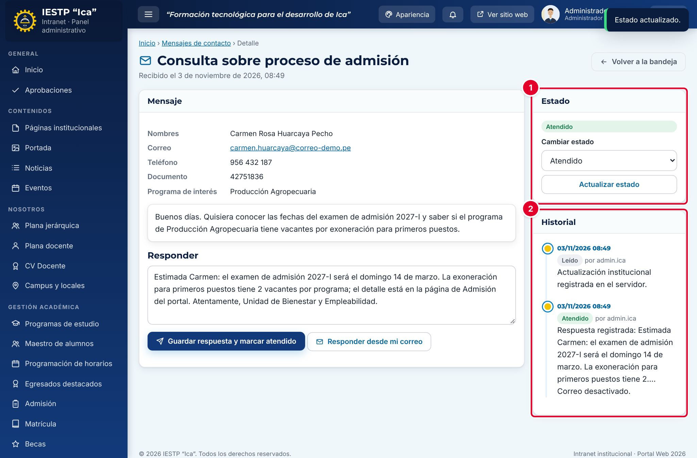
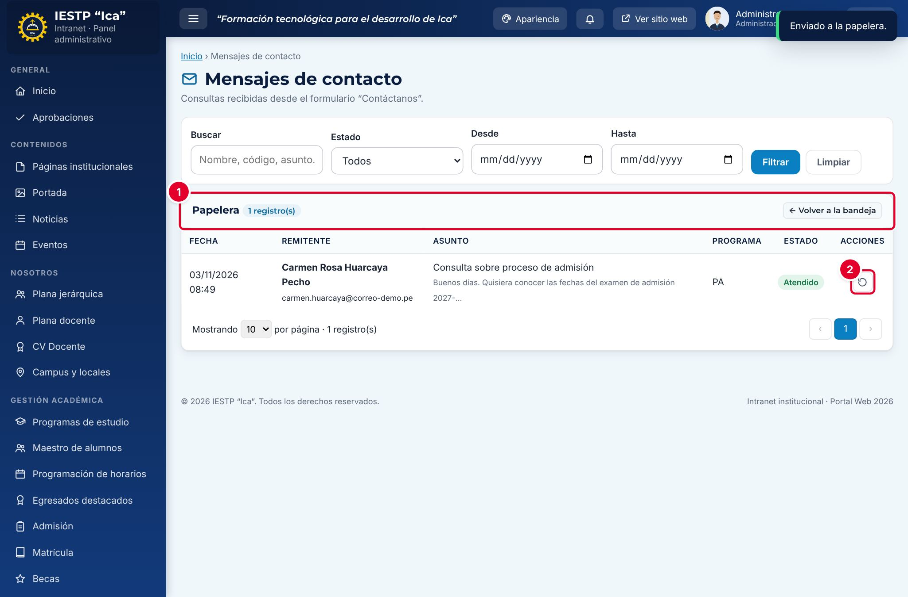

# 25 · Mensajes de contacto

## Para qué sirve

El formulario **Contáctanos** del portal recibe consultas, sugerencias y pedidos de información del público: postulantes, padres de familia, egresados o cualquier persona. Cada mensaje llega a una bandeja de la intranet, donde se lee, se responde y se marca como atendido. Todo el recorrido queda en un historial.

El proceso tiene dos lados:

- **Ciudadano (portal):** escribe su consulta y recibe un aviso de que el mensaje fue registrado.
- **Institución (intranet):** lee el mensaje, registra la respuesta y lo marca como atendido.

> A diferencia del Libro de reclamaciones (capítulo 26) y de la Mesa de partes (capítulo 27), el mensaje de contacto **no genera un código de seguimiento**: el ciudadano no puede consultar el estado en el portal. La respuesta debe llegarle por correo o por teléfono (ver el paso 4).

## Quién lo usa

| Rol | Puede |
|---|---|
| Administrador | Todo: leer, responder, cambiar estados, enviar a la papelera y restaurar |
| Atención al ciudadano | Lo mismo que el administrador en este módulo |
| Ciudadano (sin cuenta) | Enviar mensajes desde el portal |

Los demás roles no ven este módulo.

## Cómo se llega

- Intranet: menú lateral › **Atención al ciudadano** › **Mensajes de contacto**. Ruta: `#/admin/mensajes`
- Portal: menú **Contáctanos**. Ruta: `{{inst.dominio}}/#/contacto`. El mismo formulario aparece al final de **Nosotros › Campus e Informes**.

## Flujo completo

| Estado | Significado | Quién lo produce |
|---|---|---|
| Nuevo | Mensaje recién llegado, sin abrir | El ciudadano, al enviar el formulario |
| Leído | Alguien del equipo abrió el mensaje | Automático, al abrir el detalle por primera vez |
| Atendido | Se registró la respuesta | **Guardar respuesta y marcar atendido** o **Responder desde mi correo** |

Con **Actualizar estado** también puedes volver un mensaje a **Nuevo** o a **Leído**; por ejemplo, para que otra persona del equipo lo vea como pendiente.

## Paso 1 · El ciudadano escribe su mensaje (portal)

| N.º | Elemento | Descripción |
|---|---|---|
| 1 | Datos de la institución | Dirección, teléfono y horario de atención |
| 2 | **Nombres y apellidos*** | Mínimo 5 caracteres. También se piden el **Correo electrónico*** y, de forma opcional, el **Documento de identidad** (DNI de 8 dígitos) y el **Teléfono** |
| 3 | **Asunto*** | Consulta sobre proceso de admisión, Información de programas de estudio, Matrícula y becas, Certificados y trámites, Sugerencias u Otros |
| 4 | **Programa de interés** | Opcional. Ayuda a derivar la consulta al programa correcto |
| 5 | **Mensaje*** | Entre 10 y 1500 caracteres |
| 6 | **Verificación anti-spam** | Suma sencilla para evitar envíos automáticos |
| 7 | Aceptación de la Política de Privacidad | Obligatoria (Ley N.º 29733) |
| 8 | **Enviar mensaje** | Registra el mensaje |

Al enviar, el portal muestra **Mensaje enviado** ①: «Tu mensaje fue registrado correctamente. El envío por correo está pendiente de habilitación.». El formulario se limpia.

## Paso 2 · Revisar la bandeja (intranet)

| N.º | Elemento | Para qué sirve |
|---|---|---|
| 1 | Campana de avisos | Muestra cuántos mensajes nuevos hay. El menú lateral también muestra un contador en **Mensajes de contacto** |
| 2 | Filtros | **Buscar** (nombre, correo, asunto o texto del mensaje), **Estado** (Nuevo, Leído, Atendido) y rango de fechas (**Desde** y **Hasta**). Pulsa **Filtrar** o **Limpiar** |
| 3 | **Papelera** | Muestra los mensajes enviados a la papelera, con su cantidad |
| 4 | Fila del mensaje | Fecha, remitente y correo, asunto con el inicio del mensaje, programa y estado. Los mensajes **Nuevo** aparecen en negrita |
| 5 | Ojo (**Ver detalle**) | Abre el mensaje. El tacho de basura lo envía a la papelera |

Abajo eliges cuántos mensajes ver por página (5, 10, 25 o 50).

## Paso 3 · Leer el mensaje

Al abrir un mensaje **Nuevo**, pasa solo a **Leído** y el historial registra quién lo abrió.

| N.º | Sección | Descripción |
|---|---|---|
| 1 | Datos del remitente | Nombres, correo (enlace para escribirle), teléfono, documento y programa de interés. Debajo está el texto del mensaje |
| 2 | **Responder** | Texto de la respuesta institucional |
| 3 | **Guardar respuesta y marcar atendido** | Guarda la respuesta en la intranet y pasa el mensaje a **Atendido** |
| 4 | **Responder desde mi correo** | Abre tu programa de correo con la respuesta ya escrita, y además marca el mensaje como **Atendido** |
| 5 | **Estado** | Estado actual y cambio manual con **Actualizar estado** |
| 6 | **Historial** | Cada cambio con la fecha, el usuario y la nota |

## Paso 4 · Responder y cerrar

1. Escribe la respuesta en **Responder** ② (mínimo 5 caracteres): clara, completa y con los datos que pidió la persona.
2. Elige cómo hacerla llegar:
   - **Responder desde mi correo** ④: se abre tu correo (Outlook, Thunderbird, Gmail configurado como predeterminado, etc.) con el destinatario, el asunto «Re: …» y el texto. **Revisa y pulsa Enviar en tu correo.** El mensaje queda **Atendido** en la intranet.
   - **Guardar respuesta y marcar atendido** ③: solo guarda la respuesta en la intranet. Úsalo cuando respondiste por otro medio (teléfono, en persona) y quieres dejar constancia.

El estado pasa a **Atendido** ① y el **Historial** ② muestra la respuesta registrada.

> **Correo electrónico:** en la versión actual, el portal **no envía correos**. El botón **Guardar respuesta y marcar atendido** no le envía nada al ciudadano, y el historial lo indica con «Correo desactivado.». Como el ciudadano no tiene código para consultar, la respuesta solo le llega si usas **Responder desde mi correo** o si lo llamas por teléfono.

## Paso 5 · Papelera

Los mensajes de spam o duplicados se pueden quitar de la bandeja con el tacho de basura. El sistema pide confirmación: «El registro se enviará a la papelera.».

En **Papelera** ① aparecen los mensajes retirados. Con **Restaurar** ② el mensaje vuelve a la bandeja con su estado y su historial. Pulsa **← Volver a la bandeja** para regresar. La papelera no borra definitivamente: el mensaje y la acción quedan en la auditoría.

## Mensajes y problemas frecuentes

| Mensaje o situación | Causa | Qué hacer |
|---|---|---|
| «Ingrese sus nombres y apellidos completos.» | El nombre tiene menos de 5 caracteres | Escribe nombres y apellidos |
| «El DNI debe tener 8 dígitos.» | El documento opcional no tiene 8 dígitos | Corrígelo o déjalo vacío |
| «Escriba un mensaje de al menos 10 caracteres.» | Mensaje vacío o muy corto | Amplía el mensaje |
| «La suma no es correcta. Corrige el resultado e inténtalo nuevamente.» | Resultado anti-spam equivocado | Escribe el resultado correcto |
| «La verificación anti-spam ha caducado. Recarga el formulario.» | Pasaron más de 30 minutos con la página abierta | Recarga la página y vuelve a enviar |
| «Demasiados intentos. Espera unos minutos antes de continuar.» | Se enviaron más de 10 formularios en un minuto desde la misma conexión | Espera un minuto |
| «Escriba la respuesta.» | Intentaste responder sin texto | Escribe la respuesta (mínimo 5 caracteres) |
| **Responder desde mi correo** no abre nada | El equipo no tiene un programa de correo predeterminado | Copia la respuesta y envíala desde el correo institucional |
| El ciudadano dice que no recibió respuesta | El portal no envía correos | Responde con **Responder desde mi correo** o por teléfono |

## Buenas prácticas

- Revisa la bandeja **todos los días hábiles** y responde en un plazo máximo de 2 días.
- Responde siempre desde el **correo institucional** del área, no desde correos personales.
- Si la consulta es un reclamo o un trámite, indica a la persona que use el **Libro de Reclamaciones** o la **Mesa de Partes Virtual**, que sí generan código de seguimiento.
- Usa la papelera solo para spam o duplicados.
- Los datos del remitente son personales (Ley N.º 29733): úsalos solo para responder la consulta y no los compartas.
