# 27 · Mesa de partes virtual

## Para qué sirve

La Mesa de Partes Virtual recibe por internet las solicitudes, oficios, cartas, FUT y demás documentos dirigidos a la institución, las 24 horas. Cada documento recibe al instante un **N.º de expediente**, un **N.º de documento** y un **cargo de recepción en PDF** con código QR. En la intranet, Mesa de Partes deriva el expediente al área competente, que lo atiende y registra la respuesta. El remitente consulta el avance en el portal.

El proceso tiene dos lados:

- **Ciudadano (portal):** registra el documento con sus archivos, descarga su cargo y consulta el estado.
- **Institución (intranet):** recibe el expediente, lo deriva, lo observa si falta algo, lo atiende y lo cierra.

## Quién lo usa

| Rol | Puede |
|---|---|
| Administrador | Todo: configurar el horario, los tipos de documento y los plazos, editar las áreas receptoras, derivar, cambiar estados y exportar |
| Atención al ciudadano | Gestionar la bandeja: derivar, cambiar estados, descargar adjuntos y cargos, exportar |
| Directivo | Consultar la bandeja y el detalle (solo lectura) |
| Personal de un área | Si su cuenta tiene un **Área de Mesa de partes** asignada (en **Usuarios**), atiende los expedientes derivados a su área, pero no puede derivarlos a otra |
| Ciudadano (sin cuenta) | Registrar documentos y consultar su expediente con el número y su documento de identidad |

## Cómo se llega

- Intranet: menú lateral › **Atención al ciudadano** › **Mesa de partes virtual**. Ruta: `#/admin/expedientes`
- Portal: menú **Servicios** › **Mesa de Partes**. Ruta: `{{inst.dominio}}/#/servicios/mesa-de-partes`

## Flujo completo

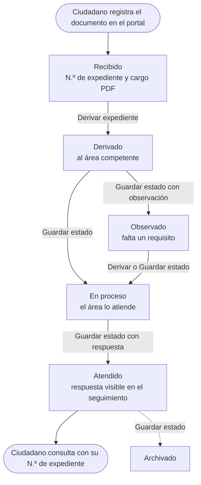

| Estado | Significado | Qué ve el ciudadano |
|---|---|---|
| Recibido | Registrado por la Mesa de Partes Virtual | «Recibido por Mesa de Partes» |
| Derivado | Enviado al área de destino | «Derivado al área de destino» |
| En proceso | El área lo está atendiendo | «En atención en el área» |
| Observado | Falta un documento o un dato; la nota explica qué | «Observado (revise el seguimiento)» |
| Atendido | Se registró la respuesta o el detalle de la atención | «Atendido» |
| Archivado | Concluido y archivado | «Archivado» |

Los estados **Observado** y **Atendido** exigen una nota: lo que se escribe en **Nota / respuesta** aparece en el seguimiento público.

**Plazos:** cada tipo de documento tiene un plazo en **días hábiles** (por ejemplo, Solicitud 10, Oficio 7, Recurso administrativo 30). El plazo se cuenta desde la fecha de recepción y la intranet muestra los días que quedan o si ya venció. Cuando el expediente pasa a **Atendido** o **Archivado**, el plazo figura como **Cerrado**.

**Horario de recepción:** se pueden registrar documentos a cualquier hora. Lo presentado después de la hora de cierre, en sábado, domingo o feriado se considera **recibido el siguiente día hábil** a la hora de inicio; lo presentado antes de la hora de inicio de un día hábil, ese mismo día a la hora de inicio. El cargo indica ambas fechas.

## Paso 1 · El ciudadano registra su documento (portal)

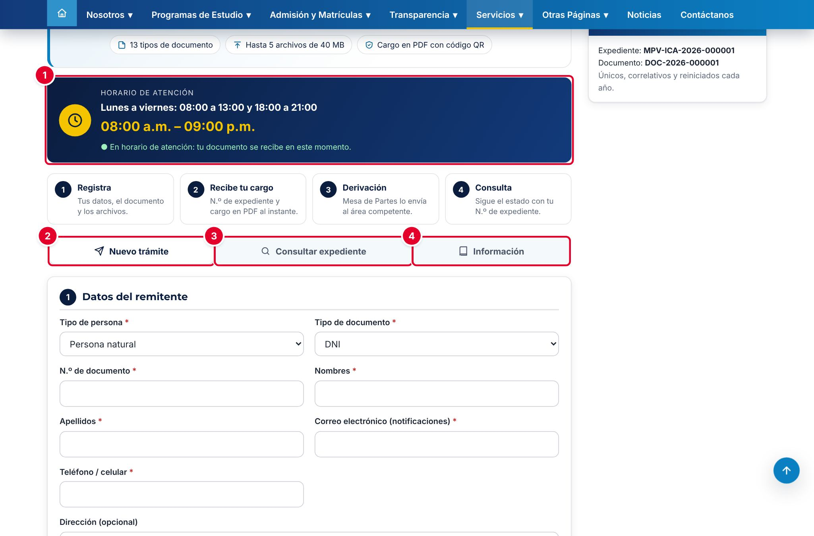

| N.º | Elemento | Para qué sirve |
|---|---|---|
| 1 | **Horario de atención** | Días y horas de recepción. Indica si en ese momento el documento se recibe de inmediato o el siguiente día hábil |
| 2 | **Nuevo trámite** | Formulario de registro |
| 3 | **Consultar expediente** | Seguimiento con el N.º de expediente |
| 4 | **Información** | Cómo funciona, tipos de documento con su plazo, reglas fuera de horario y áreas receptoras |

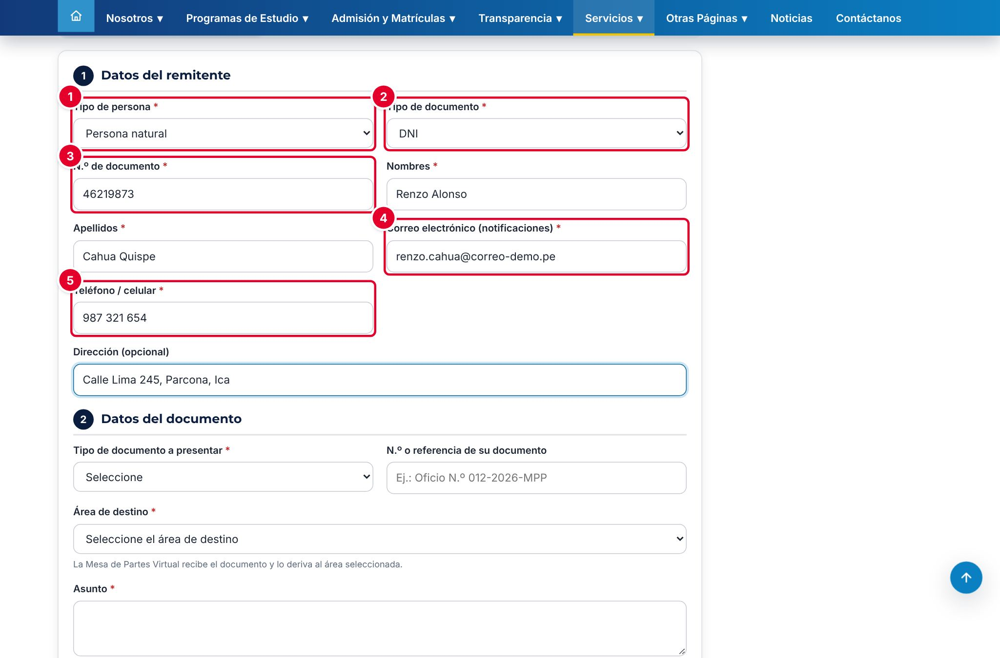

| N.º | Campo | Descripción |
|---|---|---|
| 1 | **Tipo de persona*** | Persona natural, o Persona jurídica / entidad (pide la **Razón social** en lugar de nombres y apellidos) |
| 2 | **Tipo de documento*** | DNI, Carné de extranjería, Pasaporte o RUC |
| 3 | **N.º de documento*** | DNI de 8 dígitos o RUC de 11. Debajo van **Nombres*** y **Apellidos*** |
| 4 | **Correo electrónico (notificaciones)*** | Correo de contacto del remitente |
| 5 | **Teléfono / celular*** | De 6 a 15 dígitos. La **Dirección** es opcional |

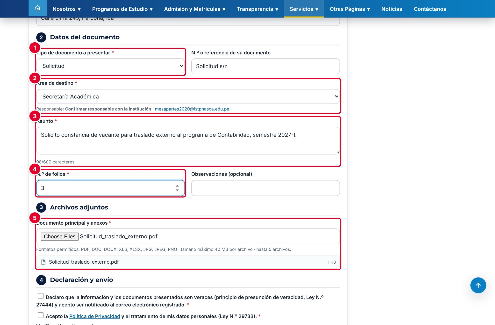

| N.º | Campo | Descripción |
|---|---|---|
| 1 | **Tipo de documento a presentar*** | Solicitud, Oficio, Carta, FUT, etc. Al lado, el **N.º o referencia de su documento** (opcional) |
| 2 | **Área de destino*** | Área a la que va dirigido. Al elegirla se muestran su responsable y su correo |
| 3 | **Asunto*** | Entre 10 y 600 caracteres |
| 4 | **N.º de folios*** | De 1 a 2000. Al lado, **Observaciones** (opcional) |
| 5 | **Documento principal y anexos*** | Al menos un archivo. Por defecto: PDF, DOC, DOCX, XLS, XLSX, JPG, JPEG o PNG, hasta 40 MB cada uno y hasta 5 archivos. La lista muestra cada archivo y avisa si alguno no cumple |

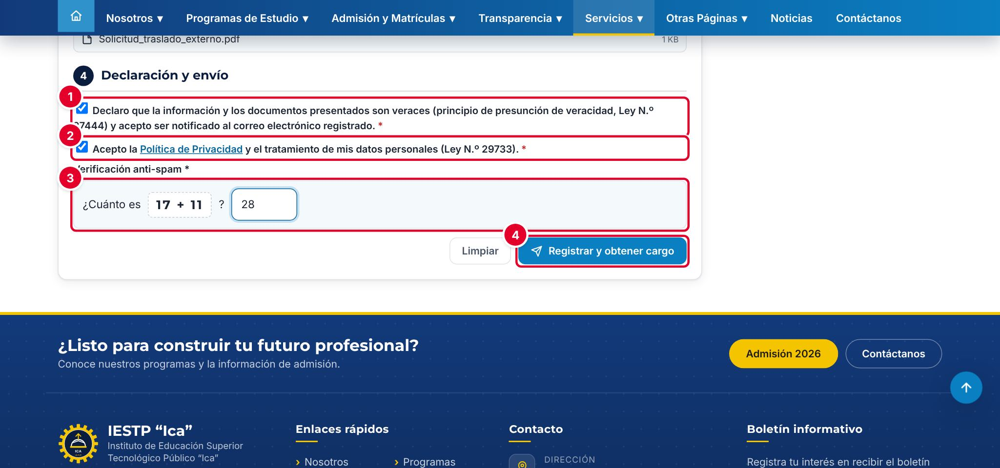

| N.º | Elemento | Descripción |
|---|---|---|
| 1 | Declaración de veracidad | Obligatoria (presunción de veracidad, Ley N.º 27444) |
| 2 | Política de Privacidad | Obligatoria (Ley N.º 29733) |
| 3 | **Verificación anti-spam** | Suma sencilla |
| 4 | **Registrar y obtener cargo** | Sube los archivos y registra el expediente. **Limpiar** borra el formulario |

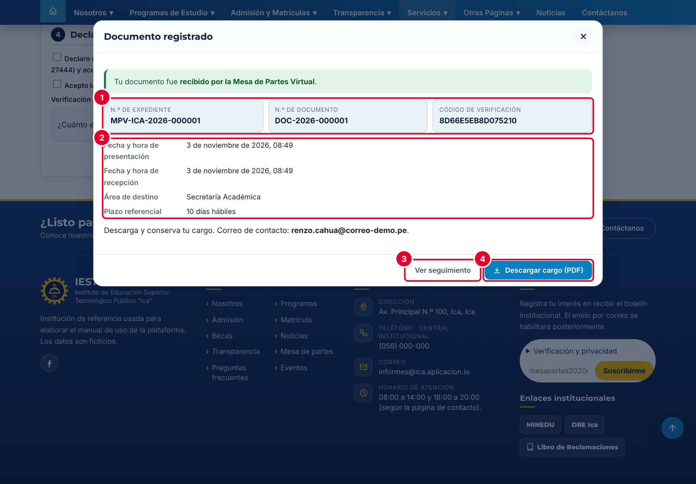

| N.º | Dato | Uso |
|---|---|---|
| 1 | **N.º de expediente** (MPV-…-AAAA-NNNNNN), **N.º de documento** (DOC-AAAA-NNNNNN) y **Código de verificación** (16 caracteres) | El expediente sirve para consultar; el código de verificación reemplaza al DNI en la consulta |
| 2 | Fechas de presentación y de recepción, área de destino y plazo referencial | Si se presentó fuera de horario, aparece «Fuera de horario: siguiente día hábil» |
| 3 | **Ver seguimiento** | Abre la consulta del expediente |
| 4 | **Descargar cargo (PDF)** | Cargo de recepción con sello, datos del remitente, lista de archivos con su huella SHA-256 y código QR de seguimiento |

La numeración es única, correlativa y se reinicia cada año.

## Paso 2 · Revisar la bandeja (intranet)

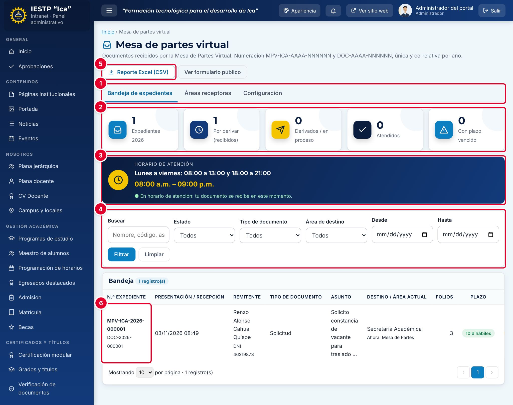

| N.º | Elemento | Para qué sirve |
|---|---|---|
| 1 | Pestañas | **Bandeja de expedientes**, **Áreas receptoras** y **Configuración** |
| 2 | Indicadores | Expedientes del año, por derivar (recibidos), derivados o en proceso, atendidos y con plazo vencido |
| 3 | Horario de atención | El mismo recuadro que ve el ciudadano |
| 4 | Filtros | **Buscar** (número, remitente, asunto, documento o código), **Estado**, **Tipo de documento**, **Área de destino** y fechas |
| 5 | **Reporte Excel (CSV)** | Descarga la bandeja filtrada. **Ver formulario público** abre el portal |
| 6 | Fila del expediente | Números, fechas de presentación y recepción, remitente, tipo, asunto, destino y área actual («Ahora: …»), folios, plazo y estado. El ojo abre el detalle |

El menú lateral muestra en **Mesa de partes virtual** un contador con los expedientes **Recibido** pendientes de derivar.

## Paso 3 · Abrir el detalle del expediente

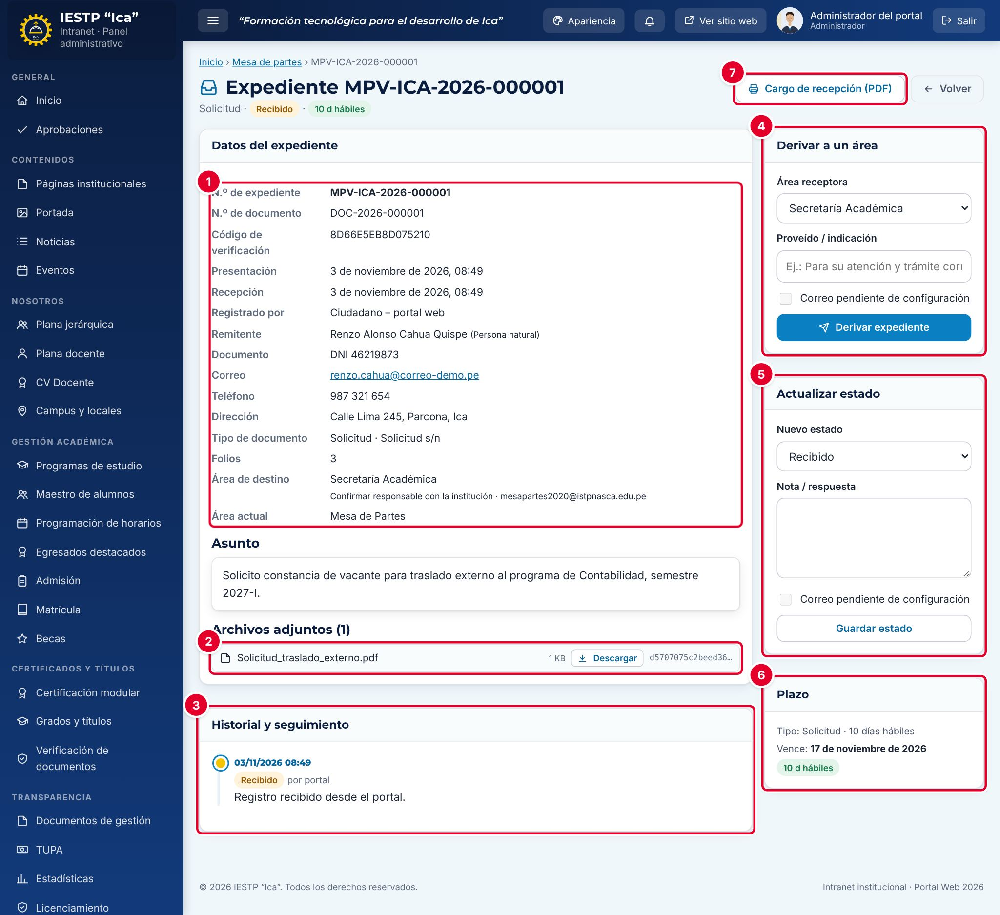

| N.º | Sección | Descripción |
|---|---|---|
| 1 | **Datos del expediente** | Números, código de verificación, fechas, remitente, tipo, folios, área de destino y **Área actual** |
| 2 | **Archivos adjuntos** | **Descargar** cada archivo; la huella SHA-256 garantiza que no fue alterado |
| 3 | **Historial y seguimiento** | Cada movimiento con fecha, usuario y nota |
| 4 | **Derivar a un área** | Envía el expediente al área que debe atenderlo |
| 5 | **Actualizar estado** | Cambia el estado con una nota o respuesta |
| 6 | **Plazo** | Plazo del tipo de documento, fecha de vencimiento y semáforo |
| 7 | **Cargo de recepción (PDF)** | Vuelve a generar el cargo del expediente |

El **Asunto** y las **Observaciones** del remitente aparecen debajo de los datos.

## Paso 4 · Derivar al área competente

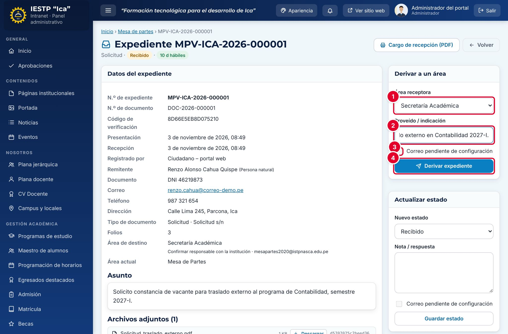

1. En **Área receptora** ①, elige el área. Viene seleccionada el área de destino que eligió el ciudadano.
2. Escribe el **Proveído / indicación** ②; por ejemplo, «Para su atención y trámite correspondiente».
3. La casilla **Correo pendiente de configuración** ③ está desactivada: no se envían correos (ver la nota del paso 5).
4. Pulsa **Derivar expediente** ④.

El expediente pasa a **Derivado** y su **Área actual** cambia. Puedes volver a derivarlo a otra área cuantas veces sea necesario; si estaba **Observado**, vuelve a **Derivado**.

## Paso 5 · Observar, atender y cerrar

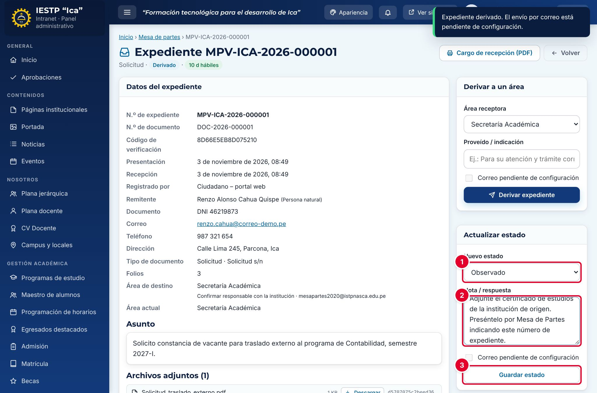

1. En **Nuevo estado** ①, elige el estado.
2. En **Nota / respuesta** ②, escribe lo que verá el ciudadano en el seguimiento:
   - **Observado:** qué falta y cómo presentarlo.
   - **Atendido:** la respuesta o el resultado del trámite.
3. Pulsa **Guardar estado** ③.

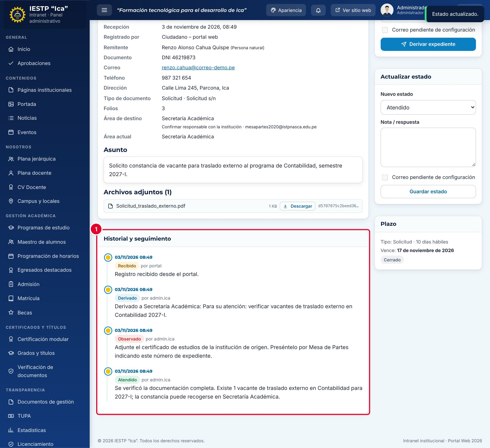

El **Historial y seguimiento** ① muestra el recorrido completo: recibido, derivado, observado y atendido, con la fecha, el usuario y la nota de cada paso.

> **Subsanar una observación:** el portal no tiene una opción para que el ciudadano responda una observación dentro del mismo expediente. Pídele en la nota que presente un **nuevo documento** por la Mesa de Partes Virtual y que escriba el N.º del expediente observado en **N.º o referencia de su documento**. Luego vuelve a derivar o actualiza el estado del expediente original.

> **Correo electrónico:** en la versión actual, el envío automático de correos está **desactivado**: las casillas **Correo pendiente de configuración** no se pueden marcar. El ciudadano se entera del avance **consultando su expediente en el portal**. Si necesitas avisarle, escríbele desde el correo institucional de Mesa de Partes.

## Paso 6 · El ciudadano consulta su expediente (portal)

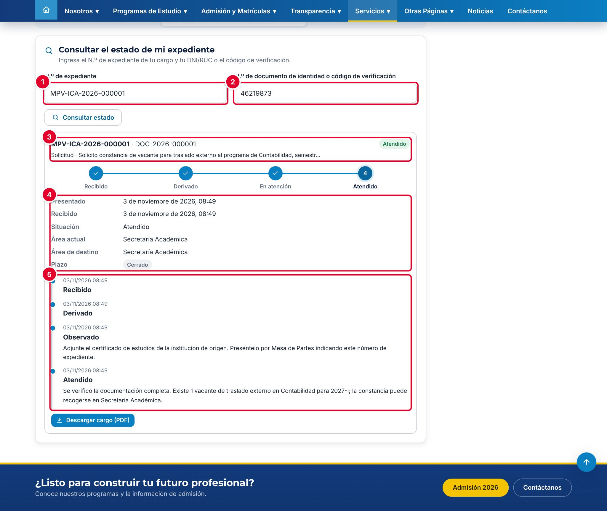

En la pestaña **Consultar expediente**, el ciudadano escribe:

| N.º | Elemento | Descripción |
|---|---|---|
| 1 | **N.º de expediente** | El número de su cargo |
| 2 | **N.º de documento de identidad o código de verificación** | Su DNI o RUC, o el código de 16 caracteres del cargo |
| 3 | Cabecera del resultado | Números, tipo, asunto y estado actual |
| 4 | Datos del trámite | Fechas, situación, área actual, área de destino y plazo |
| 5 | Historial | Cada paso con su fecha y la nota escrita por la institución |

Pulsa **Consultar estado**. Desde el resultado también puede volver a **Descargar cargo (PDF)**. El código QR del cargo abre directamente esta consulta. Por seguridad, el portal no muestra el correo, el teléfono ni los archivos del remitente.

## Paso 7 · Áreas receptoras y configuración

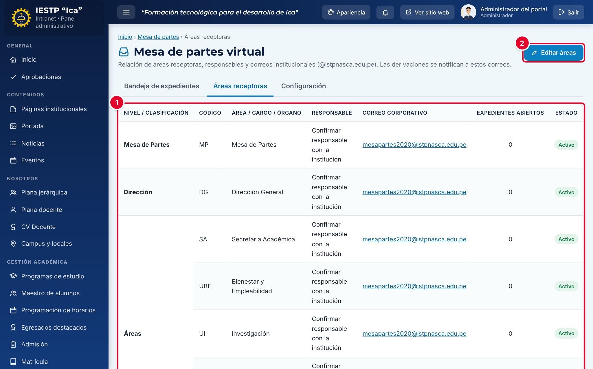

La pestaña **Áreas receptoras** lista las áreas ① por nivel, con su código, responsable, correo, expedientes abiertos y estado. Las áreas activas aparecen en el formulario público y en **Derivar a un área**. El administrador las modifica con **Editar áreas** ②, que abre el catálogo de **Configuración académica** (áreas y tipos de trámite con su plazo).

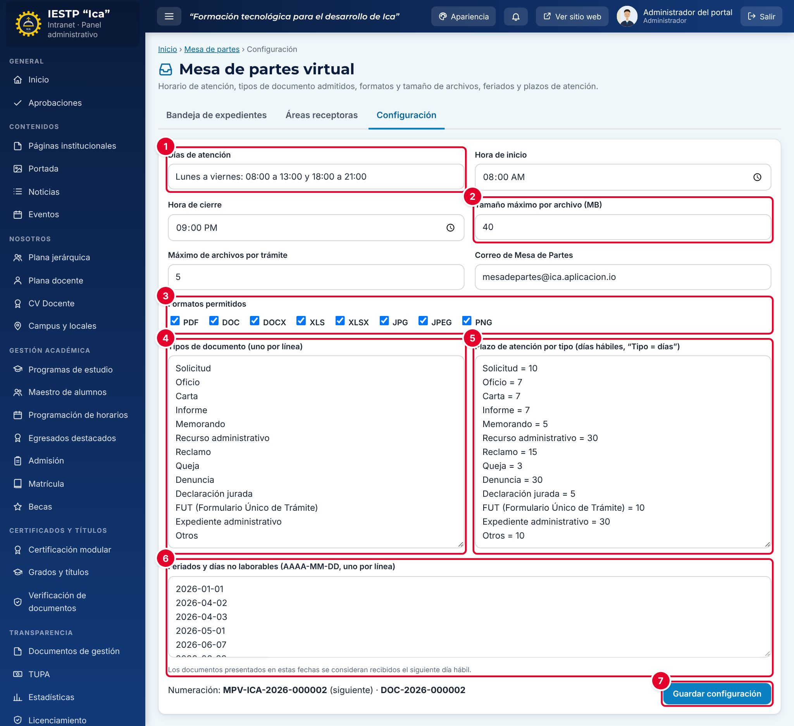

| N.º | Campo | Descripción |
|---|---|---|
| 1 | **Días de atención**, **Hora de inicio** y **Hora de cierre** | Horario de recepción que se muestra en el portal y se usa para calcular la fecha de recepción |
| 2 | **Tamaño máximo por archivo (MB)**, **Máximo de archivos por trámite** y **Correo de Mesa de Partes** | Límites de los adjuntos y correo de contacto |
| 3 | **Formatos permitidos** | Tipos de archivo aceptados |
| 4 | **Tipos de documento** | Uno por línea |
| 5 | **Plazo de atención por tipo** | Una línea por tipo: «Tipo = días» |
| 6 | **Feriados y días no laborables** | Fechas AAAA-MM-DD, una por línea. No se cuentan como días hábiles |
| 7 | **Guardar configuración** | Solo para el administrador. Debajo se ve el siguiente número de expediente |

> **Incidencia detectada al elaborar este manual (versión actual de la plataforma)**
> Al pulsar **Guardar configuración** aparece «Configuración de la Mesa de Partes guardada.», pero los cambios **no se guardan**: la pantalla vuelve a mostrar los valores anteriores y el portal sigue usando el horario, los límites y los plazos de antes. Se comprobó cambiando **Máximo de archivos por trámite** de 5 a 4 y **Días de atención**: después de guardar y recargar, ambos campos conservaban su valor original. Lo mismo ocurre con el **Libro de reclamaciones** y la **Bolsa laboral**. Ya se reportó para su corrección. Mientras tanto, los cambios de horario, feriados, límites de archivos o plazos deben hacerse con apoyo técnico.

## Mensajes y problemas frecuentes

| Mensaje o situación | Causa | Qué hacer |
|---|---|---|
| «Adjunte al menos un archivo (el documento principal).» | No se adjuntó ningún archivo | Adjunta el documento en un formato permitido |
| «Puede adjuntar hasta 5 archivos.» o un archivo marcado en rojo en la lista | Demasiados archivos, formato no permitido o archivo muy pesado | Une los anexos en un solo PDF o reduce su tamaño |
| «Describa el asunto (mínimo 10 caracteres).» | Asunto muy corto | Explica qué se solicita |
| «Debe aceptar la declaración de veracidad.» | No se marcó la declaración | Márcala antes de enviar |
| «La suma no es correcta…» o «La verificación anti-spam ha caducado…» | Verificación errada o vencida (30 minutos) | Corrige la suma o recarga la página |
| «Demasiados intentos. Espera unos minutos antes de continuar.» | Muchos envíos o consultas seguidos desde la misma conexión | Espera un minuto |
| «No se encontró el expediente con esos datos…» | Número o documento equivocado | Revisa el cargo; usa el código de verificación en lugar del DNI |
| «El expediente ya se encuentra en esa área.» | Se intentó derivar al área actual | Elige otra área |
| «Indique la observación.» / «Registre la respuesta o el detalle de la atención.» | Se eligió Observado o Atendido sin nota | Escribe la nota |
| «Consulta de solo lectura…» | Cuenta con rol Directivo | La atención la hace Mesa de partes o el área |
| El cargo dice «Fuera de horario» | Se presentó fuera del horario de atención | Es correcto: el plazo corre desde la fecha de recepción |
| La configuración «se guarda» pero no cambia | Incidencia del paso 7 | Solicita apoyo técnico |

## Buenas prácticas

- Deriva cada expediente **el mismo día** en que se recibe y escribe un proveído claro.
- Usa **Observado** solo cuando falte algo concreto, y explica en la nota qué debe presentar el ciudadano y cómo.
- Escribe la respuesta de **Atendido** pensando en el ciudadano: la leerá tal cual en el portal.
- Revisa cada semana los expedientes con **plazo vencido** con el filtro de estado y el indicador de la bandeja.
- Descarga el **Reporte Excel (CSV)** cada mes para los informes de gestión.
- Los datos y archivos del remitente son personales (Ley N.º 29733): descárgalos solo para atender el trámite y no los reenvíes fuera de las áreas involucradas.
