# 28 · Bolsa laboral

## Para qué sirve

La Bolsa laboral conecta a los estudiantes y egresados del instituto con empresas validadas. Las empresas se registran gratis desde el portal y publican ofertas; el instituto valida a cada empresa y cada oferta antes de que sean visibles. Los estudiantes y egresados postulan desde la intranet con su perfil y su CV, y la empresa revisa a los postulantes y les asigna un estado.

Intervienen cuatro actores:

- **Empresa (portal e intranet):** se registra con su RUC, publica ofertas y revisa postulantes.
- **Institución (intranet):** valida empresas y ofertas, y hace seguimiento con indicadores.
- **Estudiante o egresado (intranet):** completa su perfil profesional, sube su CV y postula.
- **Público (portal):** ve las ofertas vigentes.

## Quién lo usa

| Rol | Puede |
|---|---|
| Administrador | Todo: validar o rechazar empresas, aprobar o rechazar ofertas, crear y editar ofertas y empresas, ver postulaciones y CV, editar los criterios de validación |
| Atención al ciudadano | Lo mismo que el administrador en este módulo |
| Directivo | Consultar el panel, las empresas, las ofertas, las postulaciones y los indicadores (sin modificar) |
| Empresa | Publicar ofertas (quedan «Por validar»), ver a sus postulantes con su CV, cambiar el estado de cada postulación y actualizar sus datos |
| Estudiante y Egresado | Ver las ofertas, completar su perfil profesional con CV, postular, ver el estado de sus postulaciones y retirarlas mientras estén «Recibida» |
| Público (sin cuenta) | Ver las ofertas vigentes y registrar una empresa |

## Cómo se llega

- Intranet: menú lateral › **Servicios** › **Bolsa laboral**. Ruta: `#/admin/ix-bolsa` (gestión de ofertas: `#/admin/ix-bolsa/gestion`)
- Portal: menú **Servicios** › **Bolsa Laboral**. Ruta: `{{inst.dominio}}/#/servicios/bolsa-laboral`
- Empresas, estudiantes y egresados ingresan por **Intranet** (`{{inst.dominio}}/#/admin`) con su RUC o DNI y su contraseña.

## Flujo completo

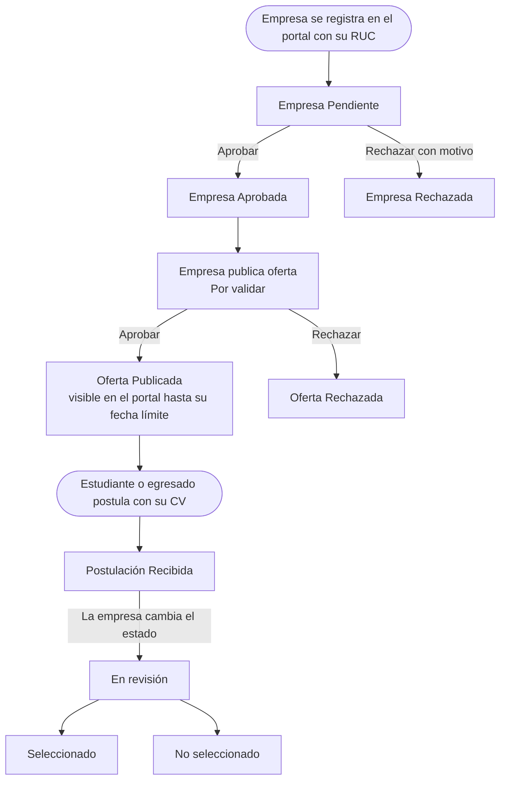

| Elemento | Estados |
|---|---|
| Empresa | **Pendiente** (recién registrada), **Aprobada** (validada por el instituto), **Rechazada** (con motivo) |
| Oferta | **Por validar**, **Publicada**, **Rechazada**, **Cerrada**. Una oferta publicada deja de verse en el portal al pasar su fecha límite |
| Postulación | **Recibida**, **En revisión**, **Seleccionado**, **No seleccionado** |

Una oferta solo aparece en el portal si está **Publicada**, su fecha límite no ha pasado y su empresa está **Aprobada**.

## Paso 1 · La empresa se registra (portal)

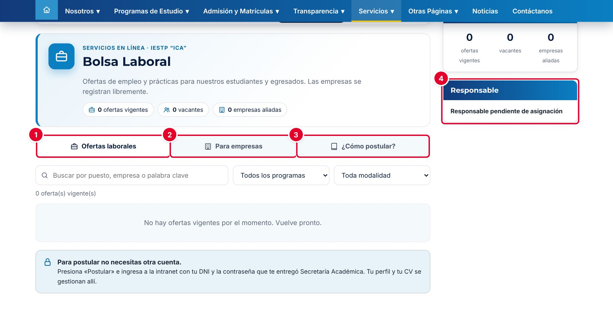

| N.º | Elemento | Para qué sirve |
|---|---|---|
| 1 | **Ofertas laborales** | Ofertas vigentes, con buscador y filtros por programa y modalidad |
| 2 | **Para empresas** | Registro de empresas, acceso a la intranet y lista de empresas aliadas |
| 3 | **¿Cómo postular?** | Pasos para estudiantes y egresados, y preguntas frecuentes |
| 4 | **Responsable** | Responsable de validar a las empresas (ver la incidencia del paso 2) |

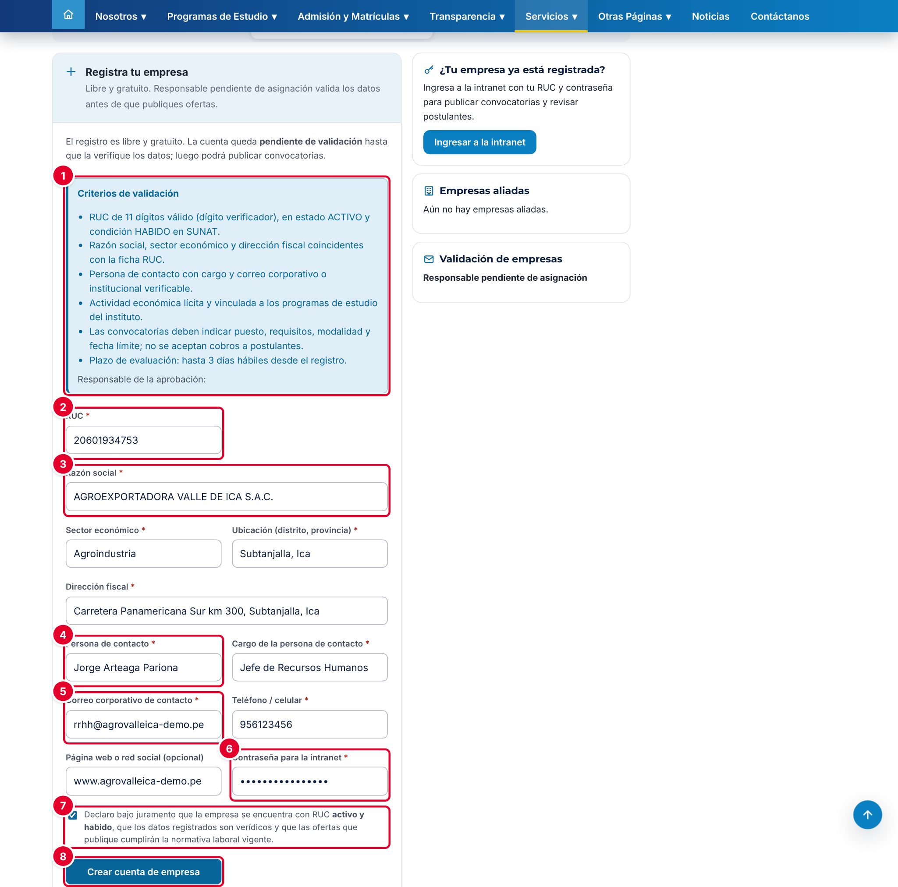

En la pestaña **Para empresas**, la empresa completa:

| N.º | Campo | Descripción |
|---|---|---|
| 1 | **Criterios de validación** | Requisitos que revisará el instituto (RUC activo y habido, datos coincidentes con la ficha RUC, contacto verificable, etc.) |
| 2 | **RUC*** | 11 dígitos, empieza en 10, 15, 17 o 20, con dígito verificador válido. Será el **usuario** de la intranet |
| 3 | **Razón social*** | También se piden **Sector económico***, **Ubicación*** y **Dirección fiscal*** |
| 4 | **Persona de contacto*** | Con su **Cargo*** |
| 5 | **Correo corporativo de contacto*** | Con el **Teléfono / celular*** (6 a 9 dígitos). La **Página web o red social** es opcional |
| 6 | **Contraseña para la intranet*** | Mínimo 12 caracteres |
| 7 | Declaración jurada | RUC activo y habido, datos verídicos y ofertas conforme a la normativa laboral |
| 8 | **Crear cuenta de empresa** | Registra la empresa y crea su cuenta |

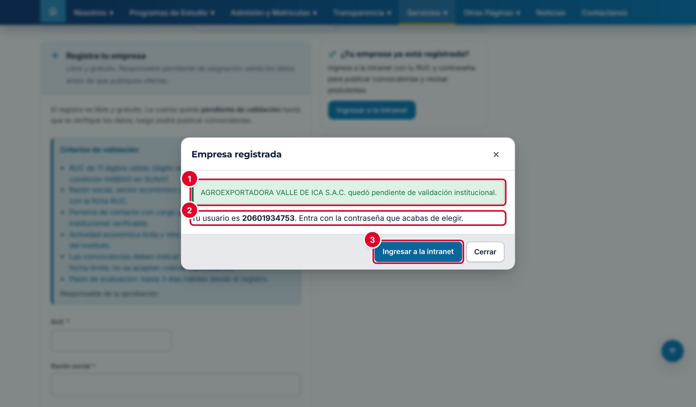

El portal confirma que la empresa quedó **pendiente de validación institucional** ①, indica el **usuario** (el RUC) ② y ofrece **Ingresar a la intranet** ③.

## Paso 2 · Validar a la empresa (intranet)

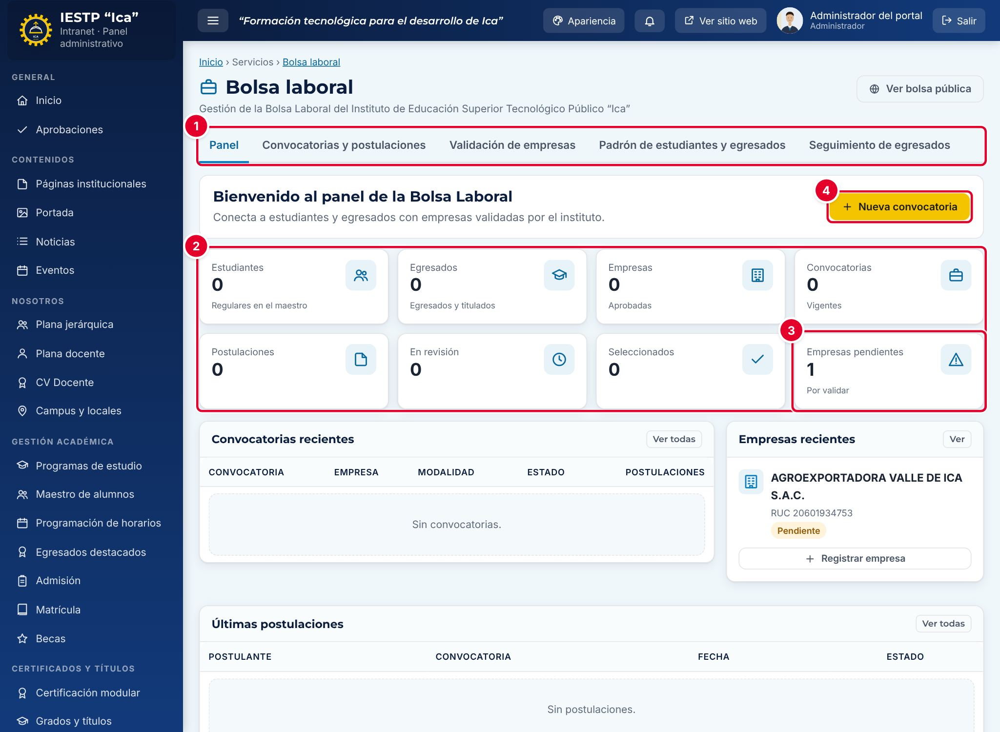

| N.º | Elemento | Para qué sirve |
|---|---|---|
| 1 | Pestañas | **Panel**, **Convocatorias y postulaciones**, **Validación de empresas**, **Padrón de estudiantes y egresados** y **Seguimiento de egresados** |
| 2 | Indicadores | Estudiantes, egresados, empresas aprobadas, convocatorias vigentes, postulaciones, en revisión y seleccionados. Cada tarjeta lleva a su lista |
| 3 | **Empresas pendientes** | Empresas por validar |
| 4 | **Nueva convocatoria** | Lleva a la gestión de ofertas |

Más abajo están **Convocatorias recientes**, **Empresas recientes**, **Últimas postulaciones** y **Acciones rápidas**.

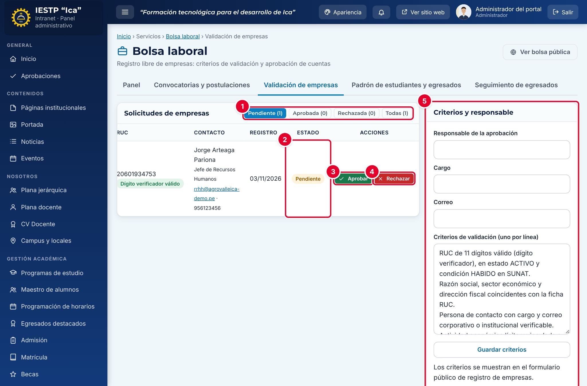

1. Abre la pestaña **Validación de empresas**. Los botones ① filtran por **Pendiente**, **Aprobada**, **Rechazada** o **Todas**.
2. Revisa los datos de la empresa. En la columna **RUC**, el sistema indica si el dígito verificador es válido. Comprueba en la consulta RUC de SUNAT que esté **activo y habido** y que la razón social coincida.
3. Revisa el **Estado** ②.
4. Pulsa **Aprobar** ③ o **Rechazar** ④. Para rechazar, escribe el motivo (mínimo 5 caracteres). En una empresa ya aprobada, el botón se llama **Suspender**.

La empresa ve el resultado en la campana de su intranet. El panel **Criterios y responsable** ⑤ define el responsable, su cargo, su correo y los criterios que se muestran en el formulario de registro.

> **Incidencia detectada al elaborar este manual (versión actual de la plataforma)**
> Al pulsar **Guardar criterios** aparece «Criterios guardados.», pero los datos **no se guardan**: al recargar, **Responsable de la aprobación**, **Cargo** y **Correo** vuelven a quedar vacíos. Por eso el portal muestra «Responsable pendiente de asignación», el texto del registro queda incompleto («…hasta que la verifique los datos») y la línea **Responsable de la aprobación:** aparece sin nombre. Lo mismo ocurre con la configuración de **Mesa de partes** y del **Libro de reclamaciones**. Ya se reportó para su corrección. Mientras tanto, el responsable debe cargarse con apoyo técnico.

## Paso 3 · La empresa publica una oferta

La empresa ingresa a la intranet con su RUC y su contraseña, y abre **Bolsa laboral**. Tiene tres pestañas: **Mis ofertas**, **Postulantes** y **Datos de la empresa**. En **Mis ofertas** pulsa **+ Publicar oferta**.

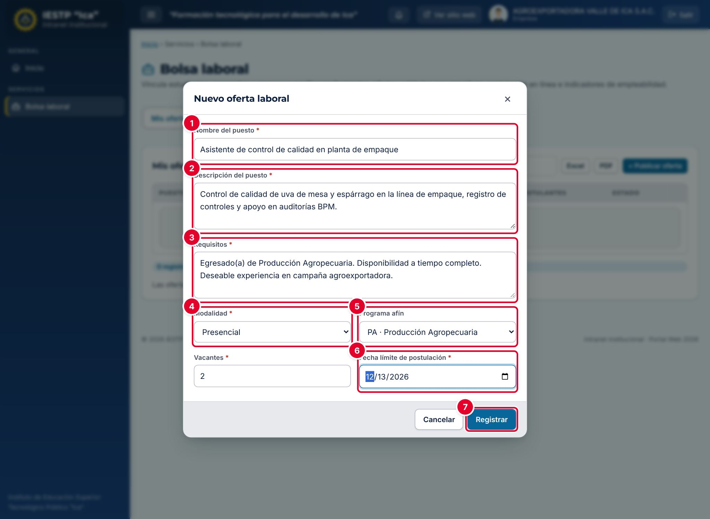

| N.º | Campo | Descripción |
|---|---|---|
| 1 | **Nombre del puesto*** | Por ejemplo, «Asistente de control de calidad» |
| 2 | **Descripción del puesto*** | Funciones principales |
| 3 | **Requisitos*** | Formación, experiencia y disponibilidad |
| 4 | **Modalidad*** | Presencial, Híbrido o Remoto. Al lado van las **Vacantes*** (1 a 50) |
| 5 | **Programa afín** | Programa de estudios relacionado, o «Cualquier programa» |
| 6 | **Fecha límite de postulación*** | No puede estar en el pasado |
| 7 | **Registrar** | Guarda la oferta como **Por validar** |

Toda oferta nueva de una empresa queda **Por validar**, y si la empresa edita una oferta, vuelve a quedar **Por validar**. Si la empresa todavía no está aprobada, la intranet le muestra el aviso «Empresa pendiente de validación».

## Paso 4 · Aprobar la oferta (intranet)

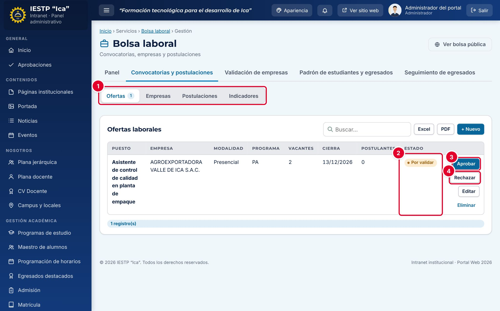

1. Ve a **Convocatorias y postulaciones**. Tiene las subpestañas ①: **Ofertas** (con el número de ofertas por validar), **Empresas**, **Postulaciones** e **Indicadores**.
2. Ubica la oferta en estado **Por validar** ②.
3. Revisa que indique puesto, requisitos, modalidad y fecha límite, y que no pida pagos a los postulantes.
4. Pulsa **Aprobar** ③ para publicarla o **Rechazar** ④.

Al aprobarla, la empresa y los estudiantes y egresados del programa afín reciben un aviso en la campana de su intranet. Con **+ Nuevo**, el personal también puede registrar ofertas directamente (con estado **Publicada**), y con **Editar** cambiar una oferta a **Cerrada**.

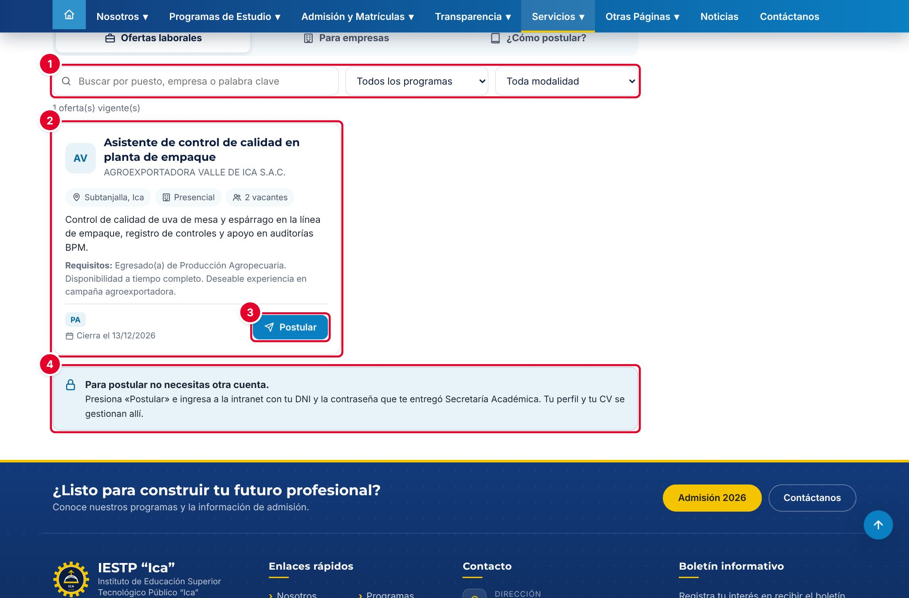

En el portal, la oferta aparece en **Ofertas laborales** con su ficha ②: empresa, ubicación, modalidad, vacantes, descripción, requisitos, programa y fecha de cierre. Los filtros ① buscan por texto, programa y modalidad. **Postular** ③ lleva al inicio de sesión de la intranet; el aviso ④ recuerda que se postula con el DNI y la contraseña de la intranet.

## Paso 5 · Dar acceso a estudiantes y egresados

Para postular, el estudiante o egresado necesita una cuenta de la intranet. Se crea en **Maestro de alumnos** (ver el capítulo correspondiente): en la fila del alumno, pulsa **Crear acceso**.

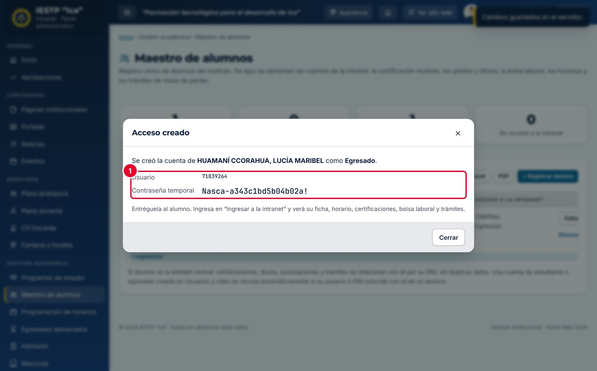

El sistema muestra el **Usuario** (el DNI) y una **Contraseña temporal** ①. Entrégala de forma personal al alumno. En su primer ingreso, la intranet le pide **cambiar la contraseña temporal** (mínimo 12 caracteres) antes de continuar. El rol (Estudiante o Egresado) depende del estado académico registrado en el maestro.

## Paso 6 · El estudiante o egresado completa su perfil y postula

En la intranet, **Bolsa laboral** tiene tres pestañas: **Ofertas disponibles**, **Mis postulaciones** y **Mi perfil profesional**. Para postular es obligatorio subir el CV.

1. En **Mi perfil profesional**, pulsa **Editar perfil y subir CV**.

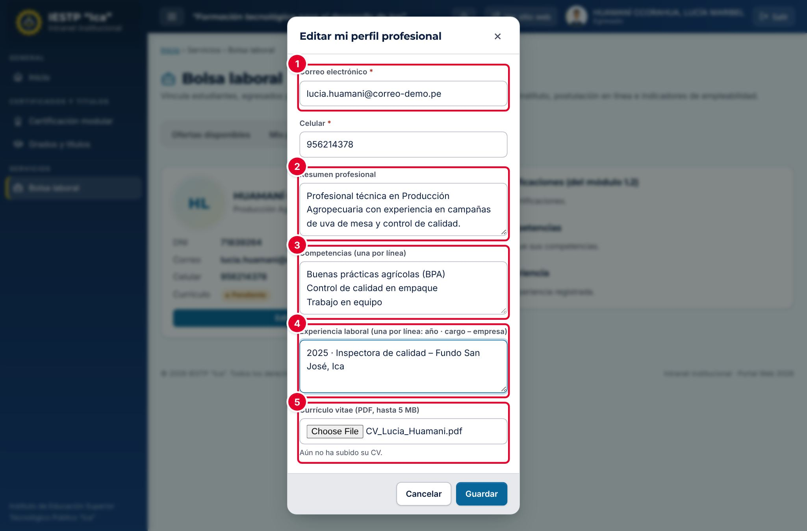

| N.º | Campo | Descripción |
|---|---|---|
| 1 | **Correo electrónico*** y **Celular*** | Datos de contacto que verá la empresa |
| 2 | **Resumen profesional** | Presentación breve |
| 3 | **Competencias** | Una por línea |
| 4 | **Experiencia laboral** | Una por línea: año · cargo – empresa |
| 5 | **Currículo vitae** | Solo PDF, hasta 5 MB. Si ya hay uno, el nuevo lo reemplaza |

2. Pulsa **Guardar**.
3. En **Ofertas disponibles**, ubica la oferta. Por defecto se ven solo las de tu programa; desmarca **Solo de …** para ver todas.
4. Pulsa **Postular**.

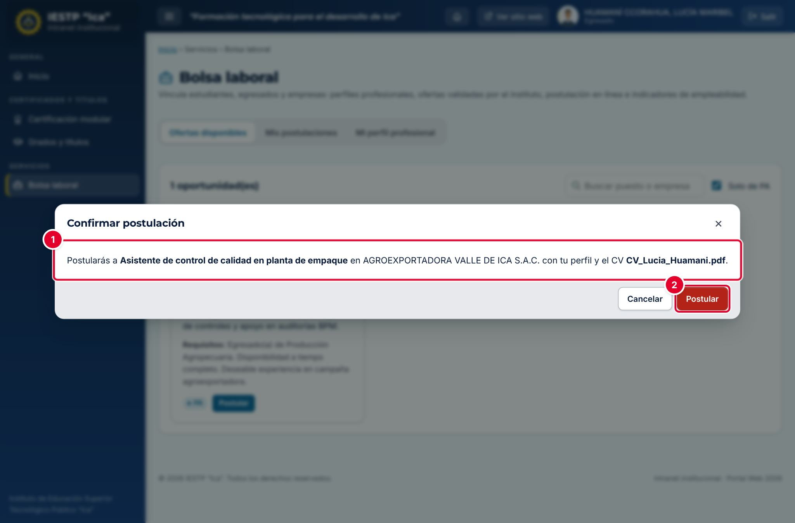

El sistema indica el puesto, la empresa y el CV que se enviará ①. Pulsa **Postular** ②. La empresa recibe un aviso en su intranet.

Si el estudiante pulsó **Postular** en el portal, después de iniciar sesión la intranet lo lleva directamente a la confirmación de esa oferta.

## Paso 7 · La empresa revisa a los postulantes

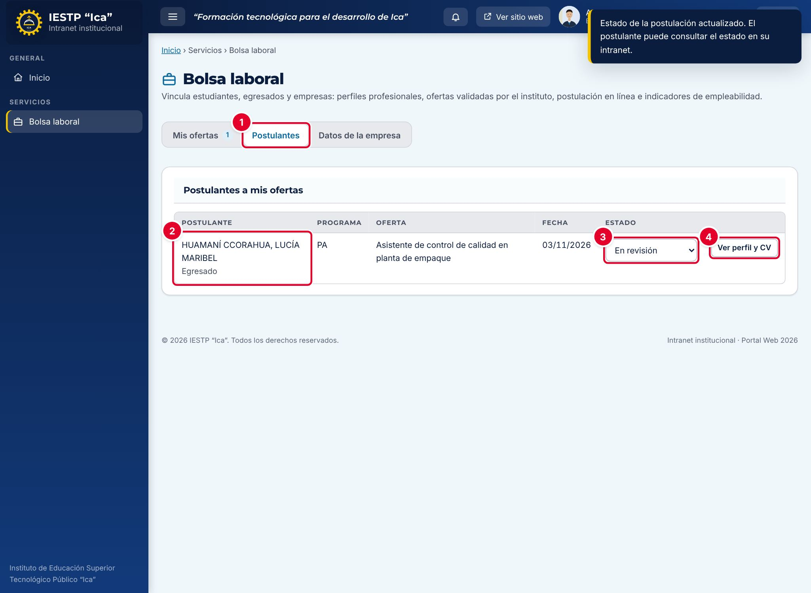

| N.º | Elemento | Para qué sirve |
|---|---|---|
| 1 | **Postulantes** | Pestaña con el número de postulaciones sin revisar |
| 2 | Postulante | Nombre y condición (estudiante o egresado), programa, oferta y fecha |
| 3 | Estado | **Recibida**, **En revisión**, **Seleccionado** o **No seleccionado**. El cambio se guarda al elegirlo y avisa al postulante |
| 4 | **Ver perfil y CV** | Abre el perfil profesional |

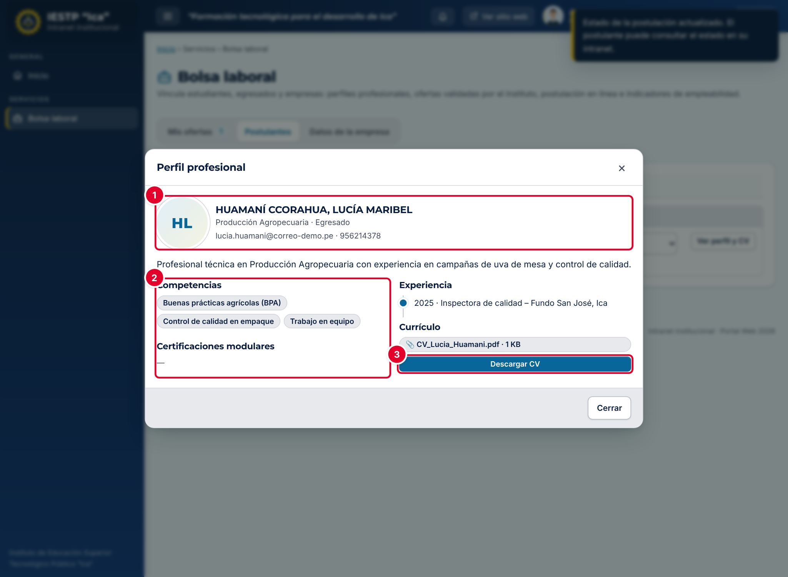

El perfil muestra los datos de contacto ①, el resumen, las competencias y las certificaciones modulares registradas por el instituto ②, la experiencia y el **Currículo**, con **Descargar CV** ③.

El personal del instituto ve todas las postulaciones en **Convocatorias y postulaciones › Postulaciones**, con el botón **Excel** para exportarlas, y los totales en **Indicadores**.

## Paso 8 · El postulante consulta su estado

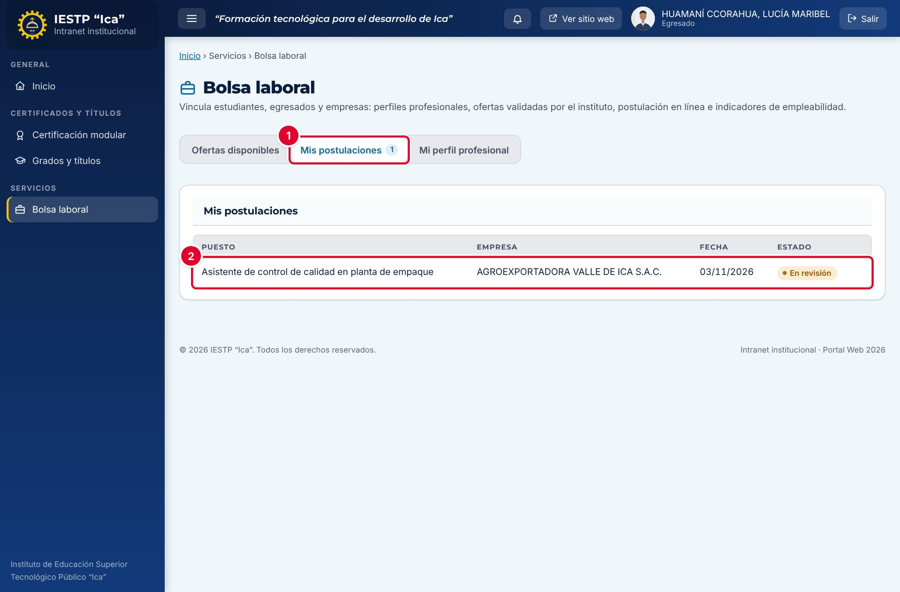

En **Mis postulaciones** ①, el estudiante o egresado ve cada postulación ② con el puesto, la empresa, la fecha y el estado que le asignó la empresa. Mientras esté **Recibida**, puede **Retirar** la postulación. Los cambios de estado también llegan a la campana de su intranet.

> **Correo electrónico:** en la versión actual, el portal **no envía correos**: los avisos de aprobación de empresas y ofertas, y de nuevas postulaciones, solo aparecen en la campana de la intranet. Avisa por teléfono o desde el correo institucional cuando sea necesario.

## Otras pestañas de la intranet

- **Padrón de estudiantes y egresados:** carga o actualiza el maestro de alumnos desde una plantilla Excel. Requiere permiso de edición del Maestro de alumnos.
- **Seguimiento de egresados:** lista de egresados y titulados con su situación laboral (dónde labora y en qué área), con filtros y exportación a Excel.

## Mensajes y problemas frecuentes

| Mensaje o situación | Causa | Qué hacer |
|---|---|---|
| «El RUC debe tener 11 dígitos (empieza en 10, 15, 17 o 20).» o «El RUC no es válido.» | RUC mal escrito o con dígito verificador incorrecto | Copia el RUC de la ficha SUNAT |
| «Ya existe una empresa con ese RUC.» | La empresa ya se registró | Ingresa a la intranet con el RUC; si olvidó la contraseña, debe pedirla al responsable de la bolsa |
| «Debes aceptar la declaración jurada.» | No se marcó la declaración | Márcala antes de enviar |
| «Demasiados intentos. Espera unos minutos antes de continuar.» | Más de 5 registros de empresas en 5 minutos desde la misma conexión | Espera unos minutos |
| «La fecha límite no puede estar en el pasado.» | Fecha límite anterior a hoy | Elige una fecha futura |
| La oferta no aparece en el portal | Está **Por validar**, la empresa no está aprobada o ya pasó su fecha límite | Aprueba la empresa y la oferta, o amplía la fecha |
| «Primero sube tu CV en “Mi perfil profesional”.» | El postulante no tiene CV | Sube el CV en PDF |
| No aparece la oferta en **Ofertas disponibles** | Es de otro programa | Desmarca **Solo de …** |
| «La postulación es para estudiantes y egresados.» | Se pulsó **Postular** con una cuenta de otro rol | Ingresa con la cuenta de estudiante o egresado |
| Al ingresar se abre «Cuentas del portal» | Es el primer ingreso con contraseña temporal | Cambia la contraseña y vuelve a la intranet |
| «Indique el motivo.» | Rechazo sin motivo | Escribe el motivo (mínimo 5 caracteres) |
| El portal dice «Responsable pendiente de asignación» | Incidencia del paso 2 | Solicita apoyo técnico |

## Buenas prácticas

- Valida las empresas **en un plazo máximo de 3 días hábiles**, como indican los criterios publicados.
- Antes de aprobar, verifica el RUC en SUNAT y que el correo de contacto sea corporativo.
- Rechaza las ofertas que pidan pagos a los postulantes o que no indiquen requisitos y fecha límite.
- Pide a las empresas que actualicen el estado de cada postulación: es la única forma de medir la inserción laboral (**Seleccionados**).
- Recuerda a estudiantes y egresados mantener su CV actualizado.
- El CV y los datos de los postulantes son personales (Ley N.º 29733): la empresa solo debe usarlos para el proceso de selección.
