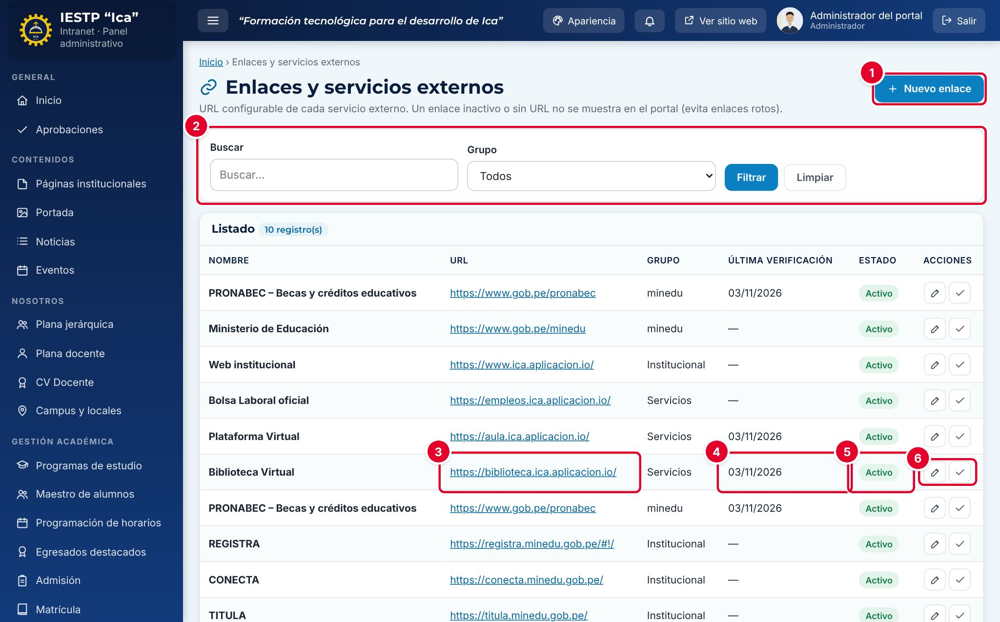
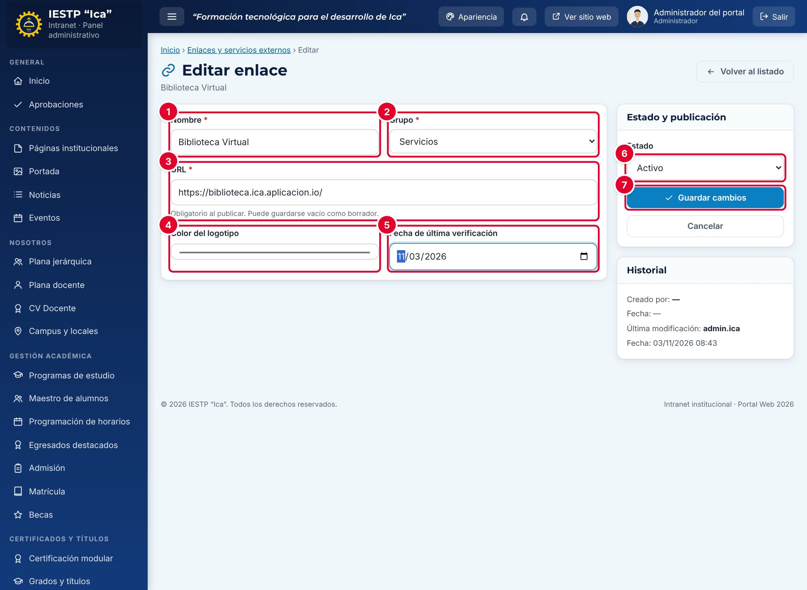
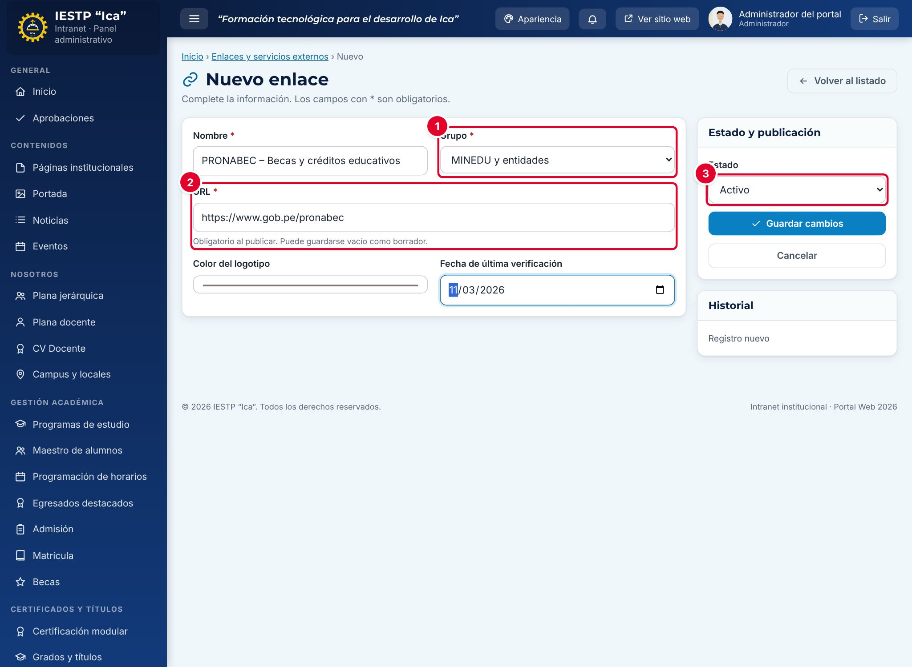
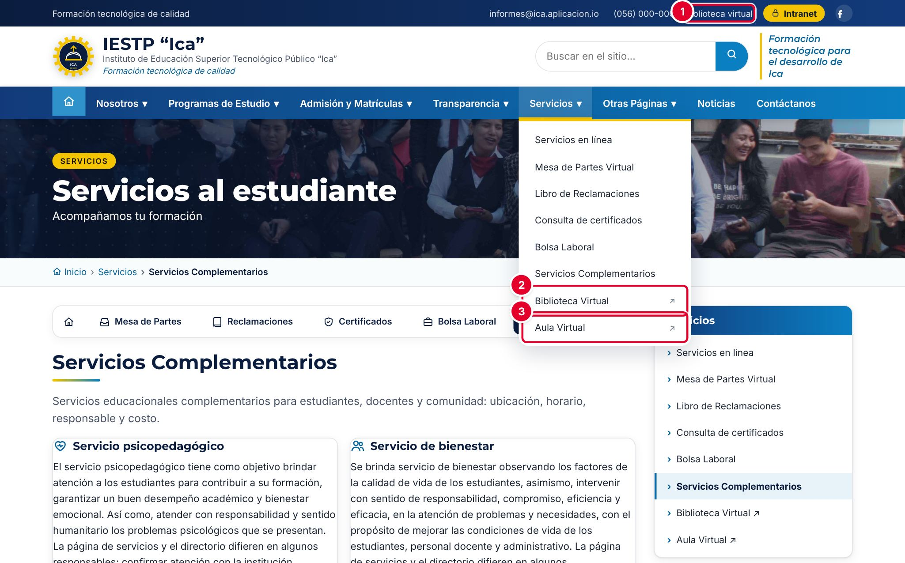
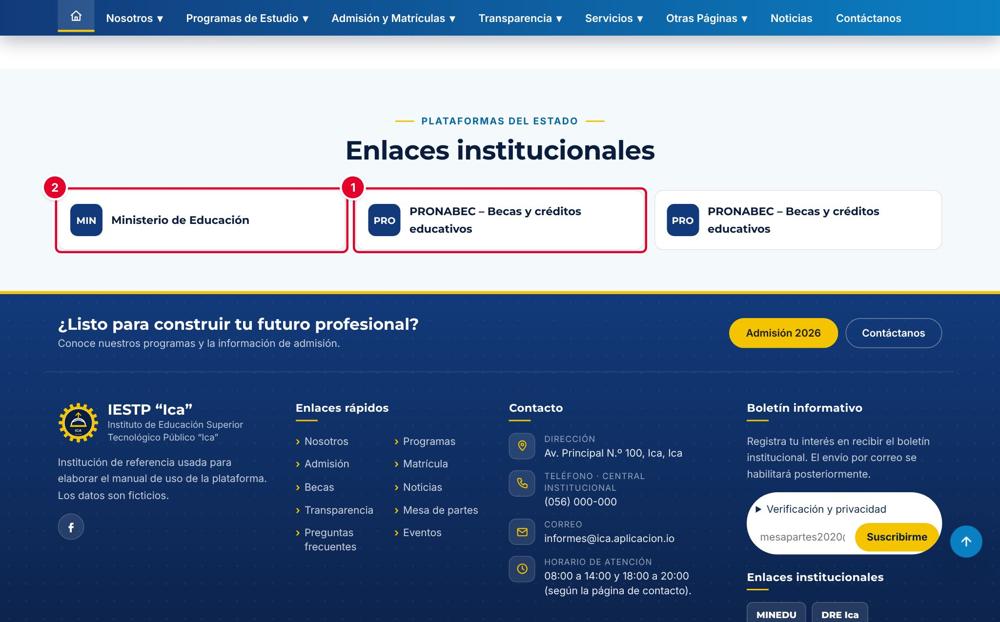

# 29 · Enlaces y servicios externos

## Para qué sirve

En este módulo se configura la dirección (URL) de los servicios externos que el portal enlaza: la biblioteca virtual, el aula virtual, las plataformas del MINEDU y otras entidades. Un enlace **Inactivo** o sin URL **no se muestra** en el portal, para evitar enlaces rotos.

Los enlaces aparecen en la franja superior del portal, en los menús **Servicios** y **Otras Páginas**, en el bloque **Enlaces institucionales** de la página de inicio, en el pie de página y en **Servicios Complementarios** › **Plataformas en línea**.

## Quién lo usa

| Rol | Puede |
|---|---|
| Administrador | Crear, editar, activar, desactivar y marcar como verificado |
| Imagen institucional | Crear, editar, activar, desactivar y marcar como verificado |

Los enlaces no se eliminan: se desactivan (**Inactivo**).

## Cómo se llega

Menú lateral › **Servicios** › **Enlaces y servicios**. Ruta: `#/admin/enlaces`

## Pantalla principal

| N.º | Elemento | Para qué sirve |
|---|---|---|
| 1 | **Nuevo enlace** | Abre el formulario para registrar un enlace. |
| 2 | Filtros | Buscan por nombre y filtran por **Grupo**. |
| 3 | **URL** | Dirección del servicio; se abre en una pestaña nueva. Si está vacía, dice **Sin configurar**. |
| 4 | **Última verificación** | Fecha en que alguien comprobó que el enlace funciona. Si pasó más de un mes, aparece la etiqueta **Revisar**. |
| 5 | **Estado** | **Activo** (se muestra en el portal) o **Inactivo**. |
| 6 | Acciones de la fila | **Editar** y **Marcar como verificado hoy** (✓): abre la URL en una pestaña nueva y registra la fecha de hoy. |

## Formulario

| N.º | Campo | Para qué sirve |
|---|---|---|
| 1 | **Nombre** | Texto del enlace. |
| 2 | **Grupo** | **Servicios**, **MINEDU y entidades**, **De interés** u otro grupo que ya exista en los datos. |
| 3 | **URL** | Dirección completa, que empieza con `https://`. |
| 4 | **Color del logotipo** | Color del recuadro con las siglas en el bloque **Enlaces institucionales**. |
| 5 | **Fecha de última verificación** | Fecha en que se comprobó el enlace. |
| 6 | **Estado** | **Activo** o **Inactivo**. |
| 7 | **Guardar cambios** | Guarda el enlace. |

| Campo | Obligatorio | Formato o límite | Ejemplo |
|---|---|---|---|
| Nombre | Sí | Texto | Biblioteca Virtual |
| Grupo | Sí | Uno de la lista | Servicios |
| URL | Para activar | Debe empezar con `http://` o `https://` | https://biblioteca.ica.aplicacion.io/ |
| Color del logotipo | No | Selector de color | — |
| Fecha de última verificación | No | Fecha | 03/11/2026 |
| Estado | Sí | Activo o Inactivo | Activo |

> **Incidencia detectada al elaborar este manual (versión actual de la plataforma)**
> El campo **Color del logotipo** se guarda, pero **no cambia** la apariencia del portal: todos los recuadros del bloque **Enlaces institucionales** se muestran con el color del tema. No es necesario completarlo.

## Procedimientos

### Cambiar la URL de un servicio

1. Pulsa el lápiz (**Editar**) del servicio; por ejemplo, **Biblioteca Virtual**.
2. Escribe la nueva **URL** ③, completa.
3. Abre la URL en otra pestaña del navegador y comprueba que carga. Luego escribe la **Fecha de última verificación** ⑤.
4. Revisa que el **Estado** ⑥ sea **Activo** y pulsa **Guardar cambios** ⑦.

### Agregar un enlace al bloque «Enlaces institucionales»

1. Pulsa **Nuevo enlace**.
2. Escribe el **Nombre**; por ejemplo, «PRONABEC – Becas y créditos educativos».
3. En **Grupo** ①, elige **MINEDU y entidades**. Solo los enlaces de ese grupo aparecen en el bloque de la página de inicio.
4. Escribe la **URL** ② y deja el **Estado** ③ en **Activo**.
5. Pulsa **Guardar cambios**.

### Verificar los enlaces cada mes

1. En el listado, busca las filas con la etiqueta **Revisar**.
2. Pulsa **Marcar como verificado hoy** (✓). La URL se abre en una pestaña nueva y la fecha de verificación cambia a hoy.
3. Si la página no carga o cambió de dirección, corrige la **URL** o cambia el **Estado** a **Inactivo**.

### Retirar un enlace

Edita el enlace, cambia el **Estado** a **Inactivo** y pulsa **Guardar cambios**. Deja de mostrarse en todo el portal, sin perder la URL.

### Qué enlace aparece en cada lugar del portal

Los servicios de la franja superior, de los menús y del pie de página se identifican por un **código interno fijo**, no por su nombre:

| Lugar del portal | Servicios que muestra |
|---|---|
| Franja superior | Correo institucional y Biblioteca virtual |
| Menú **Servicios** y **Plataformas en línea** | Biblioteca Virtual, Correo Institucional y Aula Virtual |
| Menú **Otras Páginas** | Avanza, Conecta, Registra y Titula del MINEDU, y la DRE |
| Pie de página, **Enlaces institucionales** | MINEDU y DRE. Si no tienen URL activa, se usan las direcciones oficiales por defecto |
| Inicio, bloque **Enlaces institucionales** | Todos los enlaces activos del grupo **MINEDU y entidades** |

Por eso, **un enlace nuevo no reemplaza** a un servicio de la tabla: para cambiar la biblioteca virtual, edita el registro existente de la Biblioteca Virtual. Un enlace nuevo solo aparece en el bloque de la página de inicio (si su grupo es **MINEDU y entidades**) o en un acceso rápido de la portada (ver el capítulo de Portada).

> **Incidencia detectada al elaborar este manual (versión actual de la plataforma)**
> En los datos iniciales de la plataforma no existen los registros del **Correo institucional**, **Avanza** y la **DRE**, y la intranet no permite crearlos con su código interno: un enlace nuevo recibe un código distinto. Por eso esos servicios no aparecen en la franja superior ni en los menús, aunque se registre un enlace con ese nombre. Si la institución los necesita, debe pedir apoyo técnico para crearlos.

## Flujo y estados

| Estado | Significado | Visible en el portal |
|---|---|---|
| Activo con URL | Enlace configurado | **Sí** |
| Activo sin URL | Pendiente de configurar (**Sin configurar**) | No |
| Inactivo | Retirado | No |

## Resultado en el portal público

En la franja superior aparece **Biblioteca virtual** ①. En el menú **Servicios**, la **Biblioteca Virtual** ② y el **Aula Virtual** ③ se marcan con una flecha porque abren otra página en una pestaña nueva.

En la página de inicio, el bloque **Enlaces institucionales** muestra los enlaces activos del grupo **MINEDU y entidades**, como el nuevo enlace de PRONABEC ① y el del Ministerio de Educación ②. El recuadro muestra las tres primeras letras del nombre.

## Mensajes y problemas frecuentes

| Mensaje o situación | Causa | Qué hacer |
|---|---|---|
| «Debe iniciar con http:// o https://» | La URL está incompleta | Escribe la dirección completa: `https://…` |
| «Obligatorio para publicar (puede guardarlo como borrador).» en **URL** | Se eligió **Activo** sin URL | Escribe la URL o deja el enlace **Inactivo** |
| Un enlace del MINEDU no aparece en la página de inicio | Su grupo no es **MINEDU y entidades** (por ejemplo, «Institucional») | Edita el enlace y cambia el **Grupo** |
| Creé un enlace «Correo institucional» y no aparece en la franja superior | Los servicios de la franja se buscan por su código interno | Ver la incidencia de «Qué enlace aparece en cada lugar del portal» |
| Aparece la etiqueta **Revisar** | Pasó más de un mes desde la última verificación | Verifica el enlace y pulsa ✓ |
| La lista de grupos muestra «Servicios» dos veces | Los datos iniciales usan un grupo «Servicios» propio, además del grupo base | Para los enlaces nuevos, usa los grupos base |

## Buenas prácticas

- Verifica todos los enlaces **una vez al mes** con **Marcar como verificado hoy**.
- Usa siempre direcciones con `https://`.
- Desactiva un enlace en cuanto falle: es mejor no mostrarlo que llevar al público a una página de error.
- Usa nombres cortos y reconocibles: «Biblioteca Virtual», «Aula Virtual».
