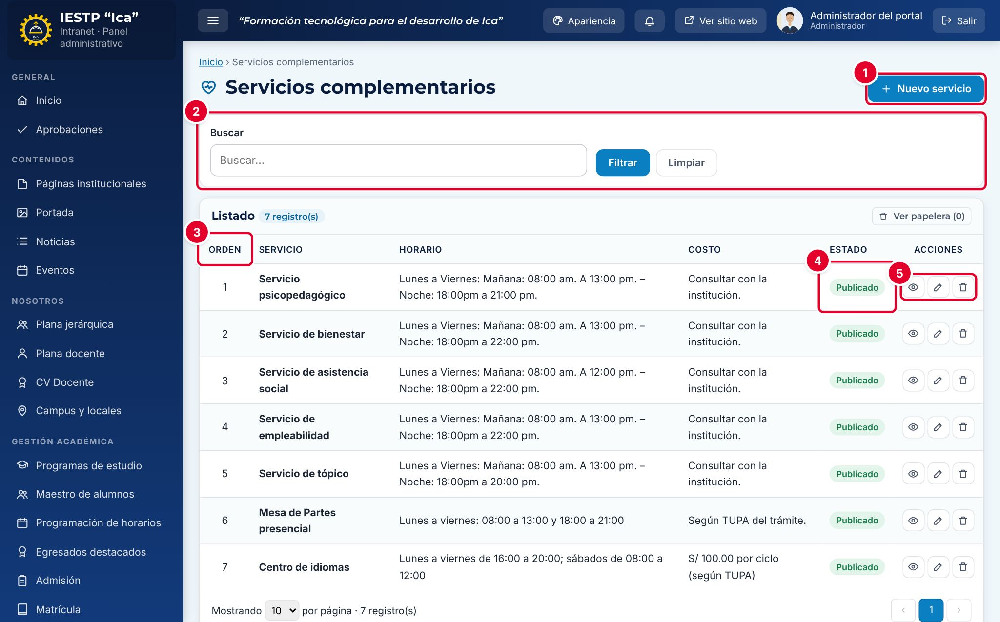
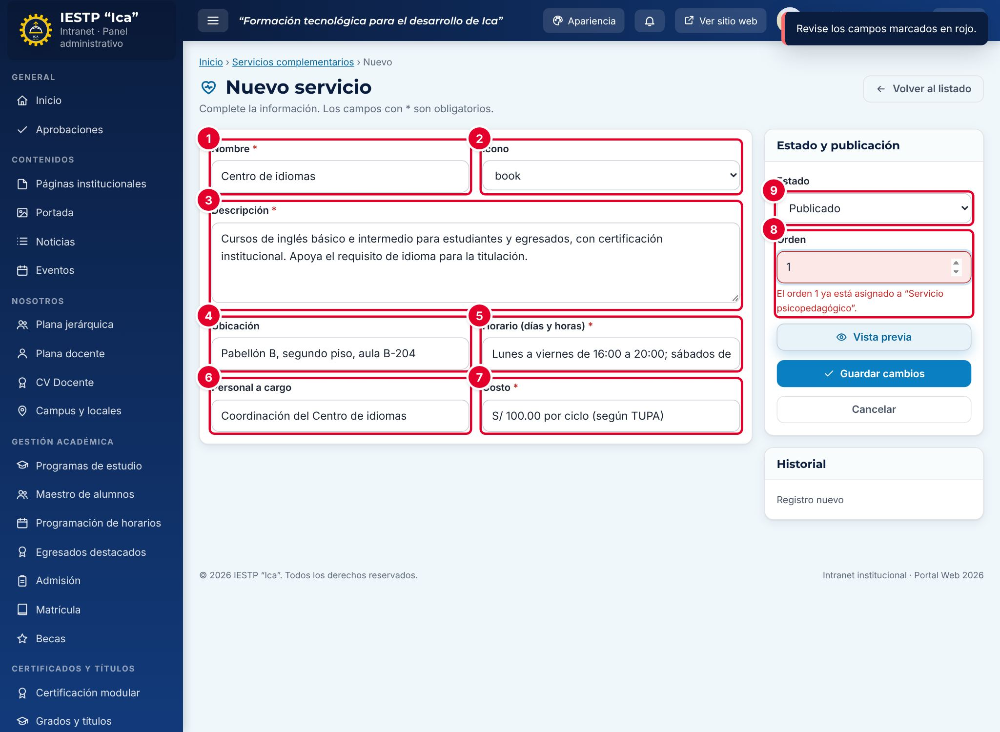
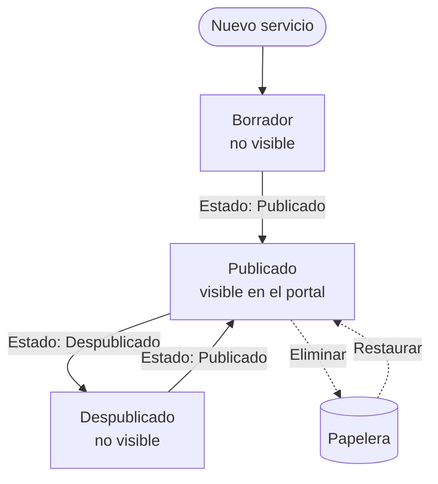
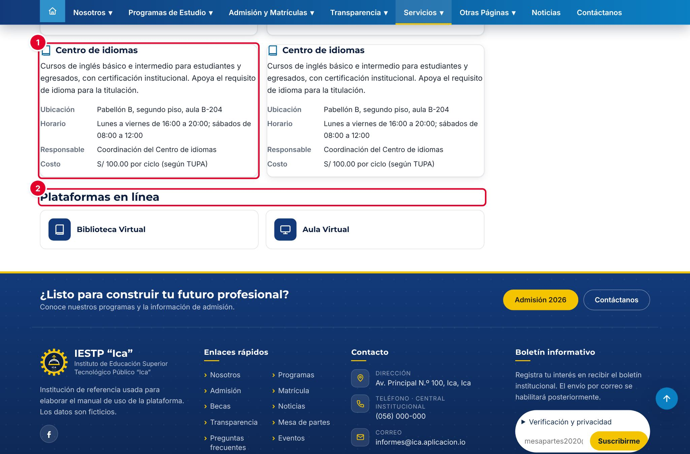

# 30 · Servicios complementarios

## Para qué sirve

En este módulo se registran los servicios complementarios que la institución ofrece a estudiantes, docentes y comunidad: servicio psicopedagógico, bienestar, tópico, empleabilidad, centro de idiomas, etc. De cada uno se publican la descripción, la ubicación, el horario, el personal a cargo y el costo.

Lo publicado aparece en el portal, en **Servicios** › **Servicios Complementarios**, que es también la página de **Servicios en línea**.

## Quién lo usa

| Rol | Puede |
|---|---|
| Administrador | Todo, incluida la **eliminación definitiva** |
| Transparencia / administración | Crear, editar, publicar, despublicar, enviar a la papelera y restaurar. No necesita aprobación del Administrador |

## Cómo se llega

Menú lateral › **Servicios** › **Servicios complementarios**. Ruta: `#/admin/servicios`

## Pantalla principal

| N.º | Elemento | Para qué sirve |
|---|---|---|
| 1 | **Nuevo servicio** | Abre el formulario. |
| 2 | Filtros | Buscan por nombre. |
| 3 | **Orden** | Posición del servicio en el portal. El listado se ordena por este número. |
| 4 | **Estado** | **Borrador**, **Publicado** o **Despublicado**. |
| 5 | Acciones de la fila | **Vista previa**, **Editar** y **Eliminar** (envía a la papelera). |

## Formulario

| N.º | Campo | Para qué sirve |
|---|---|---|
| 1 | **Nombre** | Nombre del servicio. |
| 2 | **Ícono** | Dibujo que acompaña al nombre en el portal. La lista muestra el nombre técnico del ícono: `heart` (corazón), `users` (personas), `briefcase` (maletín), `book` (libro), `monitor` (pantalla), `tool` (herramienta), `coffee` (taza) o `building` (edificio). |
| 3 | **Descripción** | Qué ofrece el servicio y a quién. |
| 4 | **Ubicación** | Dónde se atiende. |
| 5 | **Horario (días y horas)** | Días y horas de atención. |
| 6 | **Personal a cargo** | Área o cargo responsable. |
| 7 | **Costo** | Si es gratuito o cuánto cuesta. |
| 8 | **Orden** | Posición en el portal. No puede repetirse entre los servicios activos. |
| 9 | **Estado** | **Borrador**, **Publicado** o **Despublicado**. |

| Campo | Obligatorio | Formato o límite | Ejemplo |
|---|---|---|---|
| Nombre | Sí | Texto | Centro de idiomas |
| Ícono | No | Uno de la lista | book |
| Descripción | Sí | Texto | Cursos de inglés básico e intermedio… |
| Ubicación | No | Texto | Pabellón B, segundo piso, aula B-204 |
| Horario (días y horas) | Sí | Texto | Lunes a viernes de 16:00 a 20:00 |
| Personal a cargo | No | Texto | Coordinación del Centro de idiomas |
| Costo | Sí | Texto | S/ 100.00 por ciclo (según TUPA) |
| Orden | No | Número desde 1, sin repetir | 7 |
| Estado | Sí | Borrador, Publicado o Despublicado | Publicado |

## Procedimientos

### Registrar un servicio

1. Pulsa **Nuevo servicio**.
2. Escribe el **Nombre** ① y elige el **Ícono** ②.
3. Completa **Descripción** ③, **Ubicación** ④, **Horario (días y horas)** ⑤, **Personal a cargo** ⑥ y **Costo** ⑦.
4. Escribe el **Orden** ⑧: el número siguiente al último servicio del listado.
5. Elige el **Estado** ⑨ y pulsa **Guardar cambios**. Aparece «Cambios guardados.».

En la imagen, el orden 1 ya estaba ocupado: el sistema muestra «El orden 1 ya está asignado a “Servicio psicopedagógico”.» y no guarda. Cambia el número y vuelve a guardar.

### Editar un servicio

1. Pulsa el lápiz (**Editar**) del servicio.
2. Actualiza los datos; por ejemplo, el **Horario** al empezar un nuevo semestre o el **Personal a cargo**.
3. Pulsa **Guardar cambios**.

### Cambiar el orden de los servicios

Edita los servicios y cambia sus números de **Orden**. Como un número no puede repetirse, primero mueve uno de ellos a un número libre (por ejemplo, 99), luego asigna el número que quedó libre y al final corrige el primero.

### Retirar, eliminar o restaurar

- Para retirar un servicio del portal de forma temporal, cambia el **Estado** a **Despublicado**. Su número de orden queda libre para otro servicio.
- La papelera (**Eliminar**) lo envía a la papelera; se recupera con **Ver papelera** › **Restaurar**. Solo el Administrador puede eliminar definitivamente.

## Flujo y estados

| Estado | Significado | Visible en el portal |
|---|---|---|
| Borrador | En preparación | No |
| Publicado | Servicio en funcionamiento | **Sí** |
| Despublicado | Retirado temporalmente; no ocupa número de orden | No |
| En papelera | Eliminado; se puede restaurar | No |

## Resultado en el portal público

En `{{inst.dominio}}/#/servicios/complementarios` cada servicio publicado se muestra en una tarjeta ① con su ícono, nombre, descripción, ubicación, horario, responsable y costo, en el orden indicado. Debajo, **Plataformas en línea** ② muestra los accesos a la Biblioteca Virtual, el Correo Institucional y el Aula Virtual que estén configurados en **Enlaces y servicios** (capítulo 29).

## Mensajes y problemas frecuentes

| Mensaje o situación | Causa | Qué hacer |
|---|---|---|
| «El orden N ya está asignado a “…”.» | Otro servicio activo usa ese número | Usa otro número u ordena como se indica arriba |
| «Este campo es obligatorio.» | Falta nombre, descripción, horario o costo | Completa el campo marcado |
| El servicio no aparece en el portal | Está en Borrador, Despublicado o en la papelera | Cambia el **Estado** a **Publicado** |
| Falta la Biblioteca Virtual en **Plataformas en línea** | El enlace está Inactivo o sin URL | Revísalo en **Enlaces y servicios** |

## Buenas prácticas

- Escribe el horario con un formato uniforme: «Lunes a viernes de 08:00 a 13:00».
- En **Personal a cargo**, usa el nombre del área o del cargo, no datos personales como teléfonos o correos personales.
- Si el servicio tiene costo, indica que se rige por el TUPA y verifica que el monto coincida.
- Revisa los horarios al inicio de cada semestre.
