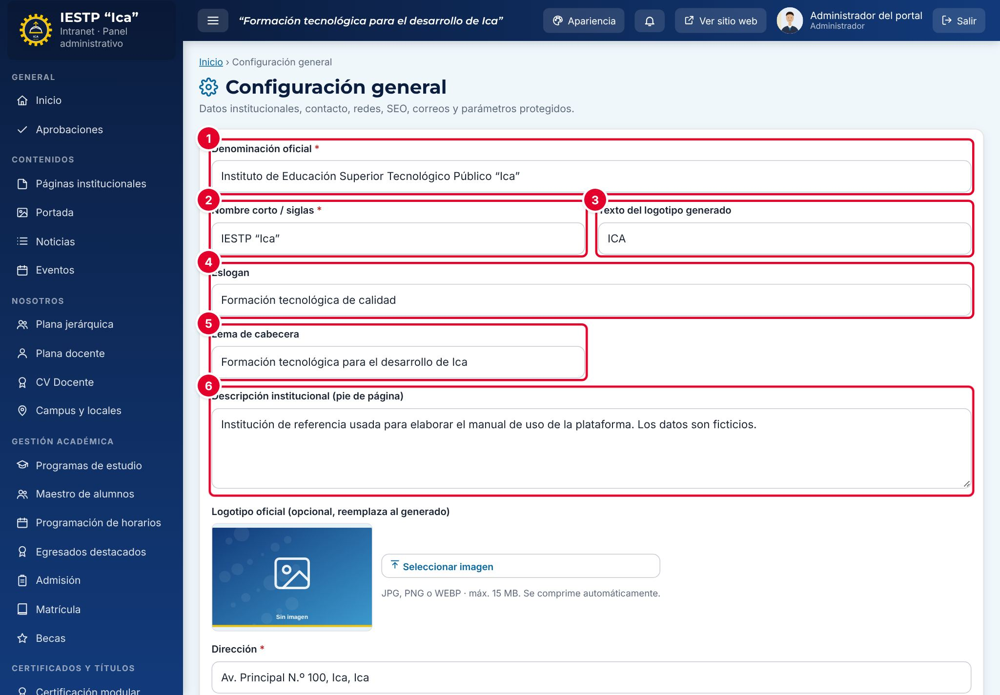
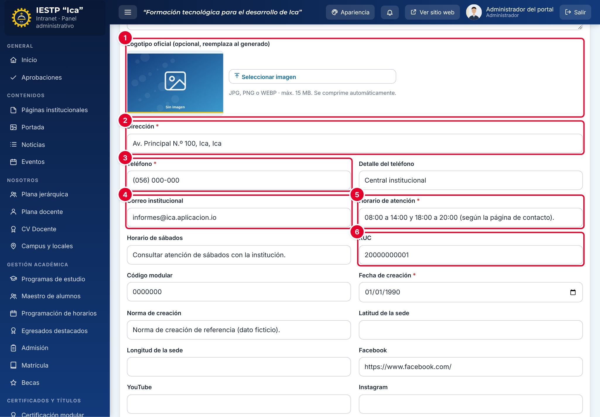
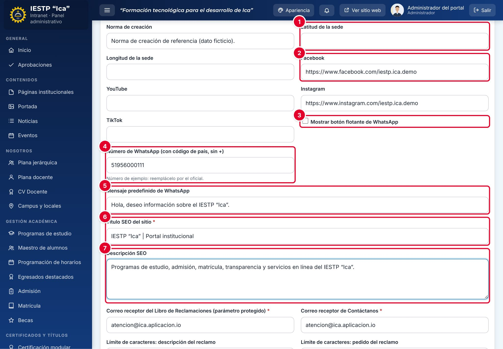
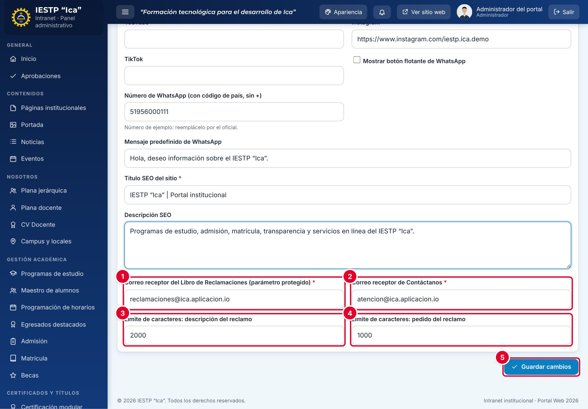
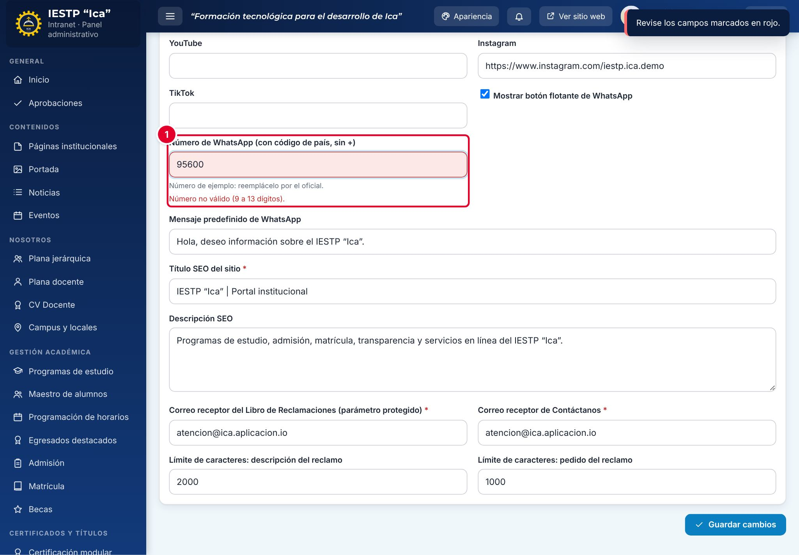
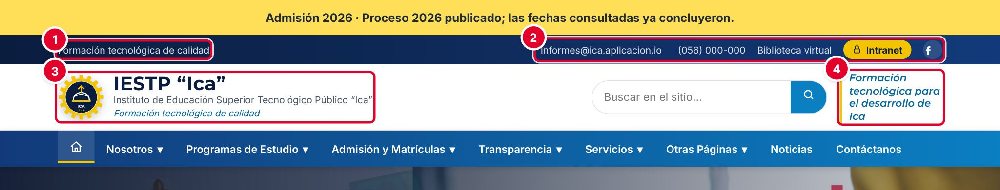
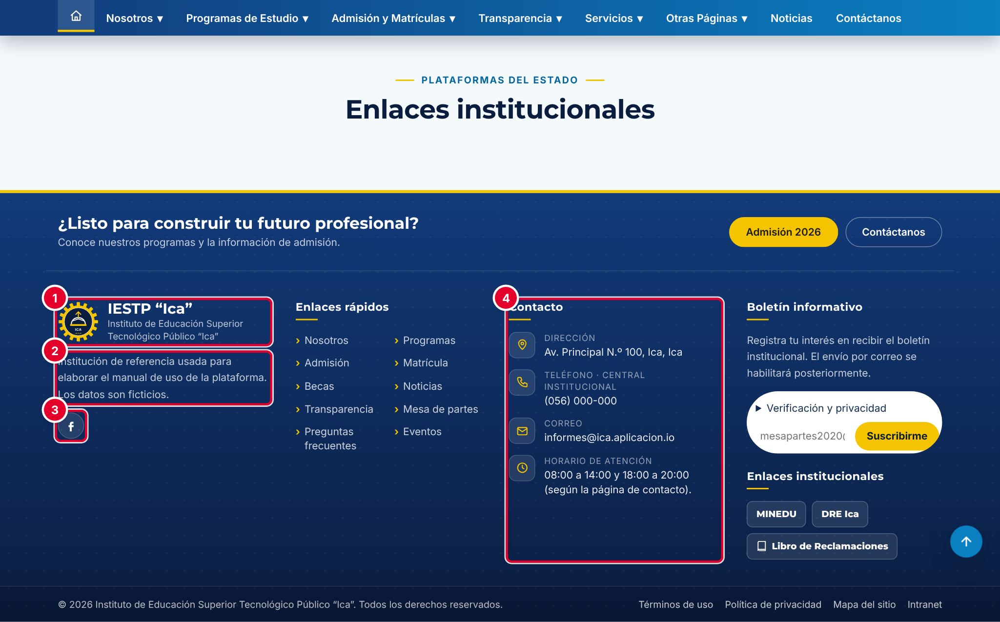
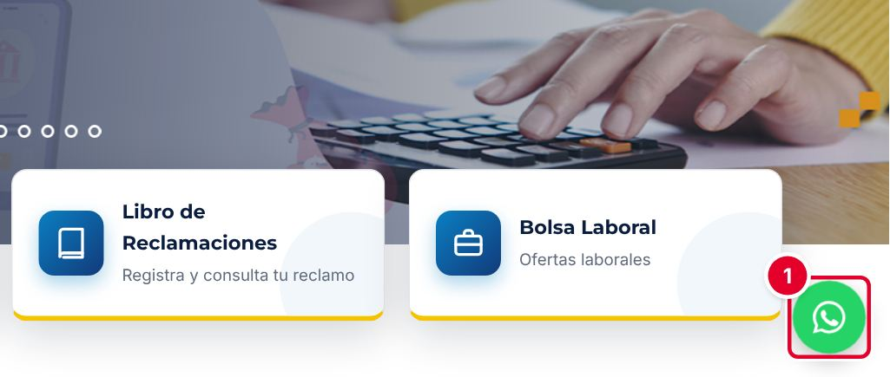
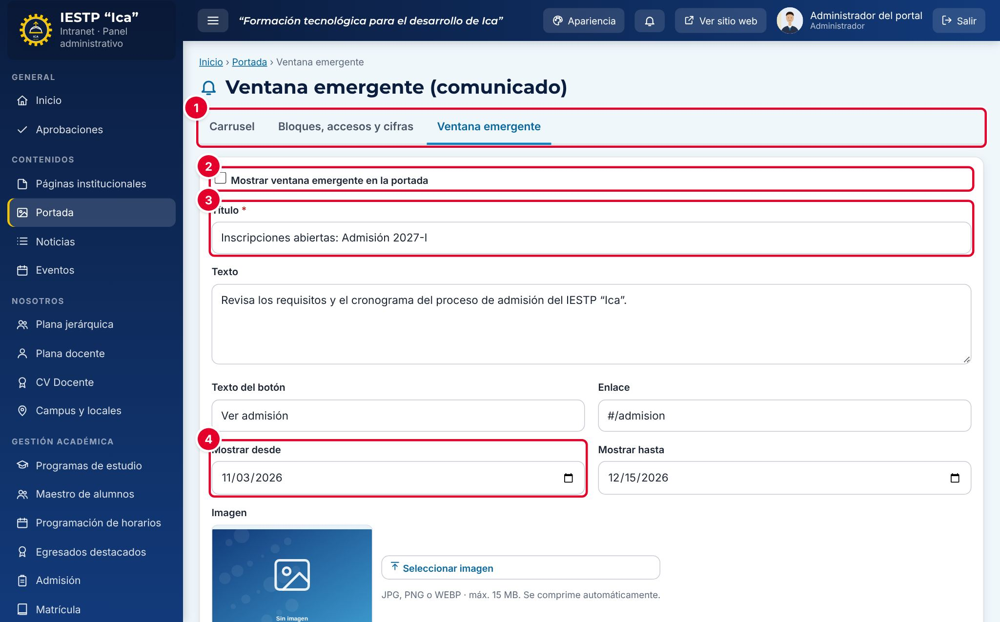
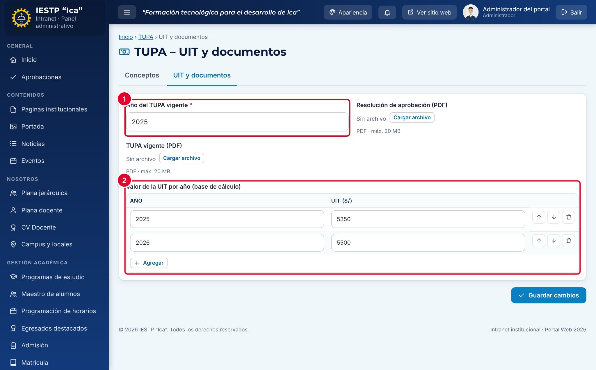

# 31 · Configuración general

## Para qué sirve

En este módulo se registran los datos que identifican a la institución en todo el portal: denominación oficial, siglas, eslogan, logotipo, dirección, teléfonos, correo, horario, redes sociales, botón de WhatsApp, textos para buscadores (SEO) y los correos que reciben los avisos del Libro de Reclamaciones y del formulario de contacto. Lo que guardes aquí se refleja de inmediato en la cabecera y el pie de página del portal, en la pantalla de acceso a la intranet y en el título que muestran el navegador y los buscadores.

Otros parámetros de alcance general (ventana emergente, valor de la UIT, bloques de la portada, colores) tienen su propia pantalla. Al final del capítulo encontrarás dónde está cada uno.

## Quién lo usa

| Rol | Puede |
|---|---|
| Administrador | Ver y modificar toda la configuración |
| Demás roles | No tienen acceso. Si intentan entrar, ven «Acceso denegado» |

> El módulo **Configuración** solo figura entre los módulos del Administrador (ver la matriz del capítulo 34). Ningún otro rol puede habilitarlo.

## Cómo se llega

Menú lateral › **Configuración y seguridad** › **Configuración**. Ruta: `#/admin/config`

## Pantalla principal

La configuración es un formulario único, sin listado. Se recorre de arriba hacia abajo y se guarda con un solo botón al final.

| N.º | Elemento | Para qué sirve |
|---|---|---|
| 1 | **Denominación oficial** | Nombre completo de la institución. Aparece bajo el nombre corto en la cabecera, en el pie de página y en la línea de derechos reservados. |
| 2 | **Nombre corto / siglas** | Nombre que se muestra en grande junto al logotipo, en la intranet y en la pantalla de acceso. Ejemplo: IESTP “Ica”. |
| 3 | **Texto del logotipo generado** | Hasta 10 caracteres. Se usa cuando no se ha cargado un logotipo oficial. |
| 4 | **Eslogan** | Frase que aparece en la barra superior del portal y debajo del nombre. |
| 5 | **Lema de cabecera** | Frase destacada a la derecha de la cabecera del portal y en la barra superior de la intranet. |
| 6 | **Descripción institucional (pie de página)** | Párrafo de presentación que aparece en el pie de página. |

| N.º | Elemento | Para qué sirve |
|---|---|---|
| 1 | **Logotipo oficial** | Imagen opcional que reemplaza al logotipo generado. Pulsa **Seleccionar imagen**. |
| 2 | **Dirección** | Dirección de la sede principal. Sale en el pie de página y en la página de campus si no hay locales registrados. |
| 3 | **Teléfono** y **Detalle del teléfono** | Número de contacto y su descripción (por ejemplo, «Central institucional»). |
| 4 | **Correo institucional** | Correo público. Aparece en la barra superior, el pie de página y la pantalla de acceso. |
| 5 | **Horario de atención** y **Horario de sábados** | Horarios que se publican en el pie de página y en la pantalla de acceso. |
| 6 | **RUC**, **Código modular**, **Fecha de creación** y **Norma de creación** | Datos de identificación institucional. La norma de creación se imprime en algunos documentos generados en PDF. |

| N.º | Elemento | Para qué sirve |
|---|---|---|
| 1 | **Latitud** y **Longitud de la sede** | Coordenadas de la sede principal. Completa ambas o deja ambas vacías. |
| 2 | **Facebook**, **YouTube**, **Instagram** y **TikTok** | Direcciones de las redes sociales. Solo se muestran los íconos de las redes que tengan dirección. |
| 3 | **Mostrar botón flotante de WhatsApp** | Activa el botón verde de WhatsApp en la esquina inferior derecha del portal. |
| 4 | **Número de WhatsApp** | Número con código de país y sin «+». Ejemplo: 51956000111. |
| 5 | **Mensaje predefinido de WhatsApp** | Texto que se escribe solo cuando el visitante abre la conversación. |
| 6 | **Título SEO del sitio** | Título que muestran la pestaña del navegador y los buscadores. Hasta 70 caracteres. |
| 7 | **Descripción SEO** | Resumen que muestran los buscadores debajo del título. Hasta 170 caracteres. |

| N.º | Elemento | Para qué sirve |
|---|---|---|
| 1 | **Correo receptor del Libro de Reclamaciones (parámetro protegido)** | Correo que recibe los avisos de reclamos y quejas nuevos. |
| 2 | **Correo receptor de Contáctanos** | Correo que recibe los mensajes del formulario de contacto. |
| 3 | **Límite de caracteres: descripción del reclamo** | Máximo de caracteres que el ciudadano puede escribir en la descripción de los hechos. Mínimo 200. |
| 4 | **Límite de caracteres: pedido del reclamo** | Máximo de caracteres para el pedido concreto. Mínimo 100. |
| 5 | **Guardar cambios** | Guarda toda la configuración. |

## Formulario

| Campo | Obligatorio | Formato o límite | Ejemplo |
|---|---|---|---|
| Denominación oficial | Sí | Texto | Instituto de Educación Superior Tecnológico Público “Ica” |
| Nombre corto / siglas | Sí | Texto | IESTP “Ica” |
| Texto del logotipo generado | No | Hasta 10 caracteres | ICA |
| Eslogan | No | Texto | Formación tecnológica de calidad |
| Lema de cabecera | No | Texto | Formación tecnológica para el desarrollo de Ica |
| Descripción institucional | No | Texto | — |
| Logotipo oficial | No | JPG, PNG o WEBP, hasta 15 MB. Se comprime automáticamente | — |
| Dirección | Sí | Texto | Av. Principal N.º 100, Ica, Ica |
| Teléfono | Sí | Texto | (056) 000-000 |
| Correo institucional | No | Correo válido | informes@{{inst.dominio}} |
| Horario de atención | Sí | Texto | 08:00 a 14:00 |
| Fecha de creación | Sí | Fecha | 01/01/1990 |
| RUC, código modular, norma de creación | No | Texto | — |
| Latitud y longitud | No | Números. Ambas o ninguna | -14.07, -75.73 |
| Redes sociales | No | Dirección que empiece con `https://` | https://www.facebook.com/… |
| Botón de WhatsApp | No | Casilla | — |
| Número de WhatsApp | Si el botón está activo | De 9 a 13 dígitos, sin «+» ni espacios | 51956000111 |
| Mensaje de WhatsApp | No | Texto | Hola, deseo información sobre el IESTP “Ica”. |
| Título SEO | Sí | Hasta 70 caracteres | IESTP “Ica” \| Portal institucional |
| Descripción SEO | No | Hasta 170 caracteres | — |
| Correo receptor del Libro de Reclamaciones | Sí | Correo válido | reclamaciones@{{inst.dominio}} |
| Correo receptor de Contáctanos | Sí | Correo válido | informes@{{inst.dominio}} |
| Límite de la descripción del reclamo | No | Número, mínimo 200. Vacío equivale a 1500 | 2000 |
| Límite del pedido del reclamo | No | Número, mínimo 100. Vacío equivale a 1000 | 1000 |

## Procedimientos

### Actualizar los datos institucionales

1. Entra a **Configuración y seguridad** › **Configuración**.
2. Corrige los campos que necesites. Los obligatorios llevan un asterisco rojo.
3. Pulsa **Guardar cambios** al final del formulario.
4. Espera el mensaje «Cambios guardados.».
5. Abre el portal con **Ver sitio web** y comprueba el cambio en la cabecera y el pie de página.

### Cambiar el logotipo

1. En **Logotipo oficial**, pulsa **Seleccionar imagen** y elige el archivo (JPG, PNG o WEBP).
2. Pulsa **Guardar cambios**.

Si el logotipo anterior también se usaba como logotipo de los documentos académicos, se reemplaza allí automáticamente.

### Activar el botón de WhatsApp

1. Marca **Mostrar botón flotante de WhatsApp**.
2. Escribe el **Número de WhatsApp** con el código de país (51 para Perú), sin «+» ni espacios.
3. Escribe el **Mensaje predefinido de WhatsApp**.
4. Pulsa **Guardar cambios**.

Si el número no tiene entre 9 y 13 dígitos, el formulario no se guarda: aparece «Revise los campos marcados en rojo.» y, debajo del campo ①, «Número no válido (9 a 13 dígitos).».

Si dejas el número vacío, el botón no aparece aunque la casilla esté marcada.

## Resultado en el portal público

| N.º | Dato | Campo de origen |
|---|---|---|
| 1 | Frase de la barra superior | **Eslogan** |
| 2 | Correo, teléfono e íconos de redes | **Correo institucional**, **Teléfono** y redes sociales |
| 3 | Logotipo, nombre y denominación | **Logotipo oficial** (o el generado), **Nombre corto / siglas**, **Denominación oficial** y **Eslogan** |
| 4 | Recuadro de la derecha | **Lema de cabecera** |

| N.º | Dato | Campo de origen |
|---|---|---|
| 1 | Logotipo y nombre | **Nombre corto / siglas** y **Denominación oficial** |
| 2 | Párrafo de presentación | **Descripción institucional (pie de página)** |
| 3 | Íconos de redes | Redes sociales con dirección |
| 4 | Bloque **Contacto** | **Dirección**, **Teléfono** con su detalle, **Correo institucional** y **Horario de atención** |

Con el botón activado, el portal muestra el ícono verde de WhatsApp ① en todas las páginas. Al pulsarlo se abre una conversación con el número configurado y el mensaje predefinido ya escrito.

## Otros parámetros de configuración

Algunos ajustes generales no están en este formulario, sino en el módulo al que pertenecen:

| Parámetro | Dónde se configura | Ruta |
|---|---|---|
| Ventana emergente (comunicado) de la portada | **Portada** › pestaña **Ventana emergente** | `#/admin/popup` |
| Bloques de la portada, accesos rápidos y cifras | **Portada** › pestaña **Bloques, accesos y cifras** | `#/admin/portada` |
| Valor de la UIT por año y TUPA vigente | **TUPA** › pestaña **UIT y documentos** | `#/admin/tupacfg` |
| Enlaces a servicios externos (por ejemplo, Mesa de Partes o biblioteca externas) | **Enlaces y servicios** | `#/admin/enlaces` |
| Responsable y plazos del Libro de Reclamaciones | **Libro de reclamaciones** › **Responsable y plazos** | `#/admin/reclamos/config` |
| Colores y apariencia | **Temas y apariencia** | `#/admin/temas` |
| Datos académicos (periodo, áreas, programas) | **Configuración académica** | `#/admin/ix-config` |

| N.º | Elemento | Para qué sirve |
|---|---|---|
| 1 | Pestañas de **Portada** | **Carrusel**, **Bloques, accesos y cifras** y **Ventana emergente** |
| 2 | **Mostrar ventana emergente en la portada** | Activa o desactiva el comunicado |
| 3 | **Título** (obligatorio), **Texto**, **Texto del botón** y **Enlace** | Contenido del comunicado. El enlace puede ser una ruta del portal, como `#/admision` |
| 4 | **Mostrar desde** y **Mostrar hasta** | Periodo de publicación. La fecha final no puede ser anterior a la inicial |

La ventana se muestra al abrir la página de inicio del portal, solo dentro del periodo indicado y una sola vez por sesión del navegador del visitante.

| N.º | Elemento | Para qué sirve |
|---|---|---|
| 1 | **Año del TUPA vigente** | Año que se usa para calcular los montos del TUPA |
| 2 | **Valor de la UIT por año (base de cálculo)** | Tabla de años y valores de la UIT en soles. Debe existir el valor del año del TUPA vigente; si falta, aparece «Registre el valor de la UIT para el año …» |

## Mensajes y problemas frecuentes

| Mensaje o situación | Causa | Qué hacer |
|---|---|---|
| «Revise los campos marcados en rojo.» | Hay un campo obligatorio vacío o con formato incorrecto | Corrige el campo indicado en rojo y vuelve a guardar |
| «Obligatorio.» | Falta un campo marcado con asterisco | Complétalo |
| «Correo no válido.» | El correo está mal escrito | Revisa la arroba y el dominio |
| «Debe iniciar con https://» | La dirección de una red social no empieza con `http://` o `https://` | Copia la dirección completa desde el navegador |
| «Número no válido (9 a 13 dígitos).» | El número de WhatsApp tiene espacios, «+» o muy pocos dígitos | Escribe solo números, con el código de país |
| El botón de WhatsApp no aparece | La casilla no está marcada o el número está vacío | Revisa ambos campos y guarda |
| El cambio no se ve en el portal | El navegador muestra una copia anterior de la página | Recarga la página del portal |

## Buenas prácticas

- Escribe la **Denominación oficial** exactamente como figura en la norma de creación.
- Usa correos institucionales en los correos receptores, nunca cuentas personales.
- Mantén el **Título SEO** corto y con el nombre de la institución al inicio.
- Antes de cambiar el logotipo, crea una copia de seguridad (capítulo 36).
- Cada vez que se guarda la configuración, la auditoría registra «Cambiar configuración» con los campos modificados (capítulo 35).
