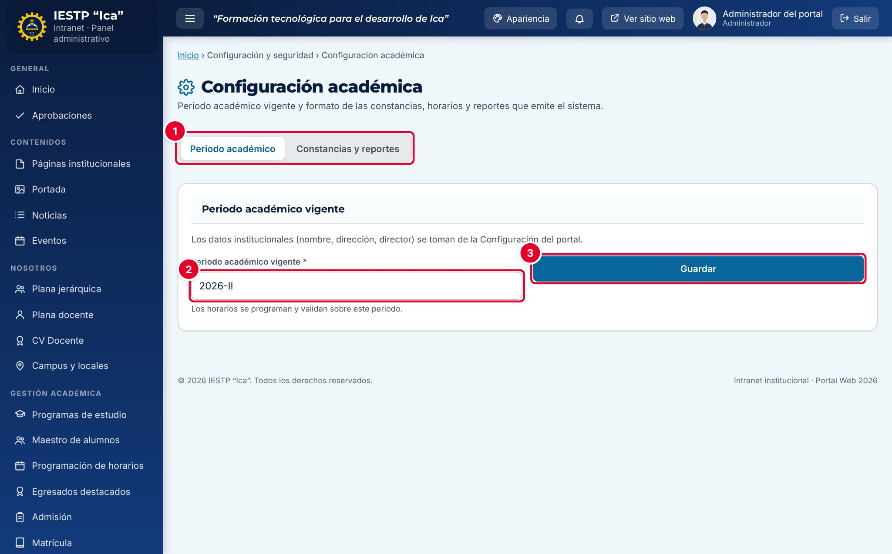
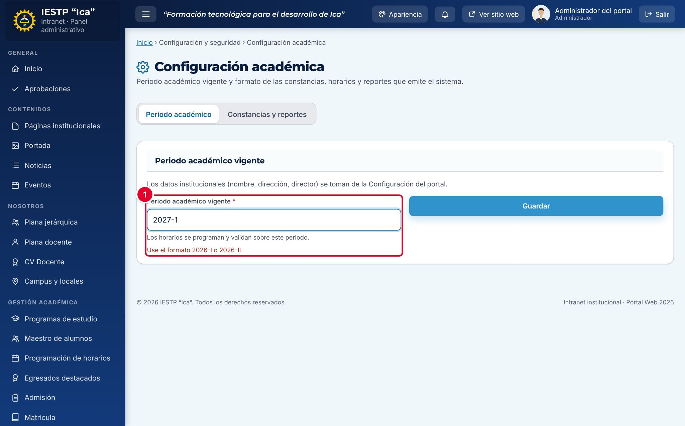
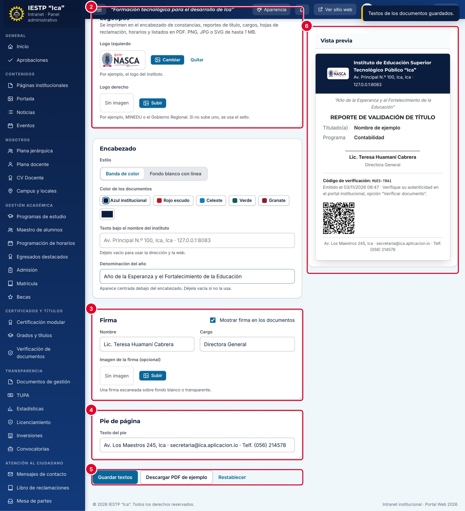

# 32 · Configuración académica

## Para qué sirve

Aquí se definen dos ajustes generales de la gestión académica:

- El **periodo académico vigente**, sobre el que se programan y validan los horarios y que se propone por defecto en los formularios (ingreso de alumnos, notas).
- El **formato de los documentos** que emite el sistema: constancias de certificación modular, reportes de validación de título, cargos de recepción, hojas de reclamación, horarios y listados en PDF (logotipos, encabezado, color, firma y pie de página).

Los datos institucionales (nombre, dirección y director) no se editan aquí: se toman de la configuración general del portal y de la Plana jerárquica.

## Quién lo usa

| Rol | Puede |
|---|---|
| Administrador | Todo |
| Otros roles | No tienen acceso a este módulo |

Los demás catálogos académicos se administran en su propio módulo:

| Catálogo | Dónde se administra |
|---|---|
| Unidades didácticas, carga docente, ambientes, bloques y receso | Programación de horarios › **Configuración** (capítulo 11) |
| Módulos formativos | Certificación modular › **Módulos formativos** (capítulo 16) |
| Programas de estudio | **Programas de estudio** del portal |
| Áreas receptoras y tipos de trámite | Mesa de partes › **Áreas receptoras** › **Editar áreas** (requiere acceso a Configuración académica) |

## Cómo se llega

Menú lateral › **Configuración y seguridad** › **Configuración académica**. Ruta: `#/admin/ix-config`

## Pantalla principal

| N.º | Elemento | Para qué sirve |
|---|---|---|
| 1 | Pestañas | **Periodo académico** y **Constancias y reportes**. |
| 2 | **Periodo académico vigente** | Periodo actual, con el formato `AAAA-I` o `AAAA-II`. |
| 3 | **Guardar** | Guarda el periodo. |

## Procedimientos

### Cambiar el periodo académico vigente

Hazlo una vez por semestre, cuando empieza la programación del nuevo periodo.

1. En la pestaña **Periodo académico**, escribe el nuevo periodo, por ejemplo `2027-I`.
2. Pulsa **Guardar**.

Aparece «Configuración guardada. Periodo vigente: 2027-I. La programación de horarios se muestra para ese periodo.».

Si el formato no es correcto, el campo se marca en rojo ① con «Use el formato 2026-I o 2026-II.» y no se guarda.

> Al cambiar el periodo, la grilla de horarios empieza vacía para el nuevo periodo y los horarios del periodo anterior dejan de mostrarse a los estudiantes y docentes. Los horarios anteriores no se borran: vuelven a verse si se regresa al periodo anterior. Cambia el periodo solo cuando el nuevo horario esté listo para programarse, y actualiza antes el **Ciclo actual** de los alumnos en el Maestro de alumnos.

### Configurar el formato de las constancias y reportes

Pestaña **Constancias y reportes**. A la derecha, la **Vista previa** muestra el resultado con un documento de ejemplo.

| N.º | Sección | Descripción |
|---|---|---|
| 1 | **Logotipos** | **Logo izquierdo** (por ejemplo, el del instituto) y **Logo derecho** (por ejemplo, MINEDU o el Gobierno Regional; si no se sube, no se muestra en el estilo con banda). PNG, JPG, SVG o WEBP de hasta 1 MB. Pulsa **Subir** o **Cambiar**, y **Quitar** para eliminarlo. Se guardan al instante |
| 2 | **Encabezado** | **Estilo**: **Banda de color** o **Fondo blanco con línea**. **Color de los documentos**: Azul institucional, Rojo escudo, Celeste, Verde, Granate u otro color con el selector. **Texto bajo el nombre del instituto** (hasta 120 caracteres; vacío usa la dirección y la web) y **Denominación del año** (hasta 140 caracteres; aparece centrada bajo el encabezado) |
| 3 | **Firma** | **Mostrar firma en los documentos**, **Nombre** (vacío usa el nombre del director), **Cargo** (hasta 80 caracteres cada uno) e **Imagen de la firma** opcional (firma escaneada sobre fondo blanco o transparente) |
| 4 | **Pie de página** | **Texto del pie** (hasta 160 caracteres), por ejemplo la dirección, el correo y el teléfono |
| 5 | Botones | **Guardar textos** guarda el encabezado, la firma y el pie. **Descargar PDF de ejemplo** genera un documento de prueba. **Restablecer** quita los logos y la firma y vuelve al estilo y color originales |
| 6 | **Vista previa** | Cómo se verá el encabezado, la firma, el código de verificación y el pie |

1. Sube los logotipos.
2. Elige el estilo y el color del encabezado. Estos cambios se guardan al pulsarlos.
3. Escribe la denominación del año, el nombre y el cargo de quien firma y el texto del pie.
4. Pulsa **Guardar textos**. Aparece «Textos de los documentos guardados.».
5. Pulsa **Descargar PDF de ejemplo** y revisa el resultado impreso.

Los cambios se aplican a los documentos que se emitan **desde ese momento**. Los PDF ya descargados no cambian.

## Mensajes y problemas frecuentes

| Mensaje o situación | Causa | Qué hacer |
|---|---|---|
| «Use el formato 2026-I o 2026-II.» | El periodo no tiene el formato correcto | Escribe el año, un guion y I o II en números romanos |
| «La imagen pesa … KB. Use una de hasta 1 MB.» | El logo o la firma superan 1 MB | Reduce la imagen |
| «El archivo debe ser una imagen PNG, JPG, SVG o WEBP.» | Formato no admitido | Convierte la imagen |
| «Tiene acceso de consulta. Solo un usuario con permiso de gestión puede cambiar los documentos.» | Tu rol no puede modificar la configuración | Pide el cambio al administrador |
| Los horarios «desaparecieron» | Se cambió el periodo vigente | Vuelve al periodo anterior o programa el nuevo |

## Buenas prácticas

- Cambia el periodo al inicio de cada semestre, en coordinación con la Jefatura de Unidad Académica, y nunca a mitad de semestre.
- Actualiza la **Denominación del año** cada enero.
- Usa logotipos con fondo transparente y en buena resolución, sin pasar de 1 MB.
- Después de cualquier cambio de formato, descarga el **PDF de ejemplo** y revísalo impreso antes de emitir documentos oficiales.
