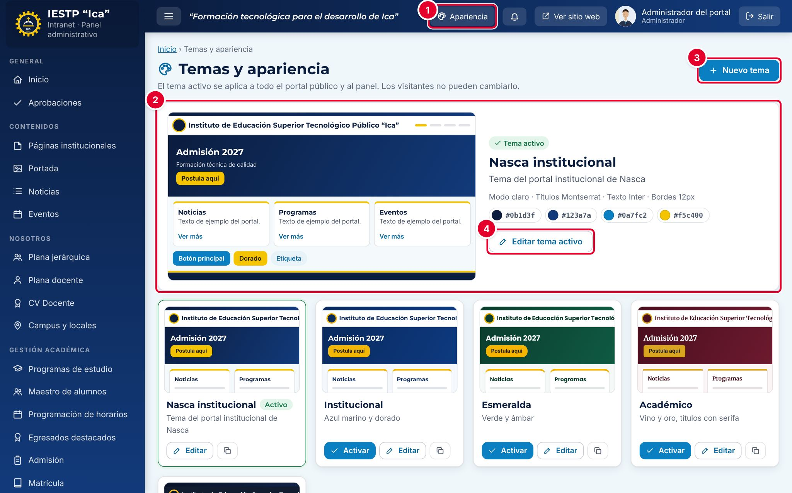
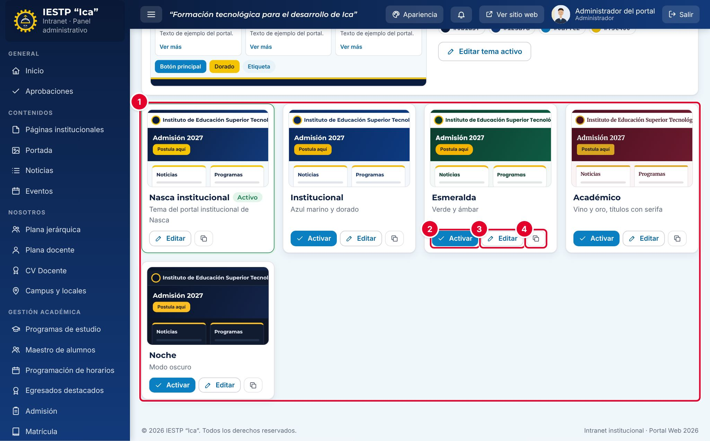
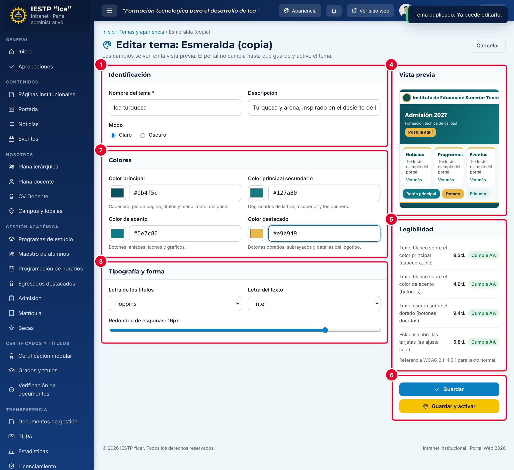
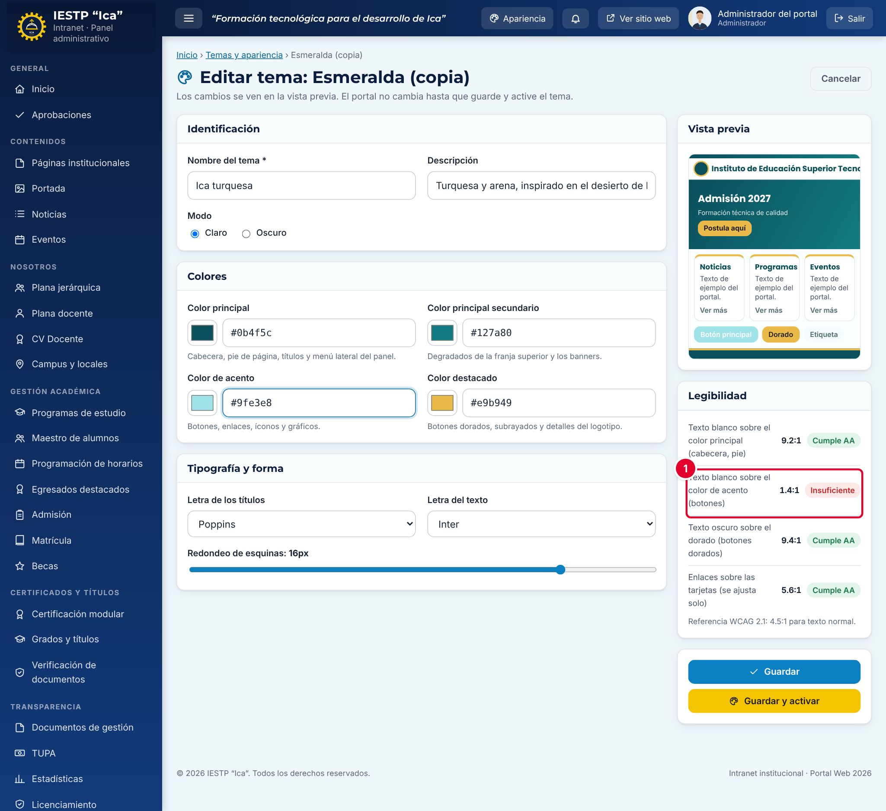
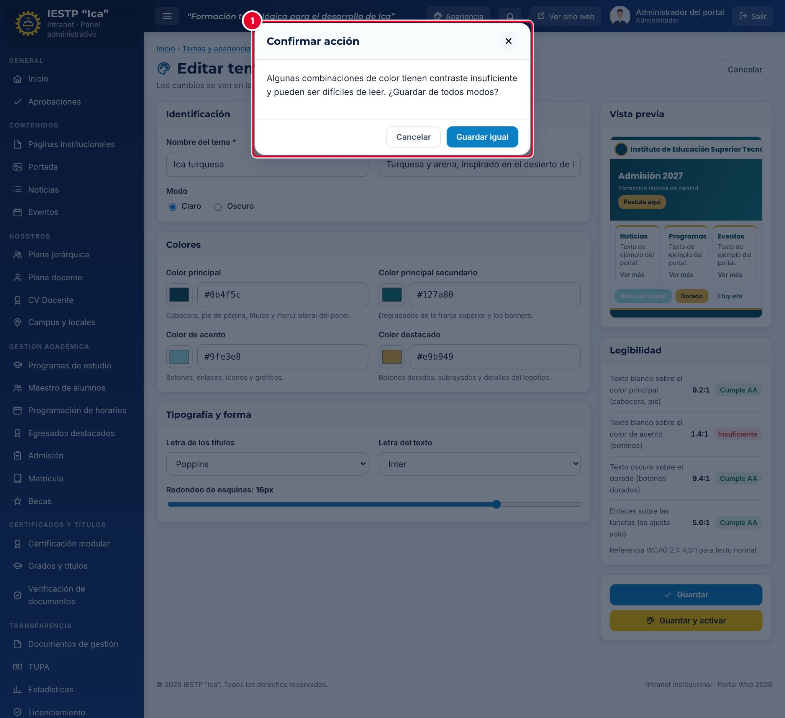
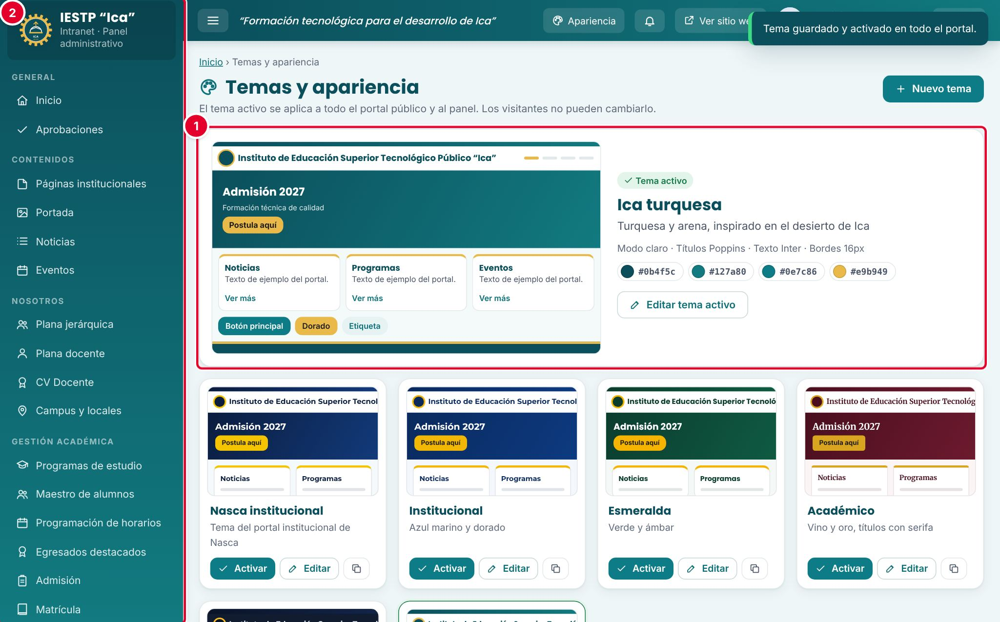
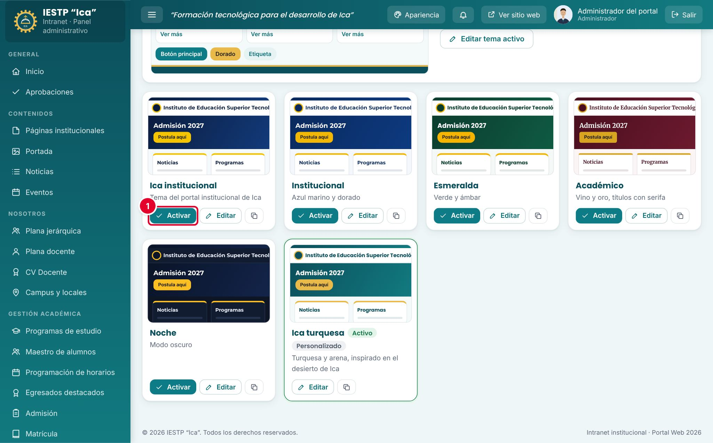
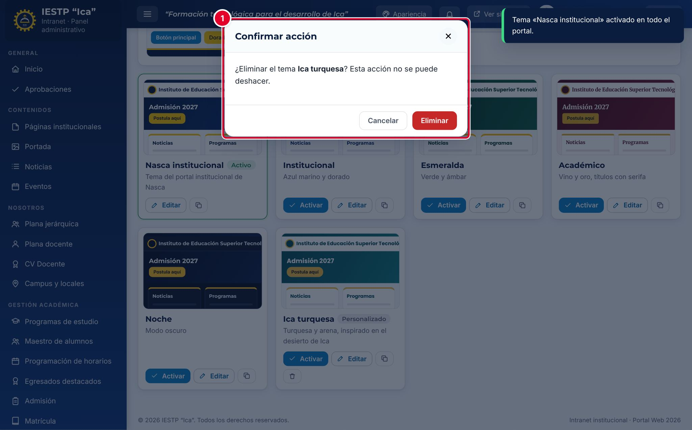
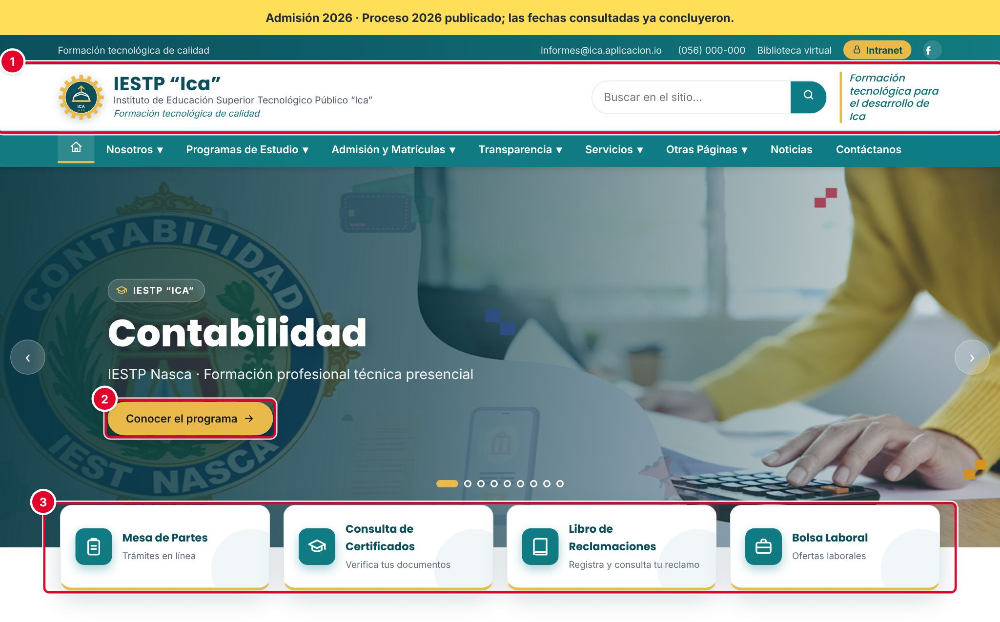

# 33 · Temas y apariencia

## Para qué sirve

En este módulo se eligen los colores, las letras y el redondeo de esquinas de todo el portal. El **tema activo** se aplica a la vez al portal público y a la intranet. Los visitantes no pueden cambiarlo.

## Quién lo usa

| Rol | Puede |
|---|---|
| Administrador | Activar, crear, duplicar, editar y eliminar temas |
| Imagen institucional | Activar, crear, duplicar, editar y eliminar temas |

Los temas incluidos con la plataforma (los que no tienen la etiqueta **Personalizado**) no se pueden eliminar. El tema activo tampoco.

## Cómo se llega

Menú lateral › **Configuración y seguridad** › **Temas y apariencia**, o el botón **Apariencia** de la barra superior. Ruta: `#/admin/temas`

## Pantalla principal

| N.º | Elemento | Para qué sirve |
|---|---|---|
| 1 | **Apariencia** | Acceso directo a este módulo desde cualquier pantalla de la intranet. |
| 2 | **Tema activo** | Vista de muestra, nombre, descripción, modo, letras, bordes y los cuatro colores del tema que se ve hoy en el portal. |
| 3 | **Nuevo tema** | Crea un tema a partir de una copia del tema activo. |
| 4 | **Editar tema activo** | Abre el editor del tema activo. Los cambios se ven en el portal apenas guardas. |

| N.º | Elemento | Para qué sirve |
|---|---|---|
| 1 | Temas disponibles | Una tarjeta por tema con su muestra. El activo lleva la etiqueta **Activo**; los creados por la institución, **Personalizado**. |
| 2 | **Activar** | Aplica el tema a todo el portal de inmediato. |
| 3 | **Editar** | Abre el editor del tema. |
| 4 | Duplicar | Crea una copia («… (copia)») y abre su editor. Es la forma recomendada de crear un tema propio. |

En los temas personalizados que no están activos aparece además el botón **Eliminar** (papelera).

## Formulario

| N.º | Zona | Contenido |
|---|---|---|
| 1 | **Identificación** | **Nombre del tema**, **Descripción** y **Modo** (**Claro** u **Oscuro**). |
| 2 | **Colores** | Cuatro colores, cada uno con selector y código hexadecimal. |
| 3 | **Tipografía y forma** | **Letra de los títulos**, **Letra del texto** y **Redondeo de esquinas**. |
| 4 | **Vista previa** | Muestra del portal que cambia mientras editas. |
| 5 | **Legibilidad** | Contraste de las combinaciones principales según WCAG 2.1. |
| 6 | Botones | **Guardar**, **Guardar y activar** (solo si el tema no está activo) y **Restaurar valores originales** (solo en los temas incluidos con la plataforma). |

| Campo | Obligatorio | Formato o límite | Ejemplo |
|---|---|---|---|
| Nombre del tema | Sí | Hasta 40 caracteres. No puede repetirse | Ica turquesa |
| Descripción | No | Hasta 80 caracteres | Turquesa y arena, inspirado en el desierto de Ica |
| Modo | Sí | Claro u Oscuro | Claro |
| Color principal | Sí | `#RRGGBB`. Cabecera, pie de página, títulos y menú lateral del panel | #0b4f5c |
| Color principal secundario | Sí | `#RRGGBB`. Degradados de la franja superior y los banners | #127a80 |
| Color de acento | Sí | `#RRGGBB`. Botones, enlaces, íconos y gráficos | #0e7c86 |
| Color destacado | Sí | `#RRGGBB`. Botones dorados, subrayados y detalles del logotipo | #e9b949 |
| Letra de los títulos | Sí | Montserrat, Poppins, Merriweather o Inter | Poppins |
| Letra del texto | Sí | Inter, Poppins o Sistema | Inter |
| Redondeo de esquinas | Sí | De 0 a 20 px | 16 px |

La tabla **Legibilidad** califica cada combinación: **Cumple AA** (contraste de 4,5:1 o más), **Solo texto grande** (de 3:1 a 4,5:1) o **Insuficiente** (menos de 3:1). El color de los enlaces se ajusta solo para mantenerse legible.

## Procedimientos

### Activar otro tema

1. En la tarjeta del tema, pulsa **Activar**.
2. Aparece el aviso «Tema «…» activado en todo el portal.» El cambio se ve de inmediato en el portal y en la intranet.

### Crear un tema propio

1. Pulsa el botón Duplicar de un tema parecido al que buscas. Aparece «Tema duplicado. Ya puede editarlo.» y se abre el editor.
2. Cambia el **Nombre del tema** y la **Descripción**.
3. Elige los cuatro colores con el selector o escribe su código, por ejemplo `#0b4f5c`.
4. Elige las letras y el redondeo de esquinas.
5. Revisa la **Vista previa** y la tabla **Legibilidad**: todas las filas deberían decir **Cumple AA**.
6. Pulsa **Guardar** (el portal no cambia) o **Guardar y activar** (el portal cambia de inmediato).

### Corregir un contraste insuficiente

Si un color hace que el texto sea difícil de leer, la fila de **Legibilidad** lo marca como **Insuficiente** ①. En el ejemplo, el color de acento es tan claro que el texto blanco de los botones casi no se ve.

Al guardar con una combinación insuficiente aparece la advertencia ①: «Algunas combinaciones de color tienen contraste insuficiente y pueden ser difíciles de leer. ¿Guardar de todos modos?». Pulsa **Cancelar**, oscurece o aclara el color hasta que la fila diga **Cumple AA** y vuelve a guardar. Usa **Guardar igual** solo si es indispensable.

### Guardar y activar

Al pulsar **Guardar y activar** aparece «Tema guardado y activado en todo el portal.». El nuevo tema se muestra como **Tema activo** ① y la intranet cambia de color de inmediato ②.

### Volver al tema anterior

En la tarjeta del tema anterior, pulsa **Activar** ①. Si modificaste un tema incluido con la plataforma, ábrelo con **Editar** y pulsa **Restaurar valores originales** y luego **Guardar**.

### Eliminar un tema personalizado

1. Asegúrate de que el tema no esté activo.
2. Pulsa la papelera de su tarjeta.
3. Confirma con **Eliminar** ①. Aparece «Tema eliminado.». Esta acción no se puede deshacer.

## Resultado en el portal público

En `{{inst.dominio}}` el tema cambia la cabecera y el menú ①, los botones dorados ② y los íconos y bordes de las tarjetas ③, además del pie de página, los banners y la intranet. El contenido (textos, imágenes, logotipo) no cambia.

## Mensajes y problemas frecuentes

| Mensaje o situación | Causa | Qué hacer |
|---|---|---|
| «Ingrese el nombre del tema.» | **Nombre del tema** vacío | Escribe un nombre |
| «Ya existe un tema con ese nombre.» | Otro tema usa el mismo nombre | Cambia el nombre |
| «Revise los códigos de color: deben tener el formato #RRGGBB.» | Código de color incompleto o mal escrito | Escribe seis caracteres hexadecimales después de `#`, por ejemplo `#0e7c86` |
| Advertencia de contraste insuficiente | Algún color no se lee bien sobre su fondo | Corrige el color hasta que **Legibilidad** diga **Cumple AA** |
| No aparece la papelera en un tema | Es un tema incluido con la plataforma o es el tema activo | Activa otro tema antes de eliminarlo; los temas incluidos no se eliminan |
| Guardé el tema y el portal no cambió | Se pulsó **Guardar** en un tema que no está activo | Pulsa **Activar** en su tarjeta |

## Buenas prácticas

- Crea tus temas duplicando uno existente; no modifiques los temas incluidos con la plataforma.
- Usa los colores oficiales de la institución y revisa que todas las filas de **Legibilidad** digan **Cumple AA**.
- Prueba el tema en el celular y en el modo **Oscuro** antes de activarlo en fechas importantes (admisión, matrícula).
- Para campañas temporales (aniversario, fiestas patrias), crea un tema aparte y vuelve a activar el tema institucional al terminar.
- Avisa al equipo antes de cambiar el tema: el cambio es inmediato para todos los visitantes y usuarios de la intranet.
