# 34 · Usuarios y roles

## Para qué sirve

En este módulo se crean y administran las cuentas de acceso a la intranet: se asigna el rol de cada persona, se restablecen contraseñas, se desbloquean cuentas y se desactivan los accesos que ya no corresponden. El **rol** define qué módulos ve cada cuenta y qué puede hacer en ellos (publicar, aprobar, eliminar definitivamente, ver el DNI completo). Todos los permisos se verifican en el servidor: ocultar un botón no basta para que alguien sin permiso pueda usarlo.

## Quién lo usa

| Rol | Puede |
|---|---|
| Administrador | Crear, editar, desactivar y desbloquear cuentas, restablecer contraseñas y editar los módulos de cada rol |
| Secretaría académica | Crear el acceso de un alumno desde **Maestro de alumnos** (capítulo correspondiente). No edita cuentas |
| Coordinador de programa | Crear el acceso de los alumnos de su propio programa desde **Maestro de alumnos**. No edita cuentas |
| Todas las cuentas | Cambiar su propia contraseña en **Mi cuenta** |

> Solo el administrador puede editar cuentas. Si otro rol lo intenta, el servidor responde «Solo el administrador puede editar cuentas.».

## Cómo se llega

- Menú lateral › **Configuración y seguridad** › **Usuarios y roles**. Ruta: `#/admin/usuarios`
- Roles y permisos: botón **Editar roles y permisos**. Dirección: `{{inst.dominio}}/roles.php`
- Mi cuenta (cambio de contraseña propia): `{{inst.dominio}}/accounts.php` o ruta `#/admin/perfil`

## Pantalla principal

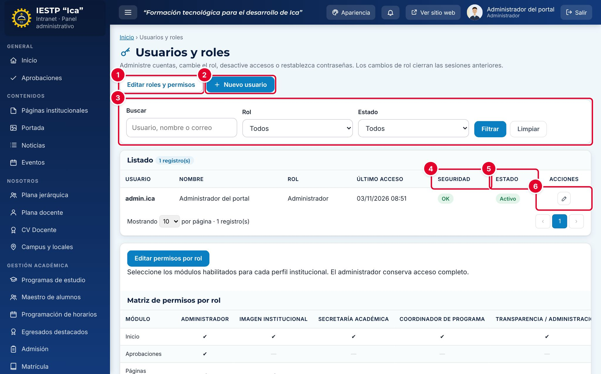

| N.º | Elemento | Para qué sirve |
|---|---|---|
| 1 | **Editar roles y permisos** | Abre la pantalla de roles, donde se activan o desactivan módulos de cada rol. |
| 2 | **Nuevo usuario** | Abre el formulario para crear una cuenta. |
| 3 | Filtros | **Buscar** por usuario, nombre o correo, y filtrar por **Rol** y **Estado** (Activo o Inactivo). Pulsa **Filtrar** o **Limpiar**. |
| 4 | **Seguridad** | **OK** o **Bloqueado**. Una cuenta se bloquea tras 5 intentos fallidos de acceso. |
| 5 | **Estado** | **Activo** (puede ingresar) o **Inactivo** (no puede ingresar). |
| 6 | Acciones | **Editar** (lápiz) y, si la cuenta está bloqueada, **Desbloquear** (candado). |

La columna **Último acceso** muestra la fecha y hora del último ingreso correcto. En la columna **Rol** de un coordinador se ve, entre paréntesis, el código de su programa.

### Matriz de permisos

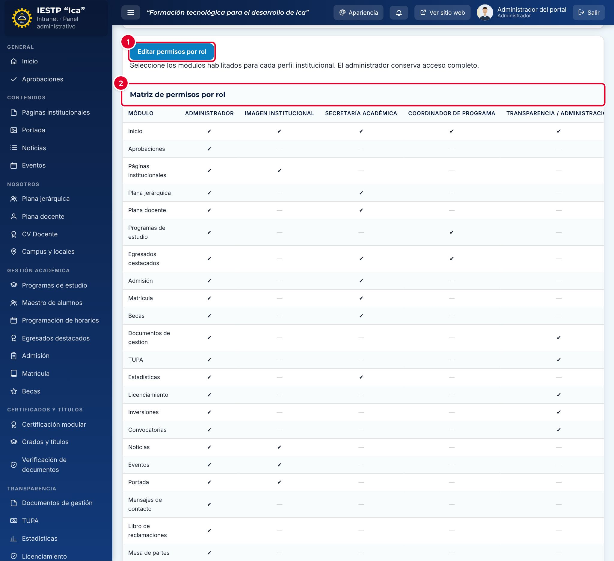

Al pie del listado está la **Matriz de permisos por rol** ②: una tabla con un ✔ por cada módulo que tiene habilitado cada rol. Desplázala hacia la derecha para ver todos los roles. El botón **Editar permisos por rol** ① abre la misma pantalla de roles que el botón del encabezado.

## Formulario

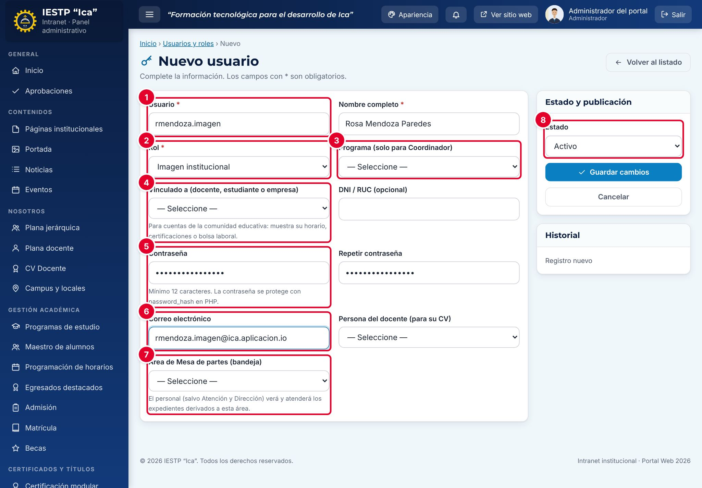

| N.º | Campo | Descripción |
|---|---|---|
| 1 | **Usuario** | Nombre de acceso. Solo letras minúsculas, números, puntos, guiones y guiones bajos (de 3 a 80). No se puede cambiar después de crear la cuenta. |
| 2 | **Rol** | Perfil de la cuenta. Define los módulos visibles (ver la matriz). |
| 3 | **Programa (solo para Coordinador)** | Programa de estudios del coordinador. Es obligatorio para ese rol. |
| 4 | **Vinculado a (docente, estudiante o empresa)** | Registro académico con el que se vincula una cuenta de la comunidad. Obligatorio para Estudiante, Egresado, Empresa y Docente. |
| 5 | **Contraseña** y **Repetir contraseña** | Contraseña inicial. Mínimo 12 caracteres y máximo 72 bytes. |
| 6 | **Correo electrónico** | Correo de la persona. Debe ser único. |
| 7 | **Área de Mesa de partes (bandeja)** | Área cuya bandeja de expedientes atenderá la cuenta. Para todo el personal salvo Administrador, Atención al ciudadano y Directivo. |
| 8 | **Estado** | **Activo** o **Inactivo**. |

También están **Nombre completo** (obligatorio), **DNI / RUC (opcional)** y **Persona del docente (para su CV)**.

| Campo | Obligatorio | Formato o límite | Ejemplo |
|---|---|---|---|
| Usuario | Sí | `a-z`, `0-9`, `.`, `_`, `-`; de 3 a 80 caracteres | rmendoza.imagen |
| Nombre completo | Sí | Hasta 150 caracteres | Rosa Mendoza Paredes |
| Rol | Sí | Uno de los 11 roles | Imagen institucional |
| Programa | Solo Coordinador | Programa registrado | Contabilidad |
| Vinculado a | Docente, Estudiante, Egresado y Empresa | Docente, alumno o empresa ya registrados | — |
| DNI / RUC | No | Hasta 11 caracteres. En estudiantes se toma del alumno vinculado | — |
| Contraseña | Al crear | De 12 caracteres a 72 bytes | — |
| Correo electrónico | No | Correo válido y no repetido | rmendoza.imagen@{{inst.dominio}} |
| Persona del docente | Docente | Persona de la plana docente | — |
| Área de Mesa de partes | No | Área receptora activa | Secretaría Académica |
| Estado | Sí | Activo o Inactivo | Activo |

## Roles de la plataforma

| Rol | Para quién | Vínculo necesario |
|---|---|---|
| Administrador | Responsable del portal y de la seguridad | — |
| Imagen institucional | Comunicación e imagen: noticias, eventos, portada, páginas | — |
| Secretaría académica | Admisión, matrícula, becas, certificados, plana docente | — |
| Coordinador de programa | Coordinación de un programa de estudios | Programa |
| Transparencia / administración | Documentos de gestión, TUPA, inversiones, convocatorias, licenciamiento | — |
| Atención al ciudadano | Mensajes, Libro de Reclamaciones, Mesa de partes, bolsa laboral | — |
| Directivo | Dirección: estadísticas y supervisión | — |
| Docente | Docentes: horario y CV | Docente y persona |
| Estudiante | Alumnos: horario, certificados, bolsa laboral | Alumno |
| Egresado | Egresados: certificados, títulos, bolsa laboral | Alumno |
| Empresa | Empresas aliadas: bolsa laboral | Empresa |

### Matriz de módulos por rol

Valores originales de la plataforma. El administrador puede desactivar módulos de un rol, pero no agregarle módulos fuera de esta tabla.

| Módulo | Administrador | Imagen institucional | Secretaría académica | Coordinador de programa | Transparencia / administración | Atención al ciudadano | Directivo | Docente | Estudiante | Egresado | Empresa |
|---|:-:|:-:|:-:|:-:|:-:|:-:|:-:|:-:|:-:|:-:|:-:|
| Inicio | ✔ | ✔ | ✔ | ✔ | ✔ | ✔ | ✔ | ✔ | ✔ | ✔ | ✔ |
| Aprobaciones | ✔ | — | — | — | — | — | — | — | — | — | — |
| Páginas institucionales | ✔ | ✔ | — | — | — | — | — | — | — | — | — |
| Plana jerárquica | ✔ | — | ✔ | — | — | — | — | — | — | — | — |
| Plana docente | ✔ | — | ✔ | — | — | — | — | — | — | — | — |
| Programas de estudio | ✔ | — | — | ✔ | — | — | — | — | — | — | — |
| Egresados destacados | ✔ | — | ✔ | ✔ | — | — | — | — | — | — | — |
| Admisión | ✔ | — | ✔ | — | — | — | — | — | — | — | — |
| Matrícula | ✔ | — | ✔ | — | — | — | — | — | — | — | — |
| Becas | ✔ | — | ✔ | — | — | — | — | — | — | — | — |
| Documentos de gestión | ✔ | — | — | — | ✔ | — | — | — | — | — | — |
| TUPA | ✔ | — | — | — | ✔ | — | — | — | — | — | — |
| Estadísticas | ✔ | — | ✔ | — | — | — | ✔ | — | — | — | — |
| Licenciamiento | ✔ | — | — | — | ✔ | — | — | — | — | — | — |
| Inversiones | ✔ | — | — | — | ✔ | — | — | — | — | — | — |
| Convocatorias | ✔ | — | — | — | ✔ | — | — | — | — | — | — |
| Noticias | ✔ | ✔ | — | — | — | — | — | — | — | — | — |
| Eventos | ✔ | ✔ | — | — | — | — | — | — | — | — | — |
| Portada | ✔ | ✔ | — | — | — | — | — | — | — | — | — |
| Mensajes de contacto | ✔ | — | — | — | — | ✔ | — | — | — | — | — |
| Libro de reclamaciones | ✔ | — | — | — | — | ✔ | ✔ | — | — | — | — |
| Mesa de partes | ✔ | — | — | — | — | ✔ | ✔ | — | — | — | — |
| Verificación de documentos | ✔ | — | ✔ | — | — | — | — | — | — | — | — |
| Enlaces y servicios | ✔ | ✔ | — | — | — | — | — | — | — | — | — |
| Campus y locales | ✔ | ✔ | — | — | — | — | — | — | — | — | — |
| Servicios complementarios | ✔ | — | — | — | ✔ | — | — | — | — | — | — |
| Configuración | ✔ | — | — | — | — | — | — | — | — | — | — |
| Maestro de alumnos | ✔ | — | ✔ | ✔ | — | — | ✔ | — | — | — | — |
| Programación de horarios | ✔ | — | ✔ | ✔ | — | — | ✔ | ✔ | ✔ | — | — |
| Certificación modular | ✔ | — | ✔ | — | — | — | ✔ | — | ✔ | ✔ | — |
| Grados y títulos | ✔ | — | ✔ | — | — | — | ✔ | — | — | ✔ | — |
| Bolsa laboral | ✔ | — | — | — | — | ✔ | ✔ | — | ✔ | ✔ | ✔ |
| Configuración académica | ✔ | — | — | — | — | — | — | — | — | — | — |
| Temas y apariencia | ✔ | ✔ | — | — | — | — | — | — | — | — | — |
| Usuarios y roles | ✔ | — | — | — | — | — | — | — | — | — | — |
| Auditoría | ✔ | — | — | — | — | — | — | — | — | — | — |
| Copias de seguridad | ✔ | — | — | — | — | — | — | — | — | — | — |
| CV Docente | ✔ | — | ✔ | — | — | — | — | ✔ | — | — | — |

Reglas que completan la matriz:

- **Directivo** consulta el Libro de reclamaciones y la Mesa de partes **sin poder modificarlos**.
- Una cuenta del personal (que no sea Administrador, Atención al ciudadano ni Directivo) con un **Área de Mesa de partes** asignada ve además **Mesa de partes**, pero solo con los expedientes derivados a su área.
- El **Coordinador** solo ve su programa, sus alumnos y sus horarios, y los egresados destacados de su programa.
- Las cuentas de **Docente**, **Estudiante**, **Egresado** y **Empresa** solo ven sus propios datos: su horario, sus certificados, sus títulos, sus postulaciones o las ofertas de su empresa.
- En los módulos académicos (Maestro de alumnos, horarios, certificación, títulos y bolsa laboral), el nivel de cada rol (sin acceso, consulta o edición) también depende de los permisos definidos en **Configuración académica**.

### Atribuciones especiales

| Atribución | Administrador | Imagen institucional | Secretaría académica | Coordinador de programa | Transparencia / administración | Atención al ciudadano | Directivo | Docente | Estudiante | Egresado | Empresa |
|---|:-:|:-:|:-:|:-:|:-:|:-:|:-:|:-:|:-:|:-:|:-:|
| Publicar | ✔ | ✔ | ✔ | ✔ | ✔ | — | — | — | — | — | — |
| Aprobar | ✔ | — | — | — | — | — | — | — | — | — | — |
| Eliminar definitivamente | ✔ | — | — | — | — | — | — | — | — | — | — |
| Ver DNI completo | ✔ | — | ✔ | — | — | ✔ | ✔ | — | — | — | — |
| Modificar periodos cerrados | ✔ | — | — | — | — | — | — | — | — | — | — |
| Limitado a su programa | — | — | — | ✔ | — | — | — | — | — | — | — |
| Cuenta de la comunidad | — | — | — | — | — | — | — | ✔ | ✔ | ✔ | ✔ |

| Atribución | Qué significa |
|---|---|
| Publicar | Puede dejar un registro en estado publicado. Sin esta atribución, lo que guarda queda como **Borrador**. |
| Aprobar | Aprueba lo que otros roles envían a publicar en **Documentos de gestión**, **Admisión** y **Convocatorias**. Si otro rol elige «Publicado» en esos módulos, el registro pasa a revisión del administrador (módulo **Aprobaciones**). |
| Eliminar definitivamente | Borra registros desde la papelera sin posibilidad de restaurarlos. Los demás roles solo envían a la papelera. |
| Ver DNI completo | Ve el número de documento completo. Los demás roles lo ven enmascarado. |
| Modificar periodos cerrados | Edita o elimina becarios de periodos de becas ya cerrados. |
| Limitado a su programa | Solo trabaja con los registros de su programa de estudios. |
| Cuenta de la comunidad | Cuenta externa al personal, vinculada a un docente, alumno o empresa. |

## Procedimientos

### Crear una cuenta del personal

1. Pulsa **Nuevo usuario**.
2. Escribe el **Usuario** (por ejemplo, `rmendoza.imagen`) y el **Nombre completo**.
3. Elige el **Rol**. Si es Coordinador de programa, elige también el **Programa**.
4. Escribe una **Contraseña** temporal de al menos 12 caracteres y repítela.
5. Escribe el **Correo electrónico** y, si la persona atenderá expedientes, el **Área de Mesa de partes (bandeja)**.
6. Deja el **Estado** en **Activo** y pulsa **Guardar cambios**.

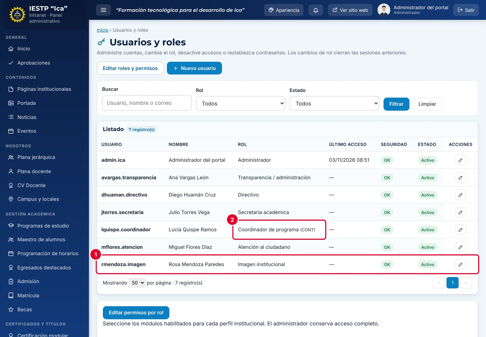

La cuenta aparece en el listado ①. Comunica el usuario y la contraseña temporal a la persona por un medio seguro. El coordinador muestra el código de su programa ②.

### Crear cuentas de la comunidad (docentes, estudiantes, egresados y empresas)

Estas cuentas deben vincularse con un registro existente:

- **Estudiante y Egresado:** registra antes al alumno en **Maestro de alumnos**. Desde ahí también se puede crear su acceso directamente: el usuario es su DNI, la contraseña temporal la genera el sistema y el rol (Estudiante o Egresado) depende de su situación académica.
- **Docente:** el docente debe existir en la carga docente y tener su registro en **Plana docente**.
- **Empresa:** la empresa debe estar registrada en **Bolsa laboral**. Las empresas también pueden registrarse por sí mismas desde el portal; su usuario es su RUC.

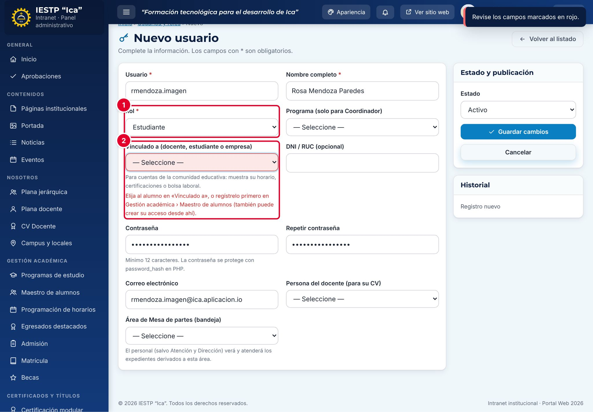

Si eliges **Estudiante** ① sin un alumno en **Vinculado a** ②, el formulario no se guarda y explica qué hacer.

### Primer ingreso de una cuenta nueva

Toda contraseña asignada por el administrador es temporal. La primera vez que la persona ingresa, la plataforma la lleva a **Cuentas del portal** y no le deja usar la intranet hasta que la cambie.

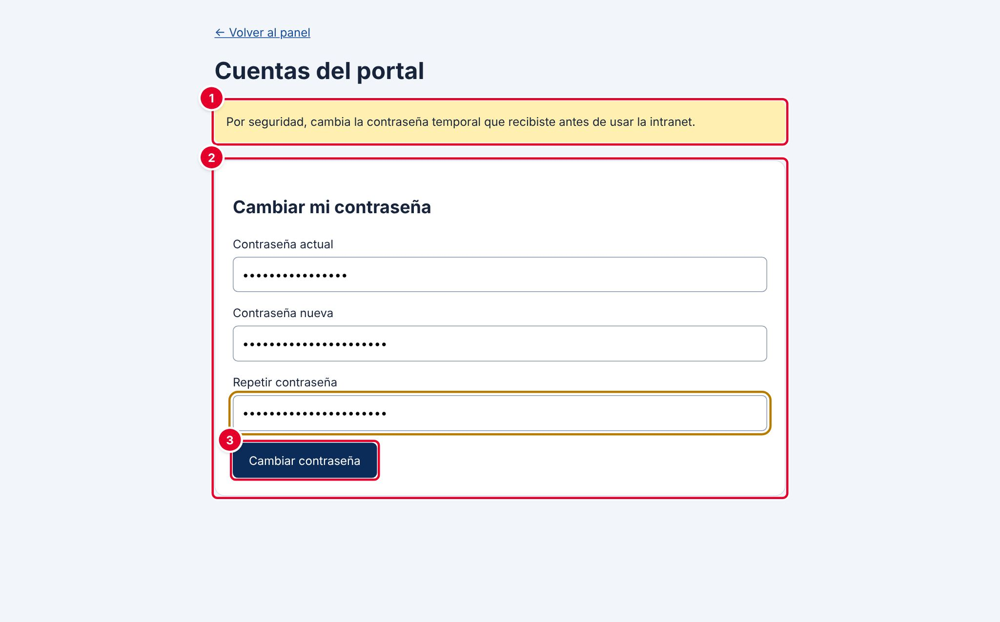

| N.º | Elemento | Descripción |
|---|---|---|
| 1 | Aviso | «Por seguridad, cambia la contraseña temporal que recibiste antes de usar la intranet.» |
| 2 | **Cambiar mi contraseña** | **Contraseña actual** (la temporal), **Contraseña nueva** y **Repetir contraseña** |
| 3 | **Cambiar contraseña** | Guarda la contraseña nueva |

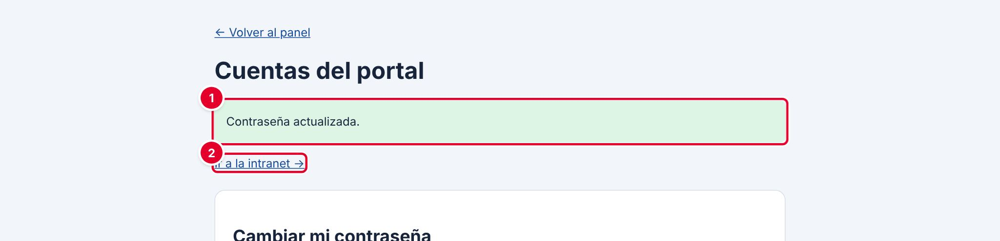

Aparece «Contraseña actualizada.» ① y el enlace **Ir a la intranet →** ②.

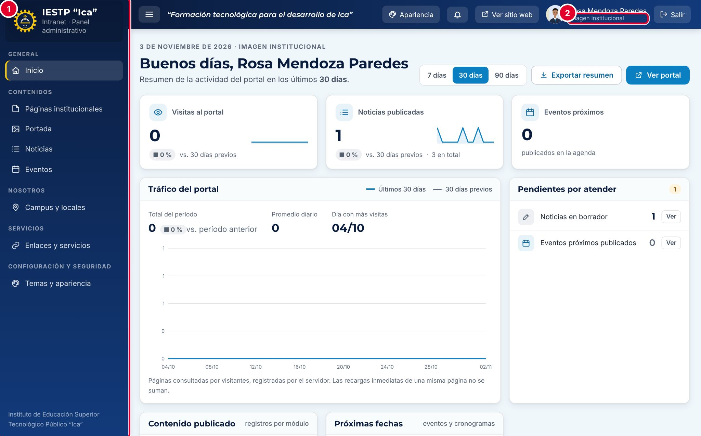

Cada cuenta ve en el menú lateral ① solo los módulos de su rol. El rol figura debajo del nombre ②. En el ejemplo, la cuenta de Imagen institucional ve Páginas institucionales, Portada, Noticias, Eventos, Campus y locales, Enlaces y servicios y Temas y apariencia.

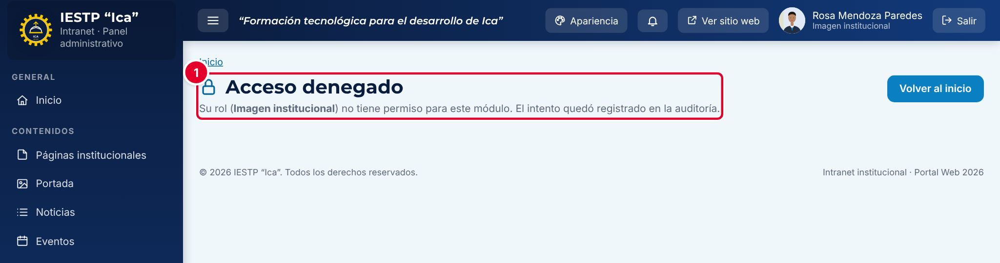

Si alguien escribe la ruta de un módulo que su rol no tiene, ve **Acceso denegado** ①.

### Cambiar la contraseña propia

Cualquier cuenta puede cambiar su contraseña en la pantalla **Cuentas del portal** (la plataforma la llama «Mi cuenta»), sección **Cambiar mi contraseña**. Se pide la contraseña actual. Al cambiarla se cierran las sesiones abiertas en otros equipos.

Esta pantalla no tiene un enlace en el menú de la intranet. Ábrela escribiendo la dirección `{{inst.dominio}}/accounts.php` (o la ruta `#/admin/perfil`, que lleva al mismo lugar) y guárdala en favoritos.

El administrador ve además, en esa pantalla, la lista **Usuarios del portal** y un formulario **Crear usuario** alternativo. Prefiere el formulario de la intranet: las cuentas creadas desde **Cuentas del portal** no quedan obligadas a cambiar la contraseña en su primer ingreso.

### Restablecer la contraseña de otra persona (olvido)

La plataforma no tiene opción «Olvidé mi contraseña»: la persona debe pedírsela al administrador.

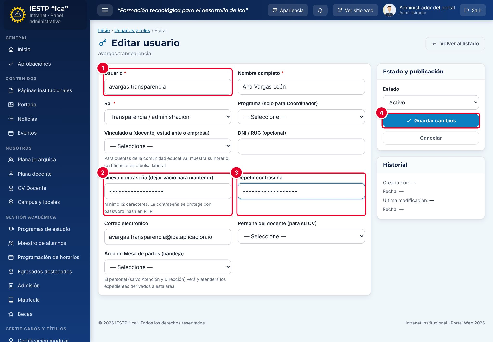

1. En el listado, pulsa **Editar** en la fila de la cuenta.
2. Escribe la contraseña temporal en **Nueva contraseña (dejar vacío para mantener)** ② y repítela en **Repetir contraseña** ③. El **Usuario** ① no se puede cambiar.
3. Pulsa **Guardar cambios** ④.

La persona deberá cambiar esa contraseña en su siguiente ingreso. Sus sesiones abiertas se cierran.

> La cuenta administradora principal (la creada al instalar el portal) solo puede cambiar su contraseña, su rol o su estado desde su propia sesión.

### Desbloquear una cuenta

Tras **5 intentos fallidos** seguidos, la cuenta se bloquea **5 minutos**.

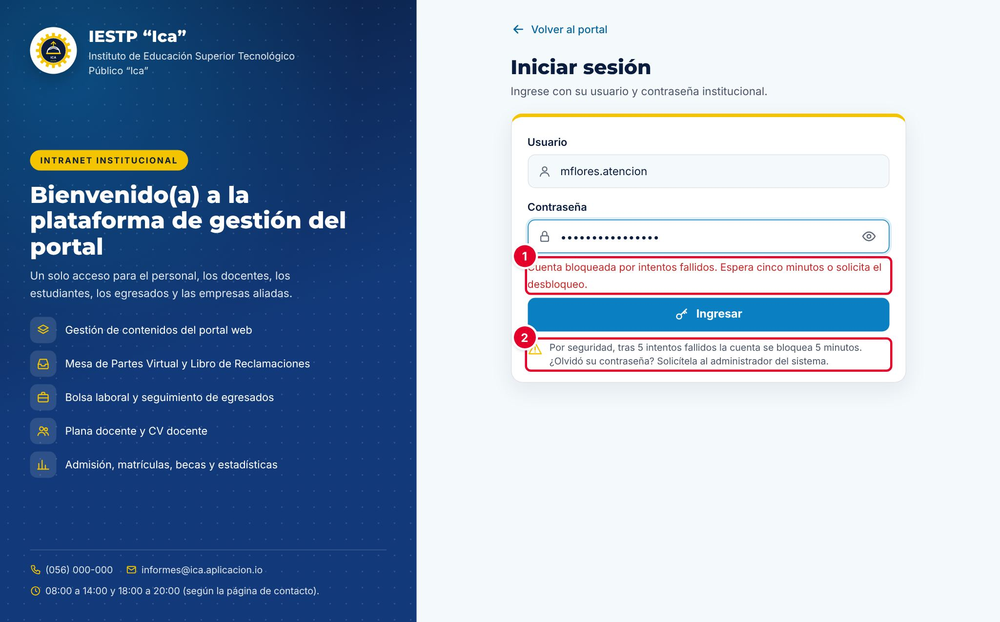

La persona ve «Cuenta bloqueada por intentos fallidos. Espera cinco minutos o solicita el desbloqueo.» ①. La pantalla de acceso recuerda la regla ②.

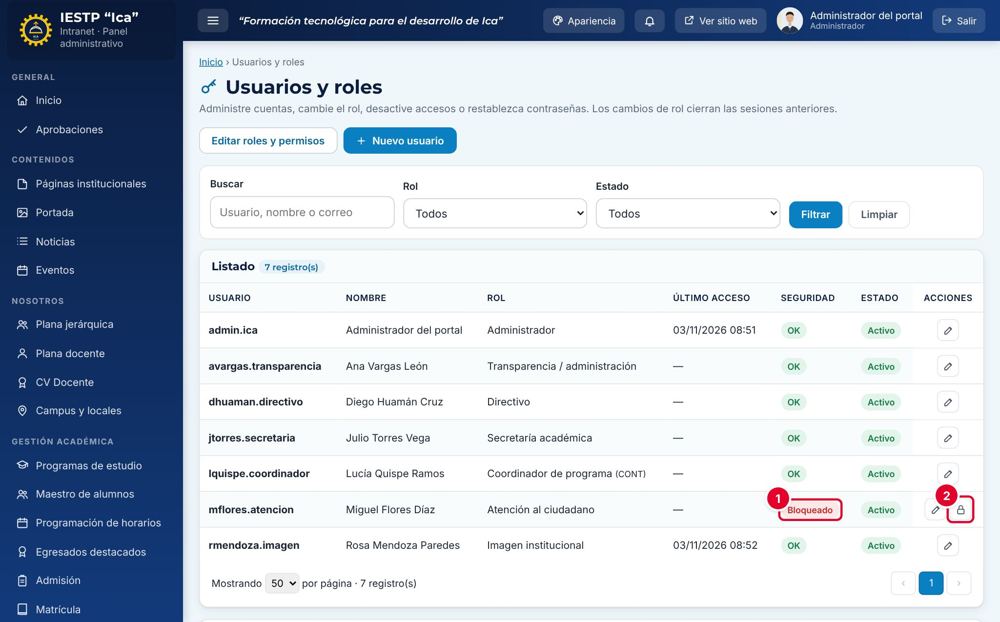

1. En el listado, la columna **Seguridad** dice **Bloqueado** ①.
2. Pulsa el candado **Desbloquear** ② de esa fila.

La cuenta puede ingresar de inmediato. Si no la desbloqueas, se desbloquea sola al pasar los 5 minutos.

### Desactivar una cuenta

Usa esta opción cuando una persona deja la institución o cambia de funciones. Las cuentas no se eliminan: se desactivan, y su historial queda en la auditoría.

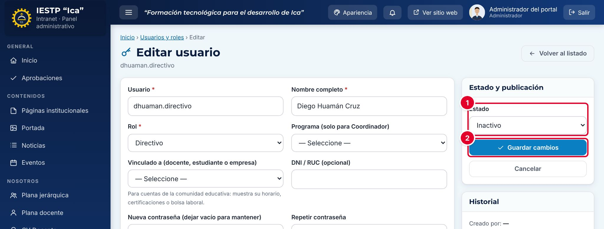

1. Pulsa **Editar** en la fila de la cuenta.
2. En **Estado** ①, elige **Inactivo**.
3. Pulsa **Guardar cambios** ②.

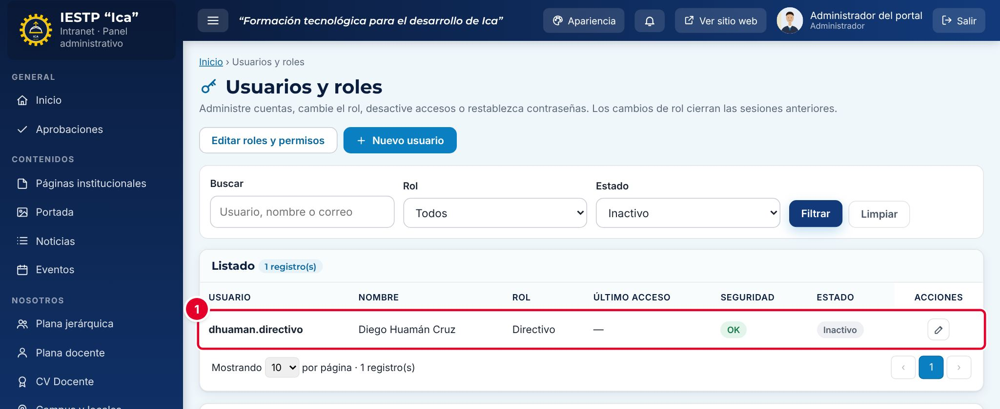

Para ver las cuentas desactivadas, filtra por **Estado** › **Inactivo** ①. Una cuenta inactiva no puede ingresar: la pantalla de acceso responde «Usuario o contraseña incorrectos.». Para reactivarla, vuelve a ponerla en **Activo**.

No puedes desactivarte a ti mismo ni quitarte el rol de Administrador, y siempre debe quedar al menos un administrador activo.

### Cambiar el rol de una cuenta

1. Pulsa **Editar**, elige el nuevo **Rol** y pulsa **Guardar cambios**.
2. La persona debe volver a iniciar sesión: los cambios de rol cierran sus sesiones anteriores.

### Editar los módulos de un rol

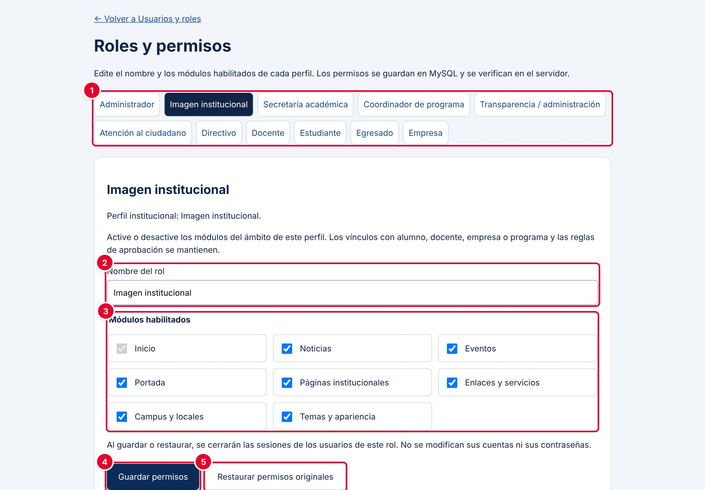

| N.º | Elemento | Para qué sirve |
|---|---|---|
| 1 | Roles | Elige el rol que quieres editar |
| 2 | **Nombre del rol** | Nombre visible del rol (hasta 100 caracteres) |
| 3 | **Módulos habilitados** | Casillas con los módulos del ámbito del rol. **Inicio** siempre queda activo |
| 4 | **Guardar permisos** | Guarda los cambios del rol |
| 5 | **Restaurar permisos originales** | Devuelve el rol a su configuración de fábrica |

1. Pulsa **Editar roles y permisos** y elige el rol.
2. Marca o desmarca los módulos.
3. Pulsa **Guardar permisos**. Aparece «Rol actualizado. Sus usuarios deberán iniciar sesión de nuevo para aplicar los permisos.».

Ten en cuenta:

- Solo puedes activar módulos que ya pertenecen al ámbito del rol. Para dar más módulos a una persona, cámbiale el rol.
- El rol **Administrador** está protegido y no se puede editar.
- Al guardar o restaurar, se cierran las sesiones de todas las cuentas de ese rol. No cambian sus contraseñas.
- Los vínculos (alumno, docente, empresa o programa) y las reglas de aprobación no se modifican desde aquí.

## Flujo y estados

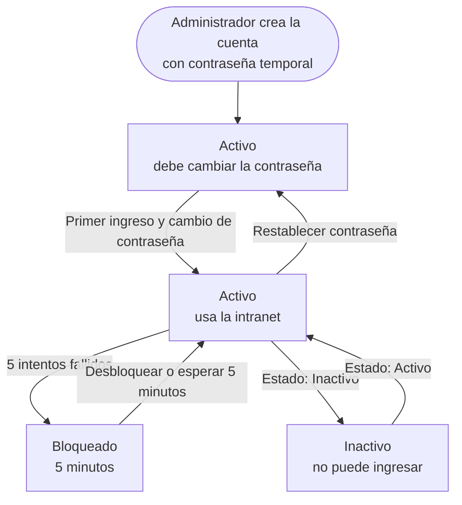

| Estado | Significado | Puede ingresar |
|---|---|---|
| Activo | Cuenta habilitada | Sí |
| Activo con contraseña temporal | Cuenta nueva o con contraseña restablecida | Solo para cambiar la contraseña |
| Bloqueado | 5 intentos fallidos seguidos | No, durante 5 minutos o hasta que se desbloquee |
| Inactivo | Acceso retirado por el administrador | No |

## Mensajes y problemas frecuentes

| Mensaje o situación | Causa | Qué hacer |
|---|---|---|
| «Usuario o contraseña incorrectos.» | Usuario o contraseña equivocados, o cuenta inactiva | Verifica los datos. Si la cuenta está inactiva, pide al administrador que la reactive |
| «Cuenta bloqueada por intentos fallidos. Espera cinco minutos o solicita el desbloqueo.» | 5 intentos fallidos seguidos | Espera 5 minutos o pide el desbloqueo al administrador |
| «Demasiados intentos. Espera unos minutos antes de continuar.» | Muchos intentos de acceso desde el mismo equipo en un minuto | Espera un minuto |
| «La contraseña necesita al menos 12 caracteres y máximo 72 bytes.» | Contraseña muy corta | Usa una frase de al menos 12 caracteres |
| «Las contraseñas no coinciden.» | La repetición es distinta | Escríbelas de nuevo |
| «El usuario o correo ya está registrado.» | Otra cuenta usa ese usuario o ese correo | Elige otro usuario o revisa el correo |
| «El usuario admite letras, números, puntos y guiones.» | El usuario tiene espacios, tildes o símbolos | Usa solo minúsculas, números, puntos y guiones |
| «Selecciona el programa del coordinador.» | Rol Coordinador sin programa | Elige el programa |
| «Vincula la cuenta con un alumno existente.» / «Vincula la cuenta con una empresa registrada.» / «Vincula la cuenta con el docente y su registro de persona.» | Cuenta de la comunidad sin vínculo válido | Registra primero al alumno, la empresa o el docente |
| «Debe quedar al menos un administrador activo.» | Se intentó desactivar o cambiar de rol al último administrador | Crea o activa otro administrador antes |
| «No puedes quitarte el acceso de administrador.» | Intentaste desactivarte o cambiar tu propio rol | Pide a otro administrador que lo haga |
| «Otra persona modificó esta cuenta. Recarga antes de continuar.» | Dos personas editaron la misma cuenta a la vez | Recarga la página y repite el cambio |
| «Cambia tu contraseña temporal antes de continuar (Mi cuenta).» | La cuenta aún usa la contraseña temporal | Cámbiala en **Mi cuenta** |
| La sesión se cerró sola | 30 minutos sin actividad, cambio de rol, de contraseña o de permisos del rol | Vuelve a iniciar sesión |

> **Incidencia detectada al elaborar este manual (versión actual de la plataforma)**
> La pantalla **Acceso denegado** dice «El intento quedó registrado en la auditoría.», pero el intento **no se registra**: el aviso se anota solo en el navegador y no se envía al servidor. Se comprobó entrando con una cuenta de Imagen institucional a `#/admin/usuarios`: la auditoría (capítulo 35) no muestra ningún evento de acceso denegado. La protección sí funciona, porque el servidor no entrega datos ni permite guardar en módulos ajenos al rol. Ya se reportó para su corrección. Mientras tanto, no uses la auditoría para buscar accesos denegados.

## Buenas prácticas

- Crea **una cuenta por persona**. No compartas cuentas entre varias personas: la auditoría registra el usuario, no a quien está frente al equipo.
- Usa usuarios fáciles de reconocer, como `inicial+apellido.área` (por ejemplo, `rmendoza.imagen`).
- Asigna el rol con **menos permisos** que le permita a la persona hacer su trabajo. Reserva el rol Administrador para una o dos personas.
- Desactiva la cuenta el mismo día en que una persona deja la institución.
- Revisa el listado cada mes: busca cuentas sin **Último acceso** reciente y cuentas bloqueadas.
- Nunca envíes contraseñas por redes sociales ni las escribas en documentos compartidos.
