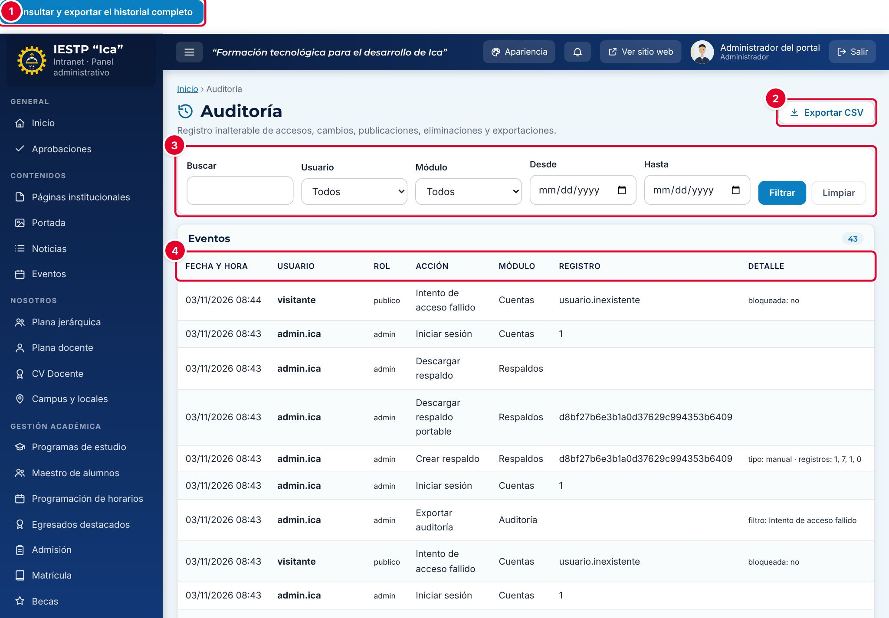
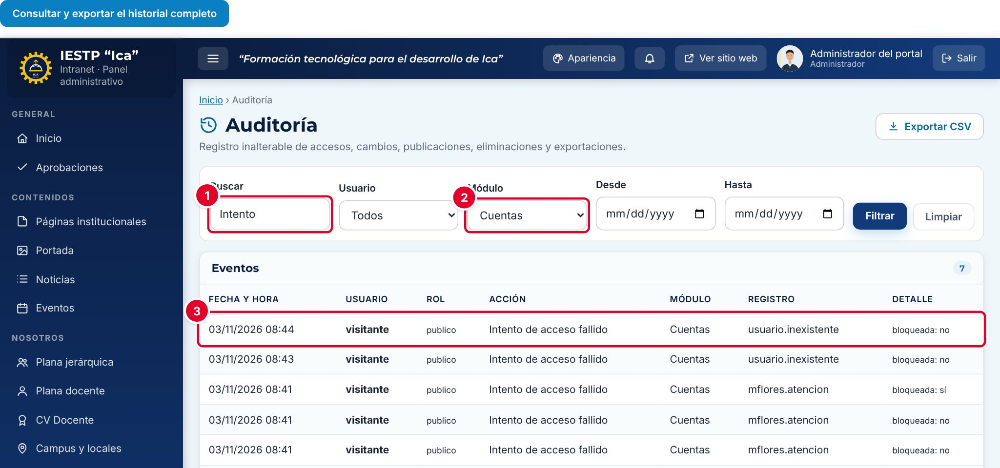
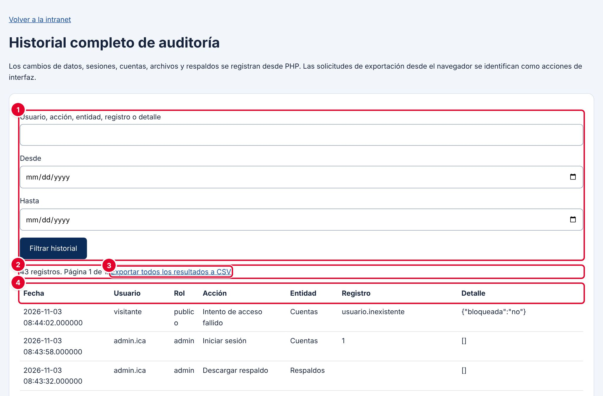
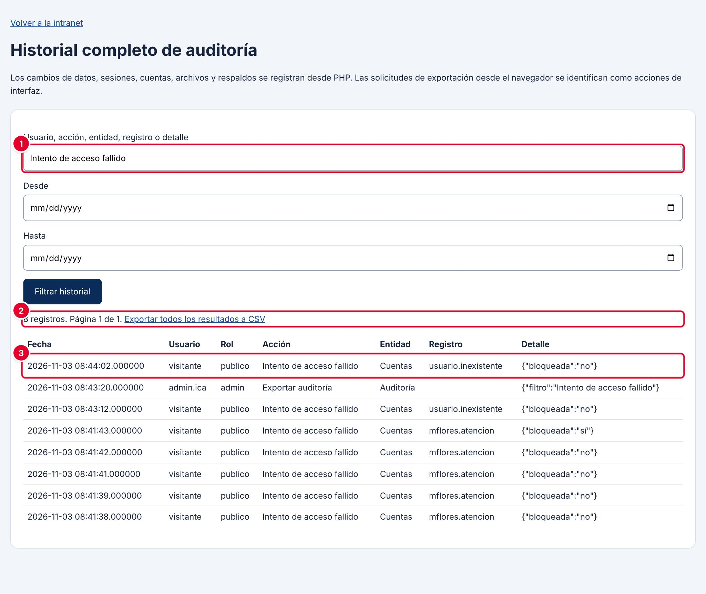

# 35 · Auditoría

## Para qué sirve

La auditoría es el registro de lo que pasa en la plataforma: quién ingresó, quién falló al ingresar, qué registros se crearon, modificaron, enviaron a la papelera, restauraron o eliminaron, qué cuentas y roles cambiaron, qué se exportó y qué respaldos se crearon, descargaron o restauraron. Cada evento guarda la fecha y hora, el usuario, su rol, la acción, la entidad afectada y el detalle. Nadie puede editar ni borrar estos eventos desde la plataforma, y se conservan incluso cuando se restaura una copia de seguridad.

## Quién lo usa

| Rol | Puede |
|---|---|
| Administrador | Consultar, filtrar y exportar la auditoría |
| Demás roles | No tienen acceso |

## Cómo se llega

- Menú lateral › **Configuración y seguridad** › **Auditoría**. Ruta: `#/admin/auditoria`
- Historial completo: botón **Consultar y exportar el historial completo**. Dirección: `{{inst.dominio}}/auditoria.php`

La auditoría tiene dos vistas:

| Vista | Qué muestra | Cuándo usarla |
|---|---|---|
| **Auditoría** (intranet) | Los últimos 1000 eventos, con filtros por usuario y módulo | Revisiones rápidas del día a día |
| **Historial completo de auditoría** | Todos los eventos, de 100 en 100 por página | Investigaciones, informes y exportaciones completas |

## Pantalla principal

| N.º | Elemento | Para qué sirve |
|---|---|---|
| 1 | **Consultar y exportar el historial completo** | Abre el historial completo. El botón aparece en la parte superior de la página, encima de la barra de la intranet. |
| 2 | **Exportar CSV** | Descarga en un archivo `auditoria.csv` los eventos que muestran los filtros actuales. |
| 3 | Filtros | **Buscar** (texto en la acción, el módulo, el registro o el detalle), **Usuario**, **Módulo**, **Desde** y **Hasta**. Pulsa **Filtrar** o **Limpiar**. |
| 4 | Tabla de eventos | **Fecha y hora**, **Usuario**, **Rol**, **Acción**, **Módulo**, **Registro** y **Detalle**. El contador junto a **Eventos** indica cuántos cumplen el filtro. |

Al pie de la tabla eliges cuántos eventos ver por página (25, 50 o 100) y cambias de página.

### Columnas

| Columna | Contenido | Ejemplo |
|---|---|---|
| Fecha y hora | Momento del evento, hora de Lima | 03/11/2026 08:43 |
| Usuario | Cuenta que hizo la acción. **visitante** si no había sesión iniciada | admin.ica |
| Rol | Rol de la cuenta (código interno). **publico** para visitantes | admin |
| Acción | Qué se hizo | Actualizar cuenta |
| Módulo | Entidad afectada: **Cuentas**, **Roles**, **Respaldos**, **Auditoría** o la colección de datos (por ejemplo, `noticias` o `config`) | Cuentas |
| Registro | Identificador del registro afectado o, en accesos fallidos, el usuario escrito | 7 |
| Detalle | Datos adicionales: campos cambiados, estado anterior y actual, rol anterior y actual, etc. | rol_anterior: directivo · rol_actual: directivo · activo: 0 |

### Eventos que se registran

| Acción | Cuándo ocurre |
|---|---|
| Iniciar sesión / Cerrar sesión | Ingreso correcto y salida con **Salir** |
| Intento de acceso fallido | Usuario o contraseña incorrectos. El detalle indica si la cuenta quedó **bloqueada** |
| Crear cuenta / Actualizar cuenta / Desbloquear cuenta | Gestión de cuentas (capítulo 34). En **Actualizar cuenta** se anota el rol anterior y actual, si quedó activa y si se cambió la contraseña |
| Cambiar contraseña | Una persona cambia su propia contraseña |
| Modificar rol | Se guardan o restauran los módulos de un rol |
| Crear / Modificar / Enviar a papelera / Restaurar / Eliminar definitivamente | Cambios en los registros de cualquier módulo (noticias, documentos, expedientes, etc.). El detalle lista los campos cambiados y los estados anterior y actual |
| Cambiar configuración | Cambios en la configuración general u otros ajustes únicos. El detalle lista los grupos de campos cambiados |
| Registrar empresa | Una empresa se registra desde la bolsa laboral |
| Exportar / Vista previa | Descargas de archivos desde la intranet (CSV, PDF). Se anotan como módulo **Interfaz**, con el nombre del archivo |
| Exportar auditoría | Exportación del historial completo a CSV |
| Crear respaldo / Descargar respaldo / Descargar respaldo portable / Programar respaldos / Restaurar respaldo | Copias de seguridad (capítulo 36) |

## Procedimientos

### Buscar eventos en la intranet

1. Escribe una palabra en **Buscar** ①; por ejemplo, «Intento».
2. Elige el **Módulo** ②; por ejemplo, **Cuentas**. Si quieres, elige también el **Usuario** y el rango **Desde** / **Hasta**.
3. Pulsa **Filtrar**. La tabla muestra solo los eventos que cumplen todos los filtros ③.
4. Pulsa **Limpiar** para volver a ver todo.

### Consultar el historial completo

| N.º | Elemento | Para qué sirve |
|---|---|---|
| 1 | Filtros | **Usuario, acción, entidad, registro o detalle** (texto libre), **Desde** y **Hasta**. Pulsa **Filtrar historial** |
| 2 | Resumen | Cantidad de registros encontrados y página actual. Se muestran 100 por página, con **Página anterior** y **Página siguiente** al final |
| 3 | **Exportar todos los resultados a CSV** | Descarga todos los eventos que cumplen el filtro, sin límite de páginas |
| 4 | Tabla | **Fecha** (con fracciones de segundo), **Usuario**, **Rol**, **Acción**, **Entidad**, **Registro** y **Detalle** en formato técnico (JSON) |

Para volver, pulsa **Volver a la intranet**.

### Revisar intentos de acceso fallidos

1. Abre el historial completo.
2. Escribe «Intento de acceso fallido» en el filtro ① y pulsa **Filtrar historial**.
3. Revisa el resumen ② y la tabla ③: la columna **Registro** muestra el usuario que se intentó usar y el **Detalle** indica `"bloqueada":"sí"` cuando ese intento bloqueó la cuenta.

Muchos intentos sobre la misma cuenta en poco tiempo pueden indicar que alguien intenta adivinar la contraseña. Muchos intentos con usuarios que no existen también son una señal de alerta.

### Exportar la auditoría

1. Aplica los filtros que necesites.
2. En el historial completo, pulsa **Exportar todos los resultados a CSV**. Se descarga `auditoria-AAAAMMDD-HHMMSS.csv`, separado por punto y coma, listo para abrir en Excel.
3. La exportación misma queda registrada como **Exportar auditoría**, con el filtro usado.

Desde la vista de la intranet, **Exportar CSV** descarga solo los eventos filtrados de esa vista (hasta los últimos 1000).

## Mensajes y problemas frecuentes

| Mensaje o situación | Causa | Qué hacer |
|---|---|---|
| «Esta acción requiere una cuenta administradora.» | Se abrió el historial completo con una cuenta que no es de administrador | Ingresa con una cuenta de administrador |
| «Fecha de filtro no válida.» | La fecha de **Desde** o **Hasta** no es válida | Elige la fecha con el calendario |
| «Filtro demasiado largo.» | El texto de búsqueda supera los 200 caracteres | Usa una palabra o frase más corta |
| Un evento antiguo no aparece en la vista de la intranet | La vista de la intranet muestra solo los últimos 1000 eventos | Búscalo en el historial completo |
| La hora no coincide con la del equipo | La auditoría usa la zona horaria configurada en el servidor (America/Lima) | Verifica la hora del equipo |

> **Incidencia detectada al elaborar este manual (versión actual de la plataforma)**
> Algunos avisos que la intranet muestra como registrados no llegan a la auditoría del servidor. En particular, la pantalla **Acceso denegado** dice «El intento quedó registrado en la auditoría.», pero ese evento no aparece en ninguna de las dos vistas (comprobado con una cuenta de Imagen institucional que abrió `#/admin/usuarios`). Los cambios de datos, sesiones, cuentas, roles, exportaciones y respaldos sí se registran. Ya se reportó para su corrección.

> **Detalle de presentación:** el botón **Consultar y exportar el historial completo** aparece fuera del marco de la intranet, en el borde superior de la página. Funciona con normalidad.

## Buenas prácticas

- Revisa la auditoría **una vez por semana**, empezando por los intentos de acceso fallidos y las eliminaciones definitivas.
- Antes de investigar un incidente, exporta el CSV del periodo: es la evidencia para el informe.
- Usa una cuenta por persona (capítulo 34). Si varias personas comparten una cuenta, la auditoría no permite saber quién hizo cada cambio.
- Guarda las exportaciones en una carpeta privada: contienen nombres de usuario y datos de actividad.
