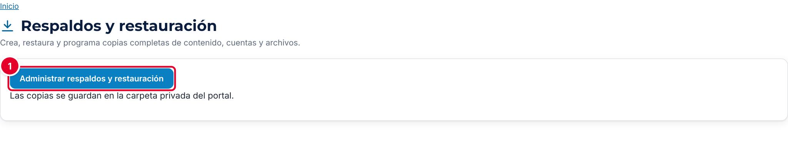
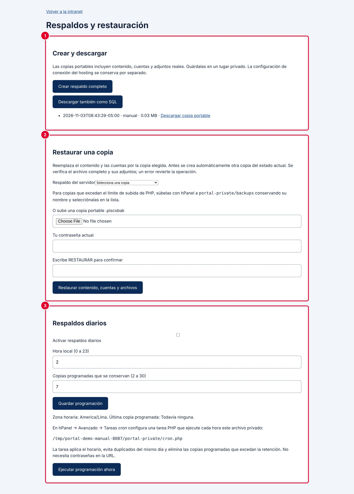
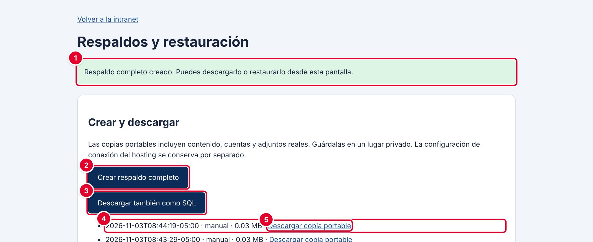
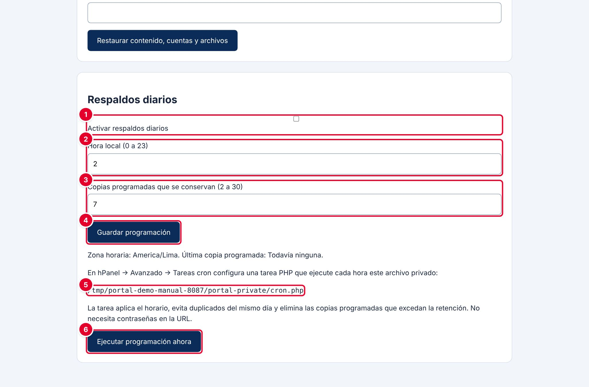
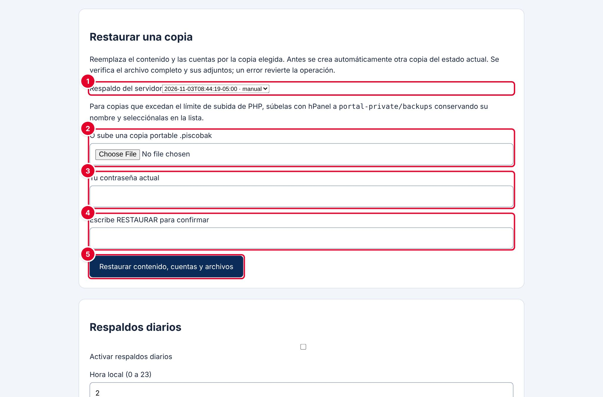
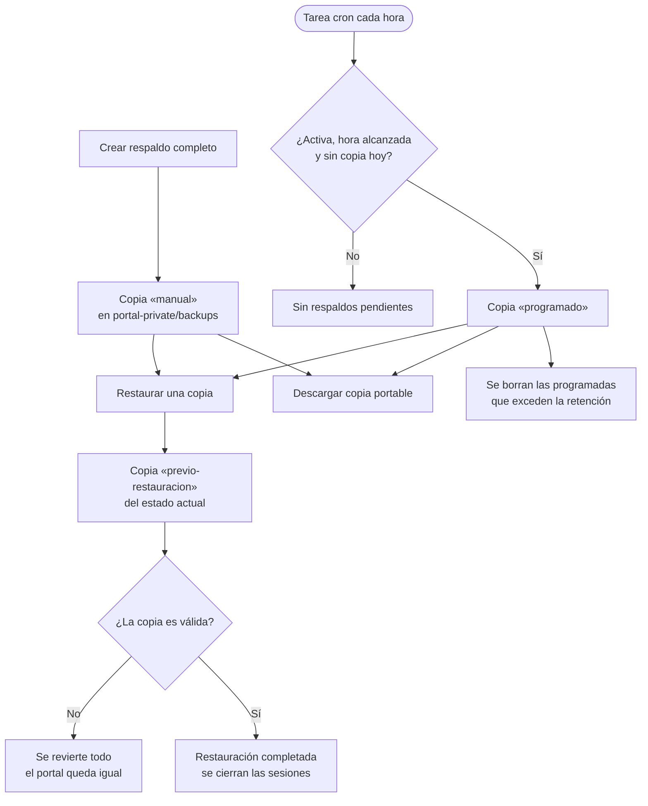

# 36 · Copias de seguridad

## Para qué sirve

Las copias de seguridad (respaldos) guardan todo lo necesario para recuperar el portal: el contenido del portal y de la intranet, las cuentas con sus roles, los archivos adjuntos (imágenes y PDF) y el registro de visitas. En este módulo se crean copias a pedido, se descargan, se programan copias diarias automáticas y, si ocurre un problema grave, se restaura una copia anterior.

## Quién lo usa

| Rol | Puede |
|---|---|
| Administrador | Crear, descargar, programar y restaurar copias |
| Soporte técnico (con acceso al hosting) | Configurar la tarea programada (cron) y mover copias grandes a la carpeta privada |
| Demás roles | No tienen acceso |

## Cómo se llega

- Menú lateral › **Configuración y seguridad** › **Copias de seguridad**. Ruta: `#/admin/respaldo`
- Pantalla de respaldos: botón **Administrar respaldos y restauración**. Dirección: `{{inst.dominio}}/respaldos.php`



La opción del menú muestra solo el botón **Administrar respaldos y restauración** ①, que abre la pantalla de respaldos.

> **Incidencia detectada al elaborar este manual (versión actual de la plataforma)**
> Al entrar a **Copias de seguridad** desde el menú, la página se muestra **sin el menú lateral ni la barra superior** de la intranet, como se ve en la captura. Para volver, usa el botón **Atrás** del navegador o el enlace **Volver a la intranet** de la pantalla de respaldos. Ya se reportó para su corrección.

## Pantalla principal



| N.º | Sección | Para qué sirve |
|---|---|---|
| 1 | **Crear y descargar** | Crea una copia completa, descarga la base en SQL y lista las copias guardadas en el servidor |
| 2 | **Restaurar una copia** | Reemplaza el contenido y las cuentas actuales por los de una copia |
| 3 | **Respaldos diarios** | Programa una copia automática al día y define cuántas se conservan |

### Qué incluye cada tipo de copia

| Tipo | Cómo se obtiene | Incluye | Se restaura desde |
|---|---|---|---|
| **Copia portable** (`.piscobak`) | **Crear respaldo completo** o la programación diaria | Contenido, cuentas (con sus contraseñas protegidas), roles, archivos adjuntos y visitas. Se verifica con una huella digital (SHA-256) | Esta misma pantalla |
| **Copia SQL** (`.sql`) | **Descargar también como SQL** | Todas las tablas de la base de datos, incluida la auditoría y los ajustes | Solo con herramientas de base de datos (phpMyAdmin), por soporte técnico |

Ninguna copia incluye `portal-private/config.php` (los datos de conexión a la base de datos): se conserva por separado en el hosting.

## Procedimientos

### Crear una copia completa

1. Abre la pantalla de respaldos.
2. Pulsa **Crear respaldo completo**.



| N.º | Elemento | Descripción |
|---|---|---|
| 1 | Mensaje | «Respaldo completo creado. Puedes descargarlo o restaurarlo desde esta pantalla.» |
| 2 | **Crear respaldo completo** | Crea otra copia portable en el servidor |
| 3 | **Descargar también como SQL** | Descarga al equipo la base completa en formato SQL (`portal-ica-AAAAMMDD-HHMMSS.sql`) |
| 4 | Copia en la lista | Fecha y hora de creación, tipo y tamaño en MB |
| 5 | **Descargar copia portable** | Descarga la copia al equipo (`<identificador>.piscobak`) |

El tipo de la copia indica su origen: **manual** (creada con el botón), **programado** (creada por la programación diaria) o **previo-restauracion** (creada automáticamente antes de una restauración). La lista muestra primero las más recientes.

### Descargar una copia a un lugar seguro

1. En la lista, pulsa **Descargar copia portable** en la copia que quieras.
2. Guarda el archivo en un medio externo y privado (disco institucional, almacenamiento en la nube de la institución).

Las copias contienen las cuentas y los adjuntos reales. Trátalas como información confidencial. Cada descarga queda registrada en la auditoría.

### Programar las copias diarias

La programación tiene dos partes: la configuración en la pantalla de respaldos y una tarea programada (cron) en el hosting, que hace el trabajo.



| N.º | Elemento | Para qué sirve |
|---|---|---|
| 1 | **Activar respaldos diarios** | Habilita la copia automática |
| 2 | **Hora local (0 a 23)** | Hora a partir de la cual se crea la copia del día. Por defecto, 2 |
| 3 | **Copias programadas que se conservan (2 a 30)** | Cuántas copias programadas se guardan. Por defecto, 7. Las más antiguas se borran solas |
| 4 | **Guardar programación** | Guarda los tres valores. Aparece «Programación guardada. La tarea privada de hPanel ejecutará los respaldos según este horario.» |
| 5 | Ruta del archivo `cron.php` | Archivo que debe ejecutar la tarea programada del hosting |
| 6 | **Ejecutar programación ahora** | Crea la copia del día si corresponde (programación activa, hora alcanzada y sin copia previa ese día) |

Debajo de **Guardar programación** se ven la **Zona horaria** del servidor y la fecha de la **Última copia programada**.

**Paso 1. En la intranet (administrador):**

1. Marca **Activar respaldos diarios**.
2. Escribe la **Hora local** y la cantidad de **Copias programadas que se conservan**.
3. Pulsa **Guardar programación**.

**Paso 2. En el hosting (soporte técnico, una sola vez):**

1. En hPanel, entra a **Avanzado** › **Trabajos cron** (la pantalla de respaldos lo llama «Tareas cron»).
2. Crea una tarea PHP que ejecute el archivo que muestra la pantalla ⑤. En una instalación típica de Hostinger es:

   ```
   php /home/<usuario>/domains/<dominio>/portal-private/cron.php
   ```

3. Prográmala **cada hora**, como indica la pantalla de respaldos.

Cada vez que se ejecuta, la tarea responde «Respaldo programado completado.» o «Sin respaldos pendientes.». Si falla, escribe «No se pudo crear el respaldo programado. Revisa permisos y espacio privado.».

Cómo decide la tarea:

- Solo crea una copia si la programación está activa, si la hora actual es igual o posterior a la **Hora local** y si todavía no hay copia programada ese día.
- Nunca crea dos copias programadas el mismo día, aunque se ejecute cada hora.
- Después de crear la copia, borra las copias **programadas** más antiguas que excedan la cantidad a conservar. Las copias **manuales** y las **previo-restauracion** no se borran solas.
- El archivo `cron.php` solo funciona desde la línea de comandos del servidor. Si alguien intenta abrirlo desde el navegador, el servidor responde con una página vacía (error 404) y no hace nada.

> **Atención: diferencia entre las indicaciones.** El archivo `README.md` del repositorio indica crear «una tarea diaria», mientras que la pantalla de respaldos indica ejecutarla «cada hora». Sigue la pantalla. Si configuras la tarea **una vez al día** a una hora **anterior** a la **Hora local** programada (por ejemplo, el cron a las 00:00 y la hora local en 2), la tarea encontrará que aún no es hora y **no creará ninguna copia**. Si prefieres una tarea diaria, prográmala a una hora igual o posterior a la **Hora local**.

### Restaurar una copia

> La restauración **reemplaza** todo el contenido, las cuentas, los archivos y las visitas actuales por los de la copia. Úsala solo ante una pérdida grave de información, y de preferencia con apoyo técnico.



| N.º | Campo | Descripción |
|---|---|---|
| 1 | **Respaldo del servidor** | Copia guardada en el servidor que se va a restaurar |
| 2 | **O sube una copia portable .piscobak** | Alternativa: subir una copia desde el equipo. Si eliges un archivo, se usa en lugar de la copia del servidor |
| 3 | **Tu contraseña actual** | Contraseña de la cuenta administradora que hace la restauración |
| 4 | **Escribe RESTAURAR para confirmar** | Confirmación escrita, en mayúsculas |
| 5 | **Restaurar contenido, cuentas y archivos** | Inicia la restauración |

1. Crea y descarga una copia del estado actual, por si necesitas volver atrás (la plataforma también la crea sola, pero es mejor tener una en tu equipo).
2. Avisa al personal que la intranet no debe usarse durante la restauración.
3. Elige la copia en **Respaldo del servidor**, o sube el archivo `.piscobak`.
4. Escribe **Tu contraseña actual** y la palabra **RESTAURAR**.
5. Pulsa **Restaurar contenido, cuentas y archivos**.
6. Espera el mensaje «Restauración completada. Se conservaron los archivos y el historial de auditoría del servidor. Por seguridad se cerraron las sesiones: entra con una cuenta incluida en el respaldo.».
7. Pulsa **Iniciar sesión** e ingresa con una cuenta administradora **que exista en la copia restaurada**.
8. Revisa el portal y avisa al personal que debe volver a iniciar sesión.

Qué hace la plataforma durante la restauración:

- Antes de cambiar nada, crea automáticamente una copia del estado actual, del tipo **previo-restauracion**.
- Verifica la copia completa: formato, versión, huella digital (SHA-256), cantidad de registros, cuentas válidas, al menos una cuenta administradora activa y que cada archivo adjunto coincida con su huella.
- Si encuentra cualquier error, **revierte todo** y deja el portal como estaba.
- Restaura el contenido, las cuentas, los archivos adjuntos, las visitas y los permisos de los roles.
- **Conserva** el historial de auditoría del servidor y registra la restauración como **Restaurar respaldo**.
- Cierra **todas** las sesiones, incluida la tuya. Las cuentas restauradas quedan desbloqueadas.

**Copias muy grandes:** si el archivo supera el límite de subida de PHP del hosting, súbelo con el Administrador de archivos de hPanel a la carpeta `portal-private/backups`, **sin cambiarle el nombre**. Luego aparecerá en la lista **Respaldo del servidor**.

**Copia SQL:** la copia `.sql` no se restaura desde esta pantalla. Soporte técnico puede importarla en la base de datos con phpMyAdmin. Esa importación reemplaza todas las tablas, incluida la auditoría.

## Flujo y estados



| Tipo de copia | Quién la crea | Se borra sola |
|---|---|---|
| manual | El administrador, con **Crear respaldo completo** | No |
| programado | La tarea cron, según la programación | Sí, al exceder la retención |
| previo-restauracion | La plataforma, antes de cada restauración | No |

## Mensajes y problemas frecuentes

| Mensaje o situación | Causa | Qué hacer |
|---|---|---|
| «Escribe RESTAURAR para confirmar.» | La confirmación está vacía o mal escrita | Escribe RESTAURAR en mayúsculas |
| «La contraseña actual no es correcta.» | La contraseña escrita no es la de tu cuenta | Escribe tu contraseña |
| «Selecciona o sube un respaldo existente.» | No se eligió copia ni se subió archivo | Elige una copia o sube el `.piscobak` |
| «No se pudo recibir el respaldo.» | El archivo supera el límite de subida o la subida falló | Súbelo por hPanel a `portal-private/backups` |
| «Formato de respaldo no admitido. Usa una copia portable .piscobak de este portal.» | El archivo no es una copia portable o es de una versión más nueva | Usa una copia `.piscobak` de este portal |
| «El respaldo está incompleto o fue alterado.» | El archivo está dañado o fue modificado | Usa otra copia |
| «Falta el final del respaldo o una cuenta administradora activa.» | La copia está cortada o no tiene ningún administrador activo | Usa otra copia |
| «Hora o retención no válida.» | Hora fuera de 0 a 23 o retención fuera de 2 a 30 | Corrige los valores |
| «No hay un respaldo programado pendiente para hoy.» | Al pulsar **Ejecutar programación ahora**: la programación no está activa, aún no es la hora o ya se hizo la copia de hoy | Es normal. Revisa la configuración si esperabas una copia |
| «No hay espacio suficiente para guardar el respaldo.» | El hosting no tiene espacio libre | Descarga y borra copias antiguas desde el Administrador de archivos de hPanel |
| La **Última copia programada** dice «Todavía ninguna» | La tarea cron no está configurada, no se ejecuta o corre antes de la hora programada | Revisa la tarea en hPanel (ver la nota del paso 2) |

## Buenas prácticas

- Activa los **respaldos diarios** y comprueba cada semana que la **Última copia programada** sea de ese día o del anterior.
- Al menos una vez al mes, **descarga** una copia portable y guárdala fuera del hosting. Una copia que solo existe en el mismo servidor no protege ante la pérdida del servidor.
- Crea una copia manual **antes** de cambios grandes: carga masiva de becarios, cambio de periodo, cambio de logotipo o actualización de la plataforma.
- Las copias manuales no se borran solas: elimina las que ya no necesites desde el Administrador de archivos de hPanel, después de descargarlas.
- No compartas las copias ni las envíes por correo: contienen cuentas y documentos de personas.
- Al actualizar la plataforma, no borres la carpeta `portal-private`: ahí están `config.php` y la carpeta `backups`.
