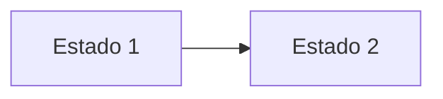

# NN · Nombre del módulo

> Copia este archivo a `contenido/NN-nombre.md` y reemplaza cada sección. No cambies el orden ni los títulos de las secciones.

## Para qué sirve

Dos o tres líneas: qué se gestiona en el módulo y dónde se refleja (portal público, intranet o documentos).

## Quién lo usa

| Rol | Puede |
|---|---|
| Administrador | Todo, incluida la eliminación definitiva |
| *Rol* | *ver / crear / editar / publicar / aprobar* |

## Cómo se llega

Menú lateral › **Grupo** › **Opción**. Ruta: `#/admin/...`

## Pantalla principal

| N.º | Elemento | Para qué sirve |
|---|---|---|
| 1 | | |

## Formulario

| Campo | Obligatorio | Formato o límite | Ejemplo |
|---|---|---|---|
| | | | |

## Procedimientos

### Crear un registro

1. Paso único y concreto por línea.
2. …

### Editar, publicar, eliminar o restaurar

…

## Flujo y estados

| Estado | Significado | Visible en el portal |
|---|---|---|

## Resultado en el portal público

Captura de la página pública donde se ve el contenido.

## Mensajes y problemas frecuentes

| Mensaje o situación | Causa | Qué hacer |
|---|---|---|

## Buenas prácticas

- …

> **Incidencia** (solo si se detectó un error al documentar): descripción, efecto y solución temporal.
